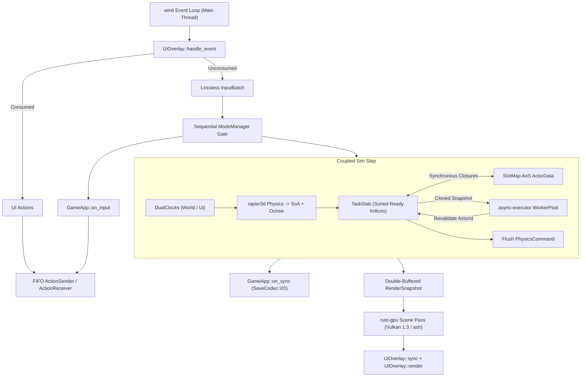

# Engine Architecture Principles

This document defines the architectural invariants of `crates/engine`. The engine is game-agnostic and self-contained so external `game` workspaces can depend on it directly.

## 1. Type-Enforced Safety and Crate Split

- Enforce invariants through private modules and Rust types inside `engine` rather than relying on external `game` Cargo, Clippy, or CI rules.
- Split the workspace into `engine` (runtime, clocks, executors, storage, physics, `rust-gpu` shaders, `UiOverlay` host) and `game` (gameplay scripts, UI views, modes, codecs).
- `EngineRunner` owns the main loop and interacts with `game` only through `GameApp` (`init`, `world_scale`, `on_input`, `on_sync`, `build_snapshot`) and `UiOverlay`.
- Keep `TaskSlab`, `TaskHandle`, `SlotMap`, SoA buffers, `rapier3d` sets, Vulkan 1.3 handles (`ash`, `ash-window`, `gpu-allocator`), and raw sync crates (`async-channel`, `event-listener`, `async-executor`) private inside `engine`.
- Run async primitives only for game logic and engine systems, never for OS or filesystem I/O.

## 2. Hybrid Memory Layout and Physics Coupling

- Store random-access gameplay state (`hp`, `potions`, `stats`, buffs) in AoS `SlotMap<ActorId, ActorRecord>` so each lookup reads one contiguous record.
- Keep private script and AI variables inside `async` functions so Rust packs them into the `Future` state machine inside `TaskSlab`.
- Acquire and drop `SlotMap` borrows strictly inside synchronous closures (`read_actor`, `write_actor`) so scripts never hold storage borrows across `.await`.
- Store batch simulation data (`positions`, `rotations`, `bounds`, `colliders`, `rigid_bodies`, `meshes`) in contiguous SoA arrays inside `engine`.
- Advance physics, script polling, and deferred physics commands in one coupled simulation step (`Physics -> poll TaskSlab -> flush PhysicsCommand`) exposed via `SpatialQuery`.

## 3. Hybrid Dual-Executor

- Execute gameplay scripts on a single-threaded `TaskSlab` that polls woken tasks in sorted index order with zero gameplay mutexes.
- Never return raw `TaskHandle` values to `game` so dropped warnings cannot silently cancel tasks.
- Expose only owner-bound spawners (`attach_actor_script`, `spawn_buff`, `push_mode_with_script`, `spawn_global_script`).
- Offload parallel culling, heavy compute, and pathfinding to the background `async-executor` `WorkerPool`.
- Pass cloned owned snapshots to `spawn_compute` tasks and revalidate target `ActorId` handles (`Option`) after `.await` returns.

## 4. Double-Buffered Render Schedule

- `EngineRunner` owns both `RenderSnapshot` buffers so `game` and `UiOverlay` read only completed frames.
- Support runtime selection between two `RenderSchedule` modes while keeping physics and `TaskSlab` together inside `Sim`:
  - `Sequential` (UI label: `Low Latency`): Runs `Sim N -> Render N` sequentially with zero extra visual lag.
  - `Parallel` (UI label: `High Frame Rate`): Runs `Sim N+1` on a worker thread while the main thread draws `RenderSnapshot` N, trading one frame of visual delay for doubled CPU budget.

## 5. Dual Clocks and Modalities

- Replace boolean pause flags with `ModeManager<FlatMode, StackMode>` and two independent clocks:
  - `ClockDomain::World`: Advances gameplay, physics, combat, and buffs at `GameApp::world_scale()` when active, or `0.0` when paused.
  - `ClockDomain::Ui`: Advances at `1.0` across all modes for menus, toasts, and UI timers.
- Preserve the `StackMode` stack across `FlatMode` toggles (for example `MainMenu` vs `InGame`).
- Store mode-scoped `TaskHandle`s privately inside `ModeLayer` so popping a mode cancels its scripts automatically.
- Apply instant frozen-world inventory effects to AoS state immediately while running timed buffs on `ClockDomain::World`.

## 6. Lossless Input Pipeline

- Gather `winit` events on the main thread; in `Parallel` mode, batch events into an ordered `InputBatch` for the next `Sim` step.
- Sum mouse deltas, record every key press and release transition in order, and preserve discrete action sequence.
- Expose only FIFO `ActionSender<T>` and `ActionReceiver<T>` channels; omit lossy notification primitives from the public API.
- Process input batches sequentially against `ModeManager` so mid-batch mode transitions immediately gate subsequent gameplay inputs.

## 7. Misuse-Resistant Async Primitives

- Implement `ActionSender<T>`, `ActionReceiver<T>`, and `StateSignal<T>` inside `engine` over `async-channel` and `event-listener` with zero `tokio` dependency.
- Enforce synchronous closure access on `StateSignal::read` so read guards never cross `.await`.
- Require explicit `WaitTimeout` (`WorldMs(u64)`, `UiMs(u64)`, or `None`) on `ActionReceiver::next`, `StateSignal::wait_until`, and `ScriptContext::sleep`.
- Compose concurrent waits structurally with `futures::join!` and `futures::select_biased!`.

## 8. Safety Rules and Checkpoint Reconstruction

- Enforce four runtime safety rules:
  1. Return `Option` on expired `ActorId` handles.
  2. Drop all owner-bound `TaskHandle`s on actor despawn.
  3. Require explicit `WaitTimeout` on async waits.
  4. Cancel existing keyed buff `TaskHandle`s when refreshing a buff.
- Reconstruct saves via Checkpoint State Reconstruction instead of serializing Rust `Future` stacks:
  1. Divide long quest and world scripts into discrete stages with unique stage IDs.
  2. In synchronous `GameApp::on_sync`, pause `ClockDomain::World` and write world time, entity checkpoints, active timers, and stage IDs through `SaveCodec`.
  3. On load, clear and restore entities, rebuild active timers, restart scripts from saved stage IDs, and resume `ClockDomain::World`.

## 9. Decoupled `UiOverlay` and `rust-gpu` Shaders

- Keep `engine` independent of any UI toolkit. Bridge UI through `UiOverlay`:
  1. `handle_event`: Inspect `winit` events first; return `true` to block consumed events from `GameApp::on_input`.
  2. `sync`: Read completed `RenderSnapshot` data and push UI actions into the shared FIFO `ActionSender`.
  3. `render`: Draw UI onto `UiRenderTarget` after the 3D scene pass finishes (`UiBlitter` composites RGBA8 buffers when using software UI renderers like `iced_tiny_skia`).
- Write all GPU shaders in `rust-gpu` (`crates/engine/shaders/core_shader`), compiled via `crates/engine/build.rs` into Cargo `OUT_DIR` with zero WGSL shaders.
