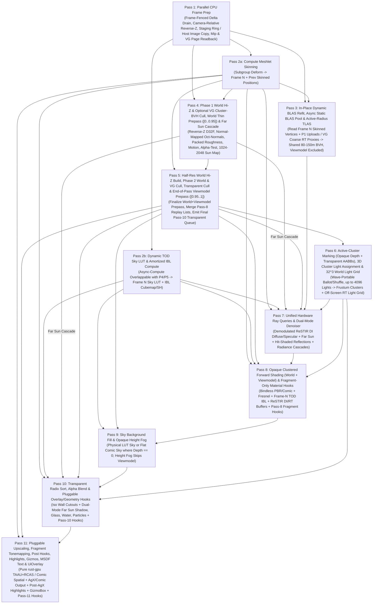

# Architectural Design Specifications for a Dual-Camera 3D RPG Graphics Engine

## Engine Motivation

This document defines the finalized graphics and streaming architecture for Dragon Engine. The engine runs both first-person and isometric role-playing games on native desktop computers running Linux or Windows with Vulkan 1.4. The architecture uses a compute-centric clustered forward render pipeline with a thin geometry attribute prepass. Compute shaders execute skeletal skinning, sky/IBL updates, meshlet culling, occlusion tests, light clustering, hardware ray queries (ReSTIR DI, reflections, Radiance Cascades), denoising, transparency sorting, and post-processing.

The engine supports two visual styles through runtime configuration. Developers configure the engine to show realistic physical graphics or flat comic graphics. The configuration changes active shader modules, ambient illumination, denoiser behavior, and post-process effects. This dual support lets artists build different game atmospheres with the same core technology.

This specification operates alongside [Engine Architecture Principles](engine-architecture.md), which governs the gameplay runtime (`TaskSlab`, AoS/SoA physics coupling, `ModeManager`, dual clocks, double-buffered `RenderSnapshot`, `ActorCheckpoint` reconstruction, and decoupled `UiOverlay`), and [Future Graphics Architecture Plans](graphics-future-plans.md), which specifies post-baseline Virtual Geometry Tier 2 (64-bit Visibility Buffer + hybrid HW/SW rasterizer) and Tier 3 (programmable rasterizer bins, runtime displacement, skinned cluster DAGs, and cluster-level ray tracing).

## Document Structure and Section Rules

This document uses a standard structure to record all architectural decisions. Every section contains a title, configuration variables, a selected option, rejected options, and an academic or industry reference.

Each selected option block contains four parts:
- **Architectural Consequences**: Explains how the choice changes engine code, GPU memory, and execution order.
- **Visual Quality Consequences**: Describes what the player sees on screen.
- **Quantitative Metrics**: Gives formulas, memory footprints, and frame time budgets.
- **AAA Benchmark**: Gives examples from modern 2026 production engines.

## Global Architectural Rules

1. **Dynamic Runtime Configuration**: The engine exposes explicit game/user-configurable `GraphicsSettings` (generic quality presets such as `Low`, `Medium`, `High`, and `Ultra`, plus individual feature knobs for resolution scale, ray counts, cascade density, reflection cutoff, world light grid, staging ring slice size, and static BLAS build caps) rather than blindly detecting GPU model names to override user settings. During startup, the engine queries Vulkan 1.4 physical device limits and `VK_EXT_memory_budget` strictly to clamp configured parameters and VRAM pools safely within adapter capabilities (`<= 75%` of available `DEVICE_LOCAL` heap capacity).
2. **Standard Open Formats**: The engine uses standard open file formats (glTF 2.0, KTX2, SPIR-V) whenever possible.
3. **Dominant Replacement Technology**: The engine adopts standard new technologies when they replace older methods completely.
4. **Artist Workflow Autonomy**: The engine and offline build pipeline handle all technical geometry, sector packing, HLOD, collider baking, and memory optimizations automatically. Developers must reject any option that forces artists to split concave meshes, create lightmap UVs, assign manual shadow flags, author manual LODs, pack texture atlases, or resize textures to uniform dimensions.
5. **Combinable Design Options**: When a system can combine multiple technologies for different situations, this document states that capability explicitly during decision tracking.
6. **Zero-Loading-Screen Asynchronous Streaming (Frame-Pacing First)**: The engine must never display loading screens between world sectors and must never block the simulation step or render frame waiting for disk I/O, decompression, GPU upload, BLAS builds, or physics splicing. When hardware falls behind demand, objects, LODs, mips, and ray-tracing structures pop in asynchronously rather than breaking frame pacing.
7. **Independent Per-Subsystem Residency Policies**: Orthogonal subsystems (Physics, Geometry/LOD, Virtual Geometry Cluster Pages when active, Ray-Tracing BLAS, Actors/AI, and GPU-Feedback Mipmap Streaming) each own independent spatial residency radii and eviction policies rather than sharing rigid coupled sector rings.

## Core Architectural Pillars

1. **Compute-Centric Workloads**: Compute shaders execute animation skinning, flat meshlet and optional Cluster-BVH culling, light clustering, ray tracing, denoising, sorting, and image effects.
2. **Meshlet & Optional Tier-1 Virtual Geometry Pipeline**: The offline build pipeline divides all meshes into 64-vertex, 124-triangle meshlets with automatic Level of Detail (LOD) chains and coarse horizon HLOD proxies. Under `VIRTUAL_GEOMETRY_MODE` (`Auto` default, `Disabled`, or `Always`), high-density static opaque meshes (`>= VG_MIN_TRIANGLES`, default `2,048` tris) automatically build crack-free Cluster-Group DAG hierarchies packed into `128 KB` quantized streaming pages with a coarse RT fallback proxy, while low-poly props, skinned characters, viewmodels, alpha-tested foliage, transparents, isometric `cutout_eligible` walls, `highlight_eligible` interactive actors, and meshes with `EffectAttachment` (`RenderEffect` hooks) stay on standard flat meshlets. Scenes with zero virtual-geometry assets incur `0.00 ms` GPU overhead and `0.0 MB` VG VRAM.
3. **Subgroup Acceleration**: Compute shaders use native Vulkan 1.4 wave-size-agnostic GPU subgroup operations and subgroup barriers (`#[spirv(subgroup_size)]`, 128-bit `SubgroupMask`), paired with an opt-in Wave32 pipeline hint (`subgroupSizeControl`, `requiredSubgroupSize = 32` when supported by the adapter) for wave-level parallel reductions, buffer compaction, and radix sorting.
4. **Unified Hardware Ray Queries**: The engine requires 2020-class Vulkan 1.4 ray-query hardware (Radeon 780M minimum baseline) and runs one unified stochastic ray pipeline across ReSTIR direct lighting, glossy reflections, and global illumination.
5. **Strict `rust-gpu` Vulkan SPIR-V and Pure-Rust Runtime Stack**: Every compute, mesh, ray-query, and graphics shader is written in Rust (`rust-gpu`, `spirv-unknown-vulkan1.4`, split into a top-level shared `crates/shader_common` library plus 4 stage-grouped shader crates with `multimodule(true)` so `core_shader_geometry`, `core_shader_shading`, and `core_shader_raytracing` share one base capability tuple while optional `VK_EXT_mesh_shader` entry points remain compile-time isolated inside `core_shader_mesh` and incremental builds stay at `2-6 s`) with zero WGSL modules, zero cross-compiler translation layers, and 100 percent CPU-GPU ABI sharing via `crates/shader_abi`. All runtime crates (`engine` runtime, `shader_abi`, `fx_fresnel_rim`, `game`) compile strictly with pure Rust dependencies; offline build tooling (`spirv-builder`'s `spirv-tools-sys`, plus an optional offline-only carve-out in `crates/asset_pipeline` if pure-Rust geometry/BC7 crates fail Phase 0 viability checks) is strictly isolated from runtime crates.

---

## Implementable Frame Execution Pipeline (Render Graph)

Every frame executes eleven deterministic passes coordinated by an internal Vulkan 1.4 Render Graph barrier tracker (`VkImageLayout`, `VkAccessFlags2`, `VkPipelineStageFlags2`, and whole-image Queue Family Ownership Transfers via Vulkan 1.4 core `synchronization2`, `dynamic_rendering`, and `pushDescriptor`). Millisecond figures throughout this document are design-time sizing references and offline QA profiler targets (calibrated to the `High` preset discrete desktop reference, with the `Low` preset iGPU reference as a conservative floor); the engine never executes runtime millisecond streaming or frame timers. Pass 2 splits into Pass 2a (Compute Meshlet Skinning, executing before Pass 3 In-Place Dynamic BLAS Refit / Active-Radius TLAS Rebuild and Pass 4 Thin Prepass so acceleration structures and rasterization read identical Frame N character poses with zero temporal lag) and Pass 2b (Dynamic Time-of-Day Sky LUT and amortized Skybox IBL compute, overlappable on an async compute queue with Pass 4/5 and synchronizing ahead of Pass 7 so Passes 7, 8, 9, and 10 consume identical Frame N sky and IBL state). In first-person mode, world geometry renders into reverse-Z viewport depth `[0.0, 0.95]` across Pass 4/5 while the half-resolution Hi-Z pyramid builds strictly from clean world depth; at the end of Pass 5 (after world Phase 2 and the finalized world Hi-Z update), the first-person viewmodel renders into the disjoint near reverse-Z sub-range `[0.95, 1.0]` with a 1-bit `is_viewmodel` flag so Hi-Z never sees weapon sway while Pass 6, Pass 7 Ray Queries, and Pass 8 Forward Shading consume one unified depth and attribute buffer (retiring a separate post-transparent viewmodel lighting pass and eliminating near-wall clipping). Any camera cut, camera-mode switch, visual-style toggle, internal-scale change, window resize, or teleport sets an explicit `history_reset` flag that invalidates previous-frame Hi-Z, Pass 7 ReSTIR/denoiser history, and Pass 11 temporal upscaler history atomically.

1. **Parallel CPU Frame Preparation (Sections 1, 8, 10, and 11)**: Before swapchain acquisition (so `ERROR_OUT_OF_DATE_KHR` or `SUBOPTIMAL_KHR` early-returns never drop scene state), `Renderer` drains an append-only monotonic retained-scene delta queue strictly up to `delta.frame_index <= snapshot.frame_index` (accumulating mutations across `Sim` steps so `RenderSchedule::Parallel -> Sequential` transitions and pre-`resumed` `GameApp::init` spawns never lose scene updates, while preventing concurrent `Sim N+1` mutations from leaking into `Render N`) and latches `history_reset` alongside any runtime `GraphicsSettings` changes (`INTERNAL_RENDER_SCALE`, `VisualStyle`, RT toggles). On window resize, `INTERNAL_RENDER_SCALE` change, or `Realistic <-> Comic` visual-style toggle (which allocates or frees temporal history targets, double-buffered Thin Prepass history buffers, and switches Pass 7's direct-diffuse / Comic-visibility target between `B10G11R11_UFLOAT_PACK32` and a dedicated `R8G8B8A8_UNORM` image), `Renderer` skips swapchain draw cleanly on `0x0` minimized windows while still draining the retained-scene delta queue and retiring completed timeline serials (preventing unbounded queue growth while minimized), retires resolution-dependent targets, transient alias heaps, and cluster buffers strictly through the timeline-semaphore reclamation queue (or recreates cleanly on `swapchain.recreate`, rebinding Set 0 frame slots only after timeline completion), and latches `history_reset = true`; unrecoverable `VK_ERROR_DEVICE_LOST` surfaces immediately as typed `EngineError::Gpu(GpuError::DeviceLost)`. Pass 1 polls retired Vulkan timeline semaphore serials (`completed_timeline_value >= submit_serial`) so asynchronous BLAS compaction queries (`VK_QUERY_TYPE_ACCELERATION_STRUCTURE_COMPACTED_SIZE_KHR`), host-mapped mipmap feedback readbacks, optional Virtual Geometry page-request feedback readbacks (zero cost when `vg_instance_count == 0`), and deferred arena/texture/bindless-slot/BLAS/VG-page reclamations resolve cleanly without blocking or frame-count drift across `OUT_OF_DATE` drops. Worker threads rebase canonical CPU coordinates (`DVec3` / chunk-local) into camera-relative `f32` reverse-Z camera matrices (plus the dedicated first-person viewmodel near projection matrix), drain ready async geometry and mip-chain uploads through the per-frame slice of the triple-buffered staging ring (`3 * STAGING_RING_MB` total host-visible ring; optionally on a dedicated DMA transfer queue using `CONCURRENT` buffer arenas and whole-image QFOT for uploaded textures, or using Vulkan 1.4 `hostImageCopy` for small mip tails and `UiRenderTarget::composite_rgba8` on unified/ReBAR GPUs when supported, after verifying `pCopyDstLayouts`, setting `VK_IMAGE_USAGE_HOST_TRANSFER_BIT_EXT`, and calling `vkTransitionImageLayoutEXT`), allocate a fresh unused `BindlessTextureTable` slot `S_new` for each promoted or demoted texture image and write `S_new` via O(1) `vkUpdateDescriptorSets` (`UPDATE_AFTER_BIND`) across all 3 Set 0 instances (avoiding in-place overwrites of slots actively sampled by in-flight frames) before swapping the material's texture slot for Frame N and retiring `S_old` + the replaced `VkImage` on timeline retirement, and upload per-frame light, bone, CPU-submitted billboard particle quad, dynamic `GpuInstance`, dynamic `GpuSubmeshDesc`, `VkAccelerationStructureInstanceKHR`, and material-update buffers into the active frame-in-flight slot.
2. **Pass 2a (Compute Meshlet Skinning) and Pass 2b (Dynamic Time-of-Day Sky/IBL Compute) (Sections 12, 13, and 14)**: Pass 2a binds `skinning_weights`, per-frame `BONE_BUFFER_MB` bone matrices, and skinning dispatch descriptors via Set 1 `pushDescriptor`, and deforms animated character meshlets with wave-portable subgroups into a linearly bump-allocated slice inside the active slot of the rotating 3-slice `CONCURRENT` skinned vertex ring (`b8`: `16 B/vert` per slice = `pos: [f32; 3]` + bit-packed `oct_normal_tangent: u32` using `10/10`-bit octahedral normal + `11`-bit tangent angle + `1`-bit bitangent handedness sign, with `VK_BUFFER_USAGE_SHADER_DEVICE_ADDRESS_BIT` and `VK_BUFFER_USAGE_ACCELERATION_STRUCTURE_BUILD_INPUT_READ_ONLY_BIT_KHR`). Frame N writes `slot[N % 3]` after waiting on **Frame N-2 Pass 4/5** completion (plus Frame N-3 full retirement guaranteed by `FRAMES_IN_FLIGHT = 3`), allowing async-compute Pass 2a and Pass 3 (after Frame N Pass 7 completes) of Frame N+1 to overlap Frame N Pass 8/9/10/11, while graphics-queue Pass 4 of Frame N+1 waits on **Frame N Pass 11** completion (preventing write-after-read hazards on Frame N's Pass 7 and Pass 11 `TaauRcas` reads of previous-frame ping-pong Thin Prepass targets, single-buffered Motion Vectors, and single-buffered Far Sun Cascade in both Realistic and Comic modes). Each `GpuInstance` carries both `cur_skinned_offset` (in `slot[N % 3]`) and `prev_skinned_offset` (in `slot[(N - 1) % 3]`, using `u32::MAX` as a sentinel on spawn, teleport, or `history_reset` to fall back to rigid transform-only motion vectors) with zero `cur -> prev` copy and zero `b8` fragmentation, so Pass 4 computes accurate per-vertex motion vectors for animated limbs (and Pass 11 highlights deform animated characters accurately). In Realistic mode, Pass 2b waits on **Frame N Pass 10** completion (preventing cross-frame write-after-read hazards on the single-buffered Sky Atmosphere LUT and double-buffered IBL cubemap + double-buffered Skybox SH Buffer across `FRAMES_IN_FLIGHT = 3`, while remaining overlappable on an async compute queue with Frame N+1 Pass 4/5 using whole-image QFOT + timeline semaphore handoff to graphics) to update the physical sky atmosphere LUT (`4 MB`) on sun-angle change and execute the amortized compute re-bake of the staging Skybox IBL cubemap (`16 MB` total ping-pong working set: prefiltered specular mips) and staging spherical-harmonic diffuse irradiance buffer (~144 B), swapping both active staging targets atomically ahead of Pass 7 (with full synchronous bake on Frame 0 and large time-of-day jumps) so Passes 7, 8, 9, and 10 read identical Frame N sky and IBL state with zero face/mip/SH seams and zero cross-frame async-compute read/write races. Comic mode skips Pass 2b.
3. **In-Place Dynamic BLAS Refit, Amortized Async Static BLAS, and Active-Radius TLAS Rebuild (Section 9)**: After a `synchronization2` memory barrier on the Pass 2a skinned vertex slice (plus an explicit cross-frame timeline semaphore wait on prior Frame N-1 Pass 7 completion before mutating single-buffered Dynamic BLASes or TLAS in-place, and Pass 1 staging uploads into newly allocated `CONCURRENT` static geometry arena slices), Pass 3 executes true hardware in-place refit (`VK_BUILD_ACCELERATION_STRUCTURE_MODE_UPDATE_KHR`) on the nearest `MAX_DYNAMIC_BLAS_COUNT` active dynamic character BLASes from Frame N vertices (within a reserved dynamic/TLAS/scratch partition of `BLAS_POOL_BUDGET_MB`), executes up to `STATIC_BLAS_BUILDS_PER_FRAME` (and `STATIC_BLAS_TRIS_PER_FRAME`) queued static BLAS builds, commits ready compacted static BLAS copies (`vkCmdCopyAccelerationStructureKHR` with `VK_COPY_ACCELERATION_STRUCTURE_MODE_COMPACT_KHR`) inside the dedicated static BLAS pool slice, and rebuilds the active-radius Top-Level Acceleration Structure (TLAS) from the current frame-in-flight `VkAccelerationStructureInstanceKHR` buffer. Pass 3 runs concurrently with Pass 4/5 on an async compute queue when available. The first-person viewmodel is excluded from the TLAS so hands and weapons receive world shadows, reflections, and GI without self-shadowing artifacts.
4. **Phase 1 World Hi-Z & Optional VG Cluster-BVH Culling, World Thin Attribute Prepass (`[0.0, 0.95]`), and Dual-Mode Far Sun Shadow Cascade (Sections 3, 4, 5, 6, and 16)**: Compute shaders cull resident opaque and alpha-tested world meshlets against the previous-frame half-res Hi-Z pyramid (multiplying world projected max-depth by `0.95` in first-person mode to match the `[0.0, 0.95]` depth partition, bypassing backface cone culling for `doubleSided` glTF meshlets, and skipping Hi-Z rejection when `history_reset` is active), select automatic LODs, and, strictly when `vg_instance_count > 0` and `GraphicsSettings::virtual_geometry_enabled` is true (`0.00 ms` skipped otherwise), run a bounded multi-level Cluster-BVH traversal compute dispatch evaluating monotonic screen-space geometric error (`VG_ERROR_THRESHOLD_PX`) against resident `128 KB` cluster pages (emitting page-fault requests for missing detail pages while clamping cleanly to resident parent clusters so no holes ever appear) and outputting surviving VG clusters into a separate zero-divergence VG visible-meshlet indirect queue. The culler excludes active isometric player-occluding `cutout_eligible` walls (detected via stateless camera-to-player capsule/cone smoothstep fade bounds `R_inner..R_outer` carried in `FrameConstants` so Pass 5 emits partially or fully faded cutout meshlets cleanly into the transparent queue without persistent per-meshlet GPU state buffers), and splits solid opaque meshlets (flat and VG queues), single-sided vs. `doubleSided` (`CULL_MODE_NONE`) alpha-tested foliage meshlets, and Pass-8 custom `RenderEffect` meshlets into dedicated indirect draw queues (overlays emit into both the base opaque queue and their per-`EffectId` queue; opaque material replacements emit only into their per-`EffectId` queue while still rendering Pass 4/5 Thin Prepass depth/attributes using the engine's `#[spirv(invariant)]` geometry front-end). The geometry prepass binds Set 0 global bindless textures (for alpha-test foliage discard and BC5 normal-map decoding, flipping geometric/mapped normals via `#[spirv(front_facing)]` on `doubleSided` materials), marks clip-space `Position` outputs `#[spirv(invariant)]` for bit-identical depth equality in Pass 8, and writes internal-resolution reverse-Z `VK_FORMAT_D32_SFLOAT`, BC5 normal-mapped octahedral world normals (`VK_FORMAT_R16G16_SNORM` or `VK_FORMAT_R16G16_SFLOAT` fallback), packed roughness + viewmodel flag (`VK_FORMAT_R8_UINT`: 7-bit roughness + 1-bit `is_viewmodel = 0`), and motion vectors (`VK_FORMAT_R16G16_SFLOAT`) totaling `9 B/sample` across 3 color attachments (no `R16_UINT` Object ID attachment is needed in Pass 4). In first-person mode, world geometry renders with `VkViewport { minDepth: 0.0, maxDepth: 0.95 }` so world surfaces down to `0.05 m` never enter `[0.95, 1.0]`. In parallel, a sun-frustum cull populates the `FAR_CASCADE_RESOLUTION` (configurable `1024x1024` or `2048x2048` in `GraphicsSettings`) directional Far Sun Shadow Cascade (`depthClamp` enabled) with dual-mode frustum bounds: wide far-vista coverage beyond `TLAS_ACTIVE_RADIUS_M` in First-Person mode, and a tight active-frustum orthographic cascade in Isometric mode (so Pass 10 cutout walls sample crisp shadows).
5. **Half-Res World Hi-Z Build, Phase 2 World Occlusion Cull, Single-Phase Transparent Cull, and End-of-Pass Viewmodel Prepass (Sections 3, 5, and 6)**: Pass 5 executes five ordered steps: (a) a compute shader builds the mid-frame half-resolution Hi-Z `min`-depth pyramid (`VK_FORMAT_R32_SFLOAT`, mip 0 at half internal resolution with conservative 3x3 reduction on odd dimensions, point/load sampled) strictly from clean Pass 4 world depth; (b) Phase 2 occlusion culling (applying the `0.95` depth scale in first-person mode) draws newly visible opaque and alpha-tested world meshlets into Thin Prepass (`[0.0, 0.95]`, `#[spirv(invariant)]`) and merges them into Pass-8 replay lists; (c) the half-res world Hi-Z pyramid updates from the finalized Phase 1 + Phase 2 world depth so next frame's Phase 1 Hi-Z contains all world occluders with zero viewmodel contamination; (d) a single-phase transparent compute culler tests transparent meshlets (glass, water, particles) and active isometric `cutout_eligible` walls against this finalized current-frame world Hi-Z (`0` frames disocclusion pop-out, `0.0 MB` retry buffer), emitting the final Pass 10 queue ahead of Pass 6; and (e) in first-person mode, a compact dynamic-rendering sub-scope (`LOAD_OP_LOAD`, `~0.03 ms` for 1-3 meshes) draws viewmodel hands and weapons scaled into the player physics capsule radius (`0.15x-0.20x` around the camera eye with matching near/far planes so reconstructed world-space positions never penetrate walls in Pass 7 TLAS ray queries) with `VkViewport { minDepth: 0.95, maxDepth: 1.0 }`, setting `is_viewmodel = 1` and writing viewmodel octahedral normals and motion vectors (combining `prev_viewmodel_view_proj` with Pass 2a previous-frame skinned positions for animated hands and weapons) into the same Thin Prepass attachments before Pass 6.
6. **Active-Cluster Marking (Opaque Depth + Transparent AABBs), Compute 3D Cluster Light Assignment, and Coarse `32^3` World Light Grid (Sections 2, 3, 5, and 12)**: Pass 6 executes: (a) an opaque depth-marking compute dispatch reading Pass 5 reverse-Z depth and `is_viewmodel` (unmapping world `[0.0, 0.95]` depth via `inv_world_proj` and mapping viewmodel `[0.95, 1.0]` world positions through `inv_viewmodel_proj` into world camera frustum coordinates, clamping `z_view` to `[CAMERA_NEAR_M, CAMERA_FAR_M]` and projected UV to `[0.0, 1.0)` so capsule-scaled viewmodel hands closer than `0.05 m` never produce negative `log()` cluster wraparound under GPU-AV); (b) a conservative transparent-meshlet AABB marking dispatch over the finalized Pass 5 transparent queue (`0.02-0.06 ms`, `+5%-15%` active clusters) so Pass 10 cutout walls, glass, water, and particles sit in active lit clusters; (c) wave-size-agnostic subgroup ballot/shuffle/barrier assignment (with opt-in Wave32 hint when supported) of up to 4,096 lights strictly into active exponential 3D clusters (compacted `u32`-packed index list storing two `u16` light IDs per `u32` word, capped at 128 lights/cluster = 64 `u32` words, clamped safely against global `b12` buffer capacity to prevent OOB writes under GPU-AV, and sorted by deterministic attenuated-intensity priority per cluster so overflow drops the weakest lights cleanly and Comic mode Pass 7/8 share one exact `0..3` priority order); and (d) a camera-centered `32 x 32 x 32` coarse world-space local-light grid (`b13`, fixed-stride `WorldLightCell { count: u32, _pad: u32, packed_indices: [u32; 16] }`, packing two `u16` light IDs per `u32` word, `72 B * 32,768 = 2.25 MB` VRAM, capped at 32 lights/cell using deterministic attenuated-intensity priority on cell overflow, `+0.05-0.12 ms`) covering `TLAS_ACTIVE_RADIUS_M` so Pass 7 off-screen reflection and GI ray hits evaluate exact local lights with zero frustum-boundary popping (controlled via the `WORLD_LIGHT_GRID_ENABLED` push-constant flag in `GraphicsSettings`).
7. **Compute Ray Queries (Demodulated ReSTIR DI, Reflections, Radiance Cascades) and Dual-Mode Denoising (Sections 4, 12, and 17)**: Compute shaders bind the Pass 3 TLAS in Set 1 (`pushDescriptor`) and reconstruct world positions through a shared `reconstruct_world_pos(uv, depth, is_viewmodel)` helper (unmapping `[0.0, 0.95]` world depth via `inv_world_proj` and `[0.95, 1.0]` viewmodel depth via `inv_viewmodel_proj` so hands and metallic weapons receive accurate world shadows, reflections, and GI without TLAS self-shadowing). Against the shared Pass 3 TLAS and Pass 2b Frame N Sky/IBL, Pass 7 executes: (a) **Direct Lighting**: in Realistic mode, **Demodulated ReSTIR DI** across the sun (blended with Pass 4's Far Sun Cascade beyond `TLAS_ACTIVE_RADIUS_M`) and up to 4,096 cluster lights using a neutral-albedo, roughness-weighted diffuse+specular target PDF (`p_hat` balanced so smooth dielectrics do not starve diffuse sampling), outputting denoised direct diffuse irradiance (`VK_FORMAT_B10G11R11_UFLOAT_PACK32` or formatless `R16G16B16A16_SFLOAT` fallback, 4 B) and denoised Fresnel-demodulated (neutral-F0) GGX direct specular radiance (4 B) for NRD-style split-sum `EnvBRDF(roughness, N·V, F0)` remodulation in Pass 8; in Comic mode, deterministic ray-queried visibility for the directional sun plus the first 3 priority-sorted cluster lights (`cluster_lights[0..3]` from Pass 6's deterministic per-cluster ordering), outputting a 4-channel visibility mask into a dedicated `VK_FORMAT_R8G8B8A8_UNORM` image (4 B, allocated on style switch and bound to the Set 1 direct-diffuse descriptor slot without mutable-format aliasing over `B10G11R11`, preserving hardware DCC) with spatial-only edge-preserving filtering (`0.0 MB` history, checking per-channel `cluster_lights[0..3]` light-ID match so weights zero out across 3D cluster seams whenever neighbor channel assignments differ) so Pass 8 shades all cluster lights at full internal resolution with zero double-counting, zero dropped lights, and crisp flicker-free cel bands; (b) **Hit-Shaded Glossy Reflections** (4 B, Realistic mode only); and (c) **Hardware Ray-Queried Radiance Cascades GI** (4 B; Realistic mode by default, skipped in Comic mode unless the optional `COMIC_GI_ENABLED` spatial-only toggle is enabled). Reflection and GI ray hits resolve `(instance_custom_index, geometry_index)` through `GpuSubmeshDesc` (Set 0 persistent geometry/skinned arenas + static/dynamic pool discriminator + element offsets, reading deformed positions/normals/tangents from the active slice of the rotating `b8` skinned vertex ring and static UVs from `b4`) into flat BLAS triangle index slices (`b5`), vertex/skinned slices, `MaterialId`, and bindless albedo/ORM textures (using stored full source dimensions for ray-cone LODs), then evaluate directional sun (Far Sun Cascade / secondary ray) + material emissive + previous-frame world-space Radiance Cascades clipmap + Pass 6's `32^3` coarse world-space local-light grid (when `WORLD_LIGHT_GRID_ENABLED` is active). A dual-mode A-Trous denoiser (reading Frame N and Frame N-1 double-buffered Thin Prepass Depth, Oct-Normals, and `R8_UINT` for temporal disocclusion in Realistic mode, zeroing edge-stopping weights across `is_viewmodel` boundaries, and performing the final joint-bilateral upsample from fractional `SHADOW_RESOLUTION_SCALE` / `REFLECTION_RESOLUTION_SCALE` / `CASCADE_RESOLUTION_SCALE` into `1.0x` internal-resolution output images so Pass 8 and Pass-8 `RenderEffect` hooks sample clean full-internal-resolution lighting without binding Thin Prepass targets) runs temporal-spatial filtering in Realistic mode and spatial-only filtering in Comic mode.
8. **Opaque Clustered Forward Shading (World + Viewmodel) and Fragment-Only Pluggable Material Hooks (Sections 3, 7, 11, and 16)**: The `rust-gpu` forward pass replays the merged Pass 4+5 visible meshlet lists (including the first-person viewmodel with `#[spirv(invariant)]` positions and matching `[0.0, 0.95]` / `[0.95, 1.0]` viewports, using `CULL_MODE_NONE` + `#[spirv(front_facing)]` normal flip for `doubleSided` glTF materials) at `Depth == Equal` (`depth_write_enable = false`, declaring `#[spirv(fragment(early_fragment_tests))]` so mipmap feedback storage buffer writes under `fragmentStoresAndAtomics` preserve hardware early-Z zero pixel overdraw; alpha-tested foliage relies on Pass 4/5 exact depth equality without redundant discard), writing linear HDR color (`VK_FORMAT_B10G11R11_UFLOAT_PACK32` or formatless `R16G16B16A16_SFLOAT` fallback). Realistic PBR remodulates Pass 7 demodulated ReSTIR DI diffuse irradiance by `albedo * (1.0 - metallic) / pi` and Fresnel-demodulated (neutral-F0) GGX direct specular radiance by split-sum `EnvBRDF(roughness, N·V, F0)`, adds glossy reflections and Radiance Cascades GI, combines Frame N Dynamic Time-of-Day Skybox IBL, emissive, and built-in material Fresnel rim highlights, and writes mipmap feedback requests (computed against stored full source texture dimensions); Flat Comic shades the directional sun and all cluster lights at full internal resolution (multiplying the sun and `cluster_lights[0..3]` by Pass 7's spatially filtered `R8G8B8A8_UNORM` visibility mask and shading remaining lights unshadowed), applies quantized cel bands, adds flat ambient (or optional spatial-only Comic GI when `COMIC_GI_ENABLED` is set), and evaluates optional Fresnel rim. Registered Pass-8 `RenderEffect` custom `rust-gpu` fragment-only hooks then consume their per-`EffectId` visible meshlet queues, `GpuInstance` (`b9`) `EffectAttachment` parameters, the frozen Set 1 Pass-8 transient bindings, and the frozen Pass-8 inter-stage vertex/mesh-to-fragment `location` interface using the engine's `#[spirv(invariant)]` geometry front-end.
9. **Sky Background Fill and Opaque Height Fog (Sections 12 and 13)**: In Realistic mode, the pass draws the physical sky from the Pass 2b sky atmosphere LUT where reverse-Z depth equals `0.0` and applies distance height fog to opaque world pixels (skipping pixels where `is_viewmodel == 1`). In Comic mode, the pass draws a stylized flat sky gradient where reverse-Z depth equals `0.0`.
10. **Transparent Meshlet Sort, Alpha Blend, and Pluggable Overlay/Geometry Hooks (Section 5)**: A wave-size-agnostic GPU subgroup radix sort (with opt-in Wave32 hint when supported) orders the finalized Pass 5 transparent meshlet queue (cutout walls in isometric mode, glass, water, particles, and any skinned transparent meshlets reading Pass 2a vertices) from back to front and draws them with hardware alpha blending depth-tested against Pass 5 depth (using the `[0.0, 0.95]` world viewport in first-person mode so viewmodel near depth `[0.95, 1.0]` naturally occludes world glass; first-person viewmodels disallow transparent submeshes by default, or execute a compact `[0.95, 1.0]` viewmodel transparent sub-scope at the end of Pass 10 if enabled), evaluating Pass 6 clustered lights (guaranteed active via Pass 6 transparent AABB marking; local lights on transparents and cutout walls remain unshadowed in Pass 10 to avoid transparent ray queries), Frame N Skybox IBL, per-fragment height fog, and Pass 4 Dual-Mode Far Sun Shadow Cascade lookup on cutout walls alongside registered Pass-10 `RenderEffect` transparent hooks (including optional custom vertex entry points for vertex-displacing barriers or distortion waves, with any optional `MeshEXT` entry point isolated in a separate `.spv` module paired with a mandatory vertex fallback for non-mesh GPUs).
11. **Pluggable Upscaling, Fragment Tonemapping, Post Hooks, Highlights, Debug Gizmos, MSDF Text, and `UiOverlay` (Sections 13, 15, and 16)**: Realistic mode invokes the decoupled `UpscalerBackend` (standardized on 100 percent `rust-gpu` `TaauRcas` across all GPUs, branching on `is_viewmodel` to prevent cross-boundary depth disocclusion) writing target-resolution linear HDR, executes any registered pre-tonemap Pass-11 `RenderEffect` hooks (ping-ponging target-resolution HDR buffers), and runs a fullscreen AgX tonemap fragment pass writing directly into the sRGB swapchain image (`VK_FORMAT_B8G8R8A8_SRGB` / `VK_FORMAT_R8G8B8A8_SRGB`, since sRGB images cannot be `STORAGE_IMAGE`) when zero post-tonemap hooks are registered. When one or more post-tonemap `RenderEffect` hooks are registered, AgX writes into a lazily allocated target-resolution LDR ping-pong target (`VK_FORMAT_R8G8B8A8_UNORM` or `VK_FORMAT_A2B10G10R10_UNORM_PACK32` with `SAMPLED | COLOR_ATTACHMENT | STORAGE_IMAGE`), post-tonemap hooks read `b0` cleanly without swapchain read-write hazards, and the final hook composites into the sRGB swapchain. Comic mode disables temporal accumulation (`0.0 MB` history), runs spatial scaling (EASU/bilinear + RCAS when `INTERNAL_RENDER_SCALE < 1.0`, or native `1.0` scale) on Linear HDR, then runs a target-resolution fragment pass applying the custom 3D color LUT and depth-and-normal geometry ink outlines (sampling internal-res Depth, Oct-Normals, and `is_viewmodel` to avoid false depth-edge bleed between weapon and world) directly into the sRGB swapchain (or lazy LDR ping-pong target if post-tonemap hooks are registered). After tonemapping, Pass 11 executes: (a) registered post-tonemap Pass-11 `RenderEffect` hooks (reading `FrameConstants::current_frame_jitter_uv` and internal-vs-target dimensions when sampling jittered internal-res Thin Prepass attributes); (b) the **Post-Tonemap Internal-Res Highlight Mask & Composite Pass** rendering only highlighted actors (typically 1 to 16, sorted back-to-front by camera distance on CPU, reading Pass 2a Frame N skinned vertices for animated characters, matching Pass 4/5 alpha-test discard and `CULL_MODE_NONE` variants for alpha-tested hair/cloth, and applying the same `#[spirv(invariant)]` positions, Halton jitter, and First-Person `[0.0, 0.95]` world viewport as Pass 4/5; `0.00 ms` when none are highlighted) into an internal-resolution `VK_FORMAT_R8_UINT` mask (allocated in the private transient optimal-image alias heap or lazily on demand) bound directly against Pass 5's existing reverse-Z `D32_SFLOAT` attachment read-only (`depth_write_enable = false`) in two compact hardware depth-tested sub-draws (`VK_COMPARE_OP_LESS` for occluded silhouettes back-to-front, followed by `VK_COMPARE_OP_GREATER_OR_EQUAL` for bit-exact visible surfaces where first-person `[0.95, 1.0]` viewmodel depth naturally occludes world actors with zero manual bias or dilation hacks), then running a target-resolution post-AgX edge composite sampling the integer `R8_UINT` mask via explicit 2x2 texel-fetch coverage interpolation around `uv + current_frame_jitter_uv` (since `R8_UINT` forbids hardware bilinear filtering, cancelling Halton sub-pixel jitter cleanly so outlines lock stably to TAAU-reconstructed silhouettes without +/- 1 px shimmer) to draw clean 2 to 3 px anti-aliased resolution-scaled tactical outlines, optional occluded silhouettes, and animated loot reveal patterns; (c) post-tonemap `GizmoBox` debug primitives; (d) GPU MSDF text; and (e) `UiOverlay::render` (`UiRenderTarget::composite_rgba8`, optionally accelerated via Vulkan 1.4 `hostImageCopy`).

---

## Render-Target Format Contract

| Render Target | Vulkan Format (`VkFormat`) | Bytes / Pixel | Required Vulkan 1.4 Feature / Probe | Producer -> Consumers |
| :--- | :--- | :--- | :--- | :--- |
| Reverse-Z Scene Depth (World `[0.0, 0.95]` + Viewmodel `[0.95, 1.0]`, ping-pong double-buffered in Realistic mode for Frame N-1 temporal disocclusion; single-buffered in Comic) | `VK_FORMAT_D32_SFLOAT` | 4 B (8 B Realistic ping-pong) | Core (`SAMPLED_IMAGE_BIT` + `DEPTH_STENCIL_ATTACHMENT_BIT`) | Pass 4/5 -> Pass 5, 6, 7 (cur + prev), 8, 9, 10, 11 (cur + prev in `TaauRcas`, read-only depth attachment in highlight mask & sampled in comic outlines) |
| Thin Prepass Oct-Normals (BC5 normal-mapped; ping-pong double-buffered in Realistic mode, single-buffered in Comic) | `VK_FORMAT_R16G16_SNORM` (fallback `VK_FORMAT_R16G16_SFLOAT`) | 4 B (8 B Realistic ping-pong) | Probe `COLOR_ATTACHMENT_BIT` at startup | Pass 4/5 -> Pass 7 (cur + prev), 11 (Comic outlines) |
| Thin Prepass Packed Roughness + Viewmodel Flag (ping-pong double-buffered in Realistic mode, single-buffered in Comic) | `VK_FORMAT_R8_UINT` (`7-bit roughness + 1-bit is_viewmodel`) | 1 B (2 B Realistic ping-pong) | Core | Pass 4/5 -> Pass 6, 7 (cur + prev), 9, 11 (cur + prev in `TaauRcas`, Comic outlines) |
| Thin Prepass Motion Vectors (World + Viewmodel) | `VK_FORMAT_R16G16_SFLOAT` | 4 B | Core | Pass 4/5 -> Pass 7 Denoiser, Pass 11 `TaauRcas` |
| Hi-Z Depth Pyramid (Half-Res Mip 0, World-Only) | `VK_FORMAT_R32_SFLOAT` | 4 B (half-res + mips, conservative 3x3 odd reduction) | Core (`STORAGE_IMAGE_BIT` + point/load) | Pass 5 -> Next-frame Pass 4 Phase 1 Cull, Pass 5 Phase 2 Cull & Transparent Cull |
| Dual-Mode Far Sun Shadow Cascade | `VK_FORMAT_D32_SFLOAT` | 4 B (`1024^2` or `2048^2` via `FAR_CASCADE_RESOLUTION`) | Vulkan 1.0 `depthClamp` | Pass 4 -> Pass 7, 10 |
| Denoised Direct Diffuse Irradiance (Realistic ReSTIR DI) / Top-3 + Sun Visibility Mask (Comic) | `VK_FORMAT_B10G11R11_UFLOAT_PACK32` (formatless fallback `VK_FORMAT_R16G16B16A16_SFLOAT`); dedicated `VK_FORMAT_R8G8B8A8_UNORM` image allocated on Comic style switch (never a mutable-format view) | 4 B (8 B fallback) | Vulkan 1.0 `shaderStorageImageExtendedFormats` + `shaderStorageImageWriteWithoutFormat` + probe `STORAGE_IMAGE_BIT` (read-only compute inputs use `SAMPLED_IMAGE` fetch) | Pass 7 (Compute) -> Pass 8 |
| Denoised Direct Specular Radiance (Fresnel-Demodulated ReSTIR DI, Realistic) | `VK_FORMAT_B10G11R11_UFLOAT_PACK32` (formatless fallback `VK_FORMAT_R16G16B16A16_SFLOAT`) | 4 B (8 B fallback) | Vulkan 1.0 `shaderStorageImageExtendedFormats` + `shaderStorageImageWriteWithoutFormat` + probe `STORAGE_IMAGE_BIT` | Pass 7 (Compute) -> Pass 8 |
| Denoised Glossy Reflections (Realistic) | `VK_FORMAT_B10G11R11_UFLOAT_PACK32` (formatless fallback `VK_FORMAT_R16G16B16A16_SFLOAT`) | 4 B (8 B fallback) | Vulkan 1.0 `shaderStorageImageExtendedFormats` + `shaderStorageImageWriteWithoutFormat` + probe `STORAGE_IMAGE_BIT` | Pass 7 (Compute) -> Pass 8 |
| Denoised Radiance Cascades GI | `VK_FORMAT_B10G11R11_UFLOAT_PACK32` (formatless fallback `VK_FORMAT_R16G16B16A16_SFLOAT`) | 4 B (8 B fallback) | Vulkan 1.0 `shaderStorageImageExtendedFormats` + `shaderStorageImageWriteWithoutFormat` + probe `STORAGE_IMAGE_BIT` | Pass 7 (Compute) -> Pass 8 |
| Linear HDR Scene Color (Internal + Target-Res TAAU) | `VK_FORMAT_B10G11R11_UFLOAT_PACK32` (formatless fallback `VK_FORMAT_R16G16B16A16_SFLOAT`) | 4 B (8 B fallback) | Vulkan 1.0 `shaderStorageImageExtendedFormats` + `shaderStorageImageWriteWithoutFormat` + probe `STORAGE_IMAGE_BIT` + `COLOR_ATTACHMENT_BIT` | Pass 8, 9, 10 -> Pass 11 Upscaler & Tonemapper |
| Internal-Res Highlight Mask (Transient Optimal-Image Heap) | `VK_FORMAT_R8_UINT` (`3-bit category + visible/occluded flag`) | 1 B (internal res) | Core (`VK_IMAGE_CREATE_ALIAS_BIT` in private transient image heap, or lazy on demand; binds Pass 5 `D32_SFLOAT` read-only; skipped if 0 highlighted actors) | Pass 11 Highlight Subpass -> Pass 11 Post-AgX Jitter-Cancelled Edge Composite |
| Upscaled / Tonemapped Output | Swapchain sRGB (`VK_FORMAT_B8G8R8A8_SRGB` / `VK_FORMAT_R8G8B8A8_SRGB`); lazy `VK_FORMAT_R8G8B8A8_UNORM` / `A2B10G10R10_UNORM` ping-pong only if post-tonemap `RenderEffect` hooks are registered | 4 B (`0.0 MB` extra when 0 post-tonemap hooks) | Core (`COLOR_ATTACHMENT_BIT`, fragment output only for swapchain; `SAMPLED | COLOR_ATTACHMENT | STORAGE_IMAGE` for lazy LDR ping-pong) | Pass 11 Fragment -> Optional Post-Tonemap Hooks -> Highlight/Gizmos/MSDF -> `UiOverlay::render` -> Present |

Thin Prepass color attachments total `4 + 1 + 4 = 9 B/sample` across 3 color targets (18 percent leaner than an Object-ID prepass); in Realistic mode, Depth + Oct-Normals + `R8_UINT` ping-pong double-buffer (`+9 B/sample` = `~18 MB` at 1080p, `0.0 MB` extra in Comic) so Pass 7 and Pass 11 retain exact Frame N-1 geometry for temporal disocclusion without copying. Using `VK_FORMAT_B10G11R11_UFLOAT_PACK32` (4 B/sample) for Linear HDR Scene Color and denoised Pass 7 radiance targets cuts HDR color bandwidth by 50 percent versus `R16G16B16A16_SFLOAT` (8 B/sample) on integrated GPUs. Because `gpu-allocator 0.28` does not expose resource aliasing directly and separates linear vs. optimal-tiling allocations, non-overlapping transient scratch resources alias inside two private raw `vk::DeviceMemory` transient heaps in `crates/engine/src/gpu/` (one optimal-image heap with `VK_IMAGE_CREATE_ALIAS_BIT` and `UNDEFINED` layout barriers for Pass 7 raw ray images and the Pass 11 highlight mask, and one linear-buffer heap for Pass 10 radix-sort scratch, honoring `bufferImageGranularity` and `memoryTypeBits` intersection).

---

## Runtime Hardware Scaling Matrix (Informative Reference)

This matrix is **purely informative**. It documents representative `GraphicsSettings` presets (`Low`, `Medium`, `High`, `Ultra`) calibrated against example hardware classes (`High` is the primary QA/profiler reference; `Low` is a conservative iGPU reference). The engine does **not** blindly detect GPU model names to lock or override user/game settings; every parameter below is configurable via `GraphicsSettings`. Throughout this specification, memory pool sizes in `MB` denote binary mebibytes (`1 MB = 1,048,576 B`) unless explicitly stated in bytes. At startup, the engine enforces only **hard physical safety clamping** against Vulkan device limits and `VK_EXT_memory_budget` (`<= 75%` of available `DEVICE_LOCAL` heap budget). Deterministic VRAM clamping reserves fixed render targets (computed from the **runtime-probed formats**, accounting for 2x target bytes if `B10G11R11_UFLOAT_PACK32` falls back to `R16G16B16A16_SFLOAT`), dynamic pools, and `BLAS_POOL_BUDGET_MB` first (clamping `BLAS_POOL_BUDGET_MB` down to a `48 MB` floor only if remaining budget is critically low), then splits remaining headroom `25%` to `STATIC_GEOMETRY_ARENA_MB` and `75%` to `TEXTURE_STREAM_BUDGET_MB` (each capped at the configured `GraphicsSettings` ceiling) so configured presets never exceed physical VRAM.

| Runtime Parameter (`GraphicsSettings`) | `Low` Preset (Ref: Radeon 780M iGPU) | `Medium` Preset (Ref: Radeon 890M iGPU) | `High` Preset (Ref: RTX 3060 / RX 6700 XT) | `Ultra` Preset (Ref: RTX 4080+ / 4K; RTX 4070 at 60+ FPS) |
| :--- | :--- | :--- | :--- | :--- |
| `INTERNAL_RESOLUTION` | 1280 x 720 (Upscaled to 1080p) | 1280 x 720 (Upscaled to 1080p at 40-50 FPS default; 60 FPS with Perf RT toggles) | 1920 x 1080 (Native at 60+ FPS, or 1477 x 831 Quality Upscale for 100+ FPS) | 2560 x 1440 (Quality Upscale to 4K) |
| `MAX_VISIBLE_LIGHTS` | 512 lights | 1,024 lights | 2,048 lights | 4,096 lights |
| `GRID_X x GRID_Y x GRID_Z` | 32 x 32 x 32 | 32 x 32 x 48 | 48 x 48 x 48 | 64 x 64 x 64 |
| `WORLD_LIGHT_GRID_ENABLED` (`32^3` RT Light Grid) | `false` (off) | `true` (2.25 MB) | `true` (2.25 MB) | `true` (2.25 MB) |
| `RAYS_PER_PIXEL` (ReSTIR DI) | 1 stochastic ray | 1 stochastic ray | 1 to 2 stochastic rays | 1 to 2 stochastic rays (up to 4 Ultra toggle) |
| `SHADOW_RESOLUTION_SCALE` | 0.5x | 0.5x (0.75x Quality toggle) | 0.75x default (1.0x Quality toggle) | 1.0x |
| `FAR_CASCADE_RESOLUTION` | 1024 x 1024 (4.0 MB) | 1024 x 1024 (4.0 MB) | 2048 x 2048 (16.0 MB) | 2048 x 2048 (16.0 MB) |
| `ALPHA_TEST_RT_RANGE_M` | 0 m (opaque proxy via `FORCE_OPAQUE`) | 15 m | 30 m (40 m Quality toggle) | 45 m (60 m Ultra toggle) |
| `CASCADE_RESOLUTION_SCALE` | 0.25x (8 MB; 0.5x Quality toggle) | 0.5x (16 MB; 0.25x Perf 60 FPS toggle) | 0.75x default (1.0x Quality toggle) | 1.0x |
| `CASCADE_0_MAX_RANGE_M` | 1.5 m | 1.5 m (2.0 m Quality toggle) | 2.0 m | 2.0 m |
| `REFLECTION_RESOLUTION_SCALE` | 0.5x | 0.5x | 0.5x default (1.0x Quality toggle) | 0.75x default (1.0x Ultra toggle) |
| `REFLECTION_ROUGHNESS_CUTOFF` | < 0.35 | < 0.45 (< 0.35 Perf 60 FPS toggle) | < 0.60 | < 0.60 default (< 0.80 Ultra toggle) |
| `TLAS_ACTIVE_RADIUS_M` / `BLAS_PREFETCH_MARGIN_M` | 80 m / +20 m | 100 m / +25 m | 120 m / +30 m | 150 m / +40 m |
| `GEOMETRY_STREAM_RADIUS_M` | 1,200 m (HLOD) / 200 m (full LOD) | 1,500 m (HLOD) / 250 m (full LOD) | 2,000 m (HLOD) / 350 m (full LOD) | 2,000 m (HLOD) / 500 m (full LOD) |
| `PHYSICS_ACTIVE_RADIUS_M` / `SIM_ACTIVE_RADIUS_M` | 120 m / 150 m | 140 m / 180 m | 160 m / 220 m | 200 m / 260 m |
| `MAX_DYNAMIC_BLAS_COUNT` (In-Place Refit) | 32 | 64 | 128 | 256 |
| `MAX_DYNAMIC_VERTICES` (`VERTEX_BYTES = 48 B`) | 16,384 (2.25 MB triple-buf) | 32,768 (4.5 MB triple-buf) | 65,536 (9.0 MB triple-buf) | 131,072 (18.0 MB triple-buf) |
| `SKINNED_VERTEX_POOL_MB` (3-Slice Rotating Ring, `16 B/vert` x 3) | 16 MB | 24 MB | 48 MB | 72 MB |
| `BONE_BUFFER_MB` (Triple-Buffered Bones) | 4 MB | 6 MB | 10 MB | 12 MB |
| `STAGING_RING_MB` (Per-Frame Slice; 3x Total Ring) | 8 MB/frame (24 MB total) | 12 MB/frame (36 MB total) | 24 MB/frame (72 MB total) | 32 MB/frame (96 MB total) |
| `STATIC_GEOMETRY_ARENA_MB` (Budget-Clamped; Shares Cap with Lazy VG Page Pool) | 512 MB | 768 MB | 1,024 MB | up to 2,048 MB (clamped to VRAM budget) |
| `VG_PAGE_POOL_MB` (Carved from Static Arena When VG Active; `0 MB` if 0 VG Assets) | 0 MB (idle) / up to 256 MB | 0 MB (idle) / up to 384 MB | 0 MB (idle) / up to 512 MB | 0 MB (idle) / up to 1,024 MB |
| `VG_ERROR_THRESHOLD_PX` (`GraphicsSettings`, `VG_PAGE_SIZE_KB = 128 KB`) | 4.0 px | 3.0 px | 2.5 px | 2.0 px |
| `BLAS_POOL_BUDGET_MB` (Reserved Dyn/TLAS + Static) | 64 MB (16 MB dyn/TLAS/scratch + 48 MB static) | 96 MB (24 MB dyn/TLAS/scratch + 72 MB static) | 128 MB (32 MB dyn/TLAS/scratch + 96 MB static) | 256 MB (64 MB dyn/TLAS/scratch + 192 MB static) |
| `MAX_BINDLESS_TEXTURES` (`UPDATE_AFTER_BIND`) | 16,384 slots | 16,384 slots | 65,536 slots | 65,536 slots |
| `TEXTURE_STREAM_BUDGET_MB` (Budget-Clamped) | up to 1,536 MB | up to 2,048 MB | up to 4,096 MB | up to 8,192 MB on 12 GB / 10,240 MB on 16 GB+ (clamped via `VK_EXT_memory_budget`) |
| `STATIC_BLAS_BUILDS_PER_FRAME` / `STATIC_BLAS_TRIS_PER_FRAME` | 4 BLAS / 64k tris | 6 BLAS / 128k tris | 8 to 12 BLAS / 256k tris | 16 to 24 BLAS / 512k tris |
| `TARGET_FRAME_RATE` (Informative Design Ref) | 30 FPS (33.3 ms) | 40-50 FPS default (20-25 ms; 60 FPS / 16.6 ms with 0.25x GI & `< 0.35` reflection Perf toggles) | 60+ FPS (<= 16.6 ms native) / 100+ FPS (upscaled) | 90+ FPS (<= 11.1 ms on RTX 4080+) / 60+ FPS (<= 16.6 ms on RTX 4070) |

---

## 1. Target Execution Platforms and Graphics API (Decided)

The configuration variables are `TARGET_RESOLUTION_X`, `TARGET_RESOLUTION_Y`, and `INTERNAL_RENDER_SCALE`.

### Selected Option: Native Linux and Windows Vulkan 1.4 via Private `ash` + `gpu-allocator`
- **Architectural Consequences**: The engine targets native desktop **Vulkan 1.4** exclusively (Linux including Steam Deck, and Windows) through private `ash 0.38`, `ash-window 0.13`, and pure-Rust `gpu-allocator 0.28` inside `crates/engine/src/gpu/`. Native macOS, DX12, Metal, and WebAssembly browsers are out of scope. Startup sets `ApplicationInfo::api_version = vk::make_api_version(0, 1, 4, 0)`, strictly requires a conformant **Vulkan 1.4 minimum** ray-tracing physical device (`props.api_version >= vk::make_api_version(0, 1, 4, 0)`; any adapter below Vulkan 1.4 or lacking hardware ray-query support is rejected immediately with `EngineError::Gpu(GpuError::UnsupportedAdapter)`), and compiles all engine and effect shaders against `spirv-unknown-vulkan1.4` (`SPIR-V 1.6`). Because `ash 0.38.0+1.3.281` predates `PhysicalDeviceVulkan14Features` while `gpu-allocator 0.28` depends on `ash 0.38`, `crates/engine/src/gpu/` enables features across their exact Vulkan feature structs: Vulkan 1.0 `VkPhysicalDeviceFeatures` (`multi_draw_indirect` for `vkCmdDrawIndexedIndirectCount`, `draw_indirect_first_instance` for non-mesh-shader `firstInstance` meshlet indexing, `sampler_anisotropy` for Set 0 `binding 1` anisotropic immutable sampler, `fragment_stores_and_atomics` for Pass 8 mipmap feedback storage writes, `shader_storage_image_extended_formats`, `shader_storage_image_write_without_format`, `depth_clamp`; read-only compute inputs sample prior targets via `SAMPLED_IMAGE` `fetch` so `shader_storage_image_read_without_format` is not a hard requirement, and `b12`/`b13` pack two `u16` light IDs per `u32` word so neither `shader_int16` nor `storage_buffer16_bit_access` is required), `PhysicalDeviceVulkan12Features` (`timeline_semaphore`, `buffer_device_address`, `draw_indirect_count`, `scalar_block_layout`, `runtime_descriptor_array`, `descriptor_binding_partially_bound`, `descriptor_binding_sampled_image_update_after_bind`, `descriptor_binding_variable_descriptor_count`, `shader_sampled_image_array_non_uniform_indexing`), `PhysicalDeviceVulkan13Features` (`dynamic_rendering`, `synchronization2`, `subgroup_size_control`, `compute_full_subgroups`), `PhysicalDeviceRayQueryFeaturesKHR` (`ray_query`), `PhysicalDeviceAccelerationStructureFeaturesKHR` (`acceleration_structure`, verifying `minAccelerationStructureScratchOffsetAlignment` and enforcing 256-byte `VkAccelerationStructureKHR` sub-allocation alignment per `VUID-VkAccelerationStructureCreateInfoKHR-offset-03734`), mandatory Vulkan 1.4 `PhysicalDeviceIndexTypeUint8FeaturesKHR` (`index_type_uint8`, guaranteed by Vulkan 1.4 core so offline `u8` `meshlet_triangles` buffers bind directly as `VK_INDEX_TYPE_UINT8` without Pass 1 widening), optional `PhysicalDeviceMeshShaderFeaturesEXT` (`task_shader`, `mesh_shader`, gated on `VkPhysicalDeviceMeshShaderPropertiesEXT` verifying `maxMeshOutputVertices >= 64 && maxMeshOutputPrimitives >= 124`), optional `PhysicalDeviceHostImageCopyFeaturesEXT` (`host_image_copy`, verifying `VkPhysicalDeviceHostImageCopyPropertiesEXT::pCopyDstLayouts`, creating target images with `VK_IMAGE_USAGE_HOST_TRANSFER_BIT_EXT`, and invoking `vkTransitionImageLayoutEXT` before `vkCopyMemoryToImageEXT`), and verifies `VkPhysicalDeviceSubgroupProperties` (`BASIC | BALLOT | ARITHMETIC | SHUFFLE`), `VkPhysicalDeviceVulkan13Properties` (`requiredSubgroupSizeStages` containing `COMPUTE_BIT` and `minSubgroupSize <= 32 <= maxSubgroupSize` before applying opt-in Wave32 hints), `PhysicalDevicePushDescriptorPropertiesKHR::max_push_descriptors >= 32`, and `maxPushConstantsSize >= 128 B`. Because `ash 0.38`'s KHR/EXT loaders resolve suffixed entry points (`vkCmdPushDescriptorSetKHR`, `vkCopyMemoryToImageEXT`), `vkCreateDevice` verifies extension advertisement via `vkEnumerateDeviceExtensionProperties` and explicitly enables only the device extensions actually consumed (`VK_KHR_push_descriptor`, `VK_KHR_index_type_uint8`, `VK_KHR_ray_query`, `VK_KHR_acceleration_structure`, `VK_KHR_deferred_host_operations`, `VK_EXT_memory_budget`, `VK_KHR_swapchain`, plus optional `VK_EXT_mesh_shader` and optional `VK_EXT_host_image_copy`; unused promoted extensions such as `maintenance5`, `maintenance6`, and `dynamic_rendering_local_read` are omitted until needed). When `ash 0.39` and matching `gpu-allocator` release on crates.io, `crates/engine/src/gpu/` migrates mechanically from the suffixed `ash::khr::push_descriptor` / `ash::ext::host_image_copy` loaders to Vulkan 1.4 core entry points without changing public APIs or shader ABIs. Eliminating cross-API translation layers lets `crates/engine` consume `rust-gpu` SPIR-V directly through `vkCreateShaderModule` with zero Naga translation and zero offline SPIRV-Cross/DXC/MetalLib toolchains. An internal Render Graph tracks per-resource `VkImageLayout`, `VkAccessFlags2`, `VkPipelineStageFlags2`, owning queue family, and cross-frame GPU-to-GPU timeline dependencies to emit minimal `vkCmdPipelineBarrier2` transitions and cross-frame timeline semaphore waits automatically, using a hybrid cross-queue model (`VK_SHARING_MODE_CONCURRENT` for shared sub-allocated geometry/AS/skinned buffers to avoid sub-range QFOT hazards, `VK_SHARING_MODE_EXCLUSIVE` with whole-image Queue Family Ownership Transfers + timeline semaphores for cross-queue images such as Pass 1 DMA texture uploads and Pass 2b Sky/IBL outputs to preserve 100 percent AMD DCC / NVIDIA delta-compression bandwidth, collapsing cleanly to single-queue barriers on unified iGPUs or single-family adapters). It binds per-pass transient storage buffers/images via `pushDescriptor` (Set 1) alongside persistent bindless textures (Set 0). All compute, mesh, and graphics pipelines compile once at startup (backed by on-disk `VkPipelineCache`) so sector streaming produces zero runtime PSO stutter. Window resize, `INTERNAL_RENDER_SCALE` changes, and `Realistic <-> Comic` visual-style toggles retire resolution-dependent targets, transient alias heaps, and cluster buffers via timeline-semaphore serials and latch `history_reset`, `0x0` minimized windows skip swapchain draw cleanly while still draining retained-scene deltas and timeline retirements, and `VK_ERROR_DEVICE_LOST` surfaces as typed `EngineError::Gpu(GpuError::DeviceLost)`. `VK_LAYER_KHRONOS_validation` (plus GPU-AV in dev/QA) runs automatically in debug builds on real Vulkan 1.4 ray-tracing hardware.
- **Visual Quality Consequences**: Direct Vulkan 1.4 eliminates WebGPU buffer/binding caps, `wgpu` ray-tracing limitations (missing BLAS refit, hidden BLAS sizes, missing per-instance TLAS flags), and bindless descriptor rebuild overhead. Integrated GPUs (Radeon 780M at 30 FPS floor, Radeon 890M at 40-50 FPS default / 60 FPS with Perf RT toggles) scale cleanly via internal resolution scaling and `VK_EXT_memory_budget` VRAM clamping, while discrete desktop GPUs render 1080p/1440p and upscaled 4K at high frame rates.
- **Quantitative Metrics**:
  - Reference hardware range: any conformant Vulkan 1.4 hardware ray-query GPU (handheld/iGPU targets such as Steam Deck or Radeon 780M scale down via user/game `GraphicsSettings` or Comic mode; discrete desktop GPUs such as RTX 3060 / RX 6700 XT and above serve as the `High`/`Ultra` QA calibration reference).
  - Active VRAM allocation range: ~2,300 MB to ~13,300 MB across informative preset ceilings (dynamically clamped at startup via `VK_EXT_memory_budget` to `<= 75%` of physical `DEVICE_LOCAL` heap capacity).
  - Command buffer recording and submission time: 0.03 ms to 0.15 ms (zero `wgpu-core` lock/tracking overhead; zero per-frame descriptor-set allocation via `pushDescriptor`).
  - Design reference frame budget: 33.3 ms at 30 FPS on Radeon 780M floor, 20-25 ms (40-50 FPS default; 16.6 ms / 60 FPS with Perf RT toggles) on Radeon 890M, <= 16.6 ms native (<= 10.0 ms with quality upscaling) on target discrete desktop GPUs.
- **AAA Benchmark (2026 Dual-Camera RPGs)**: Native desktop PC and Steam Deck engines run Vulkan 1.4 with dynamic rendering, `synchronization2`, `pushDescriptor`, `hostImageCopy`, `UPDATE_AFTER_BIND` bindless descriptors, and hardware ray queries directly over the Vulkan loader.

### Rejected Option: Cross-Backend `wgpu 30.0.1` Abstraction
- **Reason for Rejection**: `wgpu 30.0.1` lacks true in-place BLAS refit (`#6762`), hides BLAS VRAM byte sizes (`#7285`), lacks per-instance TLAS opacity flags (`#6762`), lacks `runtime_descriptor_array` (`#7347`) and in-place bindless updates (`#8557`), leaves Vulkan `shaderStorageImageExtendedFormats` disabled in `wgpu-hal` (breaking `Rg11b10Ufloat`/`Rg16Float` compute storage writes), and forces a C++ SPIRV-Cross + DXC/MetalLib cross-compilation pipeline for DX12/Metal.
- **Architectural Consequences**: Requires 7 runtime/shader workarounds and a separate offline cross-backend shader build toolchain while still targeting Vulkan first.
- **Quantitative Metrics**:
  - Dynamic RT character cap on iGPUs reduced by 2x to 4x due to full BLAS rebuilds instead of refit; bindless updates incur O(N) `create_bind_group` validation overhead.

### Rejected Option: Cross-Platform with WebAssembly Web Browsers
- **Reason for Rejection**: Web browser limits cap buffers at 256 MB, cap storage bindings at eight per stage, block multi-threaded command recording, and lack universal hardware ray queries.
- **Architectural Consequences**: The engine runs single-threaded command recording, software distance-field fallbacks, and compressed low-resolution textures.
- **Quantitative Metrics**:
  - Total GPU memory cap: 2,048 MB.
  - Command submission time: 0.30 ms to 0.80 ms.

### Reference Publication for Section 1
- **Reference**: Khronos Group. "Vulkan 1.4 Specification, KHR Ray Query, EXT Mesh Shader, Push Descriptors, Host Image Copy, and Synchronization2." Official Specification, 2024-2026. https://registry.khronos.org/vulkan/specs/latest/html/vkspec.html
- **Description**: Defines the Vulkan 1.4 core API, dynamic rendering, `synchronization2`, `pushDescriptor`, `hostImageCopy`, descriptor indexing, buffer device address, and hardware ray-query extensions consumed by `ash`.

---

## 2. Maximum Dynamic Local Lights (Decided)

The configuration variables are `MAX_VISIBLE_LIGHTS` and `LIGHT_STRUCT_BYTES`.

### Selected Option: Compute Shader Light Assignment with Storage Buffers
- **Architectural Consequences**: The engine uploads active scene lights (in camera-relative `f32` coordinates) into a global GPU storage buffer bound in Set 0 (`SET_BINDLESS_GLOBAL`). Vulkan push constants (`vkCmdPushConstants`, up to 128 bytes) pass frame-level light counts, pool indices, and element offsets directly without descriptor updates. A wave-size-agnostic `rust-gpu` compute shader (with opt-in Wave32 `subgroupSizeControl` hint when supported) tests light bounding volumes against 3D clusters using GPU subgroup operations and subgroup barriers to avoid atomic contention. Shaders read runtime-sized arrays directly from bound storage buffers.
- **Visual Quality Consequences**: Level designers place thousands of dynamic torches, lanterns, and spell lights across open cities and dungeons without manual light budgets.
- **Quantitative Metrics**:
  - `MAX_VISIBLE_LIGHTS` range: 512 to 4,096 active lights.
  - `LIGHT_STRUCT_BYTES` constant: 48 bytes (`position_range: Vec4f`, `color_source_radius: Vec4f`, `dir_and_packed_cones: Vec4f`, supporting point, spot, and physical area-light soft-shadow emitter radii cleanly without cramped bit packing).
  - Global Light Buffer formula: `MAX_VISIBLE_LIGHTS * 48 bytes` (`192 KB` for 4,096 lights).
  - Compute cluster light assignment time (Pass 6): 0.10 ms to 0.40 ms (design-time reference).
- **AAA Benchmark (2026 Dual-Camera RPGs)**: Compute-centric RPG engines process thousands of dynamic local lights in storage buffers with zero CPU light sorting.

### Rejected Option: CPU Uniform Buffer Path
- **Reason for Rejection**: Uniform buffers restrict light arrays to 64 KB (512 lights maximum) and move light sorting work back onto the CPU.
- **Architectural Consequences**: The CPU searches, sorts, and uploads visible lights every frame into a small uniform buffer.
- **Quantitative Metrics**:
  - CPU light sorting time: 0.50 ms to 2.00 ms.

### Reference Publication for Section 2
- **Reference**: Harada, T., McKee, J., and Yang, J. C. "Forward+: Bringing Deferred Lighting to the Next Level." Eurographics Symposium on Rendering, 2012.
- **Description**: Introduces GPU compute light culling and linear light buffers for forward rendering pipelines.

---

## 3. Depth Buffer and 3D Cluster Grid Dimensions (Decided)

The configuration variables are `GRID_X`, `GRID_Y`, `GRID_Z`, `CAMERA_NEAR_M`, and `CAMERA_FAR_M`.

### Selected Option: Reverse-Z `VK_FORMAT_D32_SFLOAT` and Fine Exponential 3D Cluster Grid (32 to 64 per Axis)
- **Architectural Consequences**: The engine allocates a reverse-Z `VK_FORMAT_D32_SFLOAT` buffer (`1.0` at the near plane, `0.0` at the far plane, `VK_COMPARE_OP_GREATER_OR_EQUAL`, clear `0.0`) with negative Vulkan viewport height (`y = height, height = -height`) so right-handed `+Y`-up clip space and CCW front-face winding work cleanly without inverting projection math. In first-person mode, world geometry renders across Pass 4/5 with `VkViewport { minDepth: 0.0, maxDepth: 0.95 }` (with Pass 4/5 world Hi-Z tests scaling projected world `z_ndc` by `0.95` to match the partition), and after the finalized world Hi-Z update at the end of Pass 5, the first-person viewmodel renders with `VkViewport { minDepth: 0.95, maxDepth: 1.0 }`, guaranteeing that world geometry down to `CAMERA_NEAR_M = 0.05 m` never overlaps the viewmodel depth sub-range and weapon sway never enters Hi-Z. The engine divides view space into an exponential 3D cluster grid during startup and recalculates cluster bounds only when screen resolution, camera mode, or field of view changes. After Pass 5 completes depth rendering and single-phase transparent culling, Pass 6 runs two lightweight cluster-marking dispatches: (1) reading Pass 5 reverse-Z depth and `is_viewmodel` (unmapping world `[0.0, 0.95]` depth via `inv_world_proj` and mapping viewmodel `[0.95, 1.0]` world positions through `inv_viewmodel_proj` into world camera frustum coordinates, clamping `z_view` to `[CAMERA_NEAR_M, CAMERA_FAR_M]` and UV to `[0.0, 1.0)` so capsule-scaled viewmodel geometry closer than `0.05 m` never triggers negative `log()` cluster wraparound), and (2) conservatively marking clusters intersected by the finalized Pass 5 transparent meshlet bounding volumes (`0.02-0.06 ms`, `+5%-15%` active clusters) so Pass 10 cutout walls, glass, water, and particles receive full local lighting. The cluster light assignment shader then assigns up to 4,096 lights strictly to active clusters using wave-size-agnostic subgroup ballot, shuffle, and barrier operations (with opt-in Wave32 hint when supported), skipping empty sky and occluded volumes, sorting each cluster's lights by deterministic attenuated-intensity priority (so Comic mode Pass 7/8 share one exact `0..3` ordering), and capping per-cluster light indices at `128` entries inside a compacted global `u32`-packed light-index buffer (2x `u16` light IDs per `u32` word, 64 `u32` words max per cluster, clamped safely against global `b12` capacity for GPU-AV cleanliness with zero `storage_buffer16_bit_access`/`shader_int16` requirement). Alongside the view-frustum cluster grid, Pass 6 bins active local lights inside `TLAS_ACTIVE_RADIUS_M` into a camera-centered `32 x 32 x 32` coarse world-space light grid (`b13`, fixed-stride `WorldLightCell { count: u32, _pad: u32, packed_indices: [u32; 16] }`, packing two `u16` light IDs per `u32` word, `72 B/cell`, `2.25 MB` VRAM, capped at 32 lights/cell using deterministic attenuated-intensity priority on overflow, `+0.05-0.12 ms`) so Pass 7 off-screen reflection and GI ray hits evaluate exact local lights with zero frustum-boundary popping (toggled via `WORLD_LIGHT_GRID_ENABLED` in `GraphicsSettings`).
- **Visual Quality Consequences**: Near clusters cover small indoor rooms precisely while distant clusters cover large outdoor valleys. Because lighting formulas run continuously in camera-relative world space and lights overlap border clusters conservatively, cluster boundaries show zero visible seams.
- **Quantitative Metrics**:
  - Depth range: 0.05 m to 2,000 m (first-person mode, mapped to `[0.0, 0.95]` with viewmodel in `[0.95, 1.0]`) or 10 m to 80 m (isometric mode).
  - Total clusters formula: `GRID_X * GRID_Y * GRID_Z` (32,768 to 262,144 clusters).
  - Cluster Header Buffer formula: `TOTAL_CLUSTERS * 8 bytes` (`256 KB` to `2.0 MB`).
  - Compacted Cluster Light Index List Buffer (`u32`-packed 2x `u16` indices, capped at 128 lights per active cluster): `2.0 MB` to `8.0 MB`.
  - Coarse `32 x 32 x 32` World-Space RT Light Grid (`b13`, fixed-stride `WorldLightCell { count: u32, _pad: u32, packed_indices: [u32; 16] }`, `72 B/cell`, 32 lights/cell): `2.25 MB` (optional via `WORLD_LIGHT_GRID_ENABLED`).
  - False-positive light checks per pixel: 0 to 2 extra checks.
  - Compute cluster assignment + transparent AABB marking + world light grid time: 0.17 ms to 0.58 ms.
- **AAA Benchmark (2026 Dual-Camera RPGs)**: Modern dual-camera engines combine reverse-Z depth with exponential 3D clustered grids to support both close-up interiors and open horizons.

### Rejected Option: Coarse Linear Grid (8 to 16 per Axis)
- **Reason for Rejection**: Coarse linear boxes waste depth precision near the camera and add 5 to 15 false light evaluations per pixel.
- **Architectural Consequences**: The engine allocates a small cluster header buffer with wide depth slices.
- **Quantitative Metrics**:
  - Fragment shader lighting penalty: +1.50 ms to +3.00 ms.

### Reference Publication for Section 3
- **Reference**: Olsson, O., Billeter, M., and Assarsson, U. "Clustered Deferred and Forward Shading." Eurographics / High Performance Graphics, 2012.
- **Description**: Defines exponential 3D clustered shading along the depth axis to isolate local lights across wide camera depth ranges.

---

## 4. Local and Directional Shadows (Decided)

The configuration variables are `RAYS_PER_PIXEL`, `SHADOW_RESOLUTION_SCALE`, `ALPHA_TEST_RT_RANGE_M`, `DENOISER_MODE`, and `FAR_CASCADE_RESOLUTION`.

### Selected Option: Unified Budgeted Hardware Ray Queries with Demodulated ReSTIR DI (Option 1A) and Automatic Light Selection
- **Architectural Consequences**: Every GPU runs one unified hardware ray-query compute pipeline (`VK_KHR_ray_query`) against the Section 9 hardware BVH. In Realistic mode, Pass 7 runs **Demodulated ReSTIR DI** across the directional sun and up to 4,096 cluster lights automatically by brightness and distance without manual artist shadow flags (using a neutral-albedo, roughness-weighted diffuse+specular target PDF `p_hat` balanced so smooth dielectrics do not starve diffuse sampling when Thin Prepass omits albedo and metallic), tracing 1 to 2 stochastic `TERMINATE_ON_FIRST_HIT` visibility rays per pixel (up to 4 in Ultra settings, with temporal and spatial reservoir reuse) and writing denoised **Direct Diffuse Irradiance** (`VK_FORMAT_B10G11R11_UFLOAT_PACK32`, 4 B) and denoised Fresnel-demodulated (neutral-F0) GGX **Direct Specular Radiance** (`VK_FORMAT_B10G11R11_UFLOAT_PACK32`, 4 B) for Pass 8 to remodulate by `albedo * (1.0 - metallic) / pi` and NRD-style split-sum `EnvBRDF(roughness, N·V, F0)` (preserving exact multi-colored overlapping local shadows without adding albedo or metallic to the Thin Prepass). In Comic mode, where temporal history is disabled (`0.0 MB` history), Pass 7 avoids noisy 1-spp non-temporal stochastic reservoirs under hard cel quantization by tracing **deterministic ray-queried visibility** for the directional sun plus the first 3 priority-sorted cluster lights (`cluster_lights[0..3]` from Pass 6's deterministic per-cluster ordering), writing a 4-channel visibility mask into a dedicated `VK_FORMAT_R8G8B8A8_UNORM` image (4 B, allocated on style switch and bound to Set 1's direct-diffuse descriptor slot without mutable-format aliasing) filtered by a spatial-only edge-preserving pass (zeroing cross-seam weights whenever neighbor per-channel `cluster_lights[0..3]` light IDs differ across 3D cluster boundaries) so Pass 8 shades all cluster lights at full internal resolution with zero double-counting, zero dropped lights, and crisp flicker-free cel edges. For first-person viewmodel pixels (`is_viewmodel == 1`), the viewmodel transform is capsule-scaled (`0.15x-0.20x` around the camera eye with matching near/far planes) so Pass 7 world positions reconstructed via `inv_viewmodel_proj` stay strictly in front of walls in the TLAS and hands and metallic weapons receive matching world shadows and local lighting while remaining excluded from the TLAS (zero self-shadowing and zero wall-penetration lighting inversion). For alpha-tested foliage and fences, Vulkan `VkAccelerationStructureInstanceKHR::flags` toggles `VK_GEOMETRY_INSTANCE_FORCE_NO_OPAQUE_BIT_KHR` inside `ALPHA_TEST_RT_RANGE_M` (evaluating bindless alpha masks on candidate intersections) and switches cleanly to `VK_GEOMETRY_INSTANCE_FORCE_OPAQUE_BIT_KHR` beyond `ALPHA_TEST_RT_RANGE_M` (including when `ALPHA_TEST_RT_RANGE_M = 0`), preserving distant foliage silhouettes in shadows without duplicating BLASes or dropping foliage from the TLAS. A dual-mode A-Trous denoiser (reading Frame N and Frame N-1 double-buffered Thin Prepass Depth, Oct-Normals, and `R8_UINT` for temporal disocclusion, zeroing edge-stopping weights across `is_viewmodel` boundaries, and performing the final joint-bilateral upsample to `1.0x` internal resolution for Pass 8 consumption) removes pixel noise in realistic mode, while comic mode uses a spatial-only edge-preserving filter (`0.0 MB` history). Pass 4 renders a single `FAR_CASCADE_RESOLUTION` (configurable `1024x1024` or `2048x2048` in `GraphicsSettings`) directional **Dual-Mode Far Sun Shadow Cascade** (`depthClamp` enabled): wide far-vista coverage beyond `TLAS_ACTIVE_RADIUS_M` in First-Person mode (sampled in Pass 7), and a tight active-frustum orthographic cascade in Isometric mode (sampled on Pass 10 cutout walls for crisp sun shadows).
- **Visual Quality Consequences**: Characters, weapons, pillars, and foliage cast soft physical colored area shadows from unlimited overlapping lights with zero shadow acne or cube-map seams. Defaulting the `High` preset to 0.75x ReSTIR/GI and 0.5x reflections (with a 1.0x Quality toggle) protects 60+ FPS native headroom on both RTX 3060 and RX 6700 XT while Radeon 780M scales cleanly at 0.25x-0.5x.
- **Quantitative Metrics** (design-time references; not enforced as runtime timers):
  - Cube-map shadow VRAM saved: Up to 2,516 MB eliminated.
  - ReSTIR DI reservoirs + diffuse/specular/RT denoiser history + Thin Prepass ping-pong history VRAM (Realistic, reserved first during Phase 0 VRAM clamping): `~90.0 MB to 130.0 MB` at 1080p `High` fractional scales (`~150.0 MB to 190.0 MB` at 1080p `1.0x`), `~600.0 MB to 760.0 MB` at 4K `1.0x` (`0.0 MB` in Comic).
  - Dual-Mode Far Sun Cascade VRAM (1 cascade): 4.0 MB (`1024^2`) to 16.0 MB (`2048^2`).
  - Discrete GPU ReSTIR DI and denoiser time (0.75x default / 1.0x Quality, 1 to 2 rays): 1.2 ms to 2.4 ms (Radeon 780M 720p 0.5x floor reference: 1.8 ms to 2.6 ms).
- **AAA Benchmark (2026 Dual-Camera RPGs)**: Path-traced RPG engines (such as *Cyberpunk 2077 Overdrive Mode*) use stochastic importance-sampled rays and spatial-temporal denoising to support unlimited dynamic shadow lights.

### Rejected Option: Dual Quality Tiers (Option 3A-2)
- **Reason for Rejection**: Maintaining separate deterministic and stochastic shadow pipelines doubles shader testing effort and drops frame rates when ten or more lights overlap in combat.
- **Architectural Consequences**: Discrete GPUs trace multiple deterministic rays per pixel while integrated GPUs run a separate denoised pass.
- **Quantitative Metrics**:
  - Codebase maintenance factor: 2.0x.

### Rejected Option: Rasterized Cube-Map Shadow Arrays
- **Reason for Rejection**: Cube-map arrays consume up to 2.5 GB of VRAM, require six geometry passes per point light, and force artists to tag manual shadow flags.
- **Architectural Consequences**: The CPU records six raster shadow passes per flagged light every frame.
- **Quantitative Metrics**:
  - High-bound VRAM footprint: 2,516 MB.

### Reference Publication for Section 4
- **Reference**: Bitterli, B. et al. "Spatiotemporal Reservoir Resampling for Real-Time Ray Tracing with Dynamic Direct Lighting (ReSTIR)." ACM SIGGRAPH, 2020. Also: Benty, N. et al. "DirectX Raytracing (DXR) and Compute Ray Queries." ACM SIGGRAPH Courses, 2018-2024.
- **Description**: Defines stochastic light importance sampling, first-hit compute ray queries, and denoised multi-light shadows.

---

## 5. Wall Cutout Transparency, Glass Sorting, and Viewmodels (Decided)

The configuration variables are `TRANSPARENT_SORT_METHOD`, `OVERDRAW_LAYERS`, and `VIEWMODEL_DEPTH_RANGE`.

### Selected Option: GPU Subgroup Radix Sort on Transparent Meshlets with Hardware Alpha Blending and Unified Prepass Viewmodel
- **Architectural Consequences**: All transparent geometry stays inside the unified meshlet pipeline with zero CPU sorting. Particles in the baseline engine are CPU-submitted camera-facing billboard/ribbon quads carried in `RenderSnapshot`, uploaded into the triple-buffered dynamic vertex pool during Pass 1, and emitted as transparent meshlet batches into Pass 5/10 (GPU particle simulation is out of scope for the baseline). In isometric mode, the Pass 4 opaque meshlet culler evaluates a stateless spatial smoothstep fade (`R_inner..R_outer` around the camera-to-player capsule/cone passed in `FrameConstants`, requiring zero persistent per-meshlet GPU state buffers) against architectural meshlet bounding spheres flagged `cutout_eligible` to exclude partially or fully faded occluding walls from the opaque prepass while keeping those walls opaque in the Pass 3 TLAS so rooms retain accurate shadows. Once Pass 5 finalizes the current-frame world Hi-Z pyramid, a single-phase transparent compute culler tests glass windows, water, particles, and active isometric `cutout_eligible` walls against current-frame world Hi-Z (`0` frames disocclusion pop-out, `0.0 MB` retry buffer), emitting the final Pass 10 queue directly ahead of Pass 6 (which marks their intersected 3D light clusters). In Pass 10, a wave-size-agnostic GPU compute pass (with opt-in Wave32 hint when supported) computes meshlet camera depths and runs a subgroup radix sort from back to front across three to four dispatches. One `vkCmdDrawMeshTasksIndirectCountEXT` dispatch (or `vkCmdDrawIndexedIndirectCount` fallback when `VK_EXT_mesh_shader` is absent) draws the sorted meshlets with hardware alpha blending depth-tested against Pass 5 depth (using the `[0.0, 0.95]` world viewport in first-person mode so viewmodel near depth naturally occludes world glass; first-person viewmodels disallow transparent submeshes by default, or execute a compact `[0.95, 1.0]` viewmodel transparent sub-scope at the end of Pass 10 if enabled), evaluating Pass 6 clustered lights (local point and spot lights on transparent surfaces and cutout walls remain unshadowed in Pass 10 to avoid transparent ray queries), Frame N Skybox IBL, per-fragment height fog, and Pass 4 Dual-Mode Far Sun Shadow Cascade lookup on isometric cutout walls (tight active-frustum cascade preventing sun-shadow brightening when walls turn transparent), alongside registered Pass-10 `RenderEffect` transparent hooks (including optional custom vertex entry points for vertex-displacing barriers or distortion waves, with any optional `MeshEXT` entry point isolated in a separate `.spv` module paired with a mandatory vertex fallback for non-mesh GPUs). When first-person mode operates, player hands and weapons are capsule-scaled (`0.15x-0.20x` around the camera eye with matching near/far planes so reconstructed world positions never penetrate walls in Pass 7 TLAS ray queries) and render at the end of Pass 5 (after the finalized world Hi-Z update) into the Thin Prepass and in Pass 8 Forward Shading in the disjoint near reverse-Z viewport sub-range (`VkViewport { minDepth: 0.95, maxDepth: 1.0 }`, with world draws restricted to `[0.0, 0.95]`, setting the 1-bit `is_viewmodel` flag in `R8_UINT` and writing viewmodel motion vectors combining `prev_viewmodel_view_proj` with Pass 2a previous-frame skinned positions for animated hands and weapons) while remaining excluded from both the Hi-Z pyramid and the Pass 3 TLAS. This retires a separate post-transparent viewmodel lighting pass, gives metallic weapons full Pass 7 ReSTIR DI shadows, glossy reflections, and Radiance Cascades GI (via `reconstruct_world_pos` using `inv_viewmodel_proj`), prevents wall clipping and Pass 11 temporal ghosting, and naturally depth-occludes world glass behind hands. Optional `GizmoBox` debug overlays render in Pass 11 after upscaling and tonemapping (before `UiOverlay::render`) so debug primitives remain sharp and un-smeared.
- **Visual Quality Consequences**: Concave and L-shaped walls fade smoothly in accurate depth order without forcing artists to split building meshes manually. Glass, water, and magic spells sort cleanly in both camera modes.
- **Quantitative Metrics**:
  - Sort key and value buffer VRAM (65,536 transparent meshlets): 1.0 MB to 4.0 MB.
  - GPU subgroup radix sort time: 0.15 ms to 0.40 ms.
  - Hardware alpha blend time: 0.30 ms to 1.00 ms.
  - CPU draw and sort overhead: 0.00 ms.
- **AAA Benchmark (2026 Dual-Camera RPGs)**: GPU-driven engines sort transparent meshlets and particles on the GPU with subgroup radix sorts to keep a single geometry pipeline.

### Rejected Option: Order-Independent Transparency via Per-Pixel Linked Lists
- **Reason for Rejection**: Per-pixel linked lists consume 265 MB to 1,061 MB of VRAM for node pools and create heavy atomic contention on integrated GPUs.
- **Architectural Consequences**: Fragment shaders write color and depth nodes via global atomics and sort per-pixel lists in a resolve pass.
- **Quantitative Metrics**:
  - Atomic write and resolve time: 0.80 ms to 2.50 ms.

### Rejected Option: Separate CPU-Sorted Instanced Wall Pass
- **Reason for Rejection**: Whole-object CPU sorting causes sorting errors on concave L-shaped buildings and forces artists to split walls manually, violating the Artist Workflow Autonomy rule.
- **Architectural Consequences**: The CPU removes active cutout walls from the meshlet mask and submits separate instanced draw calls.
- **Quantitative Metrics**:
  - Artist manual mesh-splitting cost: High production overhead.

### Rejected Option: Dithered Stipple Pattern and Stencil Masks
- **Reason for Rejection**: Dithered stipple leaves visible noise patterns in comic mode without temporal blur, and stencil masks only cut a narrow tunnel around the character.
- **Architectural Consequences**: Shaders discard wall pixels with noise matrices or stencil tests.
- **Quantitative Metrics**:
  - Extra VRAM footprint: 0.0 MB to 1.98 MB.

### Reference Publication for Section 5
- **Reference**: Merrill, D. and Grimshaw, A. "High Performance and Scalable Radix Sorting on GPUs." Parallel Processing Letters, 2011. Also: McGuire, M. and Bavoil, L. "Weighted, Blended Order-Independent Transparency." Journal of Computer Graphics Techniques, 2013.
- **Description**: Defines wave-accelerated GPU radix sorting and analyzes memory bandwidth limits for real-time transparent layers.

---

## 6. World Partition, Meshlet Culling, Optional Tier-1 Virtual Geometry, and Hi-Z Occlusion (Decided)

The configuration variables are `MESHLET_MAX_VERTICES`, `MESHLET_MAX_TRIANGLES`, `HIZ_MIP_LEVELS`, `GEOMETRY_STREAM_RADIUS_M`, `VIRTUAL_GEOMETRY_MODE`, `VG_MIN_TRIANGLES`, `VG_PAGE_SIZE_KB`, and `VG_ERROR_THRESHOLD_PX`.

### Selected Option: Meshlet Culling with Two-Phase Hi-Z Occlusion, Optional Tier-1 Cluster-DAG Virtual Geometry, Native `VK_EXT_mesh_shader`, and `vkCmdDrawIndexedIndirectCount`
- **Architectural Consequences**: The offline asset pipeline clusters every mesh into fixed-size meshlets (64 vertices, 124 triangles) and generates coarse horizon HLOD meshlets for distant sectors up to 2,000 m. Under `VIRTUAL_GEOMETRY_MODE` (`Auto` default, `Disabled`, or `Always`), high-density static opaque meshes (`>= VG_MIN_TRIANGLES`, default `2,048` tris) automatically also build a crack-free **Cluster-Group DAG** and per-mesh cluster BVH packed into `128 KB` quantized streaming pages (Section 10), while low-poly props, skinned characters, viewmodels, alpha-tested foliage, transparents, isometric `cutout_eligible` walls, `highlight_eligible` interactive actors, and meshes with `EffectAttachment` (`RenderEffect` hooks) remain on the standard flat meshlet + discrete LOD path with zero manual artist tagging. Every frame, a two-phase GPU compute pass performs frustum culling, backface cone culling (bypassed for `doubleSided` glTF meshlets), automatic LOD selection, and Hierarchical-Z (Hi-Z) occlusion tests over all currently resident opaque and alpha-tested world meshlets in the static geometry arena and dynamic skinned vertex ring (multiplying world projected max-depth by `0.95` in first-person mode to match the `[0.0, 0.95]` depth partition). Strictly when `vg_instance_count > 0` and `GraphicsSettings::virtual_geometry_enabled` is enabled (`0.00 ms` GPU overhead and `0.0 MB` VG VRAM when unused), Pass 4 and Pass 5 also execute a bounded multi-level **Cluster-BVH traversal** compute dispatch over VG instances: each cluster group tests `projected_error(parent) > VG_ERROR_THRESHOLD_PX >= projected_error(group)` (default `2.0 to 4.0 px`, keeping triangle spans above the 2x2 hardware rasterizer quad overdraw cliff while maintaining crack-free boundary-locked cuts), clamps cleanly to resident parent clusters whenever a child detail page is not yet streamed while writing its page ID to the GPU page-request feedback buffer, and emits surviving visible VG meshlets into a dedicated VG indirect/mesh-shader draw queue that feeds the identical Pass 4/5 Thin Prepass and Pass 8 Clustered Forward shading pipeline (zero shading/effect duplication and zero per-vertex divergence). Solid opaque meshlets (flat and VG queues), single-sided vs. `doubleSided` (`CULL_MODE_NONE`) alpha-tested foliage meshlets, and Pass-8 `RenderEffect` meshlets split into separate indirect draw queues so solid geometry keeps hardware early-Z active. Phase 1 tests world meshlets against the previous-frame half-res Hi-Z pyramid (or skips Hi-Z rejection when `history_reset` is active) and draws visible geometry (binding the global bindless texture array for alpha-test discard and BC5 normal maps, with `#[spirv(invariant)]` clip-space positions and `#[spirv(front_facing)]` normal flip on `doubleSided` materials). After building the mid-frame half-resolution Hi-Z `min`-depth pyramid (mip 0 at half internal resolution with conservative 3x3 reduction on odd dimensions, `2.76 MB` at 1080p) strictly from clean world depth, Phase 2 tests previously occluded world meshlets and VG cluster nodes, draws newly revealed objects into the Thin Prepass, merges Phase 1 + Phase 2 visible meshlets (flat and VG) into Pass-8 replay indirect buffers, updates the finalized world Hi-Z pyramid for next frame's Phase 1, and executes a single-phase transparent & cutout-wall cull against that finalized world Hi-Z (`0` frames disocclusion pop-out) before drawing the first-person viewmodel at the end of Pass 5. GPUs advertising `VK_EXT_mesh_shader` load compile-time-isolated `core_shader_mesh` `TaskEXT`/`MeshEXT` `.spv` modules (decoding quantized VG page-pool vertices and indices directly in `MeshEXT` for the VG queue); GPUs without `VK_EXT_mesh_shader` skip `core_shader_mesh` `.spv` modules and submit visible meshlets via `vkCmdDrawIndexedIndirectCount` (requiring `multi_draw_indirect`, `draw_indirect_first_instance`, and mandatory Vulkan 1.4 `index_type_uint8`): flat meshlet draws bind the `u8` `meshlet_triangles` buffer (`INDEX_BUFFER_BIT | STORAGE_BUFFER_BIT`) directly as `VK_INDEX_TYPE_UINT8` so `#[spirv(vertex_index)]` indexes `meshlet_vertices` (`b7`) and `firstInstance` indexes the visible-meshlet descriptor buffer, while optional Tier-1 VG draws bind `VG_PAGE_POOL_MB` (`INDEX_BUFFER_BIT | STORAGE_BUFFER_BIT`) directly as `VK_INDEX_TYPE_UINT8` (`firstIndex` = byte offset of the cluster's local `u8` triangle indices inside `VG_PAGE_POOL_MB`, `vertexOffset = 0`, `firstInstance` = visible VG cluster slot) so the vertex shader decodes quantized vertices from the Pass 4/5/8 Set 1 `VG_PAGE_POOL_MB` SSBO while preserving hardware post-transform vertex cache reuse.
- **Visual Quality Consequences**: The GPU removes hidden dungeon rooms and interiors behind tall city buildings in first-person view automatically. High-density architectural and terrain sculpts transition smoothly across arbitrary view distances with zero discrete LOD popping and zero T-junction cracks, while simple or stylized scenes incur zero virtual-geometry overhead. Distant sectors show seamless HLOD silhouettes out to 2,000 m while nearby geometry streams detail pages asynchronously. Zero CPU draw bottlenecks allow dense crowds and complex architecture.
- **Quantitative Metrics**:
  - `MESHLET_MAX_VERTICES` constant: 64 vertices.
  - `MESHLET_MAX_TRIANGLES` constant: 124 triangles.
  - `VG_ERROR_THRESHOLD_PX` range: 2.0 px (`Ultra`) to 4.0 px (`Low`); `VG_MIN_TRIANGLES` offline `Auto` threshold: `2,048` triangles.
  - Hi-Z depth pyramid VRAM (1080p, half-res mip 0 + conservative odd-dimension mips): 2.76 MB (~2.8 MB).
  - Two-phase flat meshlet culling time: 0.15 ms to 0.45 ms.
  - Optional Tier-1 VG Cluster-BVH traversal time: `0.00 ms` when `vg_instance_count == 0`; `0.15 ms to 0.40 ms` on dense virtualized scenes.
  - Pass 4/5 Thin Prepass + Far Sun Cascade raster time (Discrete desktop ref): 0.80 ms to 1.80 ms.
  - Pass 8 Opaque Clustered Forward Shading time (Discrete desktop ref): 1.00 ms to 2.20 ms.
  - CPU draw submission overhead: 0.00 ms.
- **AAA Benchmark (2026 Dual-Camera RPGs)**: Modern GPU-driven engines combine two-phase Hi-Z occlusion culling with meshlet clusters, continuous Cluster-DAG LOD hierarchies, and horizon HLOD proxies to handle both isometric cities and long first-person vistas.

### Rejected Option: Always-On Sub-Pixel Software Rasterizer Visibility Buffer in Baseline (Deferred to Future Tier 2)
- **Reason for Rejection**: Replacing Pass 4/5/8 Clustered Forward with a 64-bit Visibility Buffer + compute software rasterizer (`Int64Atomics`) breaks the Pass 8 `RenderEffect` vertex-to-fragment ABI, adds VisBuffer bandwidth and material-classification overhead on the Radeon 780M iGPU floor, and raises `rust-gpu` codegen risk before the core 11-pass renderer lands. Deferred cleanly to [Future Graphics Architecture Plans (Tier 2 / Tier 3)](graphics-future-plans.md) where Tier 1's Cluster-DAG, BVH cull, and `128 KB` page streaming are directly reused.
- **Architectural Consequences**: Requires a VisBuffer-to-ThinPrepass resolve pass, tile-based deferred material classification with analytic barycentric derivatives, and a v2 `RenderEffect` contract.
- **Quantitative Metrics**:
  - Additional baseline engineering effort: +6 to 12 months before core 11-pass completion; +12 MB to 32 MB VisBuffer/tile working set at 1080p to 4K.

### Rejected Option: Traditional Per-Object CPU Culling
- **Reason for Rejection**: CPU frustum culling cannot remove hidden rooms behind walls, creates CPU draw call stalls, cannot cull sub-mesh geometry, and conflicts with 2,000 m first-person visibility.
- **Architectural Consequences**: The CPU traverses a 2D grid or 3D octree and issues per-object draw calls.
- **Quantitative Metrics**:
  - CPU draw submission overhead: 2.0 ms to 8.0 ms.

### Reference Publication for Section 6
- **Reference**: Kubisch, C. "Mesh Shading: A New Approach to Geometry Pipelines." NVIDIA Technical Report, 2018. Also: Haar, U. and Aaltonen, S. "GPU-Driven Rendering Pipelines." ACM SIGGRAPH Courses, 2015; Karis, B., Stubbe, R., and Wihlidal, G. "A Deep Dive into Nanite Virtualized Geometry." ACM SIGGRAPH Courses, 2021.
- **Description**: Introduces meshlet geometry clusters, two-phase Hi-Z occlusion culling, crack-free Cluster-Group DAG LOD selection, and GPU indirect draw architectures.

---

## 7. Shader Authoring and Compilation Pipeline (Decided)

The configuration variable is `SHADER_COMPILER_BACKEND`.

### Selected Option: Strict 100 Percent `rust-gpu` Vulkan 1.4 SPIR-V Pipeline (Zero WGSL) with Multi-Module Isolation and Declarative Pluggable Shader Crates
- **Architectural Consequences**: Developers write all engine and game material, compute, ray-query, mesh, and custom `RenderEffect` shaders strictly in Rust using a modular shader layout (top-level `crates/shader_common` shared `#![no_std]` library with `crate-type = ["rlib"]` (never `dylib`, because `spirv-builder 0.11.0` links any `dylib` dependency as a shader module) alongside `crates/shader_abi` so both engine shader crates and external `RenderEffect` workspaces share helpers cleanly, plus 4 stage-grouped `dylib` shader crates under `crates/engine/shaders/`: `core_shader_geometry`, `core_shader_raytracing`, `core_shader_shading`, and optional `core_shader_mesh`, alongside external plugin crates such as `crates/fx_fresnel_rim`) compiled with `spirv-builder 0.11.0` (`spirv-unknown-vulkan1.4`, emitting `SPIR-V 1.6`) into Cargo `OUT_DIR` with one shared `target_dir_path`. Because `spirv-builder` passes `.capability(...)`/`.extension(...)` via `CARGO_ENCODED_RUSTFLAGS` (which Cargo hashes into `-Zbuild-std=core` and `spirv-std`) and Vulkan 1.4 `RayQueryKHR` is mandatory on every supported GPU, `core_shader_geometry`, `core_shader_shading`, and `core_shader_raytracing` share one unified base capability/extension tuple (explicitly including `.capability(Capability::StorageImageWriteWithoutFormat)` because `rustc_codegen_spirv 0.11.0` does not auto-emit it for `ImageFormat::Unknown` writes) while only `core_shader_mesh` adds `MeshShadingEXT` (compiling `-Zbuild-std=core` twice on clean builds rather than 4 times). `crates/engine/build.rs` compiles each shader crate with `SpirvBuilder::multimodule(true)` (`env_shader_spv_path = Some(false)`, `.scalar_block_layout(true)`, and the 2-tuple capability split so `MeshShadingEXT` stays compile-time isolated inside `core_shader_mesh`; debug builds set `.release(false)` + `.spirv_metadata(SpirvMetadata::NameVariables)` to skip `spirv-opt` cleanly without `--no-spirv-opt` warnings while keeping `spirv-val` active, with an optional per-crate release/opt toggle for `core_shader_raytracing` if unoptimized debug ray-query frame times become impractical during development, and release builds set `.release(true)` with `spirv-opt` enabled) and writes one unified entry-point-to-`.spv` manifest into `OUT_DIR`. Isolating `core_shader_mesh` into its own crate guarantees 100 percent compile-time isolation of `OpCapability MeshShadingEXT` from non-mesh adapters while keeping incremental single-pass rebuilds at `2-6 s`. `spirv-std 0.11.0` natively provides `RayQuery`, wave-size-agnostic `GL_KHR_shader_subgroup` intrinsics (`#[spirv(subgroup_size)]`, 128-bit `SubgroupMask`, ballot/shuffle/scan) and barriers, `RuntimeArray` + `NonUniform` descriptor indexing, `#[spirv(fragment(early_fragment_tests))]`, `#[spirv(invariant)]`, push constants, formatless storage image writes (`Image!(2D, type = f32, sampled = false)` omitting `format` to emit `ImageFormat::Unknown` under `shaderStorageImageWriteWithoutFormat`), and `TaskEXT`/`MeshEXT` mesh shaders; inline SPIR-V `asm!` is used only if a specialized future intrinsic lacks a wrapper. Because `rustc_codegen_spirv 0.11.0` does not yet implement shader-side `PhysicalStorageBuffer` pointer dereferencing, all shaders read typed storage buffers bound via descriptors (Set 0 persistent arenas + Set 1 `pushDescriptor` per-pass transients) plus pool discriminators and element offsets in push constants (while host-side `VK_KHR_buffer_device_address` remains enabled for Vulkan acceleration structure builds). `crates/engine/src/gpu/` loads compiled SPIR-V directly through `vkCreateShaderModule` with zero shader cross-compilation (zero WGSL, zero Naga, zero SPIRV-Cross/DXC/MetalLib). The CPU and GPU share 100 percent of Rust struct definitions and canonical Descriptor Set / Push-Constant / Inter-Stage ABI indices through scalar-backed `#[repr(C)]` types (`Vec4f`, `Mat4f`, `[f32; 4]`) in `crates/shader_abi` (zero `glam` dependency in `shader_abi`, preventing `glam::Vec3A` 16-byte vs `Vec3` 12-byte `std140`/`std430` layout divergence while shaders convert cleanly into `spirv_std::glam` math types):
  - **Set 0 (`SET_BINDLESS_GLOBAL = 0`, 3 per-frame-in-flight instances `[vk::DescriptorSet; 3]`)**: Ordered so the variable-count bindless array is the highest binding number (required by Vulkan `VUID-VkDescriptorSetLayoutBindingFlagsCreateInfo-pBindingFlags-03004`): `binding 0` `FrameConstants` UBO (per-frame-slot buffer, avoiding `VUID-vkUpdateDescriptorSets-None-03047` races across 3 frames in flight), `binding 1` frozen array of `SAMPLER_COUNT = 5` immutable `VK_DESCRIPTOR_TYPE_SAMPLER` entries (`0`: linear repeat anisotropic requiring `sampler_anisotropy`, `1`: linear clamp, `2`: point clamp, `3`: linear repeat, `4`: shadow-compare clamp), `bindings 2..13` persistent and per-frame-slot scene storage buffers (`b2`: per-frame-safe `GpuMaterial` with full source texture dimensions for mip feedback and ray-cone LODs, `b3`: `GpuSubmeshDesc` with persistent static free-list range + triple-buffered per-frame dynamic skinned sub-range (`3 * MAX_DYNAMIC_SUBMESHES`, addressed via `dynamic_base + frame_slot * MAX_DYNAMIC_SUBMESHES` encoded into `VkAccelerationStructureInstanceKHR::instanceCustomIndex` so Frame N+1 Pass 1 never overwrites Frame N dynamic submesh metadata while Pass 7 traces rays), `b4`: Static Geometry Arena vertices, `b5`: Static Geometry Arena flat BLAS indices, `b6`: Static Geometry Arena `MeshletDesc`, `b7`: Static Geometry Arena `meshlet_vertices` indirection table, `b8`: Rotating 3-slice Compact Dynamic Skinned Vertex Ring, `b9`: per-frame-slot `GpuInstance` carrying `EffectAttachment` parameters and submesh ranges, `b10`: per-frame-slot `GpuLight`, `b11`: 3D Cluster Headers, `b12`: 3D Cluster Light Indices, `b13`: Coarse `32^3` World Light Grid; `b11`/`b12` rebind per `Set 0` slot strictly after timeline-serial retirement on resize or runtime `GraphicsSettings` `GRID_X/Y/Z` changes), and `binding 14` (highest binding) unsized `RuntimeArray` sampled images (`PARTIALLY_BOUND | UPDATE_AFTER_BIND | VARIABLE_DESCRIPTOR_COUNT`, using fresh-slot allocation `S_new` written across all 3 Set 0 instances so in-flight frames never read an overwritten slot). `UiPipeline` retains its own private standalone descriptor layout outside Set 0.
  - **Set 1 (`SET_PASS_TRANSIENT = 1`, `pushDescriptor`)**: Holds strictly per-pass transient storage buffers, images, and the Pass 7 TLAS (`VK_DESCRIPTOR_TYPE_ACCELERATION_STRUCTURE_KHR`), keeping every pass at 5 to 14 push descriptors well below `maxPushDescriptors >= 32`. Engine compute/mesh passes also bind pass-scoped arenas in Set 1 (`Pass 2a`: `b0` Static Geometry Arena `skinning_weights` SSBO, `b1` per-frame `BONE_BUFFER_MB` bone matrices SSBO, `b2` skinning dispatch list; `Pass 4/5` optional Tier-1 VG Cluster-BVH culling binds `VgBvhNode`, `VgClusterGroupDesc`, `VgPageTableEntry`, and `VgPageRequestFeedback` SSBOs strictly when `vg_instance_count > 0`, leaving Set 0 `b0..b14` untouched; `core_shader_mesh` `MeshEXT` passes bind `meshlet_triangles` SSBO alongside visible-meshlet lists; `Pass 4/5/8` VG geometry front-ends bind the `VG_PAGE_POOL_MB` quantized cluster page pool SSBO; `Pass 10` particles and `Pass 11` gizmos/MSDF bind the transient dynamic vertex pool). Frozen `RenderEffect` hook bindings in `crates/shader_abi`:
    - **Pass 8 (`RenderEffect` fragment hooks):** `b0` Denoised Direct Diffuse / Comic Visibility, `b1` Denoised Direct Specular, `b2` Denoised Glossy Reflections, `b3` Denoised Radiance Cascades GI, `b4` Skybox IBL Cubemap, `b5` Skybox SH Buffer, `b6` Mipmap Feedback SSBO (engine base pass binds visible-meshlet draw list at `b7`, optional `MeshEXT` `meshlet_triangles` SSBO at `b8`, and engine-internal `VG_PAGE_POOL_MB` cluster page pool SSBO at `b9` for the VG geometry front-end without altering Pass 8 `RenderEffect` fragment hooks or `location 0..4` inter-stage outputs).
    - **Pass 10 (`RenderEffect` transparent hooks):** `b0` Pass 5 Reverse-Z Depth, `b1` Pass 4 Far Sun Shadow Cascade, `b2` Skybox IBL Cubemap, `b3` Skybox SH Buffer, `b4` Sorted Transparent Visible-Meshlet List (engine base pass binds optional `MeshEXT` `meshlet_triangles` SSBO at `b5` and transient dynamic billboard particle vertex pool at `b6`).
    - **Pass 11 (`RenderEffect` post hooks):** `b0` Scene Color (Pre-Tonemap target-res HDR ping-pong or lazy Post-Tonemap target-res LDR ping-pong input), `b1` Pass 5 Reverse-Z Depth, `b2` Thin Prepass Oct-Normals, `b3` Thin Prepass Roughness+Viewmodel, `b4` Thin Prepass Motion Vectors (`FrameConstants` supplies `current_frame_jitter_uv` and internal-vs-target dimensions for jittered Thin Prepass sampling).
  - **Push Constants (`<= 128 B`) & Pass-8 Inter-Stage Interface**: Push constants carry counts, pool discriminators, element offsets, and active `EffectId`. Pass-8 fragment-only `RenderEffect` hooks consume the frozen inter-stage locations emitted by the engine's `#[spirv(invariant)]` Pass 4/5/8 geometry front-end: `location 0` `world_pos: Vec3`, `location 1` `world_normal: Vec3`, `location 2` `world_tangent: Vec4`, `location 3` `uv: Vec2`, and `location 4` `instance_index: u32` (`#[spirv(flat)]`).
  External game or effect crates (such as `crates/fx_fresnel_rim`, also compiled to `spirv-unknown-vulkan1.4`) implement the declarative `RenderEffect` trait (`EffectShaderSpec`), supplying a stable persistent `key: &'static str` (for `ActorCheckpoint` compatibility), compiled SPIR-V bytes, entry point names, hook stage (Pass 8 fragment-only, Pass 10 transparent with optional custom vertex and separately isolated `MeshEXT` fallback pair, or Pass 11 screen-space post), and blend state; `crates/engine` compiles and binds their Vulkan pipelines privately so external host crates contain zero `ash` types and zero `unsafe` code.
- **Visual Quality Consequences**: Technical artists maintain strong Rust type safety across complex materials, ray queries, and stylized cel-shading bands with zero struct mismatch errors.
- **Quantitative Metrics**:
  - Offline shader crate compile time (4 stage-grouped crates, `spirv-opt` off in debug): 15 s to 60 s clean build (`2 s to 6 s` incremental single-pass edit).
  - Direct SPIR-V startup load time: 0.05 ms to 0.20 ms (accelerated further by `VkPipelineCache`).
  - CPU-GPU struct duplication errors: 0 errors.
  - WGSL files in repository: 0 files.
  - Runtime shader compiler memory overhead: 0.0 MB.
- **AAA Benchmark (2026 Dual-Camera RPGs)**: Native Rust game engines use pure `rust-gpu` Vulkan SPIR-V pipelines to share math libraries and data layouts directly between gameplay and rendering code.

### Rejected Option: `rust-gpu` Primary with `naga_oil` WGSL Fallback
- **Reason for Rejection**: Violates the Dragon Engine strict zero-WGSL architectural invariant, introduces a second shading language toolchain, and reintroduces manual CPU-GPU struct duplication for fallback modules.
- **Architectural Consequences**: Developers maintain parallel WGSL files and `naga_oil` preprocessing alongside `rust-gpu`.
- **Quantitative Metrics**:
  - Language maintenance overhead: 1.5x to 2.0x toolchain complexity.

### Rejected Option: Split `rust-gpu` Materials and Slang Compute Shaders
- **Reason for Rejection**: Maintaining two distinct shading languages splits math libraries and forces manual struct duplication between Rust and Slang.
- **Architectural Consequences**: Developers write material shaders in Rust and write compute and ray tracing shaders in Slang.
- **Quantitative Metrics**:
  - Language maintenance overhead: 2.0x toolchain complexity.

### Rejected Option: `naga_oil` WGSL Exclusive and Custom String Preprocessor
- **Reason for Rejection**: Raw WGSL text files force developers to duplicate every Rust data structure manually across CPU and GPU code.
- **Architectural Consequences**: The engine parses all shader modules from text files at startup.
- **Quantitative Metrics**:
  - Startup parse time: `SHADER_MODULE_COUNT * 0.75 ms`.

### Reference Publication for Section 7
- **Reference**: Rust-GPU Contributors and Embark Studios. "Rust-GPU: Making Rust a First-Class Shading Language." Open Source Technical Specification, 2020-2026.
- **Description**: Defines compiling Rust crates into Vulkan SPIR-V shader modules directly.

---

## 8. Dynamic Buffer Allocation, Streaming Arenas, and Memory Layout (Decided)

The configuration variables are `MAX_DYNAMIC_VERTICES`, `VERTEX_BYTES`, `PUSH_CONSTANT_BYTES`, `STATIC_GEOMETRY_ARENA_MB`, `BLAS_POOL_BUDGET_MB`, and `STAGING_RING_MB`.

### Selected Option: `gpu-allocator` Typed Storage Pools, Free-List Static Geometry Arena, Exact-Budget `VkAccelerationStructureKHR` Arena, Push Descriptors, and Push Constants
- **Architectural Consequences**: Using `ash` + `gpu-allocator` on Vulkan 1.4 removes all WebGPU binding and buffer limits and grants exact memory-budget control clamped dynamically via `VK_EXT_memory_budget`. At startup, the engine pre-allocates:
  1. **Fixed Triple-Buffered Dynamic Pools**: For transient dynamic/CPU-billboard-particle/gizmo/MSDF vertices (`MAX_DYNAMIC_VERTICES * VERTEX_BYTES * 3 frames`, where `VERTEX_BYTES = 48 B` for `GpuVertex`: position, normal, tangent, UV; bound via Set 1 `pushDescriptor` in Pass 10 particles and Pass 11 gizmos/MSDF), per-frame `GpuInstance` (`b9`), dynamic `GpuSubmeshDesc` slices (`b3`), per-frame `VkAccelerationStructureInstanceKHR` TLAS input buffers, bone matrices (`BONE_BUFFER_MB`: `4 MB` to `12 MB`, bound via Set 1 `pushDescriptor` in Pass 2a), and lights (`b10`), alongside the dedicated Pass 2a **Rotating 3-Slice Compact Dynamic Skinned Vertex Ring** (`b8`, `SKINNED_VERTEX_POOL_MB`: `16 MB` to `72 MB`, `CONCURRENT` across graphics/compute with `VK_BUFFER_USAGE_SHADER_DEVICE_ADDRESS_BIT` and `ACCELERATION_STRUCTURE_BUILD_INPUT_READ_ONLY_BIT_KHR` for host-side AS builds). Each slice stores `16 B` deformed Frame N data (`pos: [f32; 3]` + bit-packed `oct_normal_tangent: u32` using `10/10`-bit octahedral normal + `11`-bit tangent angle + `1`-bit bitangent handedness sign; `48 B/vert` across 3 rotating slices = ~1.0M skinned vertices in `48 MB`). Frame N linearly bump-allocates active characters into `slot[N % 3]` after waiting on Frame N-2 Pass 4/5 completion (plus Frame N-3 retirement via `FRAMES_IN_FLIGHT = 3`), allowing async-compute Pass 2a/3 of Frame N+1 to overlap Frame N Pass 8/9/10/11 while graphics-queue Pass 4 of Frame N+1 waits on Frame N Pass 11 completion (protecting Frame N Pass 7/11 reads of ping-pong Thin Prepass history, single-buffered Motion Vectors, and single-buffered Far Sun Cascade in both Realistic and Comic modes); `GpuInstance` records both `cur_skinned_offset` and `prev_skinned_offset` (`u32::MAX` sentinel on spawn, teleport, or `history_reset`) for zero-fragmentation, zero-copy previous-frame lookup, while static UVs are read from the base mesh slice in `b4` via `GpuSubmeshDesc` (`static_vertex_offset` + `skinned_vertex_offset`).
  2. **Free-List Sub-Allocated Static Geometry Arena & Lazy Tier-1 VG Cluster Page Pool (`STATIC_GEOMETRY_ARENA_MB`, Budget-Clamped)**: Fixed pre-allocated `CONCURRENT` vertex (`b4`, including tangent frames for BC5 normal maps), per-vertex `skinning_weights` (`12 B/vert` packed as `[u32; 3]`: two `u16x2` joint-index words + one `u8x4` unorm weight word, requiring zero `storage_buffer8_bit_access`/`shader_int8` features, allocated only for skinned meshes and bound via Pass 2a Set 1 `pushDescriptor`), flat BLAS triangle-index (`b5`), meshlet-descriptor (`b6`), meshlet-vertex-indirection (`b7`), and `u8` meshlet-triangle-index (`INDEX_BUFFER_BIT | STORAGE_BUFFER_BIT`, bound directly as `VK_INDEX_TYPE_UINT8` via mandatory Vulkan 1.4 `index_type_uint8` for indirect draws or read as Set 1 `pushDescriptor` SSBO in `core_shader_mesh` `MeshEXT`) buffers managed by a CPU TLSF/free-list sub-allocator, paired with a GPU `GpuSubmeshDesc` table (`b3`, partitioning persistent static free-list entries from a triple-buffered `3 * MAX_DYNAMIC_SUBMESHES` dynamic skinned sub-range addressed via `dynamic_base + frame_slot * MAX_DYNAMIC_SUBMESHES` in `instanceCustomIndex`) mapping `(instance_custom_index, geometry_index)` to static-vs-dynamic storage buffer pool discriminators, element offsets, and `MaterialId` for Pass 7 ray-hit shading on multi-material static and skinned glTF meshes. Streaming sectors sub-allocate slices inside these buffers with zero runtime geometry `vkCreateBuffer` calls. Strictly when a scene registers one or more Tier-1 Virtual Geometry assets (`0.0 MB` allocated when `vg_instance_count == 0`), the engine carves a fixed-slot `128 KB` **VG Cluster Page Pool** (`VG_PAGE_POOL_MB`, up to 50% of clamped `STATIC_GEOMETRY_ARENA_MB`, created with `INDEX_BUFFER_BIT | STORAGE_BUFFER_BIT` storing bit-packed quantized cluster vertices and `u8` local indices at `~10 to 16 B/tri` for zero-decompression `mmap -> staging ring -> page slot` uploads) plus a `1.0 MB` GPU page-request feedback buffer (1 `u32` atomic request/priority flag per VG page ID, cleared per frame to avoid L2 atomic append contention) and `3 x 1.0 MB` triple-buffered host-mapped readback ring (`4.0 MB` total when active, mirroring Section 11's mipmap feedback ring) managed by LRU eviction with pinned root pages.
  3. **Partitioned Exact-Budget Acceleration Structure Arena (`BLAS_POOL_BUDGET_MB`)**: One private `BlasPool` (`CONCURRENT` storage buffer) partitions `BLAS_POOL_BUDGET_MB` into (a) a reserved Dynamic BLAS + active TLAS + reusable build/update scratch slice sized for `MAX_DYNAMIC_BLAS_COUNT` (e.g., `16 MB` on Radeon 780M `64 MB`, `32 MB` on Desktop `128 MB`) so static streaming never starves active character shadows, and (b) a dedicated Static BLAS free-list slice (`48 MB` on 780M, `96 MB` on Desktop) holding compacted static BLASes plus 3-frame uncompacted overlap, enforcing 256-byte `VkAccelerationStructureKHR` sub-allocation alignment (`VUID-VkAccelerationStructureCreateInfoKHR-offset-03734`) and `minAccelerationStructureScratchOffsetAlignment` with exact byte counts queried from `vkGetAccelerationStructureBuildSizesKHR` and `VK_QUERY_TYPE_ACCELERATION_STRUCTURE_COMPACTED_SIZE_KHR`.
  4. **Fixed Pass 1 Upload Staging Ring (`STAGING_RING_MB`), Optional `hostImageCopy`, & Host-Mapped Feedback Ring**: Bounds per-frame CPU-to-GPU streaming transfers naturally without millisecond timers (optionally submitted on a dedicated DMA transfer queue, with Vulkan 1.4 `hostImageCopy` used for small mip tails and UI RGBA8 uploads when supported), paired with a triple-buffered host-visible readback ring that reads Pass 8 mipmap feedback back to the CPU at timeline semaphore retirement.
  5. **Private Transient Alias Heaps (`vk::DeviceMemory`)**: Because `gpu-allocator 0.28` does not provide resource aliasing and separates linear vs. optimal-tiling allocations, non-overlapping transient scratch resources alias inside two private raw `vk::DeviceMemory` heaps (one optimal-image heap with `VK_IMAGE_CREATE_ALIAS_BIT` and `UNDEFINED` layout transitions for Pass 7 raw ray buffers and the Pass 11 highlight mask, and one linear-buffer heap for Pass 10 radix-sort scratch, honoring `bufferImageGranularity` and `memoryTypeBits`).
  6. **Timeline-Semaphore Serial Deferred Reclamation Queue**: Freed static geometry slices, replaced uncompacted BLAS ranges, swapped mip-chain `VkImage` objects, and bindless descriptor indices return to their free lists strictly once `completed_timeline_value >= freed_at_submit_serial` (avoiding rigid `N+3` frame-count drift when frames early-return on `OUT_OF_DATE`).

  Compute shaders use wave-size-agnostic subgroup compaction (with opt-in Wave32 hint when supported) to pack active instances into contiguous buffer slices. Per-pass transient storage buffers/images bind via Vulkan 1.4 `pushDescriptor` (Set 1), while per-pass counts, pool discriminators, and element offsets pass through native Vulkan push constants (`vkCmdPushConstants`, up to 128 bytes).
- **Visual Quality Consequences**: Typed storage buffers and sub-allocated geometry/AS arenas keep shaders clean and frame pacing smooth during continuous world traversal. If an arena, BLAS pool, or particle pool temporarily reaches capacity, low-priority incoming props or particles defer cleanly (delayed pop-in) rather than stalling the GPU or triggering OOM crashes.
- **Quantitative Metrics**:
  - Transient Dynamic Vertex Pool formula: `MAX_DYNAMIC_VERTICES * 48 B * 3 frames` (`2.25 MB` to `18.0 MB`; separate from Section 14's `16.0 MB to 72.0 MB` skinned vertex pool).
  - Pass 1 Staging Ring: `STAGING_RING_MB` per-frame slice (`8 MB` to `32 MB`), `3 * STAGING_RING_MB` total host-visible ring (`24 MB` to `96 MB` across 3 frames in flight).
  - Push constant upload latency: 0.00 ms (inlined in command stream, `<= 128 bytes`).
  - Runtime geometry buffer allocation frame stutter penalty: 0.00 ms.
- **AAA Benchmark (2026 Dual-Camera RPGs)**: Open-world native desktop engines sub-allocate streamed sectors and BLASes inside fixed Vulkan memory heaps and pass per-draw offsets via push constants to eliminate runtime allocation stalls.

### Rejected Option: Unified WebGPU Byte-Addressable Mega-Buffer
- **Reason for Rejection**: Packing unrelated data types into raw `u32` byte offsets adds shader address math and is unnecessary once WebGPU binding limits are removed.
- **Architectural Consequences**: All geometry, bones, and transforms live inside one raw byte buffer.
- **Quantitative Metrics**:
  - Shader instruction penalty: +2 integer operations per memory read.

### Rejected Option: Per-Sector Dynamic GPU Buffer Allocation
- **Reason for Rejection**: Calling `vkCreateBuffer` / `vkAllocateMemory` per sector as sectors stream in stalls the driver and fragments GPU memory.
- **Architectural Consequences**: The engine allocates and destroys GPU buffers dynamically during sector traversal.
- **Quantitative Metrics**:
  - Frame stutter penalty range: 1.0 ms to 25.0 ms.

### Reference Publication for Section 8
- **Reference**: Sellers, G., Kessenich, J., and Lichtenbelt, B. "Vulkan Programming Guide." Addison-Wesley, 2016.
- **Description**: Details fixed triple-buffered storage pools, heap sub-allocation, push constants, and stall-free GPU memory management.

---

## 9. Static and Dynamic Ray Tracing Acceleration Structures (Decided)

The configuration variables are `TLAS_ACTIVE_RADIUS_M`, `BLAS_PREFETCH_MARGIN_M`, `STATIC_BLAS_BUILDS_PER_FRAME`, `STATIC_BLAS_TRIS_PER_FRAME`, `BLAS_POOL_BUDGET_MB`, and `MAX_DYNAMIC_BLAS_COUNT`.

### Selected Option: Amortized Async Static BLAS Compaction, Pass-3 In-Place Dynamic BLAS Refit, and Active-Radius TLAS Rebuild
- **Architectural Consequences**: The ray-tracing residency policy monitors static geometry within `TLAS_ACTIVE_RADIUS_M + BLAS_PREFETCH_MARGIN_M` independently of physics or visual LOD radii. When static sector geometry finishes uploading into the static geometry arena, its static `VkAccelerationStructureKHR` enters a multi-frame asynchronous state machine bounded by the exact `BLAS_POOL_BUDGET_MB` arena:
  - `Queued -> Built (vkCmdBuildAccelerationStructuresKHR + vkCmdWriteAccelerationStructuresPropertiesKHR) -> CompactionPending (read exact compacted size after timeline retire) -> Compacted (vkCmdCopyAccelerationStructureKHR COMPACT -> atomic TLAS swap -> timeline-serial free of uncompacted slice)`.

  Each frame in Pass 3 (immediately after Pass 2a Compute Meshlet Skinning and a `synchronization2` memory barrier, plus an explicit cross-frame timeline semaphore wait on prior Frame N-1 Pass 7 completion before mutating single-buffered Dynamic BLASes or TLAS in-place, and overlappable with Pass 4/5 on an async compute queue when available), the engine:
  1. Executes true hardware in-place refit (`VK_BUILD_ACCELERATION_STRUCTURE_ALLOW_UPDATE_BIT_KHR | PREFER_FAST_TRACE`, `VK_BUILD_ACCELERATION_STRUCTURE_MODE_UPDATE_KHR`) on the nearest `MAX_DYNAMIC_BLAS_COUNT` active dynamic character BLASes directly from Pass 2a Frame N skinned vertices inside the reserved dynamic BLAS partition (with periodic full rebuilds only if skeletal topology changes). If active animated characters inside `TLAS_ACTIVE_RADIUS_M` exceed `MAX_DYNAMIC_BLAS_COUNT`, distant overflow characters still skin and rasterize in Pass 2a/4/8 and gracefully omit TLAS participation until closer (zero stalls, zero bind-pose shadow glitches).
  2. Executes up to `STATIC_BLAS_BUILDS_PER_FRAME` queued static BLAS builds (also bounded by `STATIC_BLAS_TRIS_PER_FRAME` so complex hero meshes cannot trigger multi-millisecond build spikes; Tier-1 Virtual Geometry static meshes submit their pre-baked **coarse ray-tracing fallback proxy mesh** from `b4`/`b5` rather than full high-density cluster pages so `BLAS_POOL_BUDGET_MB` and build-rate caps stay bounded, applying standard normal-offset ray bias in Pass 7 to avoid coarse-proxy self-shadowing against fine rasterized silhouettes) and commits ready compacted static BLAS copies inside the dedicated static BLAS pool slice.
  3. Rebuilds one shared Top-Level Acceleration Structure (TLAS) in camera-relative `f32` coordinates containing all `RayReady` static and dynamic objects inside `TLAS_ACTIVE_RADIUS_M` (80 m to 150 m) while excluding the first-person viewmodel (preventing weapon self-shadowing) and keeping isometric cutout walls opaque in the TLAS (preserving interior shadows), tagging each `VkAccelerationStructureInstanceKHR` with 24-bit `instanceCustomIndex` pointing into the GPU `GpuSubmeshDesc` table and setting per-instance flags (`VK_GEOMETRY_INSTANCE_FORCE_OPAQUE_BIT_KHR` vs `FORCE_NO_OPAQUE_BIT_KHR`) so near-range foliage runs alpha-test any-hit while far-range foliage stays in the TLAS as cheap opaque silhouettes.

  If a newly streamed static object's BLAS has not completed yet, the object still rasterizes immediately and enters the TLAS atomically on the frame its BLAS finishes (zero frame stall). Shadows (Section 4), glossy reflections (Section 12), and radiance cascades (Section 17) all trace rays against this single shared Frame N TLAS.
- **Visual Quality Consequences**: Moving characters match their shadows, floor reflections, and GI bounce with zero 1-frame temporal lag, zero self-shadow acne from stale poses, and zero first-frame T-pose flashes. Static sector transitions never hitch the GPU; under extreme streaming load, ray-traced shadows and reflections for newly arrived static props pop in seamlessly once their BLAS builds complete.
- **Quantitative Metrics** (design-time references):
  - Geometry-to-BVH temporal lag: `0 frames` (`0.0 ms`).
  - Active-radius TLAS rebuild time: 0.10 ms to 0.30 ms per frame.
  - In-place dynamic character BLAS refit time (100 active characters): 0.15 ms to 0.35 ms.
  - Amortized static BLAS build and compaction time (async compute overlapped with Pass 4/5): 0.20 ms to 0.80 ms per active streaming frame (0.00 ms when sector residency is steady).
  - Amortized static BLAS build cap: `4 BLAS / 64k tris` (Radeon 780M floor) up to `16-24 BLAS / 512k tris` (High-End 4K).
  - Acceleration structure VRAM arena budget: 64.0 MB to 256.0 MB (exact driver-reported byte accounting).
- **AAA Benchmark (2026 Dual-Camera RPGs)**: Seamless open-world ray-traced engines (such as *Cyberpunk 2077 Overdrive Mode*) execute compute skinning before in-place dynamic BLAS refit, amortize streamed static BLAS builds and compactions across frames, and rebuild a bounded TLAS every frame for unified ray queries.

### Rejected Option: Update TLAS/BLAS (Pass 2) Before Compute Meshlet Skinning (Pass 3)
- **Reason for Rejection**: Pass 3 has not written Frame N deformed vertices when Pass 2 executes, forcing dynamic BLAS refit to read Frame N-1 vertices while Pass 4 and Pass 8 rasterize Frame N vertices.
- **Architectural Consequences**: Causes 1-frame self-shadowing artifacts, detached shadows on weapon swings, and bind-pose flashes on newly spawned actors even when previous-frame positions are retained separately for Pass 4 motion vectors.
- **Quantitative Metrics**:
  - Geometry-to-BVH temporal lag: `1 frame` (`16.6 ms` at 60 FPS).

### Rejected Option: Blocking Full-Level Static BLAS Build at Level Load
- **Reason for Rejection**: Violates the Zero-Loading-Screen Asynchronous Streaming rule (Global Rule 6) and causes 10 ms to 80 ms hitches when crossing sector boundaries.
- **Architectural Consequences**: The engine halts rendering to build and compact every static BLAS in a map synchronously.
- **Quantitative Metrics**:
  - Sector boundary frame spike: 10.0 ms to 80.0 ms.

### Rejected Option: Static-Only Ray Tracing with Rasterized Depth Buffer Copy
- **Reason for Rejection**: Excluding moving characters from the TLAS prevents dynamic characters from appearing in glossy reflections or blocking bounced global illumination, while adding a separate raster shadow-copy pipeline.
- **Architectural Consequences**: The engine maintains both static acceleration structures and dual depth-copy shadow maps.
- **Quantitative Metrics**:
  - Extra depth texture copy VRAM and time: 33.5 MB and 0.30 ms.

### Reference Publication for Section 9
- **Reference**: Kozlowski, P. and De Francesco, G. "Ray Tracing Overdrive in Cyberpunk 2077." ACM SIGGRAPH, 2023.
- **Description**: Details per-frame TLAS management, skinning-before-refit dynamic BLAS ordering, amortized streamed static BLAS builds, and unified ray query pipelines in seamless open-world RPGs.

---

## 10. Asset Data, Automated LODs, and Asynchronous Sector Streaming (Decided)

The configuration variables are `ASSET_FORMAT`, `LOD_CHAIN_COUNT`, `VIRTUAL_GEOMETRY_MODE`, `VG_MIN_TRIANGLES`, `VG_PAGE_SIZE_KB`, `PHYSICS_ACTIVE_RADIUS_M`, `SIM_ACTIVE_RADIUS_M`, and `STAGING_RING_MB`.

### Selected Option: Standard glTF 2.0, Native BC7/BC5 KTX2, Pure-Rust Meshlets/LODs/HLODs, Pre-Baked Colliders, and Frame-Pacing-First Async Streaming
- **Architectural Consequences**: Artists export standard glTF 2.0 models and source textures directly from 3D authoring tools with zero custom engine plugins. An automated offline build pipeline (`crates/asset_pipeline`) defaults to pure-Rust crates (with an explicit offline-tooling-only carve-out parallel to `spirv-tools-sys` if Phase 0's crate smoke check determines that a pure-Rust geometry or BC7 crate lacks skinned simplification or practical release bake speed), performing all technical packaging:
  1. Ingests glTF 2.0 via pure-Rust `gltf` (generating missing MikkTSpace tangents via a pure-Rust tangent crate such as `mikktspace` / `bevy_mikktspace`), generates full mip chains offline (linear-space downsampling back to sRGB for `VK_FORMAT_BC7_SRGB_BLOCK` albedo, linear downsampling for `VK_FORMAT_BC7_UNORM_BLOCK` ORM, and unit-length normal renormalization for `VK_FORMAT_BC5_UNORM_BLOCK` normal maps), and compresses mips via pure-Rust CPU `block_compression` (`default-features = false, features = ["bc15", "bc7"]`, supporting fast dev-iteration and high-quality release BC7 profiles, padding `2x2` and `1x1` mip tails to `4x4` blocks as required by `compress_rgba8`, parallelized across textures/tiles with `rayon` and cached by content hash; if release CPU BC7 bake times prove prohibitive in Phase 0, `crates/asset_pipeline` may use `intel_tex_2` or GPU-compute BC7 strictly offline). A custom pure-Rust KTX2 v2.0 writer inside `crates/asset_pipeline` packs **uncompressed** (`supercompressionScheme = 0`) BC7/BC5 mip pyramids with exact Khronos DFD transfer-function metadata (`KHR_DF_TRANSFER_SRGB` vs. `KHR_DF_TRANSFER_LINEAR`) and 16-byte level alignment (validated with the read-only `ktx2` crate and Vulkan `VkFormat` mapping tests; zero `libktx` C++ dependency and zero runtime CPU decompression so `mmap` pages copy directly into the Pass 1 staging ring).
  2. Uses pure-Rust `meshoptimizer-rs` (port of `meshoptimizer 1.3`, MIT; exact crate, maintenance viability, skinned attribute-preserving simplification APIs such as `build_meshlets`, `simplify`, `simplify_with_attributes`, and Cluster-DAG APIs `partition_clusters` + `SimplifyLockBorder` verified in Phase 0, with pre-approved offline-only fallback to `meshopt` inside `crates/asset_pipeline` if `meshoptimizer-rs` lacks skinned LOD simplification, cone bounds, or cluster partitioning) to generate 64-vertex / 124-triangle meshlets with bounding spheres and backface cones, 4 to 6 automatic LOD levels (static and skinned), and coarse horizon HLOD proxies for distant visibility (preserving per-submesh `MaterialId` via bindless textures or baked vertex-color averages, requiring zero offline HLOD texture-atlas baking). Under configurable `VIRTUAL_GEOMETRY_MODE` (`Disabled` | `Auto` default | `Always`), static opaque meshes qualifying for virtual geometry (`>= VG_MIN_TRIANGLES`, default `2,048` tris in `Auto` mode, excluding `cutout_eligible` walls, `highlight_eligible` actors, and meshes with `EffectAttachment`; skipped completely with `0%` preprocessing penalty when `Disabled` or below threshold) also run an iterative **Cluster-Group DAG builder** (partitioning adjacent meshlets into 4 to 8 cluster groups, locking shared boundary edges during group simplification, propagating monotonic parent-child screen-space error bounds and bounding spheres, constructing a compact per-mesh Cluster BVH, packing quantized local vertex deltas + oct-normals + UVs + local `u8` triangle indices into fixed `128 KB` streaming pages at `~10 to 16 B/tri`, and extracting a coarse RT fallback proxy mesh for Section 9 BLAS builds), parallelized via `rayon` and content-hash cached so unchanged assets incur `0 ms` incremental build cost.
  3. Pre-bakes versioned serialized `rapier3d` static collider chunks (pinning `rapier3d` in `[workspace.dependencies]` so `crates/asset_pipeline` and `crates/engine` share an identical version; separating lightweight **Tier-0 ground/walkmesh colliders** from detailed prop/building colliders, tagged with `rapier_schema_version` and optional raw triangle-soup/convex fallback if `rapier3d` upgrades) so runtime never builds trimesh BVHs on the simulation thread.
  4. Partitions world data into spatial sector containers with a reference-counted **Shared Asset Registry** keyed by stable persistent `AssetId` identifiers (content hash / canonical path, decoupled from ephemeral runtime generational handles such as `MeshHandle` or `SkeletonHandle` so `ActorCheckpoint` saves survive across runs and asset rebuilds) so common props and textures never duplicate in VRAM or unload while adjacent sectors reference them.

  At runtime, a private **OS I/O Thread Pool** (`crates/engine/src/assets/io_pool.rs`) handles all read-only `mmap` page-touching (via pure-Rust `memmap2` over `mmap` on Linux and `MapViewOfFile` on Windows, with an explicit immutable-archive `// SAFETY:` contract in `mmap_store.rs` guaranteeing mapped sector files are never modified or truncated externally) and collider deserialization completely off the simulation (`TaskSlab`) and render threads. Thread pools have strict disjoint roles under `RenderSchedule::Parallel`: `Sim` (`TaskSlab` + `PhysicsWorld`) and `WorkerPool` (`async-executor`) own gameplay/physics/animation evaluation and communicate with `assets/io_pool.rs` and `Render` solely via lock-free channels, double-buffered `RenderSnapshot`, and frame-index-fenced retained-scene delta queues (`delta.frame_index <= snapshot.frame_index`) so `Sim N+1` never mutates GPU arenas or leaks partial state into `Render N`. Each subsystem queries the spatial index with its own independent residency policy:
  - **Physics Residency (`PHYSICS_ACTIVE_RADIUS_M`)**: Streams Tier-0 ground colliders at highest priority, then splices detailed static colliders into `PhysicsWorld`. Canonical CPU world positions use double precision (`DVec3`) across `ActorSpawnDesc`, `PhysicsCommand`, `WorldReadView`, `SpatialQuery`, `Aabb3`, `RaycastHit`, `CameraSnapshot`, `GizmoBox`, and `ActorCheckpoint`, rebasing `rapier3d` (`f32`) static colliders, dynamic/kinematic rigid bodies (preserving sleep state and velocities), and in-flight `PhysicsCommand` coordinates atomically around the active physics origin on sector crossings so large seamless worlds avoid `f32` precision drift. If extreme disk starvation leaves a player's current cell without Tier-0 ground, only the player entity's vertical gravity pauses until the ground collider splices (zero render/UI stutter, zero falling through the floor).
  - **Geometry/LOD Residency (`CAMERA_FAR_M`)**: Streams HLOD proxies for distant horizons and full meshlet chains for nearby sectors into the static geometry arena via the fixed Pass 1 staging ring.
  - **Virtual Geometry Page Residency (Active Only When `vg_instance_count > 0`)**: Pins root cluster pages alongside sector residency so VG meshes render immediately with zero blank frames, while draining GPU page-request feedback on timeline retirement in Pass 1 to stream `128 KB` quantized detail pages on demand from `mmap` sector archives into the fixed-slot VG Cluster Page Pool via LRU eviction (`0.0 MB` VRAM and `0.00 ms` CPU/GPU cost when a scene contains zero VG assets).
  - **Ray-Tracing BLAS Residency (`TLAS_ACTIVE_RADIUS_M + BLAS_PREFETCH_MARGIN_M`)**: Queues static `VkAccelerationStructureKHR` builds and async compactions capped by `STATIC_BLAS_BUILDS_PER_FRAME` and exact `BLAS_POOL_BUDGET_MB`.
  - **Actor/Simulation Residency (`SIM_ACTIVE_RADIUS_M`)**: Hibernates exiting sector actors into an in-memory **Sector Delta Store** using existing `ActorCheckpoint` reconstruction (including skeletal animation clip/time state) and despawns them (auto-cancelling `TaskSlab` handles); restores deltas and restarts quest/AI scripts at saved stage IDs on re-entry.

  All uploads commit atomically when ready; stale out-of-range requests cancel immediately. CPU canonical coordinates rebase to **camera-relative `f32`** in Pass 1 for maximum GPU precision. Lightweight pacing relies exclusively on the fixed Pass 1 staging ring and the per-frame BLAS build count cap with zero millisecond streaming timers or CPU splice budgets.
- **Visual Quality Consequences**: Players traverse the entire game world with zero loading screens and zero frame-rate stutters. Native BC7/BC5 compression keeps close-up 2K and 4K first-person surfaces sharp. Under extreme movement speed or disk saturation, detailed props, higher mip levels, and ray-traced static shadows pop in asynchronously over subsequent frames while maintaining target frame pacing (30 FPS on Radeon 780M floor, 60+ FPS on higher tiers).
- **Quantitative Metrics**:
  - `LOD_CHAIN_COUNT` range: 4 to 6 automatic meshlet LOD levels plus 1 coarse horizon HLOD (standard path).
  - Optional Tier-1 Virtual Geometry: `VG_MIN_TRIANGLES = 2,048` (`Auto` threshold), `VG_PAGE_SIZE_KB = 128 KB`, quantized cluster footprint `~10 to 16 B/tri` (3x to 4x smaller than uncompressed `48 B` `GpuVertex`), offline DAG build `~50 to 300 ms` per 50k-200k tri mesh (content-hash cached; `0%` penalty when `Disabled` or below threshold), and `0.0 MB` / `0.00 ms` runtime overhead when `vg_instance_count == 0`.
  - Background memory-mapped asset parse time: 0.10 ms to 0.50 ms per model (off main/sim thread).
  - Main-thread blocking disk I/O wait time: `0.00 ms`.
  - GPU memory reduction via BC7/BC5: 75 percent smaller than uncompressed RGBA8 in VRAM.
- **AAA Benchmark (2026 Dual-Camera RPGs)**: Seamless open-world RPGs (such as *Cyberpunk 2077*) prioritize frame pacing over visual completeness, running fully asynchronous disk I/O with atomic GPU promotion and visible pop-in fallback rather than stalling gameplay.

### Rejected Option: Synchronous Loading Screens Between Sectors
- **Reason for Rejection**: Violates Global Rule 6 (Zero-Loading-Screen Asynchronous Streaming) and breaks immersion during world exploration.
- **Architectural Consequences**: The engine pauses gameplay, displays a loading overlay, flushes GPU state, and loads the next sector synchronously.
- **Quantitative Metrics**:
  - World traversal interruption: 2,000 ms to 15,000 ms per sector boundary.

### Rejected Option: Coupled Monolithic Multi-Ring Sector Loader
- **Reason for Rejection**: Violates Global Rule 7 (Independent Per-Subsystem Residency Policies) by tying unrelated hardware limits (such as Radeon 780M 80 m TLAS radius vs. 2,000 m first-person horizon vs. physics active radius) to one rigid sector ring table.
- **Architectural Consequences**: Scaling one subsystem forces unintended memory or simulation scaling in unrelated subsystems.
- **Quantitative Metrics**:
  - Policy coupling overhead: Prevents independent iGPU ray-radius scaling without shrinking visual or physics range.

### Rejected Option: Strict Per-Subsystem Millisecond Streaming Timers
- **Reason for Rejection**: Artificial micro-millisecond timers across I/O, upload, and physics splice queues add scheduler complexity and throttle fast hardware unnecessarily when a fixed Pass 1 staging ring and per-frame BLAS build cap already bound the primary GPU spike sources.
- **Architectural Consequences**: Requires per-subsystem wall-clock budgeting and deadline polling inside `SimRunner` and `Renderer`.
- **Quantitative Metrics**:
  - Unnecessary streaming latency on discrete GPUs with spare frame headroom.

### Rejected Option: Universal Web Transcoded Textures (Basis Universal)
- **Reason for Rejection**: Basis Universal prioritizes tiny web downloads over native desktop sharpness and adds CPU transcoding overhead during continuous streaming.
- **Architectural Consequences**: The CPU transcodes universal files into BC7 at runtime during streaming.
- **Quantitative Metrics**:
  - Runtime CPU transcode penalty: 2.0 ms to 8.0 ms per high-resolution texture.

### Rejected Option: Custom Proprietary Binary Source Format
- **Reason for Rejection**: Proprietary source formats require custom exporters for Blender and Maya and violate the Standard Open Formats rule.
- **Architectural Consequences**: Developers build and maintain custom 3D tool exporters and binary parsers.
- **Quantitative Metrics**:
  - Tooling maintenance cost: High engineering overhead.

### Reference Publication for Section 10
- **Reference**: Khronos Group. "glTF 2.0 Specification, KTX 2.0, and EXT_meshopt_compression." Khronos Standards, 2021-2025. Also: CD PROJEKT RED. "REDengine 4 Streaming Architecture in Cyberpunk 2077." GDC / SIGGRAPH Industry Talks, 2021-2023.
- **Description**: Defines open 3D asset delivery, GPU block compression containers, automated meshlet optimization, and frame-pacing-first asynchronous open-world streaming.

---

## 11. Material Pipeline and Mipmap Streaming (Decided)

The configuration variables are `MAX_BINDLESS_TEXTURES` and `TEXTURE_STREAM_BUDGET_MB`.

### Selected Option: Native Vulkan `UPDATE_AFTER_BIND` Unsized Bindless Arrays with GPU Mipmap Feedback Streaming
- **Architectural Consequences**: The engine binds one triple-buffered global descriptor set layout (Set 0, `[vk::DescriptorSet; 3]` across 3 frames in flight so per-frame UBO/instance/light/material updates never collide with in-flight command buffers) with `VK_DESCRIPTOR_BINDING_PARTIALLY_BOUND_BIT | VK_DESCRIPTOR_BINDING_UPDATE_AFTER_BIND_BIT | VK_DESCRIPTOR_BINDING_VARIABLE_DESCRIPTOR_COUNT_BIT` on `binding 14`, sized up to `MAX_BINDLESS_TEXTURES` (16,384 to 65,536, clamped to `maxDescriptorSetUpdateAfterBindSampledImages`) and indexed in engine shader crates (`core_shader_geometry`, `core_shader_raytracing`, `core_shader_shading`, `core_shader_mesh`) via `spirv_std::RuntimeArray<Image!(...)>` with `NonUniform` indexing (zero compile-time array size mismatch). All slot allocation, generational validation, and timeline-serial reclamation live inside one private `BindlessTextureTable` module. Each material struct stores integer texture indices and full source texture dimensions (`full_width`, `full_height`, `full_mip_count`) so Pass 8 mipmap feedback and Pass 7 ray-cone LOD calculations always reference true source resolution. For cropped `VkImage` mip-pyramid reallocation, shaders sample with `min_lod = 0.0` (because hardware implicit derivatives already scale against the cropped `VkImage` dimensions; `min_lod` clamping applies strictly when optional `VK_IMAGE_CREATE_SPARSE_RESIDENCY_BIT` full-dimension sparse images are used). During Pass 8 shading, fragment shaders write requested mipmap levels into a lightweight 1.0 MB feedback buffer (`1 u32` per bindless texture slot, up to `65,536 * 4 B = 256 KB` cleared to `0xFF` per frame, updated via `atomicMin` on a `4x4` or `8x8` pixel-hash subsample with subgroup reduction to avoid L2 atomic contention at 1440p/4K), which copies into a triple-buffered host-mapped readback ring for async CPU readback upon timeline semaphore retirement. Promoting or demoting a texture's resident mip chain allocates a new `VkImage` via `gpu-allocator` at the target mip pyramid size (or binds/unbinds mips on an optional sparse image), uploads mips from memory-mapped KTX2 files via the Pass 1 staging ring (or Vulkan 1.4 `hostImageCopy` for small mip tails when supported), allocates a fresh unused slot `S_new` from `BindlessTextureTable`, writes `S_new` across all 3 Set 0 instances via O(1) `vkUpdateDescriptorSets` (`UPDATE_AFTER_BIND`, 100 percent VUID-clean because in-flight frames never access `S_new`), publishes the updated `GpuMaterial` texture slot for Frame N, and retires both `S_old` and the replaced `VkImage` strictly once `completed_timeline_value >= freed_at_submit_serial`. Distant unused mips evict independently when VRAM approaches the `VK_EXT_memory_budget`-clamped `TEXTURE_STREAM_BUDGET_MB`.
- **Visual Quality Consequences**: Artists mix arbitrary texture resolutions (512x512 props beside 4096x4096 first-person hero surfaces) in one draw call with zero atlas packing or uniform resizing. Base mips stay resident with geometry so surfaces never appear blank; high-resolution detail sharpens asynchronously without exhausting shared system RAM.
- **Quantitative Metrics**:
  - `MAX_BINDLESS_TEXTURES` range: 16,384 to 65,536 live texture slots (clamped to physical device `UPDATE_AFTER_BIND` limits).
  - `TEXTURE_STREAM_BUDGET_MB` range: 1,536 MB (Radeon 780M floor) to 10,240 MB (High-End 4K).
  - Mipmap feedback buffer + host-mapped readback ring VRAM: 4.0 MB total (1.0 MB GPU + 3 x 1.0 MB readback).
  - Per-slot bindless update cost: O(1) (`vkUpdateDescriptorSets` on changed slots only; 0.00 ms per-material bind group switch).
- **AAA Benchmark (2026 Dual-Camera RPGs)**: Native desktop Vulkan engines pair `UPDATE_AFTER_BIND` bindless descriptor arrays with GPU mipmap feedback streaming to manage gigabytes of 4K assets smoothly across seamless worlds.

### Rejected Option: Fixed-Size 2D Texture Arrays (WebGPU Baseline)
- **Reason for Rejection**: Standard 2D texture arrays cap textures at 256 layers and require identical pixel dimensions across every texture in the array, forcing artists to resize textures manually.
- **Architectural Consequences**: The engine groups materials into separate fixed-dimension texture arrays.
- **Quantitative Metrics**:
  - Maximum textures per array: 256 layers.

### Rejected Option: Texture Atlases
- **Reason for Rejection**: Atlas borders cause mipmap color bleeding and force manual UV packing by artists.
- **Architectural Consequences**: Artists pack separate surface maps into shared image sheets.
- **Quantitative Metrics**:
  - Draw call overhead: 0.05 ms per object.

### Reference Publication for Section 11
- **Reference**: Cass, M. and Everitt, C. "Approaching Zero Driver Overhead with Bindless Graphics." NVIDIA Technical Report, 2012. Also: van Waveren, J. M. P. "Software Virtual Textures and Mipmap Feedback." id Software, 2012.
- **Description**: Defines bindless descriptor indexing and GPU-driven mipmap streaming for large material libraries.

---

## 12. Ambient Illumination and Glossy Reflections (Decided)

The configuration variables are `AMBIENT_LIGHT_QUALITY`, `REFLECTION_RESOLUTION_SCALE`, and `REFLECTION_ROUGHNESS_CUTOFF`.

### Selected Option: Dynamic Time-of-Day Skybox IBL and Unified Ray-Queried Glossy Reflections without Screen-Space Occlusion
- **Architectural Consequences**: The engine calculates far-field sky irradiance and prefiltered specular reflections from a double-buffered 16 MB total Skybox IBL cubemap pair (ping-pong active + staging cubemaps) plus a double-buffered spherical-harmonic diffuse coefficient pair (~144 B each) and disables SSAO and GTAO across both camera modes (Option Occ-B). To support Dynamic Time-of-Day lighting with zero intra-frame staleness and zero mid-transition face or SH seams, an amortized compute pass in **Pass 2b** (waiting on Frame N Pass 10 completion to avoid cross-frame Sky LUT / SH / IBL read/write hazards, while still overlappable on async compute with Frame N+1 Pass 4/5 ahead of Pass 7) re-bakes the staging Skybox IBL cubemap faces, specular mip chain, and staging spherical harmonics directly from the updated physical sky atmosphere LUT (`4 MB`) whenever sun elevation or azimuth shifts past a small angular threshold, swapping both the completed staging cubemap and staging SH buffer into their active slots atomically ahead of Pass 7 (with full synchronous bake on Frame 0 and large time-of-day jumps, avoiding single-frame spikes and eliminating cross-frame async-compute read/write races). For glossy surfaces (including first-person metallic weapons via `inv_viewmodel_proj`), a Pass 7 compute shader traces one stochastic GGX reflection ray per pixel against the Section 9 hardware BVH (Option Ref-A), reading Pass 4/5 BC5 normal-mapped octahedral normals and unpacked roughness (`R8_UINT`). On hit, the shader resolves `(instance_custom_index, geometry_index)` through `GpuSubmeshDesc` (`b3`) into the bound static geometry arena (`b4`) or active slice of the rotating dynamic skinned vertex ring (`b8`, reading deformed positions/normals/tangents from `b8` and static UVs from `b4`), flat BLAS index slice (`b5`), and `MaterialId` (`b2`), samples bindless albedo/ORM textures at a ray-cone coarse mip computed from stored full source dimensions, and evaluates directional sun (via Pass 4 Far Sun Cascade or secondary visibility ray), material emissive, previous-frame world-space Radiance Cascades clipmap, and Pass 6's `32^3` camera-centered world-space local-light grid (eliminating frustum-edge popping on behind-camera torches when `WORLD_LIGHT_GRID_ENABLED` is active). The pass reuses the spatial-temporal A-Trous denoiser (respecting `is_viewmodel` boundary weights) and skips reflection rays on rough surfaces above `REFLECTION_ROUGHNESS_CUTOFF`. Resolution (`REFLECTION_RESOLUTION_SCALE`, e.g., `0.5x`, `0.75x`, `1.0x`) and `REFLECTION_ROUGHNESS_CUTOFF` (e.g., `< 0.35` to `< 0.80`) are configured via `GraphicsSettings`. When the comic style operates, the engine disables spherical harmonics, IBL re-baking, and glossy reflections to show flat ambient colors.
- **Visual Quality Consequences**: Wet dungeon floors, metal armor, and water show accurate off-screen reflections in both first-person and isometric views without screen-space errors. Hardware ray-queried radiance cascades (Section 17) and glTF material occlusion maps provide true physical contact shadows without dark screen-space halos around first-person weapons or isometric pillars.
- **Quantitative Metrics**:
  - Skybox environment map VRAM: 16.0 MB.
  - SSAO and GTAO VRAM and GPU time: 0.0 MB and 0.00 ms.
  - Glossy reflection compute time (Radeon 780M, half resolution): 0.60 ms to 1.20 ms.
  - Glossy reflection compute time (Discrete GPU, full resolution): 0.40 ms to 0.90 ms.
- **AAA Benchmark (2026 Dual-Camera RPGs)**: Modern ray-traced engines replace screen-space reflections and SSAO with denoised hardware ray queries against a shared BVH.

### Rejected Option: Hybrid Screen-Space Reflections with Ray-Query Fallback (Option Ref-B)
- **Reason for Rejection**: Two reflection code paths double shader maintenance work and cause visible brightness jumps between screen hits and ray hits.
- **Architectural Consequences**: A compute shader marches the Hi-Z depth buffer first and invokes hardware rays only on off-screen misses.
- **Quantitative Metrics**:
  - Reflection code maintenance factor: 2.0x.

### Rejected Option: Screen-Space Ambient Occlusion (SSAO / GTAO / Option Occ-A)
- **Reason for Rejection**: Hardware ray-queried radiance cascades replace screen-space occlusion completely, save up to 1.50 ms on the Radeon 780M, and eliminate dark halos around weapons and pillars.
- **Architectural Consequences**: A post-process pass samples depth and normal buffers to darken screen-space crevices.
- **Quantitative Metrics**:
  - VRAM footprint: 8.0 MB to 32.0 MB.
  - GPU execution time penalty: 0.40 ms to 1.50 ms.

### Reference Publication for Section 12
- **Reference**: Ramamoorthi, R. and Hanrahan, P. "An Efficient Representation for Irradiance Environment Maps." ACM SIGGRAPH, 2001. Also: Liu, E. et al. "Ray-Traced Reflections in Real-Time Engines." ACM SIGGRAPH Courses, 2019-2024.
- **Description**: Defines spherical harmonic sky irradiance and denoised stochastic glossy ray queries in real-time rendering.

---

## 13. Sky Atmosphere, Image Effects, Upscaling, and Color Tonemapping (Decided)

The configuration variables are `VISUAL_STYLE`, `TONEMAPPER_TYPE`, `UPSCALER_BACKEND`, and `UPSCALER_MODE`.

### Selected Option: Configurable Dual-Style Post-Process Pipeline with Pure `rust-gpu` `UpscalerBackend` (`TaauRcas`), Dynamic Time-of-Day Sky Atmosphere, and Height Fog
- **Architectural Consequences**: Pass 2b computes the Dynamic Time-of-Day physical sky atmosphere LUT (`4 MB`) and drives amortized Skybox IBL cubemap/SH re-baking when sun angles change (Section 12) ahead of Pass 7/8/9/10. Pass 9 draws the sky background where depth equals `0.0` and applies distance height fog to opaque world pixels (skipping first-person viewmodel pixels where `is_viewmodel == 1`; transparent surfaces evaluate per-fragment height fog in Pass 10). In realistic mode, Pass 11 invokes the decoupled internal `UpscalerBackend` trait consuming linear HDR color (`VK_FORMAT_B10G11R11_UFLOAT_PACK32`), reverse-Z depth + `is_viewmodel` flag, jitter-cancelled motion vectors (world + viewmodel), and the `history_reset` flag, followed by a fullscreen AgX color tonemap fragment pass writing directly into the sRGB swapchain image:
  - **Unified Cross-Platform Backend (`TaauRcas`)**: A 100 percent `rust-gpu` temporal anti-aliasing upscaler (TAAU) with Halton sub-pixel jitter and Robust Contrast-Adaptive Sharpening (RCAS). Runs identically on Linux and Windows Vulkan GPUs with zero external proprietary DLLs and zero C/C++ SDK dependencies. Keeping `UpscalerBackend` decoupled as an internal trait preserves a clean extension seam if an optional vendor upscaler is ever desired without altering the render graph.

  In comic mode, the engine disables temporal accumulation and sub-pixel jitter (`0.0 MB` history) to keep sharp edges, replaces physical sky scattering and IBL re-baking with stylized flat sky gradients, runs spatial scaling (EASU/bilinear + RCAS) on Linear HDR whenever `INTERNAL_RENDER_SCALE < 1.0` (or native `1.0` scale when hardware headroom permits), and then runs a target-resolution fragment pass applying the custom 3D color LUT and depth-and-normal geometry ink outlines (sampling internal-res Depth, Oct-Normals, and `is_viewmodel` to prevent false depth-edge bleed across the weapon/world boundary) into the swapchain (or lazy LDR ping-pong target if post-tonemap hooks are registered).
- **Visual Quality Consequences**: Realistic mode preserves accurate bright fire and magic colors without hue shifts, shifts ambient sky color smoothly across dawn, noon, dusk, and night, and delivers consistent temporal upscaling across AMD, NVIDIA, and Intel Vulkan GPUs. Comic mode displays crisp flat color bands and bold inked outlines with zero motion ghosting during fast camera turns.
- **Quantitative Metrics** (design-time references):
  - Sky atmosphere LUT VRAM: 4.0 MB.
  - Amortized Dynamic Time-of-Day IBL re-bake time: <= 0.10 ms per active update frame (0.00 ms when sun angle is static).
  - Pass 9 sky background fill and opaque height fog time: 0.15 ms to 0.30 ms.
  - Temporal upscaling working set (`TaauRcas`, Realistic): 16.0 MB at 1080p, 64.0 MB at 4K.
  - History buffer VRAM (Comic): 0.0 MB.
  - Post-process and atmosphere time (Realistic, `TaauRcas`): 0.90 ms to 1.40 ms.
  - Post-process and outline time (Comic): 0.60 ms.
- **AAA Benchmark (2026 Dual-Camera RPGs)**: Modern engines pair dynamic physical sky atmosphere, temporal upscaling, and AgX tonemapping with modular toggles for stylized rendering.

### Rejected Option: Fast Approximate Anti-Aliasing and ACES Tonemapper
- **Reason for Rejection**: The AgX color transform replaces ACES as the industry standard for saturated bright lights, and FXAA blurs fine texture detail without providing upscaling for integrated GPUs.
- **Architectural Consequences**: The pipeline blurs edges with FXAA and maps colors through older ACES curves.
- **Quantitative Metrics**:
  - Post-process execution time: 0.20 ms.

### Reference Publication for Section 13
- **Reference**: Karis, B. "High-Quality Temporal Supersampling." ACM SIGGRAPH Courses, 2014. Also: Hillaire, S. "A Scalable and Production Ready Sky and Atmosphere Rendering Technique." Eurographics Symposium on Rendering, 2020.
- **Description**: Defines temporal anti-aliasing and upscaling stabilization alongside real-time physical sky atmosphere LUTs.

---

## 14. Character Animation Pipeline (Decided)

The configuration variable is `MAX_SKELETON_BONES`.

### Selected Option: Compute Shader Meshlet Skinning with Subgroups (Pass 2a Before Pass 3 In-Place BLAS Refit)
- **Architectural Consequences**: Skeletal keyframe sampling, animation state blending, and hierarchical bone matrix calculation execute during simulation (`Sim` / `WorkerPool`), publishing compact bone palettes in `RenderSnapshot` dynamic deltas (and saving clip ID, normalized playback time, and blend weights in `ActorCheckpoint`). Pass 1 uploads compressed bone transform matrices into a pre-allocated triple-buffered storage buffer each frame (`BONE_BUFFER_MB`, bound via Set 1 `pushDescriptor` in Pass 2a alongside Static Geometry Arena `skinning_weights`). Pass 2a executes wave-size-agnostic compute shader meshlet skinning with GPU subgroups (opt-in Wave32 hint when supported) before Pass 3 (In-Place Dynamic BLAS Refit and TLAS Rebuild) and Pass 4 (Hi-Z Culling and Thin Prepass), writing compact Frame N deformed vertices (`16 B`: position + bit-packed `oct_normal_tangent: u32` using `10/10`-bit octahedral normal + `11`-bit tangent angle + `1`-bit bitangent handedness sign, reading static UVs from `b4`) into a linearly bump-allocated slice of the active slot of the rotating 3-slice `CONCURRENT` skinned vertex ring (`b8`, `48 B/vert` across 3 slices). Frame N writes `slot[N % 3]` after waiting on Frame N-2 Pass 4/5 completion (plus Frame N-3 full retirement via `FRAMES_IN_FLIGHT = 3`), allowing async-compute Pass 2a/3 of Frame N+1 to overlap Frame N Pass 8/9/10/11 while graphics-queue Pass 4 of Frame N+1 waits on Frame N Pass 11 completion (protecting Frame N Pass 7/11 reads of ping-pong Thin Prepass history, single-buffered Motion Vectors, and single-buffered Far Sun Cascade in both Realistic and Comic modes); `GpuInstance` carries both `cur_skinned_offset` and `prev_skinned_offset` (`u32::MAX` sentinel on spawn, teleport, or `history_reset`) for zero-fragmentation, zero-copy previous-frame lookup so Pass 4 emits accurate per-vertex motion vectors for animated limbs (and Pass 11 highlights read Frame N skinned vertices for animated characters). Pass 3 reads Frame N skinned vertices after a `synchronization2` memory barrier so ray-queried shadows, reflections, and global illumination match character animations with zero temporal lag.
- **Visual Quality Consequences**: Hundreds of animated characters fight smoothly in dense RPG battles while casting accurate, zero-lag ray-traced shadows and reflections without temporal limb ghosting.
- **Quantitative Metrics** (design-time references):
  - Bone matrix storage buffer VRAM (`BONE_BUFFER_MB`): 4.0 MB (Radeon 780M) to 12.0 MB (High-End 4K).
  - Rotating 3-slice skinned vertex ring VRAM (`SKINNED_VERTEX_POOL_MB`, `16 B/vert` x 3 = `48 B/vert`): 16.0 MB (Radeon 780M) to 72.0 MB (High-End 4K; ~1.0M skinned vertices at 48 MB).
  - Compute shader meshlet skinning time: 0.20 ms to 0.40 ms.
- **AAA Benchmark (2026 Dual-Camera RPGs)**: Compute-centric engines skin character meshlets in compute shaders ahead of in-place dynamic BLAS refit and meshlet rasterization so both pipelines share one pose buffer.

### Rejected Option: CPU Matrix Calculation
- **Reason for Rejection**: CPU vertex skinning limits character counts and consumes heavy PCIe upload bandwidth every frame.
- **Architectural Consequences**: The CPU transforms every character vertex and uploads full deformed meshes to the GPU.
- **Quantitative Metrics**:
  - CPU execution time: 4.50 ms.

### Reference Publication for Section 14
- **Reference**: Dudash, B. "Skinned Subsurface Scattering." GPU Gems 3, Addison-Wesley, 2007.
- **Description**: Shows GPU compute shader vertex skinning to offload skeletal deformation from the CPU.

---

## 15. Text Display System (Decided)

The configuration variable is `FONT_TEXTURE_RESOLUTION`.

### Selected Option: Signed Distance Field (SDF) Fonts
- **Architectural Consequences**: The offline asset pipeline (`crates/asset_pipeline`) generates multi-channel signed distance field (MSDF) textures and glyph metric tables for all game fonts automatically using pure-Rust `fdsm` and `fdsm-ttf-parser` (zero C++ `msdfgen` build dependency). The engine provides a decoupled GPU MSDF text renderer invoked in Pass 11 for 3D world-space signs and screen-space HUD hooks without coupling `crates/engine` to any UI widget library.
- **Visual Quality Consequences**: HUD menus, floating combat numbers, and 3D world signs inside first-person taverns scale cleanly from 720p handheld screens to 4K desktop monitors without blurry or pixelated edges.
- **Quantitative Metrics**:
  - VRAM footprint: 2.0 MB per font family.
  - Fragment shader execution time penalty: 0.05 ms.
- **AAA Benchmark (2026 Dual-Camera RPGs)**: Standard user interfaces use signed distance field fonts to support arbitrary display scaling and 3D world-space signage.

### Rejected Option: Standard Rasterized Font Textures
- **Reason for Rejection**: Rasterized glyph atlases look blurry or jagged when zoomed in first-person view or scaled across 1080p and 4K displays.
- **Architectural Consequences**: The engine maps fixed-resolution bitmap font squares to screen quads.
- **Quantitative Metrics**:
  - VRAM footprint: 8.0 MB per font at high DPI.

### Reference Publication for Section 15
- **Reference**: Green, C. "Improved Alpha-Tested Magnification for Vector Textures and Special Effects." ACM SIGGRAPH Courses, 2007.
- **Description**: Introduces signed distance field textures to keep vector glyphs sharp at any camera magnification.

---

## 16. Object Highlight, Selection Effects, and Pluggable Custom Shaders (Decided)

The configuration variables are `HIGHLIGHT_METHOD`, `FRESNEL_ENABLED`, and `CUSTOM_EFFECT_HOOKS`.

### Selected Option: Combined Highlight System (Post-Tonemap Internal-Res Hardware-Depth Highlight Pass, Pass-8 Material Fresnel) and Declarative GPU-Driven Pluggable `RenderEffect` Hooks
- **Architectural Consequences**: Following the Combinable Design Options rule, the engine supports built-in highlights and custom pluggable `rust-gpu` shader modules together:
  1. **Post-Tonemap Internal-Res Hardware-Depth Highlight Pass (Option 4B / C5)**: Removing `R16_UINT` Object ID from the Pass 4 Thin Prepass saves 2 B/sample (18 percent bandwidth) on every frame. Instead, Pass 11 executes a lightweight highlight pass after AgX tonemapping strictly when highlighted actors > 0 (typically 1 to 16 actors, sorted back-to-front by camera distance on CPU, reading Pass 2a Frame N skinned vertices for animated characters, matching Pass 4/5 alpha-test discard and `CULL_MODE_NONE` variants for alpha-tested hair/cloth, and applying the exact same `#[spirv(invariant)]` positions, Halton jitter, and First-Person `[0.0, 0.95]` world depth viewport as Pass 4/5; `0.00 ms` when idle). Highlighted actors render into an internal-resolution `VK_FORMAT_R8_UINT` mask (allocated in the private transient optimal-image alias heap or lazily on demand) bound directly against Pass 5's existing reverse-Z `D32_SFLOAT` depth attachment read-only (`depth_write_enable = false`, zero extra depth buffer) across two compact hardware depth-tested sub-draws: (a) `VK_COMPARE_OP_LESS` writes occluded status back-to-front so closer occluded actors win over farther occluded actors behind walls, and (b) `VK_COMPARE_OP_GREATER_OR_EQUAL` writes visible status with bit-exact multi-actor and limb overlap where first-person `[0.95, 1.0]` viewmodel depth automatically occludes world actors with zero bias, dilation, or viewmodel special-casing. A target-resolution post-AgX edge composite pass then samples the integer `R8_UINT` mask via explicit 2x2 texel-fetch coverage interpolation around `uv + current_frame_jitter_uv` (since `R8_UINT` forbids hardware bilinear filtering, cancelling Halton sub-pixel jitter cleanly so outlines lock stably to TAAU-reconstructed silhouettes without +/- 1 px shimmer) to draw clean 2 to 3 px anti-aliased resolution-scaled tactical outlines (with exact post-AgX colors), optional faint/dashed occluded silhouettes behind walls, and animated loot reveal patterns directly onto the swapchain image.
  2. **Built-In Pass-8 Material Fresnel**: The Pass 8 forward material shader evaluates a Fresnel view-angle rim glow directly when `FRESNEL_ENABLED` is active on an instance.
  3. **Declarative Pluggable Custom `rust-gpu` Shaders (`RenderEffect` / `EffectRegistry`)**: `crates/engine` exposes a safe, GPU-API-agnostic `RenderEffect` trait (`EffectShaderSpec`, `EffectBlendMode`, `EffectId`, `EffectAttachment`, `EffectRegistry`, `EngineRunner::run_with_effects`) so external games and effect crates (such as `crates/fx_fresnel_rim`) supply only a stable persistent `key: &'static str` (serialized in `ActorCheckpoint` and mapped to runtime 4-byte `EffectId(u32)` by `EffectRegistry` so registration-order changes never corrupt saves), compiled `rust-gpu` SPIR-V bytes, entry points, hook stage, and blend state with zero `ash` handles and zero `unsafe` code, targeting the frozen `crates/shader_abi` Set 0 / Set 1 (`pushDescriptor`) / Push-Constant ABI. In Phase 3, `EffectShaderSpec` extends across typed hook stages: Pass 8 **fragment-only** hooks (overlay hooks with `EffectBlendMode::Additive`/`AlphaBlend` emit meshlets into both the base opaque queue and their per-`EffectId` queue replayed at `Depth == Equal`; custom opaque material hooks with `EffectBlendMode::Opaque` still render Pass 4/5 Thin Prepass depth/attributes and replace the base Pass 8 draw via their per-`EffectId` queue, always using the engine's `#[spirv(invariant)]` Pass 4/5 geometry front-end and frozen `location 0..4` inter-stage interface so `Depth == Equal` and Thin Prepass normals/motion stay bit-exact), Pass 10 transparent hooks (supporting optional custom vertex entry points for vertex-displacing magic barriers or distortion waves, with any optional `MeshEXT` entry point isolated in a separate `.spv` module paired with a mandatory vertex fallback for non-mesh GPUs), and Pass 11 custom pre/post-tonemap screen-space fragment/compute hooks reading Thin Prepass attributes (with pre-tonemap hooks ping-ponging target-res HDR and post-tonemap hooks activating a lazy target-res LDR ping-pong target so `b0` reads stay free of swapchain hazards, while `FrameConstants` supplies `current_frame_jitter_uv` and internal-vs-target dimensions).
- **Visual Quality Consequences**: Artists get readable 2 to 3 px anti-aliased post-AgX red/green/gold tactical outlines across 720p, 1080p, 1440p, and 4K with exact hardware depth/viewmodel occlusion and zero wall-edge bleed or jitter wiggle, optional occluded enemy silhouettes behind dungeon walls, animated reveal patterns for loot shortcuts, built-in glowing Fresnel rim highlights for magical artifacts, and custom game-specific `rust-gpu` shader effects (magic barriers, heat distortion, status auras) across both realistic and comic styles.
- **Quantitative Metrics** (design-time references):
  - Internal-res `R8_UINT` highlight mask VRAM: 0.88 MB at 720p, 1.98 MB at 1080p, 3.52 MB at 1440p (`0.0 MB` net when aliased inside the private transient optimal-image `vk::DeviceMemory` heap; `0.0 MB` extra depth buffer).
  - Pass 4 Thin Prepass VRAM/bandwidth saved: 2 B/sample eliminated (`11 B -> 9 B/sample`).
  - Post-tonemap highlight execution time: `0.00 ms` when 0 actors highlighted; `0.08 ms to 0.15 ms` for 1 to 16 highlighted actors.
  - Built-in Fresnel material evaluation time: 0.15 ms.
- **AAA Benchmark (2026 Dual-Camera RPGs)**: Modern tactical and action RPGs combine post-process Object ID outlines with Fresnel rim glows for clear gameplay feedback.

### Rejected Option: Scaled Geometry and Stencil Masks
- **Reason for Rejection**: Scaled inverted-hull geometry breaks on sharp hard-surface corners, changes thickness with first-person distance, and cannot draw animated screen-space loot patterns.
- **Architectural Consequences**: The engine draws highlighted objects twice using a stencil buffer and scaled vertex normals.
- **Quantitative Metrics**:
  - Extra draw calls: 2 passes per highlighted object.
  - Execution time penalty: 0.10 ms to 2.00 ms.

### Reference Publication for Section 16
- **Reference**: Scheuermann, T. "Advanced Real-Time Post-Processing." Game Developers Conference, 2006.
- **Description**: Presents post-process edge detection and silhouette highlighting techniques for real-time 3D games.

---

## 17. Dynamic Global Illumination (Decided)

The configuration variables are `GI_METHOD`, `CASCADE_RESOLUTION_SCALE`, and `CASCADE_0_MAX_RANGE_M`.

### Selected Option: Hardware Ray-Queried Radiance Cascades (Unified Budgeted Pipeline)
- **Architectural Consequences**: Compute shaders evaluate multi-bounce indirect diffuse illumination across hierarchical angular and spatial radiance cascades (including first-person viewmodel pixels reconstructed via `inv_viewmodel_proj`). Cascade 0 uses screen-space depth-anchored probes tracing short rays (`1.5 m` to `2.0 m`) for tight geometric occlusion in room corners and doorways, while higher cascades transition to a coarse 3D camera-centered clipmap tracing sparse long rays against the shared Section 9 BVH (TLAS/BLAS) with zero separate 3D signed distance fields. Before Phase 5c shader authoring, the 3D cascade layout contract locks exact cascade count (`4` to `5` cascades), spatial clipmap probe grid dimensions, octahedral angular probe resolution per cascade, probe-interval overlap, and depth/normal validity weighting at the screen-space Cascade 0 -> 3D clipmap Cascade 1 handoff so thin walls never leak light across cascade boundaries. On ray hits, the shader resolves `(instance_custom_index, geometry_index)` through `GpuSubmeshDesc` (bound storage buffers + pool discriminator + element offsets, reading static UVs from `b4`) into flat BLAS geometry/material/bindless albedo slices and evaluates directional sun, emissive, Pass 6's `32^3` coarse world-space local-light grid (when `WORLD_LIGHT_GRID_ENABLED` is active), and previous-frame merged cascade radiance for leak-free multi-bounce feedback. `CASCADE_RESOLUTION_SCALE` (`0.25x` to `1.0x`) and `CASCADE_0_MAX_RANGE_M` (`1.5 m` to `2.0 m`) are configured via `GraphicsSettings`, and Pass 7's final A-Trous denoiser bilaterally upsamples GI to `1.0x` internal resolution for Pass 8. In Comic mode, Pass 7 skips Radiance Cascades GI by default (using flat ambient, matching Pass 2b and Glossy Reflections), with an optional `COMIC_GI_ENABLED` spatial-only toggle (zero temporal history) for stylized bounced lighting.
- **Visual Quality Consequences**: Outdoor sunlight bounces naturally into caves and city alleys, and colored spells illuminate nearby stone walls and first-person weapons without temporal lag or thin-wall light leaks. Cascade 0 rays provide true geometric occlusion in room corners and doorways, eliminating SSAO and manual artist lightmap bakes.
- **Quantitative Metrics** (design-time references):
  - Angular cascade texture + 3D clipmap cache VRAM: 8.0 MB (`0.25x`) / 16.0 MB (`0.5x`) to 32.0 MB (`1.0x`).
  - Discrete desktop GPU radiance cascades time (0.75x default / 1.0x Quality): 0.7 ms to 1.6 ms (Radeon 780M 0.5x floor reference: 1.5 ms to 2.3 ms).
- **AAA Benchmark (2026 Dual-Camera RPGs)**: Modern ray-capable engines use hardware ray-queried radiance cascades to deliver leak-free, dynamic multi-bounce global illumination without lightmap baking.

### Rejected Option: Dynamic Irradiance Probe Grid (DDGI)
- **Reason for Rejection**: Uniform 3D probe grids leak light through thin interior dungeon walls and struggle with tight close-up first-person interiors.
- **Architectural Consequences**: Compute shaders update an octahedral irradiance texture grid across world volumes.
- **Quantitative Metrics**:
  - Probe texture VRAM: 8.0 MB to 24.0 MB.
  - Compute execution time: 1.5 ms to 3.5 ms.

### Rejected Option: Screen-Space Global Illumination (SSGI)
- **Reason for Rejection**: Screen-space raymarching drops bounced light whenever bright walls, torches, or ceilings move off-screen during first-person camera rotation.
- **Architectural Consequences**: A post-process shader raymarches the screen depth buffer to approximate near-field bounce light.
- **Quantitative Metrics**:
  - Half-resolution buffer VRAM: 8.0 MB.

### Reference Publication for Section 17
- **Reference**: Sannikov, A. "Radiance Cascades: A Novel Approach to Real-Time Global Illumination." 2024.
- **Description**: Introduces hierarchical angular-spatial radiance cascades for leak-free, real-time multi-bounce global illumination in compute shaders.

---

## 18. Workspace Safety, Privacy, and Boundary Invariants (Decided)

- **Strict Engine vs. Game Privacy**: `ash`, `ash-window`, `gpu-allocator`, all Vulkan handles, arenas, BLAS/TLAS structures, bindless tables, render targets, and streaming I/O threads remain 100 percent private inside `crates/engine`. Zero raw graphics API types are re-exported from `crates/engine/src/lib.rs`. External `game` and custom shader effect crates interact solely through safe opaque handles, `GameApp`, `RenderSnapshot`, declarative `RenderEffect`/`EffectShaderSpec` (`crates/shader_abi`), and `UiOverlay` (`UiRenderTarget::composite_rgba8`).
- **Scoped `unsafe` Policy**: Root `Cargo.toml` keeps `unsafe_code = "deny"` workspace-wide across gameplay, simulation, physics, `shader_abi`, `asset_pipeline`, host `fx_fresnel_rim`, and all public `engine` APIs. Local `#[allow(unsafe_code)]` is permitted strictly inside two private, audited host `crates/engine` subsystems with explicit `// SAFETY:` invariants and mandatory `VK_LAYER_KHRONOS_validation` testing on real Vulkan 1.4 ray-tracing hardware:
  1. `crates/engine/src/gpu/` (private Vulkan 1.4 `ash` + `gpu-allocator` backend wrapped behind safe internal APIs), and
  2. `crates/engine/src/assets/mmap_store.rs` (read-only immutable `mmap` slices via `memmap2` with an explicit immutable-archive safety contract).
  Isolated `#![no_std]` GPU shader crates (`crates/shader_common` and `crates/engine/shaders/core_shader_*`, excluded from the root workspace) necessarily invoke `unsafe` `spirv-std 0.11.0` hardware intrinsics (`RuntimeArray::index`, `RayQuery::*`, `Image::write`, `set_mesh_outputs_ext`, `emit_mesh_tasks_ext`); top-level `crates/shader_common` centralizes bindless and ray-query helper wrappers so external `RenderEffect` host crates remain `unsafe_code = "deny"` and effect shaders stay minimal.
- **Zero OS/Filesystem I/O in `TaskSlab`**: All asynchronous asset/sector streaming executes on a private OS I/O thread pool inside `crates/engine/src/assets/`, leaving `TaskSlab` deterministic and pure.
- **Pure-Rust Runtime Stack & Offline Tooling Boundary**: All runtime crates (`engine` runtime, `shader_abi`, `fx_fresnel_rim`, `game`) compile strictly with pure-Rust Cargo dependencies (no C++ VMA, no `libktx`, no C++ `msdfgen`, no SPIRV-Cross/DXC/MetalLib, no proprietary upscaler DLLs). Offline build tooling is strictly isolated from runtime crates: `spirv-builder`'s build-time `spirv-tools-sys` dependency is a shader-build exception, and `crates/asset_pipeline` defaults to pure-Rust crates (`gltf`, pure-Rust MikkTSpace tangents, `meshoptimizer-rs`, `block_compression`, `fdsm`, `ktx2`) with an optional pre-approved offline-only fallback to `meshopt` or `intel_tex_2` / GPU-compute BC7 strictly inside `crates/asset_pipeline` if Phase 0's crate smoke check identifies missing skinned LOD simplification or prohibitive release BC7 bake times.
