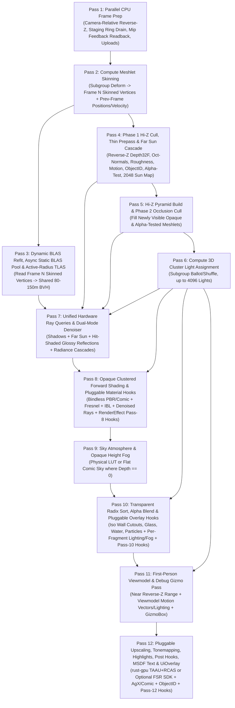

# Architectural Design Specifications for a Dual-Camera 3D RPG Graphics Engine

## Engine Motivation

This document defines the finalized graphics and streaming architecture for Dragon Engine. The engine runs both first-person and isometric role-playing games on native desktop computers (Windows, Linux, and macOS). The architecture uses a compute-centric clustered forward render pipeline with a thin geometry attribute prepass. Compute shaders execute skeletal skinning, meshlet culling, occlusion tests, light clustering, hardware ray queries, denoising, transparency sorting, and post-processing.

The engine supports two visual styles through runtime configuration. Developers configure the engine to show realistic physical graphics or flat comic graphics. The configuration changes active shader modules, ambient illumination, denoiser behavior, and post-process effects. This dual support lets artists build different game atmospheres with the same core technology.

This specification operates alongside [Engine Architecture Principles](engine-architecture.md), which governs the gameplay runtime (`TaskSlab`, AoS/SoA physics coupling, `ModeManager`, dual clocks, double-buffered `RenderSnapshot`, `ActorCheckpoint` reconstruction, and decoupled `UiOverlay`).

## Document Structure and Section Rules

This document uses a standard structure to record all architectural decisions. Every section contains a title, configuration variables, a selected option, rejected options, and an academic or industry reference.

Each selected option block contains four parts:
- **Architectural Consequences**: Explains how the choice changes engine code, GPU memory, and execution order.
- **Visual Quality Consequences**: Describes what the player sees on screen.
- **Quantitative Metrics**: Gives formulas, memory footprints, and frame time budgets.
- **AAA Benchmark**: Gives examples from modern 2026 production engines.

## Global Architectural Rules

1. **Dynamic Runtime Configuration**: The engine queries hardware limits during startup. The engine must not hardcode video memory or ray budgets. Runtime presets scale resolution, ray counts, cascade density, staging ring size, and static BLAS build caps from integrated GPUs (Radeon 780M and 890M) to 4K discrete desktop GPUs.
2. **Standard Open Formats**: The engine uses standard open file formats (glTF 2.0, KTX2, SPIR-V) whenever possible.
3. **Dominant Replacement Technology**: The engine adopts standard new technologies when they replace older methods completely.
4. **Artist Workflow Autonomy**: The engine and offline build pipeline handle all technical geometry, sector packing, HLOD, collider baking, and memory optimizations automatically. Developers must reject any option that forces artists to split concave meshes, create lightmap UVs, assign manual shadow flags, author manual LODs, pack texture atlases, or resize textures to uniform dimensions.
5. **Combinable Design Options**: When a system can combine multiple technologies for different situations, this document states that capability explicitly during decision tracking.
6. **Zero-Loading-Screen Asynchronous Streaming (Frame-Pacing First)**: The engine must never display loading screens between world sectors and must never block the simulation step or render frame waiting for disk I/O, decompression, GPU upload, BLAS builds, or physics splicing. When hardware falls behind demand, objects, LODs, mips, and ray-tracing structures pop in asynchronously rather than breaking frame pacing.
7. **Independent Per-Subsystem Residency Policies**: Orthogonal subsystems (Physics, Geometry/LOD, Ray-Tracing BLAS, Actors/AI, and GPU-Feedback Mipmap Streaming) each own independent spatial residency radii and eviction policies rather than sharing rigid coupled sector rings.

## Core Architectural Pillars

1. **Compute-Centric Workloads**: Compute shaders execute animation skinning, meshlet culling, light clustering, ray tracing, denoising, sorting, and image effects.
2. **Meshlet Geometry Pipeline**: The offline build pipeline divides all meshes into 64-vertex, 124-triangle meshlets with automatic Level of Detail (LOD) chains and coarse horizon HLOD proxies.
3. **Subgroup Acceleration**: Compute shaders use native GPU subgroup operations for wave-level parallel reductions, buffer compaction, and radix sorting.
4. **Unified Hardware Ray Queries**: The engine requires 2020-class ray-query hardware (Radeon 780M minimum baseline) and runs one unified stochastic ray pipeline across shadows, reflections, and global illumination.
5. **Strict `rust-gpu` Shading**: Every compute, mesh, and graphics shader is written in Rust (`rust-gpu`) with zero WGSL modules and 100 percent CPU-GPU ABI sharing via `crates/shader_abi`.

---

## Implementable Frame Execution Pipeline (Render Graph)

Every frame executes twelve deterministic passes. Millisecond figures throughout this document are design-time sizing references and offline QA profiler targets (calibrated to the target desktop GPU tier, with Radeon 780M serving as a conservative minimum floor); the engine never executes runtime millisecond streaming or frame timers. Pass 2 (Compute Meshlet Skinning) executes before Pass 3 (Dynamic BLAS Refit and Active-Radius TLAS Update) so acceleration structures and rasterization read identical Frame N character poses with zero temporal lag. Any camera cut, camera-mode switch, visual-style toggle, or teleport sets an explicit `history_reset` flag that invalidates previous-frame Hi-Z, Pass 7 denoiser history, and Pass 12 temporal upscaler history atomically.

1. **Parallel CPU Frame Preparation (Sections 1, 8, 10, and 11)**: Worker threads rebase canonical CPU coordinates (`DVec3` / chunk-local) into camera-relative `f32` reverse-Z camera matrices, drain ready async geometry and mip-chain uploads through the fixed-size staging ring, drain non-blocking N+3 `MAP_READ` mipmap feedback buffers, process N+3 deferred arena/texture/BLAS reclamations, batch at most one global bindless `BindGroup` update if texture slots changed, and upload light, bone, and dynamic instance buffers.
2. **Compute Meshlet Skinning (Section 14)**: Compute shaders deform animated character meshlets with subgroups and write Frame N skinned vertices into typed storage buffers while retaining previous-frame skinned positions (or emitting per-vertex motion deltas) so Pass 4 computes accurate per-vertex motion vectors for animated limbs.
3. **Dynamic BLAS Refit, Amortized Async Static BLAS, and Active-Radius TLAS Update (Section 9)**: After a GPU memory barrier on the skinned vertex buffer, the engine refits active dynamic character BLASes from Frame N vertices, executes up to `STATIC_BLAS_BUILDS_PER_FRAME` queued static BLAS builds and completes ready asynchronous `Queue::compact_blas` swaps inside the budgeted `wgpu::Blas` pool, and rebuilds the active-radius Top-Level Acceleration Structure (TLAS).
4. **Phase 1 Hi-Z Culling, Thin Attribute Prepass, and Far Sun Shadow Cascade (Sections 3, 4, 6, and 16)**: Compute shaders cull resident meshlets against the previous-frame Hi-Z pyramid (skipped when `history_reset` is active), select automatic LODs, split alpha-tested foliage into a dedicated alpha-test list, and route isometric player-occluding walls (detected via camera-to-player capsule/cone tests with hysteresis) to the transparent queue. The geometry prepass writes internal-resolution reverse-Z `Depth32Float`, octahedral normals, roughness, motion vectors (`Rg16Float`), and `R16Uint` Object IDs. In parallel, a sun-frustum cull populates the single `2048x2048` directional Far Sun Shadow Cascade covering vistas beyond `TLAS_ACTIVE_RADIUS_M`.
5. **Hi-Z Build and Phase 2 Occlusion Culling (Section 6)**: A compute shader builds the current-frame Hi-Z `min`-depth pyramid and renders newly visible opaque and alpha-tested meshlets into the depth and attribute buffers.
6. **Compute 3D Cluster Light Assignment (Sections 2 and 3)**: Compute shaders assign up to 4,096 lights to exponential 3D clusters using subgroup ballot and shuffle operations.
7. **Compute Ray Queries and Denoising (Sections 4, 12, and 17)**: Compute shaders trace stochastic first-hit shadow rays (combining with the Pass 4 Far Sun Cascade beyond `TLAS_ACTIVE_RADIUS_M`), glossy reflection rays, and hardware ray-queried radiance cascades against the shared Pass 3 TLAS. Reflection and GI ray hits resolve hit-point geometry, `MaterialId`, bindless albedo/ORM textures, and direct/cached radiance via `instance_custom_index` lookup. A denoiser filters outputs using temporal-spatial A-Trous filtering in realistic mode or spatial-only filtering in comic mode.
8. **Opaque Clustered Forward Shading and Pluggable Material Hooks (Sections 3, 7, 11, and 16)**: The `rust-gpu` forward pass evaluates bindless PBR or flat comic shaders, built-in material Fresnel rim highlights, skybox IBL, mipmap feedback writes, and denoised ray buffers at `Depth == Equal` with zero pixel overdraw, followed by registered Pass-8 `RenderEffect` custom `rust-gpu` material hooks reading GPU instance parameters.
9. **Sky Atmosphere and Opaque Height Fog (Section 13)**: A full-screen pass draws physical sky atmosphere or flat comic sky where reverse-Z depth equals zero, then applies distance height fog to opaque pixels.
10. **Transparent Meshlet Sort, Alpha Blend, and Pluggable Overlay Hooks (Section 5)**: A GPU subgroup radix sort orders transparent meshlets (cutout walls in isometric mode, glass, water, and particles) from back to front and draws them with hardware alpha blending, evaluating clustered lights, skybox IBL, and per-fragment height fog directly alongside registered Pass-10 `RenderEffect` hooks.
11. **First-Person Viewmodel and Debug Gizmo Pass (Section 5)**: When first-person mode operates, the engine draws player hands and weapons in a dedicated near reverse-Z depth range with viewmodel motion vectors and clustered/IBL lighting to prevent wall clipping and Pass 12 temporal ghosting. Optional `GizmoBox` debug primitives render at the end of Pass 11.
12. **Pluggable Upscaling, Tonemapping, Highlights, Pluggable Post Hooks, MSDF Text, and `UiOverlay` (Sections 13, 15, and 16)**: Realistic mode invokes the active `UpscalerBackend` (default pure `rust-gpu` TAAU + RCAS for Linux-first cross-platform support, or optional official AMD FSR SDK 2.4.0 on Windows Vulkan/DX12) followed by AgX tonemapping. Comic mode disables temporal accumulation and applies custom color lookup tables and geometry ink outlines. The pass then executes registered Pass-12 `RenderEffect` post-process hooks, post-upscale Object ID edge outlines (nearest-sampled from Pass 4 internal-res IDs or optional target-res highlight pass), animated loot highlights, MSDF text, and `UiOverlay::render`.

---

## Runtime Hardware Scaling Matrix

`DiscreteDesktop` is the primary QA and profiler calibration tier; `Radeon 780M` serves as the conservative minimum hardware floor.

| Runtime Parameter | Radeon 780M (Minimum Floor) | Radeon 890M (RDNA 3.5 iGPU) | Discrete Desktop (Primary Target: RTX 3060 / RX 6700 XT) | High-End Desktop (RTX 4070+ / 4K) |
| :--- | :--- | :--- | :--- | :--- |
| `INTERNAL_RESOLUTION` | 1280 x 720 (Upscaled to 1080p) | 1600 x 900 (Upscaled to 1080p) | 1920 x 1080 (Native or Quality Upscale) | 2560 x 1440 (Quality Upscale to 4K) |
| `RAYS_PER_PIXEL` (Shadows) | 1 stochastic ray | 1 stochastic ray | 1 to 2 stochastic rays | 2 to 4 stochastic rays |
| `CASCADE_RESOLUTION_SCALE` | 0.5x (Short 1.5 m Cascade 0) | 0.5x (2.0 m Cascade 0) | 1.0x (Full Resolution) | 1.0x (Full Resolution) |
| `REFLECTION_RESOLUTION_SCALE` | 0.5x (Roughness < 0.4) | 0.5x (Roughness < 0.5) | 1.0x (Full, Roughness < 0.6) | 1.0x (Full, Roughness < 0.8) |
| `TLAS_ACTIVE_RADIUS_M` | 80 m | 100 m | 120 m | 150 m |
| `STAGING_RING_MB` (Pass 1) | 8 MB per frame | 12 MB per frame | 24 MB per frame | 32 MB per frame |
| `STATIC_GEOMETRY_ARENA_MB` | 512 MB | 768 MB | 1,024 MB | 2,048 MB |
| `BLAS_POOL_BUDGET_MB` | 64 MB | 96 MB | 128 MB | 256 MB |
| `TEXTURE_STREAM_BUDGET_MB` | 1,536 MB | 2,048 MB | 4,096 MB | 10,240 MB |
| `STATIC_BLAS_BUILDS_PER_FRAME` | 4 to 8 BLAS | 8 to 12 BLAS | 24 BLAS | 48 BLAS |
| `TARGET_FRAME_RATE` (Design Ref) | 60 FPS | 60 FPS | 100+ FPS | 90+ FPS |

---

## 1. Target Execution Platforms and Graphics API (Decided)

The configuration variables are `TARGET_RESOLUTION_X`, `TARGET_RESOLUTION_Y`, and `INTERNAL_RENDER_SCALE`.

### Selected Option: Native Desktop Only via Native `wgpu` with Desktop Extensions (Vulkan-First Rollout)
- **Architectural Consequences**: The engine targets native desktop platforms via native `wgpu 30.0.1`, rolling out **Vulkan first** (Linux and Windows) across core implementation phases before adding DX12 and Metal in a dedicated cross-backend milestone. The CPU records command buffers across parallel worker threads. The engine enables native features for bindless descriptors (`TEXTURE_BINDING_ARRAY`, `SAMPLED_TEXTURE_AND_STORAGE_BUFFER_ARRAY_NON_UNIFORM_INDEXING`, plus `PARTIALLY_BOUND_BINDING_ARRAY` on Vulkan/DX12), `wgpu` Immediates (`Features::IMMEDIATES`, up to 128 bytes), `MULTI_DRAW_INDIRECT_COUNT` (Vulkan/DX12), `SUBGROUP`, `EXPERIMENTAL_MESH_SHADER`, `EXPERIMENTAL_RAY_QUERY`, `PASSTHROUGH_SHADERS`, and pass-level `TIMESTAMP_QUERY` (avoiding encoder-level timestamps that Apple Silicon Metal lacks). Because `wgpu` marks ray queries and mesh shaders as experimental, engine startup enables `wgpu::ExperimentalFeatures` explicitly inside one private audited module (`crates/engine/src/gpu/device.rs`). On Vulkan, `wgpu` loads `rust-gpu` SPIR-V bytecode directly via passthrough; the cross-backend DX12/Metal milestone adds offline SPIRV-Cross + DXC/MetalLib compilation with explicit `PassthroughShaderEntryPoint` reflection and Metal-specific accommodations (dummy-padded bindless slots and mesh-shader-only draw paths without `MULTI_DRAW_INDIRECT_COUNT`). All `wgpu` compute, mesh, and render pipelines compile once at application startup so sector streaming produces zero runtime PSO stutter.
- **Visual Quality Consequences**: Dropping browser caps removes the 256 MB buffer limit and 2,048 MB VRAM limit. Integrated GPUs (Radeon 780M and 890M) serve as the minimum floor via internal resolution scaling, while target discrete desktop GPUs render native 1080p/1440p and upscaled 4K detail at high frame rates.
- **Quantitative Metrics**:
  - Minimum GPU floor: AMD Radeon 780M (12 RDNA 3 compute units, 12 ray accelerators, shared system RAM); primary target tier: discrete desktop ray-capable GPUs (RTX 3060 / RX 6700 XT or higher).
  - Active VRAM allocation range: 2,560 MB to 24,576 MB (scaled dynamically from startup preset).
  - Multi-threaded command submission time: 0.05 ms to 0.20 ms (design-time reference).
  - Design reference frame budget: 16.6 ms at 60 FPS floor, <= 10.0 ms at 100+ FPS on target discrete desktop GPUs (offline QA target, not a runtime timer).
- **AAA Benchmark (2026 Dual-Camera RPGs)**: Modern native desktop engines target 2020-class ray-capable GPUs, precompile fixed bindless pipelines at startup, and scale resolution dynamically across handhelds, laptops, and desktops.

### Rejected Option: Cross-Platform with WebAssembly Web Browsers
- **Reason for Rejection**: Web browser limits cap buffers at 256 MB, cap storage bindings at eight per stage, block multi-threaded command recording, and lack universal hardware ray queries.
- **Architectural Consequences**: The engine runs single-threaded command recording, software distance-field fallbacks, and compressed low-resolution textures.
- **Quantitative Metrics**:
  - Total GPU memory cap: 2,048 MB.
  - Command submission time: 0.30 ms to 0.80 ms.

### Rejected Option: Direct Vulkan (`ash`) with MoltenVK on macOS
- **Reason for Rejection**: Direct Vulkan code increases unsafe Rust maintenance across three desktop platforms and relies on MoltenVK translation layers on macOS.
- **Architectural Consequences**: Developers manage explicit Vulkan synchronization, swapchains, and memory heaps manually.
- **Quantitative Metrics**:
  - Engine backend code size: 3x larger than native `wgpu`.

### Reference Publication for Section 1
- **Reference**: W3C GPU for the Web Community Group and `wgpu` Contributors. "WebGPU Specification and Native Extension Reference." Technical Documentation, 2021-2026.
- **Description**: Defines the `wgpu` hardware abstraction layer, native desktop extensions, and experimental ray query and mesh shader interfaces.

---

## 2. Maximum Dynamic Local Lights (Decided)

The configuration variables are `MAX_VISIBLE_LIGHTS` and `LIGHT_STRUCT_BYTES`.

### Selected Option: Compute Shader Light Assignment with Storage Buffers
- **Architectural Consequences**: The engine uploads active scene lights (in camera-relative `f32` coordinates) into a global GPU storage buffer each frame. `wgpu` Immediates (`set_immediates`) pass frame-level light counts to shaders directly without bind group reallocation. A `rust-gpu` compute shader tests light bounding volumes against 3D clusters using GPU subgroup operations to avoid atomic contention. Shaders read runtime-sized arrays directly from native storage buffers.
- **Visual Quality Consequences**: Level designers place thousands of dynamic torches, lanterns, and spell lights across open cities and dungeons without manual light budgets.
- **Quantitative Metrics**:
  - `MAX_VISIBLE_LIGHTS` range: 512 to 4,096 active lights.
  - `LIGHT_STRUCT_BYTES` constant: 32 bytes.
  - Global Light Buffer formula: `MAX_VISIBLE_LIGHTS * 32 bytes` (131 KB for 4,096 lights).
  - Compute cluster light assignment time (Pass 6): 0.10 ms to 0.40 ms (design-time reference).
- **AAA Benchmark (2026 Dual-Camera RPGs)**: Compute-centric RPG engines process thousands of dynamic local lights in storage buffers with zero CPU light sorting.

### Rejected Option: CPU Uniform Buffer Path
- **Reason for Rejection**: Uniform buffers restrict light arrays to 64 KB (512 lights maximum) and move light sorting work back onto the CPU.
- **Architectural Consequences**: The CPU searches, sorts, and uploads visible lights every frame into a small uniform bind group.
- **Quantitative Metrics**:
  - CPU light sorting time: 0.50 ms to 2.00 ms.

### Reference Publication for Section 2
- **Reference**: Harada, T., McKee, J., and Yang, J. C. "Forward+: Bringing Deferred Lighting to the Next Level." Eurographics Symposium on Rendering, 2012.
- **Description**: Introduces GPU compute light culling and linear light buffers for forward rendering pipelines.

---

## 3. Depth Buffer and 3D Cluster Grid Dimensions (Decided)

The configuration variables are `GRID_X`, `GRID_Y`, `GRID_Z`, `CAMERA_NEAR_M`, and `CAMERA_FAR_M`.

### Selected Option: Reverse-Z `Depth32Float` and Fine Exponential 3D Cluster Grid (32 to 64 per Axis)
- **Architectural Consequences**: The engine allocates a reverse-Z `Depth32Float` buffer (`1.0` at the near plane, `0.0` at the far plane) to support 0.05-meter first-person weapons and 2,000-meter horizons without depth fighting. The engine divides view space into an exponential 3D cluster grid during startup and recalculates cluster bounds only when screen resolution, camera mode, or field of view changes. Compute shaders assign lights to clusters using subgroup ballot and shuffle operations.
- **Visual Quality Consequences**: Near clusters cover small indoor rooms precisely while distant clusters cover large outdoor valleys. Because lighting formulas run continuously in camera-relative world space and lights overlap border clusters conservatively, cluster boundaries show zero visible seams.
- **Quantitative Metrics**:
  - Depth range: 0.05 m to 2,000 m (first-person mode) or 10 m to 80 m (isometric mode).
  - Total clusters formula: `GRID_X * GRID_Y * GRID_Z` (32,768 to 262,144 clusters).
  - Cluster Header Buffer formula: `TOTAL_CLUSTERS * 8 bytes` (256 KB to 2.09 MB).
  - False-positive light checks per pixel: 0 to 2 extra checks.
  - Compute cluster assignment time: 0.10 ms to 0.40 ms.
- **AAA Benchmark (2026 Dual-Camera RPGs)**: Modern dual-camera engines combine reverse-Z depth with exponential 3D clustered grids to support both close-up interiors and open horizons.

### Rejected Option: Coarse Linear Grid (8 to 16 per Axis)
- **Reason for Rejection**: Coarse linear boxes waste depth precision near the camera and add 5 to 15 false light evaluations per pixel.
- **Architectural Consequences**: The engine allocates a small cluster header buffer with wide depth slices.
- **Quantitative Metrics**:
  - Fragment shader lighting penalty: +1.50 ms to +3.00 ms.

### Reference Publication for Section 3
- **Reference**: Olsson, O., Billeter, M., and Assarsson, U. "Clustered Deferred and Forward Shading." Eurographics / High Performance Graphics, 2012.
- **Description**: Defines exponential 3D clustered shading along the depth axis to isolate local lights across wide camera depth ranges.

---

## 4. Local and Directional Shadows (Decided)

The configuration variables are `RAYS_PER_PIXEL`, `SHADOW_RESOLUTION_SCALE`, `DENOISER_MODE`, and `FAR_CASCADE_RESOLUTION`.

### Selected Option: Unified Budgeted Hardware Ray Queries (Option 3A-1) with Automatic Light Selection
- **Architectural Consequences**: Every GPU runs one unified stochastic ray-query compute pipeline against the Section 9 hardware BVH. The compute pass picks important cluster lights automatically by brightness and distance without manual artist shadow flags. Solid opaque shadow rays use `TERMINATE_ON_FIRST_HIT` and opaque geometry flags to stop traversal on the first blocking triangle; alpha-tested foliage and fences inside near range use non-opaque BLAS geometry with any-hit bindless alpha-mask evaluation (and switch to opaque/excluded bounds beyond near range). A spatial-temporal denoiser removes pixel noise in realistic mode, while comic mode uses a spatial-only filter to keep shadow edges sharp. Beyond `TLAS_ACTIVE_RADIUS_M` in first-person vistas, a single `2048x2048` directional Far Sun Shadow Cascade rendered in Pass 4 covers distant terrain and is sampled in Pass 7/8.
- **Visual Quality Consequences**: Characters, pillars, and foliage cast soft physical area shadows from unlimited overlapping lights with zero shadow acne or cube-map seams. Runtime scaling preserves smooth frame pacing across both integrated floors and high-end discrete GPUs.
- **Quantitative Metrics** (design-time references; not enforced as runtime timers):
  - Cube-map shadow VRAM saved: Up to 2,516 MB eliminated.
  - Denoiser history buffer VRAM: 24.0 MB at 1080p, 96.0 MB at 4K.
  - Far sun cascade VRAM (2048 resolution, 1 cascade): 16.8 MB.
  - Discrete GPU shadow and denoiser time (1080p to 4K, 1 to 4 rays): 0.8 ms to 1.8 ms (Radeon 780M 720p floor reference: 1.5 ms to 2.2 ms).
- **AAA Benchmark (2026 Dual-Camera RPGs)**: Path-traced RPG engines (such as *Cyberpunk 2077 Overdrive Mode*) use stochastic importance-sampled rays and spatial-temporal denoising to support unlimited dynamic shadow lights.

### Rejected Option: Dual Quality Tiers (Option 3A-2)
- **Reason for Rejection**: Maintaining separate deterministic and stochastic shadow pipelines doubles shader testing effort and drops frame rates when ten or more lights overlap in combat.
- **Architectural Consequences**: Discrete GPUs trace multiple deterministic rays per pixel while integrated GPUs run a separate denoised pass.
- **Quantitative Metrics**:
  - Codebase maintenance factor: 2.0x.

### Rejected Option: Rasterized Cube-Map Shadow Arrays
- **Reason for Rejection**: Cube-map arrays consume up to 2.5 GB of VRAM, require six geometry passes per point light, and force artists to tag manual shadow flags.
- **Architectural Consequences**: The CPU records six raster shadow passes per flagged light every frame.
- **Quantitative Metrics**:
  - High-bound VRAM footprint: 2,516 MB.

### Reference Publication for Section 4
- **Reference**: Bitterli, B. et al. "Spatiotemporal Reservoir Resampling for Real-Time Ray Tracing with Dynamic Direct Lighting (ReSTIR)." ACM SIGGRAPH, 2020. Also: Benty, N. et al. "DirectX Raytracing (DXR) and Compute Ray Queries." ACM SIGGRAPH Courses, 2018-2024.
- **Description**: Defines stochastic light importance sampling, first-hit compute ray queries, and denoised multi-light shadows.

---

## 5. Wall Cutout Transparency, Glass Sorting, and Viewmodels (Decided)

The configuration variables are `TRANSPARENT_SORT_METHOD`, `OVERDRAW_LAYERS`, and `VIEWMODEL_DEPTH_RANGE`.

### Selected Option: GPU Subgroup Radix Sort on Transparent Meshlets with Hardware Alpha Blending
- **Architectural Consequences**: All transparent geometry stays inside the unified meshlet pipeline with zero CPU sorting. In isometric mode, the Pass 4 meshlet culler runs a camera-to-player capsule/cone intersection test against architectural meshlet bounding spheres flagged `cutout_eligible` (using fade-in/out hysteresis to prevent flicker) and routes occluding wall meshlets into the transparent queue buffer. In first-person mode, the engine disables wall cutouts and routes glass windows, water, and spell effects into the same transparent queue. In Pass 10, a GPU compute pass computes meshlet camera depths and runs a subgroup radix sort from back to front across three to four dispatches. One mesh shader dispatch (or `MultiDrawIndirectCount` on Vulkan/DX12) draws the sorted meshlets with hardware alpha blending, evaluating Pass 6 clustered lights, skybox IBL, and per-fragment height fog directly (because Pass 7 ray buffers and Pass 9 fog cover opaque pixels only), alongside registered Pass-10 `RenderEffect` transparent overlay hooks. In Pass 11, when first-person mode operates, player hands and weapons render in a dedicated near reverse-Z depth range with viewmodel motion vectors and clustered/IBL lighting to prevent both wall clipping and Pass 12 temporal ghosting; optional `GizmoBox` debug overlays render at the end of Pass 11.
- **Visual Quality Consequences**: Concave and L-shaped walls fade smoothly in accurate depth order without forcing artists to split building meshes manually. Glass, water, and magic spells sort cleanly in both camera modes.
- **Quantitative Metrics**:
  - Sort key and value buffer VRAM (65,536 transparent meshlets): 1.0 MB to 4.0 MB.
  - GPU subgroup radix sort time: 0.15 ms to 0.40 ms.
  - Hardware alpha blend time: 0.30 ms to 1.00 ms.
  - CPU draw and sort overhead: 0.00 ms.
- **AAA Benchmark (2026 Dual-Camera RPGs)**: GPU-driven engines sort transparent meshlets and particles on the GPU with subgroup radix sorts to keep a single geometry pipeline.

### Rejected Option: Order-Independent Transparency via Per-Pixel Linked Lists
- **Reason for Rejection**: Per-pixel linked lists consume 265 MB to 1,061 MB of VRAM for node pools and create heavy atomic contention on integrated GPUs.
- **Architectural Consequences**: Fragment shaders write color and depth nodes via global atomics and sort per-pixel lists in a resolve pass.
- **Quantitative Metrics**:
  - Atomic write and resolve time: 0.80 ms to 2.50 ms.

### Rejected Option: Separate CPU-Sorted Instanced Wall Pass
- **Reason for Rejection**: Whole-object CPU sorting causes sorting errors on concave L-shaped buildings and forces artists to split walls manually, violating the Artist Workflow Autonomy rule.
- **Architectural Consequences**: The CPU removes active cutout walls from the meshlet mask and submits separate instanced draw calls.
- **Quantitative Metrics**:
  - Artist manual mesh-splitting cost: High production overhead.

### Rejected Option: Dithered Stipple Pattern and Stencil Masks
- **Reason for Rejection**: Dithered stipple leaves visible noise patterns in comic mode without temporal blur, and stencil masks only cut a narrow tunnel around the character.
- **Architectural Consequences**: Shaders discard wall pixels with noise matrices or stencil tests.
- **Quantitative Metrics**:
  - Extra VRAM footprint: 0.0 MB to 2.07 MB.

### Reference Publication for Section 5
- **Reference**: Merrill, D. and Grimshaw, A. "High Performance and Scalable Radix Sorting on GPUs." Parallel Processing Letters, 2011. Also: McGuire, M. and Bavoil, L. "Weighted, Blended Order-Independent Transparency." Journal of Computer Graphics Techniques, 2013.
- **Description**: Defines wave-accelerated GPU radix sorting and analyzes memory bandwidth limits for real-time transparent layers.

---

## 6. World Partition, Meshlet Culling, and Hi-Z Occlusion (Decided)

The configuration variables are `MESHLET_MAX_VERTICES`, `MESHLET_MAX_TRIANGLES`, `HIZ_MIP_LEVELS`, and `GEOMETRY_STREAM_RADIUS_M`.

### Selected Option: Meshlet Culling with Two-Phase Hi-Z Occlusion, Native Mesh Shaders, and `MultiDrawIndirectCount`
- **Architectural Consequences**: The offline asset pipeline clusters every mesh into fixed-size meshlets (64 vertices, 124 triangles) and generates coarse horizon HLOD meshlets for distant sectors up to 2,000 m. Every frame, a two-phase GPU compute pass performs frustum culling, backface cone culling, automatic LOD selection, and Hierarchical-Z (Hi-Z) occlusion tests over all currently resident meshlets in the static geometry arena and dynamic skinned vertex pool. Solid opaque meshlets and alpha-tested foliage meshlets split into separate indirect draw queues so solid geometry keeps hardware early-Z active. Phase 1 tests meshlets against the previous-frame Hi-Z pyramid (or skips Hi-Z rejection when `history_reset` is active) and draws visible geometry. After building the current-frame Hi-Z pyramid, Phase 2 tests previously occluded meshlets and draws newly revealed objects. Native GPUs with mesh shader support dispatch task and mesh shaders directly, while GPUs on Vulkan/DX12 without mesh shaders submit all visible meshlets in one `MultiDrawIndirectCount` call (Metal targets require native mesh shaders).
- **Visual Quality Consequences**: The GPU removes hidden dungeon rooms and interiors behind tall city buildings in first-person view automatically. Distant sectors show seamless HLOD silhouettes out to 2,000 m while nearby geometry switches cleanly into full meshlet LOD chains. Zero CPU draw bottlenecks allow dense crowds and complex architecture.
- **Quantitative Metrics**:
  - `MESHLET_MAX_VERTICES` constant: 64 vertices.
  - `MESHLET_MAX_TRIANGLES` constant: 124 triangles.
  - Hi-Z depth pyramid VRAM (1080p): 2.8 MB.
  - Two-phase meshlet culling time: 0.15 ms to 0.45 ms.
  - CPU draw submission overhead: 0.00 ms.
- **AAA Benchmark (2026 Dual-Camera RPGs)**: Modern GPU-driven engines combine two-phase Hi-Z occlusion culling with meshlet clusters and horizon HLOD proxies to handle both isometric cities and long first-person vistas.

### Rejected Option: Traditional Per-Object CPU Culling
- **Reason for Rejection**: CPU frustum culling cannot remove hidden rooms behind walls, creates CPU draw call stalls, cannot cull sub-mesh geometry, and conflicts with 2,000 m first-person visibility.
- **Architectural Consequences**: The CPU traverses a 2D grid or 3D octree and issues per-object draw calls.
- **Quantitative Metrics**:
  - CPU draw submission overhead: 2.0 ms to 8.0 ms.

### Reference Publication for Section 6
- **Reference**: Kubisch, C. "Mesh Shading: A New Approach to Geometry Pipelines." NVIDIA Technical Report, 2018. Also: Haar, U. and Aaltonen, S. "GPU-Driven Rendering Pipelines." ACM SIGGRAPH Courses, 2015.
- **Description**: Introduces meshlet geometry clusters, two-phase Hi-Z occlusion culling, and GPU indirect draw architectures.

---

## 7. Shader Authoring and Compilation Pipeline (Decided)

The configuration variable is `SHADER_COMPILER_BACKEND`.

### Selected Option: Strict 100 Percent `rust-gpu` SPIR-V Pipeline (Zero WGSL) with Pluggable Custom Shader Crates
- **Architectural Consequences**: Developers write all engine and game material, compute, ray-query, mesh, and custom `RenderEffect` shaders strictly in Rust (`crates/engine/shaders/core_shader` and external plugin crates such as `crates/fx_fresnel_rim`) with `spirv-builder 0.11.0` (`spirv-unknown-vulkan1.3`) outputting compiled SPIR-V exclusively into Cargo `OUT_DIR`. `spirv-std 0.11.0` natively provides `RayQuery`, `GL_KHR_shader_subgroup` intrinsics, `NonUniform` descriptor indexing, and `TaskEXT`/`MeshEXT` mesh shaders; inline SPIR-V `asm!` is used only if a specialized future intrinsic lacks a wrapper. On Vulkan (primary rollout), `wgpu` loads compiled SPIR-V bytecode directly through `Device::create_shader_module_passthrough` (`Features::PASSTHROUGH_SHADERS`). In the cross-backend DX12/Metal milestone, an offline SPIRV-Cross + DXC/MetalLib build step translates SPIR-V into backend-native passthrough binaries with explicit `PassthroughShaderEntryPoint` reflection. The CPU and GPU share 100 percent of Rust struct definitions through `crates/shader_abi` (including `glam 0.34` layout parity). External game or effect crates plug custom `rust-gpu` shaders into typed Pass-8, Pass-10, and Pass-12 `RenderEffect` hook points through `EffectRegistry` without accessing private engine internals. The only permitted non-`rust-gpu` binary exception is an optional feature-gated (`fsr-sdk`) official third-party vendor upscaler DLL (AMD FSR SDK 2.4.0 on Windows via `wgpu_hal`; Section 13); zero WGSL files exist anywhere in the repository.
- **Visual Quality Consequences**: Technical artists maintain strong Rust type safety across complex materials, ray queries, and stylized cel-shading bands with zero struct mismatch errors.
- **Quantitative Metrics**:
  - Offline shader crate compile time: 1.0 s to 5.0 s.
  - Direct SPIR-V startup load time: 0.05 ms to 0.20 ms.
  - CPU-GPU struct duplication errors: 0 errors.
  - WGSL files in repository: 0 files.
  - Runtime compiler memory overhead: 0.0 MB.
- **AAA Benchmark (2026 Dual-Camera RPGs)**: Native Rust game engines use pure `rust-gpu` SPIR-V pipelines to share math libraries and data layouts directly between gameplay and rendering code.

### Rejected Option: `rust-gpu` Primary with `naga_oil` WGSL Fallback
- **Reason for Rejection**: Violates the Dragon Engine strict zero-WGSL architectural invariant, introduces a second shading language toolchain, and reintroduces manual CPU-GPU struct duplication for fallback modules.
- **Architectural Consequences**: Developers maintain parallel WGSL files and `naga_oil` preprocessing alongside `rust-gpu`.
- **Quantitative Metrics**:
  - Language maintenance overhead: 1.5x to 2.0x toolchain complexity.

### Rejected Option: Split `rust-gpu` Materials and Slang Compute Shaders
- **Reason for Rejection**: Maintaining two distinct shading languages splits math libraries and forces manual struct duplication between Rust and Slang.
- **Architectural Consequences**: Developers write material shaders in Rust and write compute and ray tracing shaders in Slang.
- **Quantitative Metrics**:
  - Language maintenance overhead: 2.0x toolchain complexity.

### Rejected Option: `naga_oil` WGSL Exclusive and Custom String Preprocessor
- **Reason for Rejection**: Raw WGSL text files force developers to duplicate every Rust data structure manually across CPU and GPU code.
- **Architectural Consequences**: The engine parses all shader modules from text files at startup.
- **Quantitative Metrics**:
  - Startup parse time: `SHADER_MODULE_COUNT * 0.75 ms`.

### Reference Publication for Section 7
- **Reference**: Rust-GPU Contributors and Embark Studios. "Rust-GPU: Making Rust a First-Class Shading Language." Open Source Technical Specification, 2020-2026.
- **Description**: Defines compiling Rust crates into SPIR-V shader modules for modern graphics backends.

---

## 8. Dynamic Buffer Allocation, Streaming Arenas, and Memory Layout (Decided)

The configuration variables are `MAX_DYNAMIC_VERTICES`, `VERTEX_BYTES`, `IMMEDIATE_DATA_BYTES`, `STATIC_GEOMETRY_ARENA_MB`, `BLAS_POOL_BUDGET_MB`, and `STAGING_RING_MB`.

### Selected Option: Pre-Allocated Typed Storage Pools, Free-List Static Geometry Arena, Budgeted `wgpu::Blas` Pool, and `wgpu` Immediates
- **Architectural Consequences**: Because the engine targets native desktop APIs exclusively, pipelines bind dozens of typed storage buffers without WebGPU eight-buffer or 256 MB caps. At startup, the engine pre-allocates:
  1. **Fixed Triple-Buffered Dynamic Pools**: For dynamic vertices, Frame N skinned meshlets, previous-frame skinned positions (for Pass 4 motion vectors), per-frame instances, bone matrices, lights, and particles.
  2. **Free-List Sub-Allocated Static Geometry Arena (`STATIC_GEOMETRY_ARENA_MB`)**: Fixed pre-allocated vertex, index, and meshlet-descriptor buffers managed by a CPU TLSF/free-list sub-allocator. Streaming sectors sub-allocate slices inside these buffers and pass slice offsets through GPU instance records with zero runtime geometry `create_buffer` calls.
  3. **Budgeted `wgpu::Blas` Pool (`BLAS_POOL_BUDGET_MB`)**: Because safe `wgpu 30.0.1` allocates opaque `wgpu::Blas` objects via `Device::create_blas` and manages scratch memory internally, the engine enforces an explicit VRAM budget over live `Blas` handles and runs multi-frame asynchronous compaction (`Blas::prepare_compaction_async` -> `Queue::compact_blas`) without dropping into `unsafe` `wgpu_hal` memory heaps.
  4. **Fixed Pass 1 Upload Staging Ring (`STAGING_RING_MB`) & `MAP_READ` Feedback Ring**: Bounds per-frame CPU-to-GPU streaming transfers naturally without millisecond timers, paired with a triple-buffered non-blocking `MAP_READ` staging ring that reads the Pass 8 mipmap feedback buffer back to the CPU at N+3 frame latency.
  5. **N+3 Deferred Reclamation Queue**: Freed static geometry slices, replaced uncompacted `Blas` handles, swapped mip-chain `wgpu::Texture` objects, and bindless slots return to their free lists only after 3 GPU frames in flight retire. Global bindless `BindGroup` updates batch at most once per frame when streaming inserts or evicts texture slots.

  Compute shaders use subgroup compaction to pack active instances into contiguous buffer slices. Per-pass metadata passes through native `wgpu` Immediates (`Features::IMMEDIATES`, `set_immediates`, up to 128 bytes).
- **Visual Quality Consequences**: Typed storage buffers and sub-allocated geometry arenas keep shaders clean and frame pacing smooth during continuous world traversal. If an arena, BLAS pool, or particle pool temporarily reaches capacity, low-priority incoming props or particles defer cleanly (delayed pop-in) rather than stalling the GPU or triggering OOM crashes.
- **Quantitative Metrics**:
  - Dynamic Vertex Pool formula: `MAX_DYNAMIC_VERTICES * VERTEX_BYTES * 3 frames` (1.9 MB to 192.0 MB).
  - Pass 1 Staging Ring: `8 MB` (Radeon 780M floor) to `32 MB` (High-End 4K).
  - `wgpu` Immediates upload latency: 0.00 ms (inlined in command stream, `<= 128 bytes`).
  - Runtime geometry buffer allocation frame stutter penalty: 0.00 ms.
- **AAA Benchmark (2026 Dual-Camera RPGs)**: Open-world native desktop engines sub-allocate streamed sectors inside fixed GPU memory heaps and pass per-draw offsets via push constants to eliminate runtime allocation stalls.

### Rejected Option: Unified WebGPU Byte-Addressable Mega-Buffer
- **Reason for Rejection**: Packing unrelated data types into raw `u32` byte offsets adds shader address math and is unnecessary once WebGPU binding limits are removed.
- **Architectural Consequences**: All geometry, bones, and transforms live inside one raw byte buffer.
- **Quantitative Metrics**:
  - Shader instruction penalty: +2 integer operations per memory read.

### Rejected Option: Per-Sector Dynamic GPU Buffer Allocation
- **Reason for Rejection**: Calling `create_buffer` and rebuilding bind groups as sectors stream in stalls the graphics queue and fragments GPU memory.
- **Architectural Consequences**: The engine allocates and destroys GPU buffers dynamically during sector traversal.
- **Quantitative Metrics**:
  - Frame stutter penalty range: 1.0 ms to 25.0 ms.

### Reference Publication for Section 8
- **Reference**: Sellers, G., Kessenich, J., and Lichtenbelt, B. "Vulkan Programming Guide." Addison-Wesley, 2016.
- **Description**: Details fixed triple-buffered storage pools, heap sub-allocation, push constants, and stall-free GPU memory management.

---

## 9. Static and Dynamic Ray Tracing Acceleration Structures (Decided)

The configuration variables are `TLAS_ACTIVE_RADIUS_M`, `BLAS_PREFETCH_MARGIN_M`, `STATIC_BLAS_BUILDS_PER_FRAME`, `BLAS_POOL_BUDGET_MB`, and `MAX_DYNAMIC_BLAS_COUNT`.

### Selected Option: Amortized Async Static `wgpu::Blas` Compaction, Pass-3 Frame-Coherent Dynamic BLAS Refit, and Active-Radius TLAS Rebuild
- **Architectural Consequences**: The ray-tracing residency policy monitors static geometry within `TLAS_ACTIVE_RADIUS_M + BLAS_PREFETCH_MARGIN_M` independently of physics or visual LOD radii. When static sector geometry finishes uploading into the static geometry arena, its static `wgpu::Blas` enters a multi-frame asynchronous state machine bounded by `BLAS_POOL_BUDGET_MB`:
  - `Queued -> Built (Pass 3 build_acceleration_structures) -> CompactionPending (Blas::prepare_compaction_async) -> Compacted (Queue::compact_blas -> atomic TLAS swap -> N+3 drop of uncompacted Blas)`.

  Each frame in Pass 3 (immediately after Pass 2 Compute Meshlet Skinning and a single GPU memory barrier), the engine:
  1. Refits all active dynamic character BLASes (`AccelerationStructureUpdateMode::PreferUpdate`) directly from Pass 2 Frame N skinned vertices.
  2. Executes up to `STATIC_BLAS_BUILDS_PER_FRAME` queued static BLAS builds and commits ready asynchronous compactions from the `wgpu::Blas` pool.
  3. Rebuilds one shared Top-Level Acceleration Structure (TLAS) in camera-relative `f32` coordinates containing all `RayReady` static and dynamic objects inside `TLAS_ACTIVE_RADIUS_M` (80 m to 150 m), tagging each TLAS instance with `instance_custom_index` pointing to its `GpuInstance` record for Pass 7 ray-hit geometry/material shading.

  If a newly streamed static object's BLAS has not completed yet, the object still rasterizes immediately and enters the TLAS atomically on the frame its BLAS finishes (zero frame stall). Shadows (Section 4), glossy reflections (Section 12), and radiance cascades (Section 17) all trace rays against this single shared Frame N TLAS.
- **Visual Quality Consequences**: Moving characters match their shadows, floor reflections, and GI bounce with zero 1-frame temporal lag, zero self-shadow acne from stale poses, and zero first-frame T-pose flashes. Static sector transitions never hitch the GPU; under extreme streaming load, ray-traced shadows and reflections for newly arrived static props pop in seamlessly once their BLAS builds complete.
- **Quantitative Metrics** (design-time references):
  - Geometry-to-BVH temporal lag: `0 frames` (`0.0 ms`).
  - Active-radius TLAS rebuild time: 0.10 ms to 0.30 ms per frame.
  - Dynamic character BLAS refit time (100 active characters): 0.15 ms to 0.35 ms.
  - Amortized static BLAS build cap: `4 to 8 BLAS/frame` (Radeon 780M floor) up to `48 BLAS/frame` (High-End 4K).
  - Acceleration structure VRAM pool budget: 64.0 MB to 256.0 MB.
- **AAA Benchmark (2026 Dual-Camera RPGs)**: Seamless open-world ray-traced engines (such as *Cyberpunk 2077 Overdrive Mode*) execute compute skinning before dynamic BLAS refit, amortize streamed static BLAS builds across frames, and rebuild a bounded TLAS every frame for unified ray queries.

### Rejected Option: Update TLAS/BLAS (Pass 2) Before Compute Meshlet Skinning (Pass 3)
- **Reason for Rejection**: Pass 3 has not written Frame N deformed vertices when Pass 2 executes, forcing dynamic BLAS refit to read Frame N-1 vertices while Pass 4 and Pass 8 rasterize Frame N vertices.
- **Architectural Consequences**: Causes 1-frame self-shadowing artifacts, detached shadows on weapon swings, and bind-pose flashes on newly spawned actors even when previous-frame positions are retained separately for Pass 4 motion vectors.
- **Quantitative Metrics**:
  - Geometry-to-BVH temporal lag: `1 frame` (`16.6 ms` at 60 FPS).

### Rejected Option: Blocking Full-Level Static BLAS Build at Level Load
- **Reason for Rejection**: Violates the Zero-Loading-Screen Asynchronous Streaming rule (Global Rule 6) and causes 10 ms to 80 ms hitches when crossing sector boundaries.
- **Architectural Consequences**: The engine halts rendering to build and compact every static BLAS in a map synchronously.
- **Quantitative Metrics**:
  - Sector boundary frame spike: 10.0 ms to 80.0 ms.

### Rejected Option: Static-Only Ray Tracing with Rasterized Depth Buffer Copy
- **Reason for Rejection**: Excluding moving characters from the TLAS prevents dynamic characters from appearing in glossy reflections or blocking bounced global illumination, while adding a separate raster shadow-copy pipeline.
- **Architectural Consequences**: The engine maintains both static acceleration structures and dual depth-copy shadow maps.
- **Quantitative Metrics**:
  - Extra depth texture copy VRAM and time: 33.5 MB and 0.30 ms.

### Reference Publication for Section 9
- **Reference**: Kozlowski, P. and De Francesco, G. "Ray Tracing Overdrive in Cyberpunk 2077." ACM SIGGRAPH, 2023.
- **Description**: Details per-frame TLAS management, skinning-before-refit dynamic BLAS ordering, amortized streamed static BLAS builds, and unified ray query pipelines in seamless open-world RPGs.

---

## 10. Asset Data, Automated LODs, and Asynchronous Sector Streaming (Decided)

The configuration variables are `ASSET_FORMAT`, `LOD_CHAIN_COUNT`, `PHYSICS_ACTIVE_RADIUS_M`, `SIM_ACTIVE_RADIUS_M`, and `STAGING_RING_MB`.

### Selected Option: Standard glTF 2.0, Native BC7/BC5 KTX2, `meshoptimizer` LODs/HLODs, Pre-Baked Colliders, and Frame-Pacing-First Async Streaming
- **Architectural Consequences**: Artists export standard glTF 2.0 models and source textures directly from 3D authoring tools with zero custom engine plugins. An automated offline build pipeline (`crates/asset_pipeline`) performs all technical packaging:
  1. Compresses color textures to native BC7 and normal maps to native BC5 inside KTX2 containers (zero runtime web transcoding).
  2. Uses `meshoptimizer` to generate 64-vertex / 124-triangle meshlets, 4 to 6 automatic LOD levels, and coarse horizon HLOD proxies for distant visibility.
  3. Pre-bakes versioned serialized `rapier3d` static collider chunks (separating lightweight **Tier-0 ground/walkmesh colliders** from detailed prop/building colliders, tagged with `rapier_schema_version` and optional raw triangle-soup/convex fallback if `rapier3d` upgrades) so runtime never builds trimesh BVHs on the simulation thread.
  4. Partitions world data into spatial sector containers with a reference-counted **Shared Asset Registry** so common props and textures never duplicate in VRAM or unload while adjacent sectors reference them.

  At runtime, a private **OS I/O Thread Pool** (`crates/engine/src/assets/io_pool.rs`) handles all read-only `mmap` page-touching (`mmap` on Linux/macOS, `MapViewOfFile` on Windows) and collider deserialization completely off the simulation (`TaskSlab`) and render threads. Thread pools have strict disjoint roles under `RenderSchedule::Parallel`: `Sim` (`TaskSlab` + `PhysicsWorld`) and `WorkerPool` (`async-executor`) own gameplay/physics/animation evaluation and communicate with `assets/io_pool.rs` and `Render` (`gpu/encoder_pool.rs`) solely via lock-free channels and double-buffered `RenderSnapshot` deltas so `Sim N+1` never mutates GPU arenas or residency tables read by `Render N`. Each subsystem queries the spatial index with its own independent residency policy:
  - **Physics Residency (`PHYSICS_ACTIVE_RADIUS_M`)**: Streams Tier-0 ground colliders at highest priority, then splices detailed static colliders into `PhysicsWorld`. Canonical CPU world positions use double precision (`DVec3`) or sector-origin + local `f32` offsets, rebasing `rapier3d` (`f32`) colliders around the active physics origin on sector crossings so large seamless worlds avoid `f32` precision drift. If extreme disk starvation leaves a player's current cell without Tier-0 ground, only the player entity's vertical gravity pauses until the ground collider splices (zero render/UI stutter, zero falling through the floor).
  - **Geometry/LOD Residency (`CAMERA_FAR_M`)**: Streams HLOD proxies for distant horizons and full meshlet chains for nearby sectors into the static geometry arena via the fixed Pass 1 staging ring.
  - **Ray-Tracing BLAS Residency (`TLAS_ACTIVE_RADIUS_M + BLAS_PREFETCH_MARGIN_M`)**: Queues static `wgpu::Blas` builds and async compactions capped by `STATIC_BLAS_BUILDS_PER_FRAME` and `BLAS_POOL_BUDGET_MB`.
  - **Actor/Simulation Residency (`SIM_ACTIVE_RADIUS_M`)**: Hibernates exiting sector actors into an in-memory **Sector Delta Store** using existing `ActorCheckpoint` reconstruction (including skeletal animation clip/time state) and despawns them (auto-cancelling `TaskSlab` handles); restores deltas and restarts quest/AI scripts at saved stage IDs on re-entry.

  All uploads commit atomically when ready; stale out-of-range requests cancel immediately. CPU canonical coordinates rebase to **camera-relative `f32`** in Pass 1 for maximum GPU precision. Lightweight pacing relies exclusively on the fixed Pass 1 staging ring and the per-frame BLAS build count cap with zero millisecond streaming timers or CPU splice budgets.
- **Visual Quality Consequences**: Players traverse the entire game world with zero loading screens and zero frame-rate stutters. Native BC7/BC5 compression keeps close-up 2K and 4K first-person surfaces sharp. Under extreme movement speed or disk saturation, detailed props, higher mip levels, and ray-traced static shadows pop in asynchronously over subsequent frames while maintaining 60 FPS.
- **Quantitative Metrics**:
  - `LOD_CHAIN_COUNT` range: 4 to 6 automatic meshlet LOD levels plus 1 coarse horizon HLOD.
  - Background memory-mapped asset parse time: 0.10 ms to 0.50 ms per model (off main/sim thread).
  - Main-thread blocking disk I/O wait time: `0.00 ms`.
  - GPU memory reduction via BC7/BC5: 75 percent smaller than uncompressed RGBA8 in VRAM.
- **AAA Benchmark (2026 Dual-Camera RPGs)**: Seamless open-world RPGs (such as *Cyberpunk 2077*) prioritize frame pacing over visual completeness, running fully asynchronous disk I/O with atomic GPU promotion and visible pop-in fallback rather than stalling gameplay.

### Rejected Option: Synchronous Loading Screens Between Sectors
- **Reason for Rejection**: Violates Global Rule 6 (Zero-Loading-Screen Asynchronous Streaming) and breaks immersion during world exploration.
- **Architectural Consequences**: The engine pauses gameplay, displays a loading overlay, flushes GPU state, and loads the next sector synchronously.
- **Quantitative Metrics**:
  - World traversal interruption: 2,000 ms to 15,000 ms per sector boundary.

### Rejected Option: Coupled Monolithic Multi-Ring Sector Loader
- **Reason for Rejection**: Violates Global Rule 7 (Independent Per-Subsystem Residency Policies) by tying unrelated hardware limits (such as Radeon 780M 80 m TLAS radius vs. 2,000 m first-person horizon vs. physics active radius) to one rigid sector ring table.
- **Architectural Consequences**: Scaling one subsystem forces unintended memory or simulation scaling in unrelated subsystems.
- **Quantitative Metrics**:
  - Policy coupling overhead: Prevents independent iGPU ray-radius scaling without shrinking visual or physics range.

### Rejected Option: Strict Per-Subsystem Millisecond Streaming Timers
- **Reason for Rejection**: Artificial micro-millisecond timers across I/O, upload, and physics splice queues add scheduler complexity and throttle fast hardware unnecessarily when a fixed Pass 1 staging ring and per-frame BLAS build cap already bound the primary GPU spike sources.
- **Architectural Consequences**: Requires per-subsystem wall-clock budgeting and deadline polling inside `SimRunner` and `Renderer`.
- **Quantitative Metrics**:
  - Unnecessary streaming latency on discrete GPUs with spare frame headroom.

### Rejected Option: Universal Web Transcoded Textures (Basis Universal)
- **Reason for Rejection**: Basis Universal prioritizes tiny web downloads over native desktop sharpness and adds CPU transcoding overhead during continuous streaming.
- **Architectural Consequences**: The CPU transcodes universal files into BC7 at runtime during streaming.
- **Quantitative Metrics**:
  - Runtime CPU transcode penalty: 2.0 ms to 8.0 ms per high-resolution texture.

### Rejected Option: Custom Proprietary Binary Source Format
- **Reason for Rejection**: Proprietary source formats require custom exporters for Blender and Maya and violate the Standard Open Formats rule.
- **Architectural Consequences**: Developers build and maintain custom 3D tool exporters and binary parsers.
- **Quantitative Metrics**:
  - Tooling maintenance cost: High engineering overhead.

### Reference Publication for Section 10
- **Reference**: Khronos Group. "glTF 2.0 Specification, KTX 2.0, and EXT_meshopt_compression." Khronos Standards, 2021-2025. Also: CD PROJEKT RED. "REDengine 4 Streaming Architecture in Cyberpunk 2077." GDC / SIGGRAPH Industry Talks, 2021-2023.
- **Description**: Defines open 3D asset delivery, GPU block compression containers, automated meshlet optimization, and frame-pacing-first asynchronous open-world streaming.

---

## 11. Material Pipeline and Mipmap Streaming (Decided)

The configuration variables are `MAX_BINDLESS_TEXTURES` and `TEXTURE_STREAM_BUDGET_MB`.

### Selected Option: Native Bindless Descriptor Arrays with GPU Mipmap Feedback Streaming
- **Architectural Consequences**: The engine binds one global bindless sampled-texture descriptor array (`spirv-std` `RuntimeArray` / fixed `Image!` array with `NonUniform` indexing) clamped to adapter limits at startup, with generational slot management and N+3 frame deferred reclamation. On backends lacking `PARTIALLY_BOUND_BINDING_ARRAY` (Metal), unused slots bind a shared 1x1 dummy fallback texture view. Each material struct stores integer texture indices and an atomic `min_lod` clamp reflecting the highest currently resident mip level. During Pass 8 shading, fragment shaders write requested mipmap levels into a lightweight 1.0 MB feedback buffer, which copies into a triple-buffered non-blocking `MAP_READ` staging ring for N+3 async CPU readback. Because `wgpu::Texture` dimensions and `mip_level_count` are immutable at creation, promoting or demoting a texture's resident mip chain allocates a new `wgpu::Texture` at the target mip pyramid size, uploads mips from memory-mapped KTX2 files via the Pass 1 staging ring, swaps the bindless slot in a single batched once-per-frame `BindGroup` update, updates `min_lod` atomically, and defer-drops the replaced `wgpu::Texture` at N+3. Distant unused mips evict independently when VRAM approaches `TEXTURE_STREAM_BUDGET_MB`.
- **Visual Quality Consequences**: Artists mix arbitrary texture resolutions (512x512 props beside 4096x4096 first-person hero surfaces) in one draw call with zero atlas packing or uniform resizing. Base mips stay resident with geometry so surfaces never appear blank; high-resolution detail sharpens asynchronously without exhausting shared system RAM.
- **Quantitative Metrics**:
  - `MAX_BINDLESS_TEXTURES` range: 4,096 to 65,536 active textures (clamped to `adapter.limits()`).
  - `TEXTURE_STREAM_BUDGET_MB` range: 1,536 MB (Radeon 780M floor) to 10,240 MB (High-End 4K).
  - Mipmap feedback buffer + `MAP_READ` staging ring VRAM: 4.0 MB total (1.0 MB GPU + 3 x 1.0 MB readback).
  - Per-material CPU bind group switch cost: 0.00 ms.
- **AAA Benchmark (2026 Dual-Camera RPGs)**: Native desktop engines pair bindless descriptor tables with GPU mipmap feedback streaming to manage gigabytes of 4K assets smoothly across seamless worlds.

### Rejected Option: Fixed-Size 2D Texture Arrays (WebGPU Baseline)
- **Reason for Rejection**: Standard 2D texture arrays cap textures at 256 layers and require identical pixel dimensions across every texture in the array, forcing artists to resize textures manually.
- **Architectural Consequences**: The engine groups materials into separate fixed-dimension texture arrays.
- **Quantitative Metrics**:
  - Maximum textures per array: 256 layers.

### Rejected Option: Texture Atlases
- **Reason for Rejection**: Atlas borders cause mipmap color bleeding and force manual UV packing by artists.
- **Architectural Consequences**: Artists pack separate surface maps into shared image sheets.
- **Quantitative Metrics**:
  - Draw call overhead: 0.05 ms per object.

### Reference Publication for Section 11
- **Reference**: Cass, M. and Everitt, C. "Approaching Zero Driver Overhead with Bindless Graphics." NVIDIA Technical Report, 2012. Also: van Waveren, J. M. P. "Software Virtual Textures and Mipmap Feedback." id Software, 2012.
- **Description**: Defines bindless descriptor indexing and GPU-driven mipmap streaming for large material libraries.

---

## 12. Ambient Illumination and Glossy Reflections (Decided)

The configuration variables are `AMBIENT_LIGHT_QUALITY`, `REFLECTION_RESOLUTION_SCALE`, and `REFLECTION_ROUGHNESS_CUTOFF`.

### Selected Option: Skybox IBL and Unified Ray-Queried Glossy Reflections without Screen-Space Occlusion
- **Architectural Consequences**: The engine calculates far-field sky irradiance from a skybox cubemap and disables SSAO and GTAO across both camera modes (Option Occ-B). For glossy surfaces, a Pass 7 compute shader traces one stochastic GGX reflection ray per pixel against the Section 9 hardware BVH (Option Ref-A). On hit, the shader resolves `instance_custom_index` -> `GpuInstance` -> static geometry arena or dynamic skinned vertex buffer + index buffer + `MaterialId`, samples bindless albedo/ORM textures at a ray-cone coarse mip, and evaluates direct lighting (sun/local cluster light or cached radiance) at the hit point. The pass reuses the Option 3A-1 spatial-temporal denoiser and skips reflection rays on rough surfaces above `REFLECTION_ROUGHNESS_CUTOFF`. On integrated GPUs, reflections run at half resolution. When the comic style operates, the engine disables spherical harmonics and glossy reflections to show flat ambient colors.
- **Visual Quality Consequences**: Wet dungeon floors, metal armor, and water show accurate off-screen reflections in both first-person and isometric views without screen-space errors. Hardware ray-queried radiance cascades (Section 17) and glTF material occlusion maps provide true physical contact shadows without dark screen-space halos around first-person weapons or isometric pillars.
- **Quantitative Metrics**:
  - Skybox environment map VRAM: 16.0 MB.
  - SSAO and GTAO VRAM and GPU time: 0.0 MB and 0.00 ms.
  - Glossy reflection compute time (Radeon 780M, half resolution): 0.60 ms to 1.20 ms.
  - Glossy reflection compute time (Discrete GPU, full resolution): 0.40 ms to 0.90 ms.
- **AAA Benchmark (2026 Dual-Camera RPGs)**: Modern ray-traced engines replace screen-space reflections and SSAO with denoised hardware ray queries against a shared BVH.

### Rejected Option: Hybrid Screen-Space Reflections with Ray-Query Fallback (Option Ref-B)
- **Reason for Rejection**: Two reflection code paths double shader maintenance work and cause visible brightness jumps between screen hits and ray hits.
- **Architectural Consequences**: A compute shader marches the Hi-Z depth buffer first and invokes hardware rays only on off-screen misses.
- **Quantitative Metrics**:
  - Reflection code maintenance factor: 2.0x.

### Rejected Option: Screen-Space Ambient Occlusion (SSAO / GTAO / Option Occ-A)
- **Reason for Rejection**: Hardware ray-queried radiance cascades replace screen-space occlusion completely, save up to 1.50 ms on the Radeon 780M, and eliminate dark halos around weapons and pillars.
- **Architectural Consequences**: A post-process pass samples depth and normal buffers to darken screen-space crevices.
- **Quantitative Metrics**:
  - VRAM footprint: 8.0 MB to 32.0 MB.
  - GPU execution time penalty: 0.40 ms to 1.50 ms.

### Reference Publication for Section 12
- **Reference**: Ramamoorthi, R. and Hanrahan, P. "An Efficient Representation for Irradiance Environment Maps." ACM SIGGRAPH, 2001. Also: Liu, E. et al. "Ray-Traced Reflections in Real-Time Engines." ACM SIGGRAPH Courses, 2019-2024.
- **Description**: Defines spherical harmonic sky irradiance and denoised stochastic glossy ray queries in real-time rendering.

---

## 13. Sky Atmosphere, Image Effects, Upscaling, and Color Tonemapping (Decided)

The configuration variables are `VISUAL_STYLE`, `TONEMAPPER_TYPE`, `UPSCALER_BACKEND`, and `UPSCALER_MODE`.

### Selected Option: Configurable Dual-Style Post-Process Pipeline with Pluggable `UpscalerBackend`, Physical Sky Atmosphere, and Height Fog
- **Architectural Consequences**: The engine computes a physical sky atmosphere LUT and distance height fog to blend distant first-person horizons cleanly (opaque pixels in Pass 9; per-fragment height fog on transparent surfaces in Pass 10). In realistic mode, Pass 12 invokes a decoupled internal `UpscalerBackend` consuming linear HDR color, reverse-Z depth, jitter-cancelled motion vectors, and the `history_reset` flag, followed by the standard AgX color tonemapper:
  1. **Primary Cross-Platform Backend (`TaauRcas`, Linux-first default)**: A 100 percent `rust-gpu` temporal anti-aliasing upscaler (TAAU) with Halton sub-pixel jitter and Robust Contrast-Adaptive Sharpening (RCAS). Runs natively on Linux Vulkan, Windows, macOS, and CI with zero external binaries and zero `unsafe` HAL interop.
  2. **Optional Vendor SDK Backend (`AmdFsrSdk`, feature-gated `fsr-sdk`, Windows Vulkan/DX12)**: Integrates the official **AMD FSR SDK 2.4.0** (`ffx-api`, https://github.com/GPUOpen-LibrariesAndSDKs/FidelityFX-SDK) providing signed **AMD FSR Upscaling 4.1.2** (including AMD's official lightweight INT8 model on supported RDNA 2/3/3.5 APUs and discrete GPUs) with automatic **FSR 3.1.6** analytical fallback on NVIDIA/Intel GPUs. Isolated behind a single private `unsafe` `wgpu_hal` bridge (`crates/engine/src/gpu/upscaler_fsr.rs`). Third-party GPL/patched DLL override mods are never bundled into Dragon Engine.

  In comic mode, the engine disables temporal accumulation and sub-pixel jitter to keep sharp edges, replaces physical sky scattering with stylized flat sky gradients, applies a custom color lookup table, and runs a depth-and-normal geometry outline pass.
- **Visual Quality Consequences**: Realistic mode preserves accurate bright fire and magic colors without hue shifts while delivering clean temporal upscaling natively on Linux and optional ML upscaling via official AMD FSR SDK 2.4.0 on Windows. Comic mode displays crisp flat color bands and bold inked outlines with zero motion ghosting during fast camera turns.
- **Quantitative Metrics** (design-time references):
  - Sky atmosphere LUT VRAM: 4.0 MB.
  - Temporal upscaling working set (`TaauRcas`, Realistic): 16.0 MB at 1080p, 64.0 MB at 4K.
  - Temporal upscaling working set (`AmdFsrSdk` FSR 4.1.2, Optional Windows): ~81.0 MB at 1080p, ~318.0 MB at 4K.
  - History buffer VRAM (Comic): 0.0 MB.
  - Post-process and atmosphere time (Realistic, `TaauRcas`): 0.90 ms to 1.40 ms.
  - Post-process and outline time (Comic): 0.60 ms.
- **AAA Benchmark (2026 Dual-Camera RPGs)**: Modern engines pair physical sky atmosphere, temporal upscaling (FSR), and AgX tonemapping with modular toggles for stylized rendering.

### Rejected Option: Fast Approximate Anti-Aliasing and ACES Tonemapper
- **Reason for Rejection**: The AgX color transform replaces ACES as the industry standard for saturated bright lights, and FXAA blurs fine texture detail without providing upscaling for integrated GPUs.
- **Architectural Consequences**: The pipeline blurs edges with FXAA and maps colors through older ACES curves.
- **Quantitative Metrics**:
  - Post-process execution time: 0.20 ms.

### Reference Publication for Section 13
- **Reference**: Karis, B. "High-Quality Temporal Supersampling." ACM SIGGRAPH Courses, 2014. Also: Hillaire, S. "A Scalable and Production Ready Sky and Atmosphere Rendering Technique." Eurographics Symposium on Rendering, 2020.
- **Description**: Defines temporal anti-aliasing and upscaling stabilization alongside real-time physical sky atmosphere LUTs.

---

## 14. Character Animation Pipeline (Decided)

The configuration variable is `MAX_SKELETON_BONES`.

### Selected Option: Compute Shader Meshlet Skinning with Subgroups (Pass 2 Before Pass 3 BLAS Refit)
- **Architectural Consequences**: Skeletal keyframe sampling, animation state blending, and hierarchical bone matrix calculation execute during simulation (`Sim` / `WorkerPool`), publishing compact bone palettes in `RenderSnapshot` dynamic deltas (and saving clip ID, normalized playback time, and blend weights in `ActorCheckpoint`). Pass 1 uploads compressed bone transform matrices into a pre-allocated triple-buffered storage buffer each frame. Pass 2 executes compute shader meshlet skinning with GPU subgroups before Pass 3 (Dynamic BLAS Refit and TLAS Rebuild) and Pass 4 (Hi-Z Culling and Thin Prepass), writing Frame N deformed vertex positions and normals into the skinned storage buffer while retaining previous-frame skinned positions (positions-only buffer) so Pass 4 emits accurate per-vertex motion vectors for animated limbs. Pass 3 reads Frame N skinned vertices after a GPU memory barrier so ray-queried shadows, reflections, and global illumination match character animations with zero temporal lag.
- **Visual Quality Consequences**: Hundreds of animated characters fight smoothly in dense RPG battles while casting accurate, zero-lag ray-traced shadows and reflections without temporal limb ghosting.
- **Quantitative Metrics** (design-time references):
  - Bone matrix storage buffer VRAM: 12.0 MB.
  - Frame N skinned vertex buffer + previous-frame positions buffer VRAM: 36.0 MB to 72.0 MB.
  - Compute shader meshlet skinning time: 0.20 ms to 0.40 ms.
- **AAA Benchmark (2026 Dual-Camera RPGs)**: Compute-centric engines skin character meshlets in compute shaders ahead of dynamic BLAS refit and meshlet rasterization so both pipelines share one pose buffer.

### Rejected Option: CPU Matrix Calculation
- **Reason for Rejection**: CPU vertex skinning limits character counts and consumes heavy PCIe upload bandwidth every frame.
- **Architectural Consequences**: The CPU transforms every character vertex and uploads full deformed meshes to the GPU.
- **Quantitative Metrics**:
  - CPU execution time: 4.50 ms.

### Reference Publication for Section 14
- **Reference**: Dudash, B. "Skinned Subsurface Scattering." GPU Gems 3, Addison-Wesley, 2007.
- **Description**: Shows GPU compute shader vertex skinning to offload skeletal deformation from the CPU.

---

## 15. Text Display System (Decided)

The configuration variable is `FONT_TEXTURE_RESOLUTION`.

### Selected Option: Signed Distance Field (SDF) Fonts
- **Architectural Consequences**: The offline asset pipeline (`crates/asset_pipeline`) generates multi-channel signed distance field (MSDF) textures and glyph metric tables for all game fonts automatically. The engine provides a decoupled GPU MSDF text renderer invoked in Pass 12 for 3D world-space signs and screen-space HUD hooks without coupling `crates/engine` to any UI widget library.
- **Visual Quality Consequences**: HUD menus, floating combat numbers, and 3D world signs inside first-person taverns scale cleanly from 720p handheld screens to 4K desktop monitors without blurry or pixelated edges.
- **Quantitative Metrics**:
  - VRAM footprint: 2.0 MB per font family.
  - Fragment shader execution time penalty: 0.05 ms.
- **AAA Benchmark (2026 Dual-Camera RPGs)**: Standard user interfaces use signed distance field fonts to support arbitrary display scaling and 3D world-space signage.

### Rejected Option: Standard Rasterized Font Textures
- **Reason for Rejection**: Rasterized glyph atlases look blurry or jagged when zoomed in first-person view or scaled across 1080p and 4K displays.
- **Architectural Consequences**: The engine maps fixed-resolution bitmap font squares to screen quads.
- **Quantitative Metrics**:
  - VRAM footprint: 8.0 MB per font at high DPI.

### Reference Publication for Section 15
- **Reference**: Green, C. "Improved Alpha-Tested Magnification for Vector Textures and Special Effects." ACM SIGGRAPH Courses, 2007.
- **Description**: Introduces signed distance field textures to keep vector glyphs sharp at any camera magnification.

---

## 16. Object Highlight, Selection Effects, and Pluggable Custom Shaders (Decided)

The configuration variables are `HIGHLIGHT_METHOD`, `FRESNEL_ENABLED`, and `CUSTOM_EFFECT_HOOKS`.

### Selected Option: Combined Highlight System (Internal-Res Object ID Buffer, Pass-8 Material Fresnel) and GPU-Driven Pluggable `RenderEffect` Hooks
- **Architectural Consequences**: Following the Combinable Design Options rule, the engine supports built-in highlights and custom pluggable `rust-gpu` shader modules together:
  1. **Post-Process Object ID Outlines**: Pass 4 writes an integer Object ID and highlight category (enemy, ally, interactive loot) into an internal-resolution `R16Uint` Object ID attachment (`INTERNAL_RESOLUTION_X * INTERNAL_RESOLUTION_Y * 2 bytes`). Pass 12 runs a post-upscale edge detector (nearest-sampling the Object ID buffer, or reading an optional target-resolution highlight pass when sharp 1-pixel outlines are required at low render scales) to draw outlines and animated loot patterns.
  2. **Built-In Pass-8 Material Fresnel**: The Pass 8 forward material shader evaluates a Fresnel view-angle rim glow directly when `FRESNEL_ENABLED` is active on an instance.
  3. **Pluggable Custom `rust-gpu` Shaders (`RenderEffect` / `EffectRegistry`)**: `crates/engine` preserves `EffectRegistry`, `EffectId`, `EffectAttachment`, and `EngineRunner::run_with_effects` so games and external effect crates (such as `crates/fx_fresnel_rim`) can register custom `rust-gpu` SPIR-V shaders compiled against `crates/shader_abi`. Legacy CPU `SceneVertex` range draws are replaced by GPU-driven hook stages: Pass 8 (custom opaque material/overlay pipelines reading GPU instance `EffectAttachment` parameters and `@group(0)` engine bindings), Pass 10 (custom transparent overlays), and Pass 12 (custom pre/post-tonemap screen-space passes reading Thin Prepass attributes).
- **Visual Quality Consequences**: Artists use sharp red or green outlines for tactical combat targeting, animated reveal patterns for loot shortcuts, built-in glowing Fresnel rim highlights for magical artifacts, and custom game-specific `rust-gpu` shader effects (magic barriers, heat distortion, status auras) across both realistic and comic styles.
- **Quantitative Metrics** (design-time references):
  - Object ID buffer VRAM formula: `INTERNAL_RESOLUTION_X * INTERNAL_RESOLUTION_Y * 2 bytes` (1.8 MB at 720p internal, 4.1 MB at 1080p internal, 7.4 MB at 1440p internal).
  - Post-process outline execution time: 0.30 ms.
  - Built-in Fresnel material evaluation time: 0.15 ms.
  - Combined built-in highlight execution time: 0.45 ms.
- **AAA Benchmark (2026 Dual-Camera RPGs)**: Modern tactical and action RPGs combine post-process Object ID outlines with Fresnel rim glows for clear gameplay feedback.

### Rejected Option: Scaled Geometry and Stencil Masks
- **Reason for Rejection**: Scaled inverted-hull geometry breaks on sharp hard-surface corners, changes thickness with first-person distance, and cannot draw animated screen-space loot patterns.
- **Architectural Consequences**: The engine draws highlighted objects twice using a stencil buffer and scaled vertex normals.
- **Quantitative Metrics**:
  - Extra draw calls: 2 passes per highlighted object.
  - Execution time penalty: 0.10 ms to 2.00 ms.

### Reference Publication for Section 16
- **Reference**: Scheuermann, T. "Advanced Real-Time Post-Processing." Game Developers Conference, 2006.
- **Description**: Presents post-process edge detection and silhouette highlighting techniques for real-time 3D games.

---

## 17. Dynamic Global Illumination (Decided)

The configuration variables are `GI_METHOD`, `CASCADE_RESOLUTION_SCALE`, and `CASCADE_0_MAX_RANGE_M`.

### Selected Option: Hardware Ray-Queried Radiance Cascades (Option 3A-1 Unified Budgeted Pipeline)
- **Architectural Consequences**: Compute shaders evaluate multi-bounce indirect diffuse illumination across hierarchical angular and spatial radiance cascades. Cascade 0 uses screen-space depth-anchored probes tracing short rays (`1.5 m` to `2.0 m`) for tight geometric occlusion in room corners and doorways, while higher cascades transition to a coarse 3D camera-centered clipmap tracing sparse long rays against the shared Section 9 BVH (TLAS/BLAS) with zero separate 3D signed distance fields. On ray hits, the shader resolves `instance_custom_index` -> geometry/material/bindless albedo and evaluates direct light plus previous-frame merged cascade radiance for leak-free multi-bounce feedback. Runtime presets scale cascade resolution automatically from 0.5x on integrated floors to 1.0x on target discrete desktop GPUs; comic mode runs spatial-only filtering or flat ambient override without temporal ghosting.
- **Visual Quality Consequences**: Outdoor sunlight bounces naturally into caves and city alleys, and colored spells illuminate nearby stone walls without temporal lag or thin-wall light leaks. Cascade 0 rays provide true geometric occlusion in room corners and doorways, eliminating SSAO and manual artist lightmap bakes.
- **Quantitative Metrics** (design-time references):
  - Angular cascade texture + 3D clipmap cache VRAM: 16.0 MB (half resolution) to 32.0 MB (full resolution).
  - Discrete desktop GPU radiance cascades time (1.0x scale): 0.7 ms to 1.5 ms (Radeon 780M 0.5x floor reference: 1.5 ms to 2.3 ms).
- **AAA Benchmark (2026 Dual-Camera RPGs)**: Modern ray-capable engines use hardware ray-queried radiance cascades to deliver leak-free, dynamic multi-bounce global illumination without lightmap baking.

### Rejected Option: Dynamic Irradiance Probe Grid (DDGI)
- **Reason for Rejection**: Uniform 3D probe grids leak light through thin interior dungeon walls and struggle with tight close-up first-person interiors.
- **Architectural Consequences**: Compute shaders update an octahedral irradiance texture grid across world volumes.
- **Quantitative Metrics**:
  - Probe texture VRAM: 8.0 MB to 24.0 MB.
  - Compute execution time: 1.5 ms to 3.5 ms.

### Rejected Option: Screen-Space Global Illumination (SSGI)
- **Reason for Rejection**: Screen-space raymarching drops bounced light whenever bright walls, torches, or ceilings move off-screen during first-person camera rotation.
- **Architectural Consequences**: A post-process shader raymarches the screen depth buffer to approximate near-field bounce light.
- **Quantitative Metrics**:
  - Half-resolution buffer VRAM: 8.0 MB.

### Reference Publication for Section 17
- **Reference**: Sannikov, A. "Radiance Cascades: A Novel Approach to Real-Time Global Illumination." 2024.
- **Description**: Introduces hierarchical angular-spatial radiance cascades for leak-free, real-time multi-bounce global illumination in compute shaders.

---

## 18. Workspace Safety, Privacy, and Boundary Invariants (Decided)

- **Engine vs. Game Split**: All GPU pipelines, arenas, `wgpu::Blas`/TLAS structures, bindless tables, streaming I/O threads, and `wgpu` handles stay private inside `crates/engine`. External `game` and custom shader effect crates interact solely through opaque handles, `GameApp`, `RenderSnapshot`, `RenderEffect`/`EffectRegistry` (`crates/shader_abi`), and `UiOverlay`.
- **Scoped `unsafe` Policy**: Root `Cargo.toml` keeps `unsafe_code = "deny"` workspace-wide. Local `#[allow(unsafe_code)]` is permitted strictly at minimal unavoidable private boundaries where no safe alternative exists:
  1. `crates/engine/src/gpu/device.rs` (`wgpu::ExperimentalFeatures` and SPIR-V/passthrough shader creation),
  2. `crates/engine/src/assets/mmap_store.rs` (read-only immutable `mmap` slices), and
  3. `crates/engine/src/gpu/upscaler_fsr.rs` (optional feature-gated `fsr-sdk` `wgpu_hal` Vulkan/DX12 bridge for official AMD FSR SDK 2.4.0).
  Each boundary must document its explicit safety invariants.
- **Zero OS/Filesystem I/O in `TaskSlab`**: All asynchronous asset/sector streaming executes on a private OS I/O thread pool inside `crates/engine/src/assets/`, leaving `TaskSlab` deterministic and pure.
