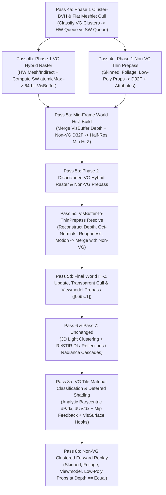

# Future Graphics Architecture Plans: Virtual Geometry Tiers 2 and 3

## 1. System Motivation and Scope

This document defines the post-baseline roadmap for evolving Dragon Engine's optional **Tier-1 Cluster-DAG Virtual Geometry** (specified in [Graphics & Streaming Architecture](graphics-architecture.md) and scheduled in [Graphics Implementation Plan](graphics-implementation-plan.md)) into sub-pixel micro-polygon rendering (**Tier 2**) and full-spectrum virtualized geometry (**Tier 3**).

Tier 1 establishes the offline Cluster-Group DAG builder, quantized `128 KB` cluster page streaming, GPU Cluster-BVH traversal, coarse ray-tracing fallback proxies, and zero-cost bypass (`0.00 ms` / `0.0 MB`) for scenes that do not use virtual geometry. Tier 1 intentionally retains hardware meshlet rasterization (`VK_EXT_mesh_shader` / `vkCmdDrawIndexedIndirectCount`) at a `2.0 to 4.0 px` screen-space error floor (`VG_ERROR_THRESHOLD_PX`) to avoid breaking Pass 8 Clustered Forward shading, the Pass 8 `RenderEffect` vertex-to-fragment ABI, and Radeon 780M iGPU frame budgets.

**Scope of this document:**
- **Tier 2 (Proposed, Post-Phase 7):** 64-bit Visibility Buffer + hybrid hardware/software compute rasterization for static opaque micro-polygon geometry (`<= 1.0 px` target error), preserving Passes 6, 7, 9, 10, and 11 through a VisBuffer-to-ThinPrepass resolve pass.
- **Tier 3 (Proposed, Long-Term Research / Next-Gen):** Programmable rasterizer bins (alpha-tested foliage and world-position offset), runtime micro-polygon displacement and tessellation, skinned/skeletal cluster DAGs and rigid assemblies, and cross-vendor hardware Cluster-BLAS ray tracing.

---

## 2. Global Architectural Constraints (Inherited Invariants)

Every future Tier 2 and Tier 3 change must preserve these non-negotiable Dragon Engine invariants:

1. **Zero-Cost Optionality Preserved:** Scenes without virtualized assets (`vg_instance_count == 0`) or games opting out via `GraphicsSettings` / `VirtualGeometryMode::Disabled` must continue bypassing VG allocations (`0.0 MB`) and VG compute passes (`0.00 ms`).
2. **Strict `rust-gpu` Vulkan 1.4 SPIR-V Pipeline:** All new compute rasterizers, visibility-buffer resolvers, tile classifiers, and displacement shaders must compile through `rust-gpu` (`spirv-unknown-vulkan1.4`, zero WGSL, zero HLSL/Slang cross-compilers, 100% `crates/shader_abi` sharing).
3. **Pure-Rust Runtime & Scoped `unsafe` Privacy:** All Vulkan handles remain private inside `crates/engine/src/gpu/`. Public `crates/engine` APIs, `crates/game`, and host `RenderEffect` crates keep `unsafe_code = "deny"`.
4. **Dual-Style & Dual-Camera Compatibility:** Every tier must operate identically across First-Person (`[0.0, 0.95]` world / `[0.95, 1.0]` viewmodel depth partition) and Isometric (concave wall cutout transparency) cameras, and across both `Realistic` (TAAU + ReSTIR DI + Radiance Cascades) and `Comic` (zero temporal history, deterministic top-3 + sun visibility, depth/normal ink outlines) visual styles.
5. **Frame-Pacing-First Async Streaming (Zero Loading Screens):** Page streaming, fallback-to-detail promotion, and coarse/cluster BLAS updates must never stall simulation or frame pacing.
6. **Minimum Hardware Baseline Protection (Radeon 780M):** Tier 2 and Tier 3 features must expose explicit `GraphicsSettings` toggles and error-threshold clamps so integrated GPUs can stay on Tier-1 hardware meshlets or looser error targets without violating the 30 FPS / 720p floor.

---

## 3. Tier Progression Overview

| Capability | Baseline Tier 1 (Decided) | Future Tier 2 (Proposed) | Future Tier 3 (Proposed) |
| :--- | :--- | :--- | :--- |
| **Target Triangle Density** | ~2 to 4 px triangles (`VG_ERROR_THRESHOLD_PX = 2.0..4.0 px`) | Sub-pixel / ~1 px micro-polygons (`0.5..1.0 px`) | Sub-pixel + runtime displaced/tessellated + skinned micro-polygons |
| **Static Opaque Rasterizer** | Hardware meshlets (`VK_EXT_mesh_shader` / indirect) | Hybrid: Hardware (`> 8 px` clusters) + Compute SW Rasterizer (`<= 8 px` clusters) | Programmable HW/SW Rasterizer Bins (opaque, masked foliage, vertex-WPO) |
| **Intermediate Geometry Buffer** | 9 B/sample Thin Prepass (`D32F`, Oct-Normals, `R8_UINT`, Motion) | 64-bit Visibility Buffer (`8 B/px`) -> Resolved to 9 B/sample Thin Prepass | 64-bit Visibility Buffer + per-bin programmable attributes -> Thin Prepass |
| **Opaque Shading Architecture** | Pass 8 Clustered Forward (`Depth == Equal` meshlet replay) | Tile-Based Deferred Material Classification & Shading (analytic barycentric derivatives) | Unified Deferred Material Graph + Displaced/Skinned VisBuffer Shading |
| **Pass 8 `RenderEffect` ABI** | Frozen `location 0..4` fragment hooks (unchanged) | **Breaking v2 ABI:** `VisSurface` deferred material hook contract (Tier-1 forward hooks kept for non-VG) | Unified programmable raster + `VisSurface` material hooks |
| **Ray Tracing BVH (Section 9)** | Coarse pre-baked RT fallback proxy BLAS in `BlasPool` | Coarse RT fallback proxy BLAS + ray-offset / shadow-terminator mitigation | Cross-vendor Hardware Cluster-BLAS (`KHR` standardized equivalent) |
| **Skinned Characters & Foliage** | Standard Pass 2a skinning + Pass 3 BLAS refit + HW meshlets | Unchanged (non-VG path alongside Tier 2 static opaque) | Hierarchical Skinned Cluster DAGs / Assemblies + Masked SW/HW Bins |
| **Estimated Effort (1 Engineer)** | 2 to 4 months (Phase 6b, with ABI reserved in Phase 0) | 6 to 12+ months post-Phase 7 | 18 to 36+ months (multi-subsystem research) |

---

## 4. Tier 2: Core Static Nanite (64-bit Visibility Buffer and Hybrid HW/SW Rasterizer)

**Status:** Proposed (Post-Phase 7)
**Configuration Variables:** `VG_RASTER_MODE` (`Tier1Hardware` | `Tier2HybridVisBuffer`), `VG_SW_RASTER_THRESHOLD_PX`, `VG_ERROR_THRESHOLD_PX` (`0.5 to 2.0 px`), `VG_VISBUFFER_FORMAT`, `VG_TILE_SIZE`.

### 4.1 Motivation and Trigger Conditions

Tier 1 hardware meshlets lose GPU efficiency when art pipelines supply cinema-density ZBrush or photogrammetry assets whose triangles project to `<= 2 px` on screen:
- Hardware rasterizers always shade 2x2 pixel quads, wasting up to 75% of fragment ALU and texture fetches on helper lanes for 1-pixel triangles.
- Fixed-function triangle setup throughput (1 to 4 triangles/clock per raster engine) becomes a hard bottleneck before shader cores saturate.

Tier 2 solves sub-pixel triangle throughput by replacing Pass 4/5/8 meshlet rasterization strictly for **static opaque VG geometry** with a **64-bit Visibility Buffer** fed by a hybrid Hardware + Compute Software Rasterizer, while reusing 100% of Tier 1's offline Cluster-Group DAG, `128 KB` quantized page pool, GPU Cluster-BVH culling, and coarse RT fallback proxies.

### 4.2 Modified Render Graph Delta (Passes 4, 5, and 8)

Passes 1, 2a, 2b, 3, 6, 7, 9, 10, and 11 remain structurally intact because Tier 2 inserts a **VisBuffer-to-ThinPrepass Resolve** step at the end of Pass 5 (before Pass 6 Active-Cluster Marking and Pass 7 Unified Ray Queries).

### 4.3 Selected Option: 64-Bit Atomic Visibility Buffer, Compute Software Rasterizer, and Tile-Based Material Shading

#### Architectural Consequences

1. **64-Bit Visibility Buffer Layout (`VG_VISBUFFER_FORMAT`):**
   - Each internal-resolution pixel stores one `u64` value packed as:
     `vis64 = (depth_u32 << 32) | ((visible_cluster_index & 0x01FF_FFFF) << 7) | (triangle_index & 0x7F)`
   - Because Dragon Engine uses Reverse-Z (`1.0` near, `0.0` far), IEEE-754 non-negative float bits preserve strict monotonic ordering under unsigned integer comparison (`OpAtomicUMax`). Nearest surface wins lock-free across concurrent compute workgroups and hardware rasterizer invocations.
   - **Vulkan 1.4 Feature Requirement:** Requires `VK_KHR_shader_atomic_int64` (`shaderBufferInt64Atomics`, core in Vulkan 1.2) on a tiled/Morton-swizzled `u64` storage buffer (portable across all Vulkan 1.4 GPUs) or optional `VK_EXT_shader_image_atomic_int64` (`shaderImageInt64Atomics`) on `VK_FORMAT_R64_UINT` when advertised. Using a Morton-tiled `u64` SSBO (`8x8` micro-tiles matching compute workgroup tiles) avoids optional extension fragmentation and improves L2 cache locality during software rasterization.

2. **Cluster Size Classification (Hardware vs. Software Binning):**
   - Surviving visible VG clusters from Pass 4/5 Cluster-BVH culling evaluate their projected screen-space bounding box and average triangle pixel span:
     - **Small / Sub-Pixel Clusters (`avg_tri_span <= VG_SW_RASTER_THRESHOLD_PX`, default `8.0 px`, and cluster not crossing near plane):** Emitted to the **SW Rasterizer Queue**.
     - **Large / Near-Clipped Clusters (`avg_tri_span > 8.0 px` or intersecting near plane):** Emitted to the **HW Rasterizer Queue** (`VK_EXT_mesh_shader` or `vkCmdDrawIndexedIndirectCount`), which writes the identical `vis64` payload into the Visibility Buffer via `atomicMax` (with early-Z testing against a pre-cleared depth buffer when helpful).

3. **Compute Software Rasterizer (`core_shader_geometry`):**
   - Launches 1 compute workgroup (`64` or `128` threads) per visible small cluster:
     - **Vertex Stage (parallel per vertex):** Decodes up to 64 quantized cluster vertices from the `128 KB` VG Page Pool into `#[spirv(workgroup)]` shared memory, applying camera-relative `world_view_proj` and First-Person `[0.0, 0.95]` depth scaling.
     - **Triangle Setup & Scanline / Half-Space Rasterization (parallel per triangle):** Each thread loads its 3 triangle vertices from shared memory, performs sub-pixel snapping (8-bit sub-pixel precision matching hardware top-left fill convention to guarantee zero cracks between HW and SW rasterized neighboring clusters), backface/zero-area/micro-frustum culling, and tight bounding-box iteration using incremental edge equations (`E0, E1, E2`).
     - **Early Depth Reject Before Atomic:** Reads current `vis64 >> 32` non-atomically before issuing `OpAtomicUMax` to eliminate redundant atomic bus traffic on occluded pixels.

4. **VisBuffer-to-ThinPrepass Resolve Pass (Pass 5c):**
   - Runs one fullscreen compute dispatch (`8x8` tiles) over internal resolution strictly for pixels where `vis64 != 0` and `(vis64 >> 32) > non_vg_depth_bits`:
     - Loads `(visible_cluster_index, triangle_index)` -> `GpuInstance` + `128 KB` cluster page -> transforms the 3 triangle vertices using current and previous frame transforms (`world_view_proj`, `prev_world_view_proj`).
     - Computes **analytic perspective-correct barycentrics** `lambda = (l0, l1, l2)` and their exact screen-space partial derivatives `(dlambda/dx, dlambda/dy)` from the 3 projected clip-space vertices (`v0, v1, v2`).
     - Interpolates UV, normal, tangent, and analytic `(dUV/dx, dUV/dy)`, samples BC5 normal maps and ORM roughness from Set 0 bindless `RuntimeArray` using explicit `sample_grad(uv, dUV_dx, dUV_dy)` (no 2x2 quad helper lanes required), computes exact motion vectors from previous-frame clip position, and writes merged `D32_SFLOAT`, `Oct-Normals`, `R8_UINT` (`roughness + is_viewmodel = 0`), and `Motion Vectors` into the existing 9 B/sample Thin Prepass attachments.
   - **Critical Architectural Benefit:** Pass 6 (3D Light Clustering), Pass 7 (ReSTIR DI, Reflections, Radiance Cascades, Dual-Mode Denoiser), Pass 9 (Sky/Fog), Pass 10 (Transparents), and Pass 11 (TAAU/Comic Outlines/Highlights/MSDF/UI) remain **100% unchanged**.

5. **Tile-Based Deferred Material Classification & Shading (Pass 8a):**
   - Replaces Pass 8 meshlet replay strictly for VG pixels:
     - **Material Tile Classification Compute Pass:** Scans `8x8` tiles of the Visibility Buffer, extracts each pixel's `MaterialId` / `EffectId`, compacts active material bitmasks via wave-portable subgroup ballot/compaction, and builds per-material tile indirect dispatch lists (or emits a 16-bit `material_id` depth buffer for hardware depth-equal fullscreen passes).
     - **Deferred Material Shading Dispatch:** Executes one clean, coherent shading pass per active material/effect over only the `8x8` tiles containing that material. Reconstructs `VisSurface` (world position, normal, tangent, UV, `dUV/dx`, `dUV/dy`, `instance_index`) from the Visibility Buffer, samples bindless albedo/ORM via `sample_grad`, writes Section 11 mipmap feedback using analytic `log2(max(|dUV/dx|, |dUV/dy|))` against stored full source dimensions, and evaluates the identical Realistic PBR (remodulating Pass 7 ReSTIR DI/Reflections/GI) or Flat Comic cel shading as Pass 8b.
   - **Pass 8 `RenderEffect` v2 ABI Migration:**
     - Existing Tier-1 Pass 8 fragment-only hooks (`location 0..4` inter-stage interface) continue working for non-VG meshes (Pass 8b).
     - VG-compatible custom opaque materials migrate to a `RenderEffect` v2 **`VisSurface` compute/fragment contract** in `crates/shader_abi` where engine-generated prologue code decodes the Visibility Buffer into a `VisSurface` struct and passes it to the effect shader alongside frozen Set 1 `b0..b6` lighting buffers.

6. **Section 9 Hardware Ray-Tracing Alignment:**
   - Static VG meshes continue registering their pre-baked **coarse RT fallback proxy mesh** in `BlasPool` (`64 to 256 MB`).
   - Because Tier 2 rasterizes sub-pixel geometric detail (`<= 1 px`) while Pass 7 traces rays against a coarser proxy BVH, Pass 7 adds a **geometry-error-scaled normal offset** (`ray_origin += geom_normal * max(base_bias, proxy_geometric_error)`) plus optional short screen-space contact-ray refinement (3 to 6 Hi-Z steps over `0.05 to 0.25 m` before invoking the TLAS ray query) to eliminate coarse-proxy shadow terminator artifacts.

#### Visual Quality Consequences
- Artists import multi-million-triangle ZBrush sculpts and photogrammetry scans directly with true sub-pixel geometric silhouettes (`~1 px` triangles) and zero LOD popping.
- Eliminates 2x2 quad over-shading on micro-triangles, keeping shading cost proportional strictly to screen pixel count rather than scene triangle count.
- Analytic derivatives produce sharper anisotropic mip selection across grazing micro-polygons without quad-extrapolation artifacts.

#### Quantitative Metrics (Design-Time Sizing References)
- **Visibility Buffer VRAM (`8 B/px`):**
  - 720p (`1280 x 720`): `7.03 MB`
  - 1080p (`1920 x 1080`): `15.82 MB`
  - 1440p (`2560 x 1440`): `28.13 MB`
  - (Aliased inside the private transient buffer/image heap outside Passes 4, 5, and 8 where lifetime permits; zero allocation when `VG_RASTER_MODE == Tier1Hardware` or `vg_instance_count == 0`.)
- **Tile Material Classification Scratch VRAM:** `1.0 MB to 4.0 MB` (transient linear alias heap).
- **Compute SW + HW Rasterizer Budget (10M to 50M source tris, 1080p Desktop Ref):** `0.70 ms to 1.80 ms` (vs. `3.5 ms to 10.0+ ms` on hardware-only rasterization at 1-pixel triangle density).
- **VisBuffer-to-ThinPrepass Resolve + Tile Material Classification (1080p Desktop Ref):** `0.40 ms to 0.90 ms`.
- **Radeon 780M iGPU Impact:** Adds `~1.0 to 1.8 ms` fixed VisBuffer + resolve bandwidth overhead at 720p. On Radeon 780M `Low` preset, `VG_RASTER_MODE` defaults to `Tier1Hardware` (`VG_ERROR_THRESHOLD_PX = 4.0 px`) so iGPUs avoid paying VisBuffer overhead when Pass 7 ray queries dominate the 33.3 ms frame budget.

#### Industry Benchmark
- **Unreal Engine 5 (Nanite):** 64-bit `InterlockedMax` Visibility Buffer, hybrid HW/SW compute rasterizer with 8-bit sub-pixel snap, material-depth fullscreen shading with analytic barycentric derivatives, and coarse fallback proxy meshes for Lumen/HW RT.

### 4.4 Rejected Tier-2 Options

#### Rejected Option: Full G-Buffer Deferred Renderer Replacing Visibility Buffer
- **Reason for Rejection:** Writing full albedo, metallic, roughness, normals, emissive, and motion vectors during rasterization triples memory bandwidth (`32 to 48 B/px` vs. `8 B/px` VisBuffer) and still suffers 2x2 quad overdraw on micro-polygons during G-Buffer population.
- **Architectural Consequences:** Eliminates the 9 B/sample Thin Prepass advantage and explodes VRAM/bandwidth on Radeon 780M.
- **Quantitative Metrics:** +24 to 40 B/px bandwidth penalty (`+47 to 79 MB` at 1080p) and zero solution for sub-pixel quad waste.

#### Rejected Option: Persistent-Thread Global Work-Stealing Queue for BVH Traversal
- **Reason for Rejection:** Vulkan does not guarantee forward progress across concurrent workgroups on all desktop and integrated GPUs (especially under preemption or mixed compute/graphics queues), risking GPU hangs (`VK_ERROR_DEVICE_LOST`) across Linux Mesa RADV and Windows drivers.
- **Architectural Consequences:** Requires spin-locks and global atomic work queues inside one single compute dispatch.
- **Quantitative Metrics:** High driver-hang risk on iGPU/handheld targets vs. `<= 0.05 ms` overhead for a bounded 4-to-6-level indirect compute dispatch loop.

### 4.5 Mandatory `rust-gpu` Prerequisite Spike Before Tier 2 Execution

Before promoting Tier 2 from `Proposed` to active implementation, execute a dedicated `rust-gpu` spike verifying:
1. `spirv-std` emits valid `OpAtomicUMax` with `Int64Atomics` capability on `u64` storage buffer elements (`VK_LAYER_KHRONOS_validation` + GPU-AV clean).
2. `spirv-opt` register pressure and VGPR occupancy of the compute software rasterizer inner loop (edge stepping + quantized vertex decode) stays within `<= 64 VGPRs` on RDNA3 (Radeon 780M/RX 7000) and Ada/Ampere GPUs.
3. Analytic barycentric derivative `sample_grad` (`Image::sample_by_gradient`) works with `RuntimeArray<Image!(...)>` `NonUniform` indexing in compute shaders.

### 4.6 Reference Publications for Tier 2
- **Reference:** Karis, B., Stubbe, R., and Wihlidal, G. "A Deep Dive into Nanite Virtualized Geometry." ACM SIGGRAPH Courses, 2021.
- **Reference:** Burns, C. A. and Hunt, W. A. "The Visibility Buffer: A Cache-Friendly Approach to Deferred Shading." Journal of Computer Graphics Techniques (JCGT), 2013.
- **Reference:** Schied, C. and Dachsbacher, C. "Deferred Attribute Interpolation for Memory-Efficient Deferred Shading." High-Performance Graphics (HPG), 2015.

---

## 5. Tier 3: Full UE 5.5+ Feature-Parity Virtual Geometry

**Status:** Proposed (Long-Term Roadmap, Post-Tier 2)
**Configuration Variables:** `VG_PROGRAMMABLE_BINS_ENABLED`, `VG_DISPLACEMENT_ENABLED`, `VG_SKINNED_CLUSTERS_ENABLED`, `VG_CLUSTER_BLAS_MODE`.

### 5.1 Motivation and Scope

Tier 2 handles static opaque micro-polygons cleanly, leaving four major content categories outside virtual geometry:
1. Alpha-tested foliage and wind-animated vegetation (world-position offset / vertex displacement).
2. Runtime micro-polygon displacement and procedural terrain/architectural detail without baking billions of static triangles to disk.
3. High-density animated/skinned characters (hero NPCs and creatures).
4. Eliminating geometric mismatch between micro-polygon rasterization and coarse ray-tracing fallback proxies in Pass 7.

Tier 3 extends Tier 2 across four orthogonal, independently adoptable tracks (following Global Rule 5, Combinable Design Options).

---

### 5.2 Track 3A: Programmable Rasterizer Bins (Alpha-Tested Foliage and Vertex WPO)

#### Architectural Consequences
- **Cluster Classification Extended to Rasterizer Bins:** During Pass 4/5 Cluster-BVH culling, clusters are binned by `(raster_size: HW | SW, program_bin: Opaque | AlphaTest | WindWPO | AlphaTest+WindWPO)` into compact per-bin indirect dispatch/draw queues.
- **Fixed-Function Fast Path Preserved:** Standard opaque clusters continue running the minimal, zero-texture-fetch Tier-2 SW/HW rasterizer with maximum VGPR occupancy.
- **Programmable Masked / WPO Bins:**
  - `AlphaTest` compute SW rasterizer evaluates barycentrics and samples the bindless opacity mask (`sample_by_lod` at cluster-projected mip) inside the inner pixel loop before issuing `OpAtomicUMax`.
  - `WindWPO` bins evaluate deterministic vertex displacement (reading `FrameConstants::world_time` and per-instance wind parameters) during the workgroup vertex-decode stage, expanding cluster culling AABBs conservatively offline by `max_wpo_displacement_m`.
- **Offline Foliage DAG Preservation:** Standard edge-collapse simplification collapses thin leaves/twigs into vanishing slivers. `crates/asset_pipeline` adds an **alpha/silhouette-preserving foliage simplification mode** (inspired by UE5 Nanite Foliage / voxelized distant cluster fallback or billboard-preserving cluster decimation) so dense forests stay lush at 2,000 m without overdraw explosion.

#### Quantitative Metrics
- **Opaque Bin Regression:** `0.00 ms` (opaque clusters never execute masked or WPO shader branches).
- **Masked Foliage SW Rasterizer Overhead:** ~1.8x to 3.0x per pixel vs. opaque SW rasterizer due to bindless texture fetch inside raster loop; mitigated by binning large close-up leaves to the HW rasterizer and reserving SW raster for distant 1-2 px leaf clusters.
- **Cluster AABB Culling Expansion:** Conservative offline `max_wpo_displacement_m` (`0.05 to 0.50 m`), adding `< 5%` false-positive frustum survivors.

---

### 5.3 Track 3B: Runtime Micro-Polygon Displacement and On-the-Fly Tessellation

#### Architectural Consequences
- **Disk & Archive Size Compression:** Instead of storing multi-gigabyte baked static sculpts in sector archives, artists author medium-density base meshes paired with KTX2 `BC4` / `R16_UNORM` height/displacement maps (or procedural brick maps).
- **Sub-Cluster Split Queue (Pass 4/5):** When a visible VG cluster reaches leaf level in the Cluster-DAG yet still exceeds `VG_ERROR_THRESHOLD_PX` with a displacement map attached:
  - A compute **Tessellation Split Pass** subdivides visible base triangles into micro-patches (`<= 124` micro-triangles per split batch) using precomputed barycentric tessellation tables (`[u8; 2]` barycentric lookup tables in constant/storage memory).
  - The SW rasterizer evaluates the bindless displacement map along interpolated normals at each tessellated micro-vertex directly in workgroup shared memory (`0.0 MB` persistent tessellated vertex storage in VRAM), guaranteeing crack-free water-tight edges by computing edge tessellation factors strictly from shared edge endpoint screen lengths.
- **Offline Conservative Displacement Bounds:** `crates/asset_pipeline` computes per-cluster `(min_disp, max_disp)` bounds directly from the source displacement texture and inflates Cluster-BVH AABBs/spheres offline so Hi-Z occlusion culling remains 100% conservative.

#### Quantitative Metrics
- **Disk / VRAM Geometry Savings:** 5x to 20x smaller geometry archives compared to pre-baked static micro-polygon meshes for terrain, cobblestone roads, and brick architecture.
- **Transient Split-Patch Queue VRAM:** `4.0 MB to 16.0 MB` (transient linear alias heap).
- **Runtime Tessellation Compute Budget (1080p Desktop Ref):** `0.30 ms to 0.80 ms` on displaced foreground surfaces.

---

### 5.4 Track 3C: Skinned and Skeletal Cluster DAGs (Animated Virtual Geometry)

#### Architectural Consequences
- **Hierarchical Skinned Cluster DAG (`crates/asset_pipeline`):**
  - Extends the Cluster-Group DAG builder with **bone-influence-aware graph partitioning** (preferring cluster groups sharing the same subset of <= 4 to 8 bones) and **attribute-weighted boundary-locked simplification** preserving joint weights (`GpuSkinningWeights`).
  - Packs quantized bone indices and weights inside `128 KB` skinned cluster pages alongside base vertices, plus per-cluster **bone-inflated bounding spheres** (tracking the maximum bone-weighted vertex radius per influencing bone so Pass 4/5 can compute tight animated cluster bounds on the GPU from Frame N bone matrices without skinning culled clusters!).
- **Culling-Before-Skinning Architecture (Replaces Full-Mesh Pass 2a for Skinned VG):**
  - Instead of Pass 2a skinning 100% of vertices of every off-screen or distant character unconditionally:
    - **Step 1:** Pass 4/5 Cluster-BVH culling evaluates animated cluster bounds directly against Frame N bone palettes (`BONE_BUFFER_MB`), selecting only visible screen-error-appropriate clusters.
    - **Step 2:** Only visible surviving skinned clusters deform on-the-fly during SW/HW rasterization (and emit previous-frame deformed positions from `prev_bone_matrices` during VisBuffer-to-ThinPrepass Resolve for exact animated limb motion vectors with `0.0 MB` persistent skinned vertex ring for VG characters!).
- **Pass 3 Dynamic BLAS Interaction:**
  - Because Pass 3 hardware ray tracing still requires a closed dynamic BLAS for animated characters inside `TLAS_ACTIVE_RADIUS_M`, skinned VG characters retain a compact **coarse skinned RT proxy** (e.g., 2k to 5k tris) deformed by Pass 2a and refit in-place in Pass 3 (`MAX_DYNAMIC_BLAS_COUNT`), preserving zero-lag shadows, reflections, and GI while rasterizing 100k+ tri hero characters smoothly.

#### Quantitative Metrics
- **Skinned Vertex Pool Savings:** Eliminates storing high-LOD full-mesh deformed vertices in `SKINNED_VERTEX_POOL_MB`; retains only `~10 to 20%` capacity for coarse RT dynamic BLAS proxies.
- **GPU Skinning Work Reduction:** Culls 60% to 90% of occluded/distant character triangles before skinning math executes.
- **Per-Cluster Animated Bound Overhead:** `8 to 16 B` bone-influence header per cluster; `< 0.10 ms` compute cost for 100+ active characters.

---

### 5.5 Track 3D: Hardware Cluster-BLAS Ray Tracing (Eliminating Coarse RT Proxy Mismatch)

#### Architectural Consequences
- **Root Problem Solved:** Both Tier 1 and Tier 2 rely on pre-baked coarse RT fallback proxy meshes in Section 9 `BlasPool`, creating inevitable geometric divergence (shadow-terminator artifacts, light leaks on displaced surfaces, mismatched silhouette reflections) between rasterized micro-geometry and traced BVH triangles.
- **Target Hardware Mechanism:** Hardware Cluster Acceleration Structures (first introduced vendor-specifically via `VK_NV_cluster_acceleration_structure` on NVIDIA RTX GPUs and expected to standardize across AMD/Intel/NVIDIA in a future cross-vendor `VK_KHR_cluster_acceleration_structure` extension):
  - Builds lightweight, shareable **Cluster BLAS Templates** directly from resident `128 KB` VG cluster pages (`64` verts / `124` tris per cluster) with sub-millisecond GPU-indirect build/move operations.
  - Assembles per-instance **Cluster-Level TLAS/CLAS** matching the exact view-dependent (or slightly coarser RT-error-threshold) Cluster-DAG cut currently resident in `VG_PAGE_POOL_MB`, eliminating duplicate `b4`/`b5` coarse RT fallback geometry completely.
- **Hardware Baseline Gate:** Dragon Engine **rejects vendor-only RT paths** that break the AMD Radeon 780M minimum baseline (Global Rule 1 and Section 1). Track 3D activates strictly once a cross-vendor `VK_KHR` cluster acceleration structure extension achieves conformant Linux Mesa RADV and Windows driver support, or as an opt-in high-tier backend behind the private `BlasPool` abstraction with automatic fallback to coarse RT proxies on non-supporting adapters.

#### Quantitative Metrics
- **Coarse RT Fallback Proxy VRAM Eliminated:** Removes duplicate `b4`/`b5` fallback proxy storage (`15% to 30%` static geometry VRAM savings on VG-heavy scenes).
- **Geometric Ray-to-Raster Error:** Drops from coarse proxy error (`5 to 50 mm`) to exact cluster-cut parity (`< 1 to 2 mm`), eliminating normal-offset shadow-terminator hacks in Pass 7.

### 5.6 Reference Publications for Tier 3
- **Reference:** Epic Games. "Nanite Foliage, Tessellation, and Assemblies in Unreal Engine 5.3 to 5.5." GDC / Unreal Fest Technical Talks, 2023-2025.
- **Reference:** Khronos Group / NVIDIA. "`VK_NV_cluster_acceleration_structure` Specification and Ray Tracing Cluster Geometry." Vulkan Registry, 2025. https://registry.khronos.org/vulkan/specs/latest/man/html/VK_NV_cluster_acceleration_structure.html
- **Reference:** Yuksel, C. "Mesh Colors and Micro-Mesh Displacement." ACM SIGGRAPH / High-Performance Graphics, 2022-2024.

---

## 6. Promotion Criteria (Tier 1 -> Tier 2 -> Tier 3)

Do not start implementing Tier 2 or Tier 3 until every prerequisite gate below passes objectively:

### Gate A: Tier 1 -> Tier 2 Promotion Criteria
1. All baseline phases (`Phase 0` through `Phase 7`) of [Graphics Implementation Plan](graphics-implementation-plan.md) pass with zero `VK_LAYER_KHRONOS_validation` / GPU-AV errors.
2. Offline QA Vulkan timestamp profiling on actual production art assets proves that Tier-1 hardware meshlets are bottlenecked by sub-pixel 2x2 quad overdraw (`Pass 4/5 Thin Prepass + Pass 8 > 4.0 ms` on `High` discrete desktop reference due to `< 2 px` triangles).
3. The Section 4.5 `rust-gpu` prerequisite spike (`Int64Atomics` `OpAtomicUMax`, `<= 64 VGPR` SW rasterizer occupancy, and bindless `sample_by_gradient`) passes on real Linux + Windows Vulkan 1.4 hardware.
4. `RenderEffect` v2 (`VisSurface`) contract is reviewed and approved for external shader crates (`crates/fx_fresnel_rim`).

### Gate B: Tier 2 -> Tier 3 Promotion Criteria
1. Tier 2 Visibility Buffer + Hybrid SW/HW Rasterizer achieves target frame budgets across both `Realistic` and `Comic` styles while preserving `0.00 ms` / `0.0 MB` optional bypass for non-VG scenes.
2. Each Tier-3 track (3A Programmable Foliage/WPO, 3B Runtime Displacement, 3C Skinned Cluster DAGs, 3D Cross-Vendor Cluster-BLAS) is evaluated and scheduled independently based on measured game content bottlenecks and Vulkan `KHR` extension availability.
